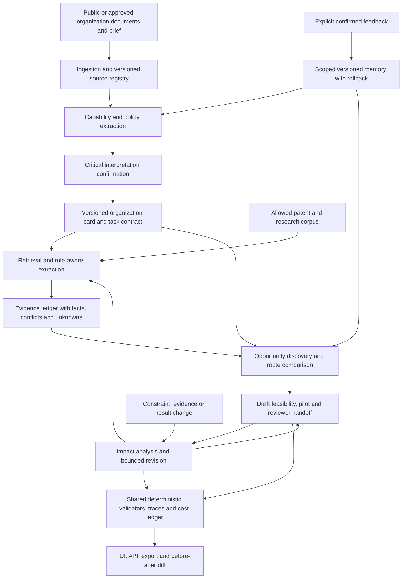

# GOAL — Organization-Adaptive R&D Agent

**Workspace:** Patent-to-Pilot · **ทบทวน:** 24 ตุลาคม 2026 · **รุ่นแผน:** 1
**ชื่อวิจัยทำงาน:** Patent-to-Pilot: An Adaptive Agent for Patent-Grounded R&D Planning under Changing Organizational Constraints

เอกสารนี้เป็นแผนหลักตามทิศทางล่าสุดของเจ้าของ ครอบคลุมผลิตภัณฑ์ งานวิจัย และการเตรียมบทความ งาน G01–G22 เป็นลำดับส่งมอบที่เสนอ ไม่ใช่คำรับรองว่ามี implementation หรือผลทดลองแล้ว และไม่ใช่การอนุมัติดาวน์โหลดไม่จำกัด ใช้ API แบบเสียเงิน เปิด cloud หรือเผยแพร่ข้อมูล

เมื่อรายละเอียดเดิมใน [PLAN](docs/PLAN.md) จำกัดภาพผลิตภัณฑ์ไว้แคบกว่า ให้ใช้วิสัยทัศน์ใน GOAL นี้เป็นทิศทางล่าสุด ส่วน [evaluation protocol](methodology/evaluation/PROTOCOL.md), [gap matrix](docs/RESEARCH_GAP_MATRIX.md), source manifests และ provenance ยังใช้ต่อได้ รายละเอียด protocol ที่ต้องเพิ่มสำหรับ longitudinal learning จะทำก่อนการทดลองส่วนนั้น ไม่แก้ประวัติผลเก่าให้เหมือนว่าเคยทดสอบแล้ว

## ภาพที่ต้องการไปให้ถึง

สร้าง **Organization-Adaptive R&D Agent** ที่ช่วยจัดงานตั้งแต่รู้จักองค์กรจนถึงชุดส่งต่องานวิจัยและพัฒนา:

1. รับเอกสารองค์กรที่เป็นสาธารณะหรือได้รับอนุญาต พร้อมโจทย์ เป้าหมาย และข้อจำกัด
2. สร้าง capability/policy map ที่เชื่อมกลับข้อความต้นฉบับ แยกความสามารถที่มีเอง จ้างภายนอก และยังไม่ยืนยัน แล้วให้ผู้ใช้ยืนยันเฉพาะการตีความสำคัญ
3. ค้นโอกาสจากสิทธิบัตรและงานวิจัยที่สัมพันธ์กับโจทย์และทรัพยากรองค์กร
4. เปรียบเทียบ development routes พร้อมข้อแลกเปลี่ยน หลักฐาน ข้อขัดแย้ง และสิ่งที่ยังไม่ทราบ
5. ร่าง feasibility/pilot plan และชุดส่งต่องาน R&D, RA หรือ Clinical Research ให้คนทำงานต่อได้
6. เก็บ feedback ที่ยืนยันแล้วภายในขอบเขตองค์กร/โครงการ เพื่อปรับการทำงานครั้งถัดไป พร้อมประวัติและ rollback
7. เมื่อ constraints, evidence หรือผลทดลองเปลี่ยน ให้ปรับทั้ง project ที่ได้รับผล ตั้งแต่ capability assumptions, options, route, test plan จนถึง handoff โดยเห็นเหตุผลและ before/after diff

คุณค่าที่ต้องการคือช่วยลดงานอ่านซ้ำ จัดเอกสารซ้ำ และความสับสนว่าเงื่อนไขใหม่กระทบส่วนใด **ประโยชน์ด้านเวลา คุณภาพ และต้นทุนยังเป็นสมมติฐาน** ต้องวัดภายหลัง การมี agent, graph หรือ memory ไม่ได้ทำให้เกิดประโยชน์เอง

ขอบเขตเทคนิคที่อาจเริ่มได้ ได้แก่ formulation, drug delivery, manufacturing/process และ medical devices เลือกจุดเริ่มจาก coverage ที่วัดจริงและเอกสารที่อ่านตรวจได้ ไม่ตั้งชื่อว่าครอบคลุมทุกสาขาก่อนมีหลักฐาน เคส microneedle แรกเป็น smoke test สำหรับพัฒนา schema/validators ไม่ใช่เพดานของผลิตภัณฑ์หรือคำตัดสินเลือก final domain

เจ้าของเป็นเภสัชกรและไม่มี independent domain experts ทำ gold standard เริ่ม technical study ได้ด้วยแหล่งจริงและ explicit task contracts ส่วน owner review เป็น formative การให้ LLM/NLI ให้คะแนนเป็น exploratory proxy ทั้งสองอย่างไม่ใช่ independent clinical/legal gold ระบบนี้ไม่มีอำนาจอนุมัติ clinical use, regulatory compliance, patentability, FTO หรือการทดลองกับคน

## วิธีทำงานที่ไม่โยนภาระกลับให้เจ้าของ

**Primary coding/research executor ที่เจ้าของเลือก: `gpt 5.6 luna max`** ใช้ชื่อนี้ตามคำขอ ไม่เดา provider/model ID, reasoning flag, CLI alias หรือ availability ยังไม่ได้สลับ executor ปัจจุบันหรือตั้งค่า account/model ใด ถ้า runtime ไม่มีชื่อนี้ ให้รายงาน mapping ที่ยังไม่ทราบครั้งเดียว ไม่แอบแทนรุ่นอื่น ส่วน product/benchmark inference เป็นอีกบทบาทหนึ่งผ่าน provider adapter และ cheap API ที่ calibrate ภายหลัง ไม่ใช่การบังคับใช้ executor รุ่นเดียวเป็นโมเดลทดลอง

**Agent รับผิดชอบงานภายใน scope ที่อนุมัติแล้ว:** แตกงาน เลือก implementation/library ที่เหมาะสม เขียนเอกสารหรือโค้ด แก้บั๊ก เลือก tests ที่ตรงความเสี่ยง และทำการเปลี่ยนแปลงที่ย้อนกลับได้ ไม่ถามอนุมัติทีละไฟล์ ทีละ function หรือให้เจ้าของออกแบบระบบแทน

รอบนี้ได้รับมอบหมายให้เขียนแผนเท่านั้น เมื่อมีคำสั่งให้เริ่ม G ใดในภายหลัง ก็ทำงานธรรมดาภายใน G นั้นต่อได้เองตาม permissions ที่ใช้จริง ไม่ต้องสร้าง approval gate ใหม่ทุกขั้น ส่วนการจ่ายเงิน เปิดเผยข้อมูลจำกัด เปลี่ยน security/global settings ทำลายข้อมูล หรือ publish/submit ต้องมี authorization ที่ตรงกับการกระทำนั้น

| ประเภท | วิธีจัดการ |
|---|---|
| Core blocker | ข้อมูลเสี่ยงสูญหาย, disclosure/spend ที่ไม่ได้รับอนุญาต, oracle leakage, source ผิดจนทำให้ข้อสรุปหลักใช้ไม่ได้, หรือ workflow หลักทำงานไม่ได้ ให้แก้ก่อนอ้างว่า G ส่วนนั้นเสร็จ |
| Noncritical limitation | UI ยังไม่ประณีต, optional integration ยังไม่มี, edge case นอก scope, benchmark เสริมยังไม่โหลด ให้บันทึก backlog แล้วจบ G ได้ถ้า acceptance หลักผ่าน |
| ข้อจำกัด clinical/regulatory/legal | ระบุขอบเขตและ unknown ให้ชัด งานเหล่านี้อยู่นอก technical validation ไม่ใช้เป็นเหตุให้ technical goals ค้างไม่จบ |
| Dependency ติดขัด | เก็บ checkpoint, ระบุ action/target/reason/status และทางต่อที่เล็กที่สุด แล้วทำ G ที่ไม่พึ่ง dependency นั้นต่อ |

แต่ละ milestone ใช้ **หนึ่ง scoped review → แก้ปัญหาที่พบ → retest ส่วนที่ได้รับผล** ไม่รัน global audit หรือ benchmark เก่าซ้ำหากไม่มีการเปลี่ยนแปลงหรือหลักฐานใหม่ที่เกี่ยวข้อง จำนวน tests/hashes ไม่ใช่เป้าหมายในตัวเอง Hash ใช้ตอนรับหรือเปลี่ยน source snapshot ไม่ต้องคำนวณทั้งคลังทุกครั้งที่แก้คำในเอกสาร

DONE อาจมี known limitations ที่ไม่กระทบข้ออ้างหลัก แต่ห้ามซ่อน critical failures หรือให้ผ่านอัตโนมัติ หากต้องถามเจ้าของ ให้รวมเรื่องสำคัญเป็นชุดเดียว พร้อมค่าเริ่มต้นที่เสนอ เหตุผล และผลกระทบ งานที่ไม่ขึ้นกับคำตอบทำต่อได้

**Authority และ startup:** current owner/runtime instructions มาก่อน → [AGENTS](AGENTS.md) สำหรับ execution contract → GOAL สำหรับ product scope/roadmap/defaults ล่าสุด → [protocol](methodology/evaluation/PROTOCOL.md) สำหรับวิธีประเมินที่ freeze แล้ว ส่วน PLAN เป็นรายละเอียดฐานภายใต้ scope นี้ Manifests/raw receipts พิสูจน์ได้เฉพาะข้อเท็จจริงที่บันทึก ไม่ใช่คำสั่งให้รันงาน Memory เป็น index/checkpoint ไม่ใช่ authority ถ้าพบความขัดแย้งที่กระทบ core result ให้เปิดประเด็นเจาะจง ไม่ rewrite source history

เริ่ม session ด้วย AGENTS, GOAL ส่วนสรุป/roadmap/G ที่เกี่ยวข้อง, PLAN ส่วนที่ใช้, memory index/next action แล้วอ่านเฉพาะ sources/skills ของ task เลือก **G แรกที่ dependency พร้อมและอยู่ใน authorization ปัจจุบัน** จากนั้นกำหนดหนึ่ง work package: goal ID, scope/input, deliverable paths, acceptance, targeted check และ next step/checkpoint อ่าน [CLI handoff](docs/CODEX_CLI_HANDOFF.md) สำหรับ resume algorithm ไม่โหลด GOAL ทั้งฉบับและ papers ทุกเล่มซ้ำโดยไม่มีเหตุ

หากงานใหญ่ ให้แบ่งเป็น slice ที่รัน/ทบทวนได้ จบ slice ด้วยสถานะ ready/done/blocked, actual changed files, tests/failures/known limits และคำสั่งหรือชิ้นงานถัดไปที่เล็กที่สุด Agent debug/fix ภายใน permissions ได้เอง Optional reviewer ใช้เฉพาะ targeted high-risk change เมื่อ runtime อนุญาต delegation ไม่เป็น mandatory review ทุก task และไม่แทน independent domain expert

## สิ่งที่มีแล้ว กับสิ่งที่ยังไม่ได้เริ่ม

สถานะนี้อ้างอิงไฟล์ที่มีอยู่ในวันที่ทบทวน ไม่ใช่คะแนนประสิทธิผลของผลิตภัณฑ์

| สถานะ | หลักฐานในโครงการ | ขอบเขตที่ยืนยันได้ |
|---|---|---|
| มีเอกสารฐานแล้ว | [PLAN](docs/PLAN.md), [gap matrix](docs/RESEARCH_GAP_MATRIX.md), [protocol](methodology/evaluation/PROTOCOL.md), [AGENTS](AGENTS.md) | มี design และข้อจำกัด ไม่ใช่ implemented system |
| เก็บ external PDFs 35 ฉบับแล้ว | [manifest](literature-review/manifest.json), [reading list](literature-review/README.md) | มี verified reading copies และบันทึกระดับการอ่าน ไม่ใช่ reproduce ทุก paper หรือรวบรวมครบทั่วโลก |
| มี Paper 53 ภายในแยก 1 ฉบับ | [internal provenance](literature-review/internal/PROVENANCE.md) | ใช้เป็น internal foundation ยังไม่อยู่ external bibliography และ acceptance/publication ไม่ยืนยัน |
| มี PTP-0001 หนึ่ง development case | [case README](methodology/evaluation/cases/PTP-0001/README.md), [verification](methodology/evaluation/cases/PTP-0001/verification.json), [walkthrough](docs/FIRST_CASE_WALKTHROUGH.md) | มี authored states/negative fixtures และบันทึก offline checks 39 checks ไม่ใช่ผลโมเดลหรือ 39 independent samples |
| มี dataset metadata/qrels/samples เล็กแล้ว | [inventory](methodology/datasets/INVENTORY.md), [download manifest](methodology/datasets/download-manifest.json) | 18 files รวม 2,498,071 bytes ณ preflight; ไม่มี PLS CSV หรือ EnterpriseRAG source slices เต็ม |
| มี organization access notes/example | [options](methodology/datasets/ORGANIZATION_PROFILE_OPTIONS.md), [NCATS example](methodology/datasets/organization-profile-example.json) | source-derived description ไม่ใช่ approved organization card หรือ validated patent–organization pair |
| ยังไม่เริ่ม | app/API/UI, model experiments, indexing, learning across tasks, public release, submission | ไม่มีผล accuracy, saving หรือ business effectiveness ให้รายงาน |

ข้อความ `created=0` หรือ “ยังไม่มี case” ในบางส่วนของเอกสารวางแผนเก่าหมายถึงก่อนเพิ่ม PTP-0001 ตอนนี้มี development unit หนึ่งเคส แต่ยังไม่มี main controlled benchmark หรือ held-out study ไม่ตีความเคสนี้เป็นผลทดลองย้อนหลัง

## ตัวอย่างตั้งแต่ต้นจนจบสำหรับคนเริ่มใช้

**ตัวอย่างภาพผลิตภัณฑ์ที่ต้องสร้าง — องค์กรและข้อจำกัดต่อไปนี้เป็นเรื่องสมมติ ไม่ใช่ผลรันปัจจุบัน**

คุณให้เอกสารที่อนุญาตของทีม formulation พร้อมโจทย์ว่า “ช่วยหาแนวทาง drug delivery ที่ทีมควรศึกษา เปรียบเทียบสิ่งที่ทำเองได้กับสิ่งที่ต้องจ้าง และร่าง pilot สำหรับทบทวน” ระบบดึง capability พร้อม source locator แยก “มีเอกสารบอกว่าทำได้” ออกจาก “ยืนยันว่าพร้อมรับงานรอบนี้” แล้วรวมคำถามสำคัญ เช่น equipment ที่กล่าวถึงเป็นของทีมจริงหรือ partner และ constraint ใดบังคับใช้กับโครงการนี้

เมื่อยืนยัน card แล้ว ระบบค้น patent/research สร้าง opportunity shortlist และ route matrix แต่ละ route มีเหตุผลว่าเหมาะกับ brief ตรงไหน ต้องใช้ capability ใด หลักฐานกล่าวอะไร และมี unknown ใด จากนั้นจัด draft pilot plan: คำถามที่จะทดสอบ ตัวแปร/การวัดที่เสนอ สิ่งที่ต้องตรวจเพิ่ม และผู้รับช่วงงาน ไม่แต่ง yield, efficacy, cost หรือเวลาผลิตที่ source ไม่รองรับ

ต่อมาเครื่องมือหนึ่งใช้ไม่ได้ หรือ budget/partner เปลี่ยน ระบบแสดง impact map พัก route ที่พึ่งสิ่งนั้น ค้นทางเลือกภายในงบที่กำหนด แก้ test plan/handoff ที่เกี่ยวข้อง และคงหลักฐานส่วนอื่นไว้ หากได้รับผลทดลองที่ยืนยันแล้ว ก็เก็บเป็น evidence ใหม่พร้อมผู้ยืนยัน/วันที่ ไม่ถือว่าเป็นความจริงทั่วไปของทุก formulation

สิ่งที่คุณได้รับคือ brief/card รุ่นล่าสุด, shortlist, options/route matrix, evidence ledger, draft pilot, RA/Clinical Research question pack ตาม use case และ revision diff การส่งต่อเอกสารได้ครบยังไม่เท่ากับรับรอง feasibility ทางวิทยาศาสตร์

ตัวอย่างที่มีไฟล์ตรวจได้แล้วในวันนี้คือ [PTP-0001](docs/FIRST_CASE_WALKTHROUGH.md): เมื่อห้าม silicon เฉพาะ substrate ต้องเปลี่ยนสถานะตัวเลือกที่เกี่ยวข้อง รักษา glass option ตามกฎที่เหลือ และคง production yield เป็น unknown ใช้ตัวอย่างนี้ทดสอบกลไกพื้นฐานก่อนขยายโจทย์จริง

## Architecture ที่เสนอ

ทั้งหมดใน diagram นี้เป็น planned architecture ยกเว้นเอกสาร/source fixtures ที่มีแล้ว ใช้หนึ่ง orchestrator ที่ตรวจ state ได้ เริ่มจาก deterministic state machine ไม่ต้องใช้หลาย agent หรือ workflow framework ตั้งแต่ต้น



**ขอบเขตข้อมูล:** source text เป็นข้อมูลที่อาจมีคำสั่งแฝง ไม่ใช่ instruction channel ให้แยกจาก system/owner instructions ไม่ให้เอกสารเพิ่มสิทธิ์เครื่องมือเอง External API รับเฉพาะข้อมูลที่อนุญาตให้ประมวลผลกับ provider นั้น ห้ามส่งเอกสารลับเพียงเพราะเข้าถึงไฟล์ในเครื่องได้

**Core records ที่เสนอ:** Organization, SourceVersion, Passage, SourceAssertion, Capability, Policy, Constraint, Opportunity, Route, ProposedTest, Handoff, ChangeEvent, Dependency, Feedback และ MemoryVersion ทุก record ที่ derive จากหลักฐานมี source IDs/locator และ state ที่แยก known, unknown, unsupported, conflict, not-applicable ตามนิยามของ task อย่าใช้คำว่า approved กับสิ่งที่ model สรุปเอง

Dependencies ระบุชนิด เช่น `requires`, `supports`, `contradicts`, `derived_from`, `supersedes` พร้อมผู้สร้าง/วิธีสร้าง ข้อมูล evaluator-only และ expected answers ไม่อยู่ใน runtime registry ของระบบที่ถูกประเมิน

## Tech stack: ตัวเลือกหลักหนึ่งชุด

เลือก stack เพื่อให้คนเดียวดูแลและ debug ได้ก่อน เอกสารนี้ไม่อ้างว่าติดตั้ง dependencies เหล่านี้แล้ว ตรวจ compatibility และ pin versions ตอนเริ่ม implementation

| ส่วน | ข้อเสนอหลัก | เหตุผลและขอบเขต |
|---|---|---|
| Runtime/backend | Python 3.12 + FastAPI | Python 3.12.10 เคยตรวจได้ในเครื่อง ใช้ FastAPI จัด API และ schema contract; app ยังไม่มี [FastAPI docs](https://fastapi.tiangolo.com/) |
| Typed records | Pydantic models + JSON Schema | validate types, required fields และ allowed states ร่วมกันระหว่าง runner/API; ผ่าน schema ไม่ใช่พิสูจน์ scientific truth [Pydantic docs](https://docs.pydantic.dev/latest/) |
| Workflow | Python functions + explicit state transitions/checkpoints | ทำ fixed flow, bounded tool budget, retries และ resume ให้มองเห็นก่อน ใช้ workflow library ภายหลังเมื่อ checkpoint/branch complexity มีปัญหาที่วัดได้ |
| Metadata/state | SQLite บน local disk, single writer queue, transactions; WAL หลังตรวจ runtime version | เหมาะกับ local single-user workspace ไม่วาง WAL DB บน network share ถ้าต้องมี concurrent writers/หลายเครื่องจริง ค่อยย้าย PostgreSQL [SQLite WAL](https://www.sqlite.org/wal.html) |
| Corpus | Immutable raw snapshots → normalized Parquet; DuckDB สำหรับ disk-based query | เลือก columns/rows และอ่านเป็น batch แทนโหลดทั้ง corpus เข้า RAM DuckDB query ก็ใช้ RAM/temp disk ได้ ต้องจำกัดตามเครื่อง ไม่ใช่ zero-memory [DuckDB official project](https://github.com/duckdb/duckdb) |
| Retrieval baseline | SQLite FTS5 BM25 บน selected normalized corpus | baseline อธิบายได้และไม่ต้อง GPU ตรวจ FTS5 availability/tokenizer และคง source/field IDs; optional embeddings/hybrid เพิ่มเมื่อ baseline failure ชี้ว่าคุ้ม [FTS5](https://www.sqlite.org/fts5.html) |
| Document ingestion | Python CSV/JSON/HTML readers; pypdf สำหรับ text PDFs | เก็บ raw text/locator และ extraction version แยกจาก normalized facts OCR/table-heavy extraction เป็น optional task ตาม source ไม่ใช้ผล parser เป็น gold [pypdf text extraction](https://pypdf.readthedocs.io/en/stable/user/extract-text.html) |
| Model provider | Provider adapter ฝั่ง backend รองรับ OpenAI หรือ OpenRouter | เลือก provider/model ที่พร้อมใช้ ราคาถูกและผ่าน contract calibration ก่อน ไม่ผูก workflow กับ SDK รายเดียว เก็บ exact model/provider/version และ routing; keys อยู่ server เท่านั้น |
| Model เริ่มประเมิน | GPT-4o-mini เป็น candidate ตามที่เจ้าของเสนอ | ยังไม่เลือก model ID/price ณ วันนี้ ต้องตรวจ availability, context limits, data handling และราคา official ตอนเตรียม run matrix ไม่ถือว่าชื่อรุ่นเก่ายังใช้ได้แน่ |
| Web UI | React + TypeScript + Vite SPA เชื่อม FastAPI | เริ่ม workspace สำหรับ review/diff/export ไม่ต้องเพิ่ม SSR stack สำหรับ local tool นี้ เป็นข้อเสนอ ไม่ใช่ app ที่มีแล้ว [React TypeScript](https://react.dev/learn/typescript), [Vite](https://vite.dev/guide/) |
| Tests | pytest สำหรับ core/API/evaluator; Playwright สำหรับ critical user journeys | offline fixtures และ mocked providers เป็น default; paid live smoke แยกจาก ordinary tests [pytest](https://docs.pytest.org/en/stable/), [Playwright](https://playwright.dev/docs/intro) |
| Traces/results | Structured JSONL + SQLite run index + Parquet/CSV summaries | บันทึก visible inputs, retrieved IDs, output, calls, latency, errors และต้นทุน โดย redact secrets; ไม่ต้องใช้ hosted tracing ตั้งแต่ต้น |
| Packaging | Project-local virtual environment, pinned dependency lock, npm lockfile | แยก app/runtime ออกจาก global tools เดิม ไม่แก้ hooks/agents เพื่อให้ stack นี้ทำงาน |

Alternatives ที่มีเหตุเปลี่ยนจริง: PostgreSQL เมื่อ concurrency ต้องการ, embedding/vector index เมื่อ measured retrieval gap คุ้มต้นทุน, workflow library เมื่อ custom state machine ดูแลยาก และ remote CPU เมื่อ RAM local ไม่พอ ส่วน GPU ใช้เมื่อวัดความจำเป็นของ embeddings/open weights/training แล้ว ไม่เป็น prerequisite ของ product หรือ paper

ตรวจ third-party licenses ก่อนนำ runtime dependencies เข้า product; code license, dataset license และสิทธิ์ข้อความ/รูปใน paper เป็นคนละเรื่อง Existing PyMuPDF ที่ใช้ตรวจคลัง PDF ไม่ได้บังคับให้ production app ใช้ parser ตัวเดียวกัน

## Dataset strategy และการจัดสิทธิ์

ใช้ existing benchmarks ตามงานเดิมของแต่ละชุด และสร้าง **declared constructed patent–organization task benchmark** แยกต่างหาก ไม่อ้างว่าจับ patent dataset กับ synthetic company แล้วได้ validated real organization–patent pairs

| ลำดับใช้ | แหล่ง / ขนาดหรือ coverage ที่ตรวจได้ | Access / สิทธิ์ / สถานะจริง | งานที่เหมาะ |
|---|---|---|---|
| Core starter domain | [PLS EMNLP2022](https://github.com/boschresearch/pls_benchmark_emnlp2022): Atazanavir 640 และ Ritonavir 781 รวม **1,421 reported records/families ในสอง landscape topics** | `patent_ls` CC BY 4.0 แยกจาก code AGPL-3.0; repo archived; มี PatBase/MineSoft/RWS enrichment provenance CSV ยังไม่โหลด/parse ไม่ใช่สิทธิบัตรเพียงสองฉบับ | secondary labeled pharma classification/domain anchor ไม่ใช่ final corpus ทั้งหมดหรือ R&D feasibility gold |
| Core research retrieval | [DAPFAM](https://huggingface.co/datasets/datalyes/DAPFAM_patent): 1,247 query families / 45,336 target families | CC BY-NC-SA 4.0; qrels และ first-five API samples มีแล้ว full corpus/queries ยังไม่โหลด จำนวน pharma/device ที่ใช้ได้ยังไม่วัด | known citation-family retrieval แยก candidate exposure จาก final ranking; noncitation ไม่เท่ากับ irrelevant |
| Core organization starter sample | [EnterpriseRAG-Bench](https://github.com/onyx-dot-app/EnterpriseRAG-Bench): synthetic company, 500,000+ documents / 500 questions | repo/HF label MIT; ยังไม่โหลด data archives เลือก release v1.0.0 พร้อมครบทุก `expected_doc_ids` ต่อคำถาม ไม่โหลดทั้ง corpus ตั้งแต่แรก | organization-source grounding, conflict/missing info ไม่ใช่ actual pharma capability |
| Core constructed study | Patent-to-Pilot tasks ที่สร้างจาก real source snapshots + declared fictional briefs | มี PTP-0001 dev unit หนึ่งเคส main set ยังไม่มี; สิทธิ์ source แต่ละรายการต้องคงอยู่เมื่อดัดแปลง task | extraction, explicit organization fit, within-project revision และ longitudinal tracks แยกคะแนน |
| Public profile anchor | [NCATS/TRND capabilities](https://ncats.nih.gov/research/research-activities/trnd/scientific-capabilities) | official self-description, หน้าเดิมระบุ last update 2023-11-07; [local example](methodology/datasets/organization-profile-example.json) ยังไม่ใช่ owner-approved brief | ใช้เป็น source assertion ของ profile; current cost/capacity/availability/lead time ยัง unknown ไม่อนุมานว่าเข้าถึง service ได้ |
| Optional passage check | [FiNE-Patents](https://github.com/boschresearch/fine-patents), 3,658 claims | code MIT/data CC BY 4.0 ตาม release; metadata/license มีแล้ว multipart archive ยังไม่โหลด | feature-to-passage evidence convention ของชุดเดิม ไม่เรียก pharma labels หรือ gold ของแผนใหม่ |
| Optional enterprise track | [AST-FRI EnterpriseBench](https://github.com/ast-fri/EnterpriseBench), 500 simulated tasks | [HF data](https://huggingface.co/datasets/AST-FRI/EnterpriseBench) gated แม้ label MIT; ยังไม่ accept/share contact | organization hierarchy/access-control tasks ไม่บล็อก core pilot |
| Optional sandbox | [TheAgentCompany](https://github.com/TheAgentCompany/TheAgentCompany), 175 tasks | MIT repo; setup ต้อง free disk 30+ GB ไม่ใช่ download size ที่วัดแล้ว ยังไม่เปิด sandbox | role/workflow track แยก ไม่เป็น core dependency |
| Optional policies/tools | [τ-bench](https://github.com/sierra-research/tau-bench), successor [tau2-bench](https://github.com/sierra-research/tau2-bench) | MIT repo; original tasks เตือนว่า outdated ต้อง pin release ที่ใช้จริง ยังไม่รัน | policy/tool end states เป็นคนละ domain กับ pharma |
| Optional research-only | [CRMArena-Pro](https://github.com/SalesforceAIResearch/CRMArena), [HF data](https://huggingface.co/datasets/Salesforce/CRMArenaPro) | research/noncommercial; HF CC BY-NC 4.0; sandbox/org access แยก ยังไม่ขอ credentials | multi-turn/confidentiality methodological check แยกจาก commercial product data |
| Deferred / excluded dependency | PatenTEB/problem2full, PatRe, full enterprise sandbox/corpus | PatenTEB บางส่วน gated/planned; PatRe data/license ยัง unresolved; ดู [inventory](methodology/datasets/INVENTORY.md) | ไม่ใช้เป็น critical path; เก็บเหตุผล deferred แทนทำเหมือนทุกชุด ready-to-run |

รายละเอียด access/license พร้อมหลักฐานอยู่ใน [organization options](methodology/datasets/ORGANIZATION_PROFILE_OPTIONS.md), [access review](methodology/datasets/metadata/organization-access-review.json) และ [dataset inventory](methodology/datasets/INVENTORY.md) ตรวจ snapshot ของ source ที่ใช้จริงหนึ่งครั้งตอนรับเข้า ไม่เปิดกว้างเป็นการ audit license ทุกชุดทั่วโลก

### Starter acquisition batch — เสนอไว้ ยังไม่ได้ดาวน์โหลด

| ไฟล์ | Exact bytes ที่ตรวจจาก upstream manifest | รุ่นที่เสนอ |
|---|---:|---|
| PLS `atazanavir.csv` | 137,145,663 | commit `0a035ce46815b2aae5b7e49031c2975ba91fb0d1` |
| PLS `ritonavir.csv` | 121,948,387 | commit เดียวกัน |
| EnterpriseRAG `github_slice_0001.zip` | 12,246,702 | release v1.0.0 |
| EnterpriseRAG `github_slice_0002.zip` | 7,431,363 | release v1.0.0 |
| EnterpriseRAG `questions.jsonl` | 764,927 | release v1.0.0 |
| **รวม payload 5 ไฟล์** | **279,537,042 ≈ 266.59 MiB** | ยังไม่รวม tiny license/manifest และ derived outputs |

แหล่งขนาด: [PLS pinned tree](https://github.com/boschresearch/pls_benchmark_emnlp2022/tree/0a035ce46815b2aae5b7e49031c2975ba91fb0d1/patent_ls), [EnterpriseRAG release](https://github.com/onyx-dot-app/EnterpriseRAG-Bench/releases/tag/v1.0.0) PLS Git blobs ขนาด 134 bytes เป็น LFS pointers ไม่ใช่ CSV จริง

เมื่อเริ่มดาวน์โหลดภายใต้ task ที่อนุญาต ให้ stream ทีละไฟล์ ใช้ temp file/resume ตาม server support แล้วตรวจ bytes/hash ที่ source ให้มา ก่อน promote เป็น raw snapshot เลือก enterprise question เพียงเล็กน้อยและตรวจว่าทุก expected document อยู่ใน release ที่ pin จริง เก็บเอกสารเต็มที่เกี่ยวข้องพร้อม IDs ไม่เลือก ZIP เล็กแบบสุ่มแล้วอ้างว่า evidence ครบ Exact uncompressed size และ closed sample ยังไม่ยืนยัน คัดเฉพาะเอกสารจำเป็นและตั้ง extraction cap ก่อนแตก

Starter batch นี้มีไว้ทดสอบ ingestion/linked sample ไม่ใช่ final benchmark ทั้งหมด `all_documents.zip` ของ EnterpriseRAG = 1,256,181,062 bytes ยังไม่อยู่ batch แรก ส่วน DAPFAM corpus = 1,149,928,014, queries = 62,667,355 และ qrels = 828,375 bytes ตาม snapshot ที่มี metadata เก็บอยู่ การขยาย download ต้องมี relevance/sampling plan ไม่ต้องโหลดทุก corpus เพื่อเริ่ม

**Capacity snapshot:** C: ว่าง 208.09 GiB; RAM รวม 15.67 GiB/ว่างราว 0.65 GiB/ใช้อยู่ 95% ณ preflight 24 ตุลาคม 2026 ไม่ใช่สถานะถาวร Disk พอสำหรับ batch แรก แต่ file size ไม่เท่ากับ parsing/indexing RAM ให้ streaming/chunking และ recheck RAM เฉพาะตอนเริ่มงานหนัก ไม่หยุด apps ของโครงการอื่นเอง

## Benchmark ที่จะใช้ตอบแต่ละคำถาม

| Track / คำถาม | Input และ reference | คะแนนที่รายงานได้ | สิ่งที่ไม่สรุป |
|---|---|---|---|
| Retrieval / extraction | released PLS/DAPFAM tasks ตาม convention; real passages กับ role/witness fixtures | task-specific classification, known-link Recall@k/nDCG@k, candidate exposure, tuple-role/witness correctness | exhaustive relevance, utility หรือ semantic truth จาก citation match |
| Organization grounding / fit | enterprise linked sample, public source profile และ explicit approved/fictional constraints | source resolvability, explicit fit/violation, correct unknown/conflict handling | actual current company capacity หรือ clinical feasibility |
| Within-project revision | base brief + current packet + change events; evaluator-only expected updates | update precision/recall, preservation, stale-source reuse, cost per valid revision | cumulative learning across tasks |
| Longitudinal adaptation | chronological tasks ต่อองค์กร พร้อม confirmed past feedback ตาม schedule | performance/cost บน later tasks เทียบ memory controls, transfer/regression/rollback behavior | self-learning จากเพียงแก้เคสเดิมหรือได้รับข้อมูลเพิ่มมากกว่า baseline |
| Natural cases / portfolio | held-out briefs ที่เจ้าของอ่านทบทวน | corrections, artifact usefulness และเวลาของเจ้าของแบบ descriptive | independent expert consensus, population usability หรือ measured clinical benefit |

ทุก task แยก **source assertion / benchmark stipulation / expert-dependent interpretation** การมี quote จริงพิสูจน์เพียง literal presence; entailment/ความเป็นไปได้อาจยัง unknown อย่าให้ schema คำว่า “feasible” รวมคำถามวิทยาศาสตร์ กฎหมาย และการผ่านกฎวัสดุเป็นคะแนนเดียว

**Common comparison set:** B0 rules+same extraction, B1 static RAG/full regeneration, B2 direct revision, B3 deterministic invalidation+same generator, B4 adaptive search+ordinary regeneration/revision และ P proposed dependency-guided adaptation ใช้ sources/model/schema/validators/extraction opportunity/budgets เท่ากัน แจก checked facts เท่ากันเฉพาะ checked-fact track; open-text track ไม่แจก oracle tuples/graph ให้ P

**Within-case ablations:** no dependency links, no targeted evidence-gap retrieval, no source-version tracking แยก fixed-source update ออกจาก adaptive-search track ที่มี recoverable evidence/distractors จริง ไม่รวมจนแยกไม่ออกว่าประโยชน์มาจากค้นหรือซ่อม

**Memory controls:** memory off; same confirmed feedback in prompt; scoped persistent memory; rollback/contradictory-feedback challenge ให้ทุกวิธีได้ information budget และ feedback เท่าเทียม การสรุป/คัด feedback เป็นส่วนที่ต้องนับต้นทุน ไม่ถือว่าการมีข้อความเพิ่มคือ memory algorithm ที่ดีกว่า

**Splits:** แยก source family/base brief/scenario template ก่อนสร้าง variants หากจะอ้างข้ามองค์กร ต้องมี held-out organizations และแยก report จาก within-organization tasks Reset memory ระหว่าง independent organizations; อนุญาต accumulated feedback เฉพาะ chronological track ขององค์กรนั้นตาม protocol ไม่มี hidden test answers, oracle graph, future changes หรือ future feedback ใน runtime inputs Freeze global prompts/rules ก่อน test ส่วน online memory เปลี่ยนได้ตาม feedback schedule ที่ freeze ไว้เท่านั้น

Pilot ที่เสนอคือ **10 development cases / 3 fictional organization profiles** ใช้ของจริงที่มี source รองรับและประกาศส่วนที่แต่งขึ้น ไม่ใช่จำนวนที่ทำครบแล้วหรือ final sample size หน่วย case, source/family, brief, organization, event และ variant ต้องนับแยกกัน Main size กำหนดจาก pilot variance, coverage และ run budget ไม่ตั้งเป้า accuracy ลอย ๆ หรือรับรอง statistical power

ใช้ paired comparisons และ uncertainty ที่ cluster ตาม base brief/family components ส่วน learning track ต้องคำนึงถึง organization/sequence ด้วย เมื่อมีองค์กรน้อยให้รายงาน descriptive uncertainty ตามข้อจำกัด ไม่ bootstrap variants เสมือนเป็น independent samples หากมี zero valid outputs ให้ cost-per-valid เป็น undefined พร้อม total spend/failures ไม่แทนเป็นศูนย์

## งบและที่รัน

API-first หมายถึงเริ่มจาก hosted inference ผ่าน provider adapter และมี backend API ที่แยกจาก UI ไม่จำเป็นต้องซื้อ GPU หรือ fine-tune เพื่อให้เริ่มได้

| ก้อนงบที่เสนอใหม่ | เพดานวางแผน | ใช้เมื่อ |
|---|---:|---|
| Pilot/calibration | $30 | ประเมิน cost/episode, failures และความจำเป็นของแต่ละวิธี |
| Main runs + essential ablations | $120 | หลัง freeze run matrix และลด scope ให้พอจบได้ |
| Reserve | $50 | retries/จำเป็นต้อง rerun จากเหตุที่ระบุ ภาษีหรือค่าเกี่ยวข้องที่อยู่ในเพดาน |
| รวม | **$200** | **ยังไม่ใช่ spending approval หรือประมาณราคาที่ตรวจแล้ว** |

Allocation นี้แทนข้อเสนอแบ่งก้อนเก่าใน PLAN เพื่อใช้วางแผนต่อ ไม่เพิ่มวงเงินและไม่ถือว่าอนุมัติซื้อเครดิต $200 ไม่รวมแรงงาน paid annotation หรือ journal/APC

ก่อน paid run จัด run matrix = groups × events × methods × seeds × model calls พร้อม estimated input/output tokens, retrieval/repair/memory/judge/retry overhead, unit prices ที่ตรวจจาก provider ณ วันรัน, hard cap และ stop condition ถ้าไม่พอ ให้ agent เสนอขนาดที่จบได้ในงบพร้อมผลต่อ claims แล้วขอ owner approval ของ paid batch ครั้งเดียว ไม่ถามอนุมัติทีละ call

Local เป็น canonical data/results เก็บ Git สำหรับ code/config/small manifests ไม่ใส่ heavy corpus, reading PDFs, private org docs, secrets หรือ raw confidential traces ลง Git หาก RAM local ไม่พอ ให้ประเมิน remote CPU ก่อน GPU

หากมีเหตุใช้ RunPod ภายหลัง: clone เฉพาะ code revision ที่อนุญาต → fetch data ด้วย pinned URL/hash manifest ที่มีสิทธิ์ใช้ → run ตาม budget → backup outputs/checkpoints/cost logs กลับ canonical storage และตรวจ restore ได้ก่อน terminate การส่งข้อมูลออกเครื่องและค่า persistent storage ต้องรวมอยู่ใน approval นั้น แยก running compute cost ออกจาก retained volume cost เอกสารนี้ไม่ได้สร้าง Pod/volume หรืออนุมัติ cloud ใด

## Directory map

`[มี]` คือ path ที่มีแล้ว ส่วน `[แผน]` เป็นเป้าหมาย output ยังไม่ได้สร้าง การระบุ path ด้านล่างไม่ใช่หลักฐานว่ามี implementation

```text
patent-to-pilot/
├─ GOAL.md                                    [เอกสารนี้]
├─ AGENTS.md, README.md                       [มี]
├─ docs/                                     [มี]
│  ├─ PLAN.md, RESEARCH_GAP_MATRIX.md          [มี]
│  ├─ FIRST_CASE_WALKTHROUGH.md                [มี]
│  ├─ TOOLING_REGISTRY.md, MEMORY_PROTOCOL.md  [มี]
│  ├─ product/                                [แผน: use cases, acceptance journeys]
│  ├─ architecture/                           [แผน: ADRs, schema, data flow]
│  └─ release/                                [แผน: runbook, limits, release plan]
├─ literature-review/                        [มี: PDFs, notes, manifest, references]
│  └─ internal/PROVENANCE.md                   [มี: Paper53 reuse/citation pending]
├─ methodology/
│  ├─ datasets/                               [มี: inventory, metadata, qrels, samples]
│  │  ├─ raw/pls_emnlp2022/<commit>/           [แผน]
│  │  ├─ raw/enterprise_rag/v1.0.0/            [แผน]
│  │  ├─ normalized/<dataset>/<version>/       [แผน]
│  │  └─ samples/enterprise_rag/<sample-id>/   [แผน: questions+complete linked docs]
│  ├─ organizations/<org-id>/<version>/       [แผน: permitted docs/cards/policies]
│  ├─ evaluation/PROTOCOL.md                  [มี]
│  ├─ evaluation/cases/PTP-0001/              [มี: dev fixtures]
│  ├─ evaluation/splits/                      [แผน]
│  ├─ evaluation/longitudinal/                [แผน: sequences/feedback schedule]
│  └─ codes/verify_assets.py                  [มี: offline asset check]
├─ src/patent_to_pilot/                       [แผน: core, providers, API, workflow]
├─ apps/web/                                 [แผน: React/TypeScript UI]
├─ tests/                                    [แผน: unit/API/integration/E2E]
├─ configs/                                  [แผน: nonsecret model/run settings]
├─ runtime/                                  [แผน: local DB/index/jobs; outside Git]
├─ results/<study>/<run-id>/                  [แผน: raw outputs/traces/costs]
├─ artifacts/<project-id>/<revision>/         [แผน: handoff packs/exports]
├─ manuscript/                               [แผน: claims/tables/text/response]
├─ portfolio/                                [แผน: approved sanitized case packs]
└─ memory/                                   [มี: portable Markdown research notes]
```

ความลับอยู่ environment/secret storage ที่ได้รับอนุญาตและอยู่นอก Git; `.env.example` ที่อาจสร้างภายหลังมีแต่ชื่อ variables ห้ามเก็บ key จริง Scope memory คือ `research/patent-to-pilot` ไม่ใช้ global transcript histories หรือข้อมูลโครงการอื่น ai-memory/obsidian-mind ไม่เป็น dependency ของ goals ด้านล่าง

## Roadmap และความหมายของสถานะ

**มีฐานแล้ว** = มีเอกสารหรือ development artifact ที่ระบุ ไม่ได้แปลว่าทั้ง G เสร็จ
**เสนอ** = ยังไม่เริ่ม implementation/experiment
**พร้อมทำเมื่อมี task** = prerequisites บางส่วนพร้อม แต่แผนนี้ไม่ขยาย permissions ของรอบเขียนเอกสาร

| ช่วง | Goals | ผลที่ต้องได้ |
|---|---|---|
| A: ตั้งโจทย์และข้อมูล | G01–G06 | product contract, bounded gap, versioned data/org cards, valid tasks/splits |
| B: สร้างแกนที่ใช้ได้ | G07–G12 | stack/core schemas, ingestion, handoff, strong baselines, revision และ scoped memory |
| C: ลองแบบจำกัดและทำให้ใช้สะดวก | G13–G15 | calibration/budget, usable UI/API และ critical E2E/reliability checks |
| D: สร้างหลักฐาน | G16–G18 | main study, honest analysis, reproducible/releasable artifact |
| E: ส่งต่องานอาชีพและบทความ | G19–G22 | portfolio, manuscript, authorized submission และ reviewer response |

ไม่ต้องรอทุก G ก่อนหน้าครบเพื่อทำงานอิสระ เช่น UI mock ใช้ schema/fixtures ได้ระหว่างคัด case และ manuscript background เขียนได้ก่อน main runs ส่วนผลเชิงประจักษ์ต้องรอข้อมูลจริง

## G01 — ล็อก product contract และ use cases ที่มีประโยชน์

**สถานะ:** มีแนวคิดและ walkthrough แล้ว; expanded product contract ยังเป็นแผน
**เป้าหมาย/คุณค่า:** ให้คนใช้เห็นว่า agent ช่วยงาน R&D ตั้งแต่ organization understanding จนถึง handoff และ project adaptation ได้อย่างไร ไม่จบเพียง material-toggle demo

**พึ่งพา:** คำสั่งเจ้าของล่าสุดและเอกสารที่มี ไม่รอ dataset เต็มหรือ expert panel

**งาน:**

1. ระบุ use cases หลัก: capability/policy mapping, opportunity discovery, route comparison, draft pilot/handoff, change impact และ feedback reuse
2. ทำ user journey แบบรับเอกสาร → ตรวจ card → ทบทวน options → รับ pack → แจ้ง change พร้อมตัวอย่างของที่ต้องได้จริง
3. แยกสิ่งที่ระบบเสนอได้ สิ่งที่ต้องถามยืนยัน และสิ่งที่อยู่นอก autonomous authority

**Input:** [GOAL](GOAL.md), [walkthrough](docs/FIRST_CASE_WALKTHROUGH.md), [PLAN](docs/PLAN.md)
**Output [แผน]:** `docs/product/PRODUCT_CONTRACT.md`, `docs/product/USER_JOURNEYS.md`

**จบเมื่อ:** มี workflow หลักและ acceptance journey ที่อ่านแล้วรู้ว่า input/output คืออะไร ไม่มีการทำ clinical/legal approval อัตโนมัติ Scope แรกเล็กพอส่งมอบได้และยังต่อยอดภาพใหญ่ได้

**ตรวจ/หลักฐาน:** walkthrough ด้วย authored example หนึ่งเส้นทาง บันทึกข้อไม่ชัดเป็น backlog ไม่บังคับให้ทุก future feature พร้อม
**ความเสี่ยง:** agent กลายเป็น chatbot กว้างแต่ไม่มี artifact; แก้ด้วย output contract
**Owner decision:** ถ้ามี use cases แข่งขันกัน ให้เสนอเริ่ม organization→options→handoff→change ก่อน เจ้าของเลือกทิศทางเฉพาะเมื่อมี trade-off สำคัญ
**ขนานได้:** G02 literature gap และ G03 acquisition plan

## G02 — Freeze literature/gap แบบมีขอบเขต

**สถานะ:** มี 35 external PDFs, gap matrix และ source notes แล้ว; longitudinal gap ยังต้องสังเคราะห์เพิ่ม
**เป้าหมาย/คุณค่า:** ป้องกันการลงทุนสร้างสิ่งที่มีแล้วและตั้ง research claims ให้ตรงสิ่งที่ทดสอบได้

**พึ่งพา:** G01; ใช้ collection เดิมก่อน widening search

**งาน:**

1. ใช้ [gap matrix](docs/RESEARCH_GAP_MATRIX.md) เปรียบเทียบ adaptive search, patent workflows, context/memory และ minimal repair จาก methods ที่อ่านจริง
2. แยก RQ ภายใน project: source/constraint-linked revision กับ RQ ข้ามงาน: confirmed-feedback adaptation บน later tasks
3. Freeze claim/evidence table สำหรับ implementation รุ่นแรก ระบุ novel hypothesis, known prior work และ falsifier หากพบคู่แข่งใหม่ให้เพิ่มเฉพาะส่วนที่กระทบ claim

**Input:** [manifest](literature-review/manifest.json), [WPI review](literature-review/notes/29_oltra_garcia_2018.md), [organization reading](literature-review/notes/30-35_organization_profile_reading.md), [internal ledger](literature-review/internal/PROVENANCE.md)
**Output [แผน]:** revision ของ `docs/RESEARCH_GAP_MATRIX.md`, `docs/product/CLAIM_EVIDENCE_MAP.md`

**จบเมื่อ:** ทุก candidate claim มี closest collision, ขอบเขต และ experiment ที่อาจหักล้างได้ ไม่มี first adaptive search/first organization memory claim

**ตรวจ/หลักฐาน:** scoped source review หนึ่งครั้งของข้ออ้างสำคัญพร้อม locators ไม่อ่านใหม่ทั้ง 35 papers เพื่อผ่าน G นี้
**ความเสี่ยง:** novelty ไม่พอสำหรับ algorithm paper; benchmark/empirical boundary อาจเป็น contribution ได้แต่ยังต้องมีผลจริง
**Owner decision:** ไม่มีงานเลือก citation รายรายการให้เจ้าของ; เปลี่ยน research direction ถ้าพบ core collision แล้วเสนอทางเลือกเป็นชุด
**ขนานได้:** G03/G04 และ prototype schema design ของ G07

### หลักฐานใกล้เคียงที่ต้องรักษาไว้ใน claim map

| แหล่ง | สิ่งที่มีแล้วและผลต่อ claims |
|---|---|
| [Oltra-Garcia 2018](https://doi.org/10.1016/j.wpi.2017.05.001) | S31–S32 มี adaptive what/where/how และ learning across searches เป็น training guidance ไม่ใช่ controlled timing study ต้องมี adaptive-search comparator |
| [PatExpert](https://arxiv.org/abs/2409.19006) | orchestration, Graph RAG และ hypothesis generation ไม่อ้างว่าเชื่อม patent→idea ครั้งแรก |
| [ACE](https://arxiv.org/abs/2510.04618), [ShareMem](https://arxiv.org/abs/2609.32511), [AFTER](https://arxiv.org/abs/2606.23127) | context/procedural memory adaptation มี prior work ประโยชน์จาก cumulative feedback ต้องแยกจากแค่เห็นข้อมูลเพิ่ม |
| [ESCROW](https://arxiv.org/abs/2608.01772), [GCJR](https://arxiv.org/abs/2608.29228) | scoped revision/regression guards/minimal dependency repair มีแล้ว ห้ามให้ runtime เห็น paired clean oracle หรือ gold graph |
| [ReformIR](https://arxiv.org/abs/2605.00560), [Programmatic Search Agents](https://arxiv.org/abs/2610.06689) | query drift, feedback และ candidate workspace เป็น prior art ไม่อ้าง reformulation loop อย่างเดียวว่าใหม่ |
| [FollowIR](https://aclanthology.org/2025.naacl-long.597/), [CheckList](https://aclanthology.org/2020.acl-main.442/), [ALCE](https://aclanthology.org/2023.emnlp-main.398/) | instruction/behavior/citation evaluation มีกรอบแล้ว ไม่ใช้ quote-exists เป็น semantic entailment |

## G03 — รับ datasets แบบจำกัด พร้อม provenance/rights/version

**สถานะ:** มี metadata และ preflight; starter payload ยังไม่โหลด
**เป้าหมาย/คุณค่า:** ได้ข้อมูลที่ใช้สร้างงานต่อได้จริง โดยไม่ถ่วงเครื่องหรือพา research-only data ปะปนกับ product corpus

**พึ่งพา:** G01; มี task อนุญาต acquisition ที่ตรงกับ batch

**งาน:**

1. รับ starter 5 files ตามตารางด้านบนจาก pinned source พร้อม license/readme snapshots เก็บ originals ไม่ overwrite ข้อมูลเก่า
2. ตรวจ actual bytes/hash เทียบ upstream, parse CSV/JSONL แบบ streaming และรายงาน columns/counts/duplicates/missingness จริง อย่าเอา reported 1,421 มาอ้างว่า parse แล้ว
3. คัด enterprise sample ที่รักษา expected-document closure และสร้าง manifest ของ subset; ถ้าไฟล์ที่เกี่ยวข้องไม่ครบให้ exclude หรือ mark incomplete
4. Register core/optional/deferred/rejected status, acquisition state, research/product-use restrictions และเหตุผลขยาย corpus; สำรวจ DAPFAM domain slice ภายหลังเมื่อเลือก sampling plan

**Input:** [dataset inventory](methodology/datasets/INVENTORY.md), [access notes](methodology/datasets/metadata/organization-access-review.json), pinned URLs/versions ใน GOAL
**Output [แผน]:** raw/normalized/samples ตาม directory map, `methodology/datasets/acquisition-registry.json`, อัปเดต download manifest/inventory

**จบเมื่อ:** starter files ที่ใช้จริงอ่านได้ มีสิทธิ์/รุ่น/provenance ชัด linked sample ปิดครบ หรือมี exclusion ที่ทำให้ใช้ subset ที่เหลือต่อได้ ไม่มี GB download ที่ไม่จำเป็น

**ตรวจ/หลักฐาน:** one ingestion/schema/sample-closure check พร้อม intentionally missing reference case; asset integrity เฉพาะไฟล์ที่รับใหม่
**ความเสี่ยง:** LFS pointer แทน payload, text enrichment/rights, RAM spike, release mismatch
**Owner decision:** ไม่ต้องยืนยันทีละไฟล์เมื่อ batch ได้รับอนุญาตแล้ว; gated terms, restricted data หรือ scope/ขนาดขยายมากจึงค่อยถาม
**ขนานได้:** G04/G07 จาก local fixtures โดยไม่รอ full corpus

## G04 — สร้าง source-linked organization capability/policy map

**สถานะ:** มี public-source NCATS example; ยังไม่มี general extractor หรือ approved cards
**เป้าหมาย/คุณค่า:** เปลี่ยนเอกสารกระจัดกระจายเป็นสิ่งที่ใช้ตัดสิน constraints ของ project ได้ พร้อมรู้ว่าจุดใดต้องถามเพิ่ม

**พึ่งพา:** G01, source access ของ G03; schema design ทำร่วม G07

**งาน:**

1. กำหนด capability/policy schema: owned/external/unknown, source assertion, confidence/ambiguity, effective date และ confirmation state
2. สร้าง fictional profiles เริ่มต้น 3 แบบที่มีข้อจำกัดต่างกัน โดยประกาศทุก stipulation แยกจาก public source descriptions ไม่อ้าง NCATS เป็นลูกค้าหรือรับรอง availability
3. จัด confirmation queue เฉพาะ critical interpretations เช่น “มีเครื่องเอง” เทียบ “ร่วมงานกับผู้ให้บริการ” และ source conflict ไม่ให้เจ้าของตรวจทุก extracted token
4. เก็บ policy changes พร้อมรุ่นและขอบเขต; model/feedback ไม่มีสิทธิ์เปลี่ยน hard constraints เอง

**Input:** [organization example](methodology/datasets/organization-profile-example.json), allowed enterprise documents, owner-approved brief เมื่อมี
**Output [แผน]:** `methodology/organizations/<org-id>/<version>/profile.json`, `policy.json`, `source-map.json`, `confirmation-queue.md`

**จบเมื่อ:** critical capability/policy fields มี source หรือ stipulation ชัด unknown ไม่ถูกเติมเอง และได้ profiles ที่พอสร้าง distinct tasks โดยไม่อ้าง validated real org pairing

**ตรวจ/หลักฐาน:** source-to-field checks, owned-vs-partner trap, stale-policy/conflicting-policy fixture; interpretation ที่ไม่มี oracle แยกจากคะแนนหลัก
**ความเสี่ยง:** public expertise ถูกตีเป็นพร้อมผลิต/พร้อมรับงานปัจจุบัน
**Owner decision:** ยืนยันเฉพาะ card ที่จะใช้แทนองค์กรจริงและการตีความที่เปลี่ยนเส้นทางสำคัญ; fictional benchmark cards ไม่ต้องให้เจ้าของออกแบบทั้งหมด
**ขนานได้:** G05 task curation, G07 typed records

## G05 — สร้าง source-backed development cases ที่มีงานให้ระบบทำจริง

**สถานะ:** PTP-0001 หนึ่งเคสมีแล้ว; เสนอรวม 10 development cases
**เป้าหมาย/คุณค่า:** พิสูจน์ว่า schema/validator ใช้กับหลาย source ได้ และมี extraction/retrieval gap ที่ agent อาจช่วยได้จริง

**พึ่งพา:** G02–G04 บางส่วน; เริ่มเพิ่มทีละ independent source/family group ได้

**งาน:**

1. ใช้ PTP-0001 ต่อ เลือก case ถัดไปจาก coverage จริง แยก topic, source family, base brief และ change events
2. แบ่ง checked-fact bookkeeping, open-text extraction/fixed-source revision และ adaptive-search packets ที่มี verified distractors/recoverable evidence
3. เขียน hidden allowed states/expected changes เฉพาะ explicit checks พร้อม positive และ deliberately wrong fixtures ข้อ science/legal interpretation ที่ตรวจไม่ได้คง unknown
4. ประกอบกับ fictional org profiles อย่างประกาศชัด ไม่ให้ agent ได้ gold tuples/dependency graph ใน open-text track

**Input:** [case template](methodology/evaluation/CASE_TEMPLATE.json), [PTP-0001](methodology/evaluation/cases/PTP-0001/README.md), selected real sources
**Output [แผน]:** case directories ถัดไปใน `methodology/evaluation/cases/`, case manifest, exclusion/coverage notes

**จบเมื่อ:** development pack ที่เลือกมี witness/contract/negative fixture ใช้งานได้ และ case diversity พอ calibration เป้าหมาย 10 เป็นขนาดงานเริ่มต้น หาก source ไม่พอให้ปรับพร้อมเหตุผล ไม่แต่ง facts ให้ครบจำนวน

**ตรวจ/หลักฐาน:** source witness และ negative fixture ต่อชนิดความผิดหลัก; ไม่ใช้ arbitrary test count เป็นเกณฑ์ผ่าน
**ความเสี่ยง:** toy rules task หรือ role/value oracle ที่มาจาก model โดยไม่ตรวจ
**Owner decision:** เลือก domain direction เฉพาะเมื่อ coverage ชี้ trade-off สำคัญ; agent ทำ case curation ตามค่าเริ่มต้น pharma-adjacent
**ขนานได้:** G06/G07/G08 จาก cases ที่พร้อม ไม่รอครบทุก topic

## G06 — แยก splits และ freeze evaluation contract

**สถานะ:** มี within-case protocol; main splits/longitudinal schedule ยังไม่สร้าง
**เป้าหมาย/คุณค่า:** ให้ผลทดสอบประเมินสิ่งที่ไม่เห็นตอนจูน และไม่ให้ memory กลายเป็นช่องส่งเฉลย

**พึ่งพา:** G02/G05; frozen final settings ทำหลัง G13 calibration

**งาน:**

1. แยก family/base brief/template ก่อน variants และเก็บ connected groups ที่แชร์ source ใช้ทำ split/resampling
2. กำหนด dev/validation/final test, held-out organization track หากจะอ้าง cross-org transfer และ chronological feedback schedule
3. ระบุ visible input contract, forbidden evaluator paths, allowed online memory updates และ contamination/reset policy
4. Freeze endpoints/metric denominators/comparisons/stopping rules ก่อน final outputs ไม่เปลี่ยน threshold ตามผลที่ชอบ

**Input:** [protocol](methodology/evaluation/PROTOCOL.md), case manifest, org profiles
**Output [แผน]:** `methodology/evaluation/splits/`, `methodology/evaluation/longitudinal/`, protocol revision พร้อม freeze record

**จบเมื่อ:** trace ได้ว่าแต่ละ base group/organization/variant อยู่ไหน ระบบไม่เห็น hidden/future information และแยก frozen global configuration จาก permitted online memory ได้

**ตรวจ/หลักฐาน:** leakage assertions ของ IDs/template/families และ packet visibility; task ที่มี shared sources จัดกลุ่มหรือเปิดเผย exception
**ความเสี่ยง:** variants ถูกนับเป็น samples อิสระ; feedback ในอนาคตรั่วสู่ prompt
**Owner decision:** ไม่มีการให้เจ้าของออกแบบสถิติเอง; agent เสนอ endpoint/analysis ที่รองรับขนาดจริง
**ขนานได้:** G07–G12 ใช้ dev only, G20 background

## G07 — วาง stack/environment และ typed core

**สถานะ:** เสนอ; ยังไม่มี app dependencies/config implementation
**เป้าหมาย/คุณค่า:** ได้ฐานที่ runner, backend และ UI ใช้ records ชุดเดียวกัน ลดการแก้ format ซ้ำ

**พึ่งพา:** G01/G04 และ implementation task ภายหลัง

**งาน:**

1. ตั้ง project-local environment/lockfiles ตาม stack หลัก ตรวจ versions ที่รองรับจริงโดยไม่แก้ global tooling
2. สร้าง typed models/DB migrations สำหรับ sources, org cards, constraints, routes, evidence, changes, feedback และ run accounting
3. กำหนด state machine/checkpoint และ provider interface ที่ mock ได้ก่อนต่อ paid API
4. บันทึก ADR เฉพาะการตัดสินใจสำคัญ: SQLite concurrency, corpus/index separation, model boundary และ privacy

**Input:** GOAL architecture, [tool registry](docs/TOOLING_REGISTRY.md), task schemas
**Output [แผน]:** `src/patent_to_pilot/`, `configs/`, `docs/architecture/`, Python/Node lockfiles

**จบเมื่อ:** import/core serialization/DB round trip และ mocked provider path ทำงานได้ ไม่มี requirement ให้ติดตั้งทุก optional framework

**ตรวจ/หลักฐาน:** unit tests ของ states/IDs/version history และ migration rollback/recovery ตามความเสี่ยง; no live paid calls
**ความเสี่ยง:** framework มากเกินงาน; SQLite concurrency ใช้ผิด
**Owner decision:** agent เลือกรายละเอียด library ภายใน stack ไม่ขออนุมัติ per package; install/security permissions ที่ runtime กำหนดยังต้องเคารพ
**ขนานได้:** G08 ingestion, G14 UI fixture design

## G08 — ทำ ingestion, retrieval และ role-aware extraction

**สถานะ:** เสนอ; มี source files/fixtures เป็น input
**เป้าหมาย/คุณค่า:** ทุกสิ่งที่ system ใช้มีที่มาและค้นกลับได้ ไม่ให้ output ดูดีแต่หา source ไม่เจอ

**พึ่งพา:** G03/G07; เริ่มจาก small selected corpus

**งาน:**

1. Normalize documents/passages โดยคง originals, publication/family/date fields และ extraction version; deduplicate family อย่างตรวจได้
2. ทำ BM25 baseline และ deterministic filters ตาม allowed corpus/current source version แยก initial candidate exposure จาก reranking/final selection
3. ทำ lexical/component-window extraction comparator และ one-pass structured extractor interface ให้ budget เดียวกับ proposed path
4. Source/locator checks และ unknown/conflict handling ก่อนส่ง facts ไปใช้ downstream; embeddings เป็น optional measured addition

**Input:** pinned raw data, dev cases, organization docs ที่อนุญาต
**Output [แผน]:** normalized Parquet, local FTS index, `src/patent_to_pilot/ingestion/`, `retrieval/`, `extraction/`, extraction diagnostic report

**จบเมื่อ:** selected documents ค้น/อ่านได้ facts มี witness ที่ resolve ได้ และ role confusion ถูกจับแยกจาก policy logic ไม่มีข้ออ้าง semantic correctness จาก substring อย่างเดียว

**ตรวจ/หลักฐาน:** known ID recovery, material-role trap, duplicate family/date trap, missing evidence; size/RAM checks เฉพาะ pipeline ที่ใช้
**ความเสี่ยง:** parser normalization ทำ offset เสีย, earliest metadata ปน latest consolidated text
**Owner decision:** ไม่มี ordinary preprocessing decisions; confidential source processing ต้องได้รับอนุญาตก่อน external API
**ขนานได้:** G09 output pack/G10 evaluator runner

## G09 — ส่งมอบ draft opportunity → route → pilot/handoff แบบฐาน

**สถานะ:** เสนอ; authored walkthrough ไม่ใช่ generator ปัจจุบัน
**เป้าหมาย/คุณค่า:** ได้ product slice ที่มีประโยชน์แม้ adaptive method ยังไม่ชนะ baselines

**พึ่งพา:** G01/G04/G07/G08

**งาน:**

1. สร้าง opportunity shortlist ที่ผูกโจทย์/แหล่งข้อมูล ไม่สรุป patent claim เป็น proven effect
2. ทำ route comparison: declared capabilities, explicit fit, source support, contradictions, unknowns, proposed measurements และ follow-up evidence
3. Generate draft feasibility/pilot plan และ handoff templates สำหรับ R&D/RA/Clinical Research พร้อม jurisdiction/source/date เมื่อมี regulatory reference
4. Export structured JSON + readable Markdown ก่อนเพิ่ม document formats ที่ยังไม่จำเป็น; แสดง assumptions/status ทุก pack

**Input:** approved/fictional card ตาม track, evidence ledger, brief, output schema
**Output [แผน]:** `artifacts/<project-id>/<revision>/` ที่มี brief/card/options/route/pilot/evidence/open-questions/handoff

**จบเมื่อ:** เดิน main journey จาก permitted input ถึง draft pack ได้ ผู้ใช้ trace ตัวเลือกและคำถามค้างได้ ไม่ต้องรับรองว่าทดลองจริงแล้วได้ผล

**ตรวจ/หลักฐาน:** mocked offline E2E pack และ traceability/unknown checks; live generation ใช้เมื่อมี paid/free run authorization ที่ตรงกัน
**ความเสี่ยง:** format ครบแต่เนื้อหาว่าง; ให้แยก schema completeness จาก evidence coverage
**Owner decision:** bundled formative review ของ pack ที่จับต้องได้ ไม่ถามทุก field
**ขนานได้:** G10/G11, G14 UI ใช้ export schema

## G10 — ทำ baseline/evaluation runner ที่ยุติธรรม

**สถานะ:** มี baseline specification; ไม่มี executed comparison
**เป้าหมาย/คุณค่า:** รู้ว่า agent เพิ่มจาก extraction+rules หรือ direct revision ตรงไหน และนับต้นทุนตามจริง

**พึ่งพา:** G06–G09 บน dev cases

**งาน:**

1. Implement B0/B1/B2/B3/B4-RG/P interface เดียวกัน พร้อม B4-DR diagnostic เมื่อ budget รองรับ
2. B4 ทบทวน what/where/how จาก intermediate results และ bounded alternatives จริง เป็น implementation interpretation ของ WPI ไม่เรียก exact reproduction
3. แจก facts/extraction opportunity/schema/validators เท่ากัน จำกัด candidate/tool/token budget และบันทึก consumption จริง
4. ทำ isolated packet staging ไม่ให้ methods อ่าน source archive/oracle ที่ถอนหรือซ่อนอยู่ และ cost ledger รวม failed runs/retries

**Input:** [baseline matrix](methodology/evaluation/PROTOCOL.md), staged dev packets, provider mocks
**Output [แผน]:** `src/patent_to_pilot/evaluation/`, `configs/runs/`, `results/development/<run-id>/`

**จบเมื่อ:** runner รัน methods ที่กำหนดบน packet เดียวกันได้พร้อม raw outputs/checks/costs และ deterministic baseline ผ่าน fixture ที่ควรทำได้

**ตรวจ/หลักฐาน:** intentionally failing method/timeout/cost inclusion, oracle access denial, same-input contract; ไม่เรียก paid benchmark เพื่อทดสอบ runner ธรรมดา
**ความเสี่ยง:** proposed ได้ข้อมูล/guard มากกว่า baseline; budget ถูกนับแต่ generation calls
**Owner decision:** agent ลด optional variants ก่อนถ้างบไม่พอ พร้อมเสนอ run matrix เดียว
**ขนานได้:** G11/G12 implementation บน dev; G14 UI

## G11 — เพิ่ม dependency-guided project adaptation

**สถานะ:** เสนอ; ยังไม่มี runtime dependency repair
**เป้าหมาย/คุณค่า:** เปลี่ยนทั้ง project ที่ได้รับผลอย่าง traceable โดยรักษาข้อมูลส่วนที่ยังใช้ได้

**พึ่งพา:** G07–G10

**งาน:**

1. สร้าง dependencies จาก observable inputs และ generated artifacts พร้อม uncertainty ไม่ใช้ hidden gold graph
2. เมื่อมี policy/capability/source/result change ให้หา affected nodes, invalidate derived fields, retrieve/ask for missing evidence ใน budget แล้ว revise downstream packs
3. เก็บ source/version history และ diff; facts ไม่เปลี่ยนตามความชอบ ให้ unknown/conflict เมื่อ support ไม่พอ
4. เปรียบเทียบ deterministic invalidation+same generator โดยตรง และรองรับ no-links/no-gap-retrieval/no-version ablations

**Input:** current project state, explicit change event, allowed sources, typed records
**Output [แผน]:** `src/patent_to_pilot/adaptation/`, versioned impact map/revision trace/diff ใน artifacts/results

**จบเมื่อ:** explicit affected fields อัปเดตได้ unaffected fields คงอยู่ตาม contract และเห็น why/which evidence ของ revision หาก graph uncertain ให้ widen bounded repair/unknown อย่างเปิดเผย

**ตรวจ/หลักฐาน:** source withdrawal ≠ material ban, no-op preservation, source replacement, contradictory evidence และ missing results fixtures
**ความเสี่ยง:** incomplete runtime graph ทำให้ missed update; “minimal” ถูกอ้างโดยไม่มี proof ให้ใช้ bounded/targeted ตามสิ่งที่ทำได้
**Owner decision:** ไม่มีให้อนุมัติ graph edges รายเส้น; hard constraint interpretation สำคัญเข้าคิวเดียวกับ G04
**ขนานได้:** G12 memory และ G14 UI diff

## G12 — เรียนรู้จาก confirmed feedback แบบจำกัดขอบเขต

**สถานะ:** มี portable research notes; ไม่มี product learning memory ที่ทดสอบแล้ว
**เป้าหมาย/คุณค่า:** ให้ later tasks ใช้ประสบการณ์ที่ยืนยันแล้วขององค์กรได้ โดยไม่เปลี่ยน source facts หรือข้ามองค์กรผิดขอบเขต

**พึ่งพา:** G04/G06/G07/G10; revision tools ของ G11 ใช้ร่วมได้

**งาน:**

1. แยก organization preferences, confirmed capabilities/policies, reusable procedures และ experimental/source facts พร้อม scope/date/version
2. รับ feedback ที่ผู้มีอำนาจหรือ task schedule ยืนยันแล้ว เก็บ provenance; model self-critique ยังเป็น hypothesis ไม่เป็น confirmed feedback เอง
3. ทำ explicit memory read/write, stale/conflict detection, rollback และ reset ระหว่าง independent organizations ไม่เปิด transcript capture/global profile
4. เตรียม memory-off, same-feedback-in-prompt, persistent-memory และ contradictory-feedback/rollback controls

**Input:** confirmed past feedback, org/task scope, [memory protocol](docs/MEMORY_PROTOCOL.md), chronological schedule
**Output [แผน]:** `src/patent_to_pilot/memory/`, scoped runtime memory versions, longitudinal logs; research notes ใน `memory/` ยังเป็นคนละชั้น

**จบเมื่อ:** trace ได้ว่า memory ใดถูกใช้เพราะอะไร ยกเลิก/แก้ย้อนหลังได้ และไม่มี future feedback/cross-org leakage ยังไม่ใช้คำว่าเรียนรู้ดีขึ้นจนมี later-task comparison จริง

**ตรวจ/หลักฐาน:** org isolation, contradictory/stale feedback, rollback, no-confirmation-no-promotion และ same-information control
**ความเสี่ยง:** memory poisoning หรือ instruction แฝง; ผลดีมาจากเห็นข้อมูลมากกว่า
**Owner decision:** เลือกชนิด feedback ที่ product จะจดจำและสิทธิ์ข้อมูลสำคัญครั้งเดียวต่อ policy ไม่ให้เจ้าของ curate ทุก message
**ขนานได้:** G13/G14; ai-memory/Obsidian backend activation ไม่บล็อก goal นี้

## G13 — Pilot/calibration ให้รู้ต้นทุนและจุดที่ควรลดความซับซ้อน

**สถานะ:** เสนอ 10 dev cases/3 fictional orgs; ยังไม่ได้รัน models
**เป้าหมาย/คุณค่า:** ตัดสินว่าจะขยาย study แบบใดด้วยข้อมูลจริงก่อนใช้งบหลัก

**พึ่งพา:** dev-ready G05/G07–G12 และ paid batch approval หากมีค่าใช้จ่าย

**งาน:**

1. Dry run offline เพื่อตรวจ runner/staging/schema; ทดลอง live calibration เฉพาะ batch ที่อนุมัติ
2. วัด per-episode input/output tokens, calls, latency, costs, extraction misses, update errors และ failures/retries รวม memory overhead
3. ตรวจว่า one-pass extraction+rules/direct revision เพียงพอหรือไม่ ถ้าเพียงพอให้ simplify product และลด algorithm claim
4. เสนอ final sample/run matrix จาก variance/coverage/budget; freeze prompt/metrics/splits หลังแก้ dev findings

**Input:** dev pack, baseline/proposed implementations, current provider prices/model availability ณ วันรัน
**Output [แผน]:** `results/pilot/`, `methodology/evaluation/PILOT_REPORT.md`, `configs/runs/main-plan.json`

**จบเมื่อ:** รู้ cost/failure drivers พอเลือก main study ที่จบได้และเสนอ justification ของขนาด ไม่มีข้อกำหนดว่าต้องชนะ baseline จึงถือว่า pilot สำเร็จ

**ตรวจ/หลักฐาน:** reconcile raw usage/cost ledger, failure examples และ paired pilot summaries; no power/accuracy guarantee จาก sample เล็ก
**ความเสี่ยง:** ตัดงานยากออกจนดูดี; ต้องเก็บ exclusions พร้อมเหตุผล
**Owner decision:** อนุมัติเพดาน paid pilot และ main matrix เมื่อพร้อม ไม่ต้องเลือก temperatures/library knobs เอง
**ขนานได้:** G14/G15 และ G20 methods draft ที่ติดป้าย planned

## G14 — ทำ UI/API ให้คนใช้จบงานได้

**สถานะ:** เสนอ; ยังไม่มี frontend/API product
**เป้าหมาย/คุณค่า:** ใช้งานและตรวจเอกสารได้จริงโดยไม่ต้องอ่าน JSON/logs หรือส่งคำสั่งซ้ำหลายรอบ

**พึ่งพา:** G07/G09; mock UI เริ่มได้ตั้งแต่ schemas พร้อม G11/G12 เติมทีหลัง

**งาน:**

1. ทำหน้าจอ project/brief, source import/status, capability confirmation queue, opportunity/route comparison, draft pack และ change diff
2. แสดง source witness, source/stipulation/interpretation labels, unknown/conflict และ “ต้องตรวจเพิ่มอะไร” ในจุดที่ตัดสินใจ
3. API ครอบคลุม import, card confirmation, plan/revision jobs, feedback, source lookup และ export พร้อม job status/cancel/resume
4. เก็บ model keys ฝั่ง backend; failure ต้องให้ next action ที่ชัด ไม่บังคับผู้ใช้ debug stack trace

**Input:** product journeys, typed API/output schema, offline sample artifacts
**Output [แผน]:** `apps/web/`, FastAPI endpoints ใน `src/patent_to_pilot/api/`, UI/API usage guide

**จบเมื่อ:** ผู้ใช้ทำ core journey ถึง exported pack และดูผล change ได้ใน interface เดียว ไม่ต้องมี billing/team admin/mobile/native app เพื่อผ่านระยะแรก

**ตรวจ/หลักฐาน:** Playwright critical journeys บน fixtures/mocked providers และ API contract tests; formative owner walkthrough หนึ่งรอบแบบรวมประเด็น
**ความเสี่ยง:** UI ซ่อน unknown หรือแสดง “ผ่าน” เหมือนรับรอง feasibility
**Owner decision:** สำคัญเฉพาะ workflow ที่ใช้จริง/สิ่งที่ไม่ช่วยงาน; agent ดูแล layout/component details
**ขนานได้:** G13 pilot, G15 reliability, G19 portfolio skeleton

## G15 — ทดสอบ E2E, security และ reliability ตามความเสี่ยงจริง

**สถานะ:** เสนอ; existing case checks ไม่แทน app security/E2E
**เป้าหมาย/คุณค่า:** ใช้ต่อได้โดยไม่ทำข้อมูลเสีย ส่งข้อมูลผิดขอบเขต หรือรันวนเกินงบ

**พึ่งพา:** G07–G14 เฉพาะ slice ที่จะเปิดใช้

**งาน:**

1. ทดสอบ main import→map→plan→change→export journey รวม restart/resume, timeout, provider error และ duplicate request
2. จำกัด file paths/types/sizes, safe archive extraction, approved outbound sources, prompt-injection boundary และไม่รันคำสั่งจากเอกสาร
3. ตรวจ secret redaction, local project isolation, per-run spend/tool ceilings, cancellation และ atomic writes/backups ที่ตรงความเสี่ยง
4. ถ้ายัง local single-user ให้ bind local interface ตาม scope ไม่อ้าง production multi-tenant security; auth/access-control เพิ่มก่อน network exposure จริง

**Input:** app slice, threat assumptions, permitted data classes
**Output [แผน]:** `tests/` critical suites, `docs/release/OPERATIONS.md`, risk/known-limits record

**จบเมื่อ:** core journey ไม่ทำข้อมูลเสีย/รั่วหรือหลุดงบที่กำหนด และมี recovery path ข้อจำกัด noncritical ระบุได้โดยไม่ขวาง release ภายใน

**ตรวจ/หลักฐาน:** targeted failure-injection และ data-boundary tests หนึ่ง scoped review; fix/retest เฉพาะ affected paths ไม่เริ่ม global audit ใหม่ทุก fix
**ความเสี่ยง:** evaluator files หลุด runtime, private text หลุด logs/provider, archive path traversal
**Owner decision:** restricted-data processing, security changes และ external exposure ที่มีผลจริงเท่านั้น
**ขนานได้:** G16 เมื่อ runner/data gates พร้อม ไม่ต้องรอ UI polish

## G16 — รัน main study และ essential ablations

**สถานะ:** เสนอ; ยังไม่มี held-out model results
**เป้าหมาย/คุณค่า:** ได้คำตอบเชิงประจักษ์ต่อ revision และ cumulative learning ที่แยกกันชัด

**พึ่งพา:** G06 freeze, G10–G13, critical runner isolation ของ G15 และ authorization ของ paid main batch

**งาน:**

1. รัน paired held-out comparison ตาม frozen plan แยก fixed-source/extraction/adaptive-search/longitudinal tracks
2. ทำ baselines และ essential mechanism/memory ablations ตาม budget ที่อนุมัติ ไม่เพิ่มทุก model เพื่อให้ตารางดูใหญ่
3. เก็บ raw outputs, passages, traces, versions, seeds, usage/cost/time/retries/fails ครบ; checkpoint ต่อ batch และ enforce spending stop
4. บันทึก protocol deviations หาก test ถูกใช้ debug ให้ mark contaminated และจัด fresh evaluation เท่าที่งบ/claims รองรับ ไม่แกล้งเรียก untouched test

**Input:** frozen task/split/run manifests, pinned model/provider settings, approved budget
**Output [แผน]:** `results/main/<run-id>/`, evaluator summaries, deviations/exclusions ledger

**จบเมื่อ:** planned core comparisons มีผลหรือ documented failed attempts ที่วิเคราะห์ได้ ค่าใช้จ่ายไม่เกินขอบเขต และไม่มี hidden leakage ที่ทำให้ core result ใช้ไม่ได้ ไม่ต้องได้ผลบวกจึงถือว่าเก็บข้อมูลสำเร็จ

**ตรวจ/หลักฐาน:** run manifest completeness และ targeted staging/usage reconciliation; ห้าม retune แล้ว rerun test จนชนะ
**ความเสี่ยง:** cost overrun, provider/model drift, insufficient valid samples
**Owner decision:** ขอใหม่เฉพาะเพิ่ม spend/scope สำคัญหรือใช้ test ใหม่ที่มีต้นทุนเกินอนุมัติ; agent หยุดตาม cap ได้เอง
**ขนานได้:** G17 analysis บน batches ที่ครบและ G18 artifact packaging

## G17 — วิเคราะห์ผลและยอมรับขอบเขตที่ agent ไม่ช่วย

**สถานะ:** เสนอ; ไม่มี effect sizes ให้สรุปตอนนี้
**เป้าหมาย/คุณค่า:** แปลงผลเป็นคำตอบที่ใช้ตัดสิน product architecture และ claims ได้

**พึ่งพา:** G16; analysis scripts/empty table templates เตรียมก่อนรันได้

**งาน:**

1. รายงาน metric แยก extraction/retrieval, organization grounding, revision และ longitudinal learning พร้อม denominators/coverage
2. ทำ paired cost–correctness frontier และ clustered uncertainty ตามหน่วยที่เหมาะ ไม่เลือกเฉพาะ seed/method ที่ชนะ
3. วิเคราะห์ required updates, collateral changes, stale sources, family/date confusion, unknown failures, memory contamination และ rollback
4. ตัดสิน falsification: proposed แพ้ rules/direct revision, gain มาจาก gold graph/ตรวจน้อยลง หรือ learning gain มาจากข้อมูลเพิ่ม ให้ลด claim/ความซับซ้อนตามผล

**Input:** raw results/evaluator logs, frozen analysis plan, exclusions/deviations
**Output [แผน]:** `results/analysis/`, claim-evidence map ที่เติม observed findings, error taxonomy/plots/tables

**จบเมื่อ:** ทุก conclusion หลักย้อนกลับ runs ได้ มี failure/negative results และไม่ขยายผล owner-reviewed cases เป็น independent efficacy/clinical validation

**ตรวจ/หลักฐาน:** reproduce key tables จาก raw run IDs หนึ่งรอบ และ inspect representative failures ตาม taxonomy; ไม่ rerun models หากแค่จัดตารางผิด
**ความเสี่ยง:** sample/organization น้อยแต่สรุปทั่วไป; ต้องระบุ applicability boundary
**Owner decision:** product direction ถ้าผลชี้ให้ simplify หรือเปลี่ยน domain สำคัญ; agentเสนอ default จากหลักฐาน
**ขนานได้:** G18/G19/G20

## G18 — ทำ reproducibility pack และแยก private/public release

**สถานะ:** มี source manifests และ local handoff เดิม; study release pack ยังไม่มี
**เป้าหมาย/คุณค่า:** คนอื่นหรือ session ถัดไปสร้าง artifact/ตารางหลักซ้ำได้โดยไม่รับคลังส่วนตัวทั้งเครื่อง

**พึ่งพา:** G03/G06/G07/G16–G17; packaging เริ่มระหว่าง main ได้

**งาน:**

1. รวม code/config versions, dependency locks, data fetch manifests, task schemas/generation/validators, allowed splits และ instructions
2. แยก local canonical raw data/results กับ small redistributable pack; NC/restricted data ใช้ lawful fetch instructions หรือ access conditions ตามสิทธิ์ ไม่ push PDFs ทั้งคลัง
3. ทำ offline smoke reproduction จาก permitted tiny fixture และ regenerate key analysis tables จาก released/sanitized data ตามสิทธิ์
4. จัด release plan ว่าอะไร public/private/redacted และอะไรยัง reproduce ไม่ได้พร้อมเหตุผล

**Input:** raw/normalized manifests, run configs/logs, licenses, [submission checklist](docs/SUBMISSION_CHECKLIST.md)
**Output [แผน]:** `docs/release/REPRODUCIBILITY.md`, `release-manifest.json`, sanitized artifact bundle; ยังไม่เผยแพร่

**จบเมื่อ:** มี concrete reviewable release candidate ที่ไม่มี secrets/private org docs/owner manuscript/PDF library ปะปน และบอกขอบเขต reproduction ตามจริง ไม่จำเป็นต้องแจกทุกข้อความที่ใช้ศึกษา

**ตรวจ/หลักฐาน:** clean small-fixture replay และ artifact/link/rights check เฉพาะ release candidate; expensive exact-model replay ไม่ต้องทำซ้ำเพียงเพื่อแพ็กไฟล์
**ความเสี่ยง:** shareable code ถูกปนกับ NC/ND data หรือ confidential traces
**Owner decision:** อนุมัติการ publish/push ที่ปลายทางและขอบเขตจริงหลัง candidate พร้อม ไม่ใช่ก่อนจัด pack
**ขนานได้:** G19/G20 และ private product usage ตามสิทธิ์

## G19 — ทำ portfolio ที่แสดงทักษะ RA / R&D / Clinical Research

**สถานะ:** มีแนวคิด artifacts; ยังไม่มี usable product case pack หรือ career claim ที่วัดแล้ว
**เป้าหมาย/คุณค่า:** ได้ผลงานอธิบายการทำงานและข้อจำกัดได้ แม้งานวิจัยยังไม่ accepted

**พึ่งพา:** G09/G14; ใช้ sanitized formative cases ได้ก่อน main study

**งาน:**

1. R&D pack: approved/fictional brief, opportunity/route matrix, evidence gaps, draft pilot และ change diff
2. RA pack: requirements–evidence checklist พร้อม jurisdiction/source/date, unresolved questions และ reviewer handoff ไม่ label ว่า compliance approved
3. Clinical Research pack: draft research question, evidence summary, proposed next-review questions ไม่ออก clinical recommendation หรือ protocol คนไข้จริง
4. ทำ case narrative และ demo walkthrough แยก authored fixtures, owner observations และ actual model results ชัด

**Input:** sanitized artifacts และ real result subset ที่มีแล้วตามเวลา
**Output [แผน]:** `portfolio/` case packs, demo script, one-page project explanation

**จบเมื่อ:** ผู้ดูผลงานเข้าใจโจทย์ กระบวนการ หลักฐาน และบทบาทเจ้าของได้ ไม่มี fabricated impact/time saving/expert endorsement

**ตรวจ/หลักฐาน:** trace claims กับ artifact และตรวจ privacy ของ pack ที่จะใช้จริง ไม่ต้องรอวารสารหรือ clinical experts
**ความเสี่ยง:** portfolio เล่าเกิน empirical evidence
**Owner decision:** career emphasis และอนุญาตเผยแพร่ข้อมูล/ตัวตนที่เกี่ยวข้อง ส่วนจัดเอกสาร agentทำต่อได้
**ขนานได้:** G20 manuscript

## G20 — เขียน manuscript ที่พร้อมให้ทบทวนสำหรับ World Patent Information

**สถานะ:** ambition/outline ยังไม่มี manuscript results
**เป้าหมาย/คุณค่า:** นำปัญหาสารสนเทศสิทธิบัตรและผลทดลองที่ทำซ้ำได้มาเล่าเป็น contribution ที่ประเมินได้

**พึ่งพา:** G02/G06; introduction/methods draft เริ่มก่อนผล ส่วน results/discussion ใช้ G16–G18

**งาน:**

1. วางบทความรอบคำถามที่ผลตอบได้: source/constraint-linked handoff revision และ/หรือ longitudinal organization adaptation ตาม evidence จริง ไม่บังคับรวมสอง claims ถ้าข้อมูลไม่พอ
2. แสดง patent-specific failure modes: family/publication/date/version confusion, withdrawn support, role attribution และ downstream accountability
3. เขียน methods/limitations ที่แยก deterministic contracts, semantic proxies, owner formative review และไม่มี expert gold; รายงาน baselines/negative results/costs
4. Resolve Paper53 reuse/citation-pending ตามสิ่งที่ใช้จริงก่อน public submission ไม่อ้าง inherited ideas/results เป็นใหม่หรือซ่อน reuse เพราะยังไม่ accepted

**Input:** claim-evidence map, analysis, reproducibility pack, [internal provenance](literature-review/internal/PROVENANCE.md)
**Output [แผน]:** `manuscript/` text, tables/figures, external references, limitations และ submission-ready checklist

**จบเมื่อ:** draft มี evidence รองรับ claims หลักและ citations/version/limitations ตรงของจริง พร้อมให้ review ได้ ไม่ต้องรับรองว่าจะ accepted

**ตรวจ/หลักฐาน:** manuscript-level scoped claim/source/table/reuse review หนึ่งรอบ; แก้เฉพาะประเด็นที่พบ ไม่เปิด literature hunt ไม่มีจุดจบ
**ความเสี่ยง:** novelty ไม่พอ/fit ไม่ตรง; วาง contribution benchmark/empirical boundary ตามผล ไม่เพิ่ม firstness
**Owner decision:** authorship, reuse disclosure ที่ต้องยืนยัน, journal direction; agentดูแล structure/citation formatting ตาม guideline ที่ตรวจได้
**ขนานได้:** G19 และ G21 current guideline preparation

## G21 — เตรียมและยื่นบทความเมื่อมี authorization

**สถานะ:** ยังไม่ submit; current author guidelines/APC ยังไม่ได้ตรวจครบ
**เป้าหมาย/คุณค่า:** ส่ง manuscript/artifact ที่ตรวจทานแล้ว โดยไม่มี hidden license/fee/attribution issue

**พึ่งพา:** G18/G20; explicit submission/publication authorization

**งาน:**

1. ตรวจ official journal scope, article type, author instructions, declarations, data/AI-use policies และ fees ณ เวลาส่งจริง ไม่อาศัย guideline ที่เข้าไม่ถึงเดิม
2. เตรียม cover letter, highlights/metadata/declarations ตามข้อกำหนดที่ใช้จริง พร้อม reuse/data availability statements
3. ยืนยัน authorship, Paper53 citation/disclosure และ shareable data/figures แล้วจัด final submission package ให้ owner ดูของจริงได้
4. Submit เฉพาะเมื่อได้รับอนุมัติและมี access ที่อนุญาต เก็บ receipt/version; ถ้า portal blocked ให้ส่ง package และ exact smallest owner action ไม่วนลอง security/paywall

**Input:** manuscript/release candidate, [submission checklist](docs/SUBMISSION_CHECKLIST.md)
**Output [แผน]:** `manuscript/submission/`, approval/receipt record เมื่อเกิดขึ้นจริง

**จบเมื่อ:** preparation package พร้อม หรือ submission มี receipt ตาม task ที่อนุมัติ แยกสองสถานะนี้ ไม่ใช้ “พร้อมส่ง” แทน “ส่งแล้ว”

**ตรวจ/หลักฐาน:** current requirements checklist ของ package จริง; no repeat global app/benchmark audit
**ความเสี่ยง:** fees นอก $200, portal/account restrictions, acceptance ไม่รับประกัน
**Owner decision:** final journal/authors/declarations, actual fees และ submit action ที่จำเป็น; ไม่ให้เจ้าของแก้ formatting routine
**ขนานได้:** G19 portfolio และ product backlog ที่ไม่กระทบ submitted result

## G22 — รับ reviewer feedback และปิด revision อย่างมีขอบเขต

**สถานะ:** ยังไม่มี reviewer comments; เป็น future conditional milestone
**เป้าหมาย/คุณค่า:** ตอบข้อวิจารณ์ตรงหลักฐานและรักษาประวัติว่าอะไรเปลี่ยนหลัง submission

**พึ่งพา:** G21 และ comments/decision จริง

**งาน:**

1. ทำ response matrix: comment → interpretation → action → changed locator/evidence หรือเหตุผลที่ไม่ทำ
2. Agent จัดลำดับ fixes ที่ต้องทำก่อนกับ improvement ที่อธิบายข้อจำกัดได้ แก้ text/analysis ด้วยข้อมูลเดิมก่อนเสนอ expensive new experiments
3. หากต้องทดลองเพิ่ม ให้เสนอ targeted run matrix/cost/claim impact และแยกใหม่จาก frozen main study ไม่ rewrite ประวัติ protocol
4. เตรียม tracked changes/clean manuscript และ response letter; resubmit เมื่อมี authorization ที่ตรงกัน

**Input:** actual reviewer/editor decision, submitted version, preserved runs/provenance
**Output [แผน]:** `manuscript/revisions/<round>/`, response matrix/letter และ result supplement ถ้ามีจริง

**จบเมื่อ:** ทุก comment มี concrete response/action/deferred rationale และ revised package พร้อมหรือ resubmitted ตาม task ไม่ต้องแก้ทุกคำขอด้วยโค้ดหรือ model run ใหม่

**ตรวจ/หลักฐาน:** ตรวจเฉพาะ changed claims/tables/analysis และ requested experiments ที่ทำจริง
**ความเสี่ยง:** เปลี่ยนคำถามวิจัยจนเกินข้อมูล/งบ; ไม่รับรอง acceptance หลัง revision
**Owner decision:** material new spend, authorship/declaration, resubmit หรือเปลี่ยน journal เมื่อมี trade-off จริง
**ขนานได้:** independent product improvements และ portfolio ที่ไม่ทำให้ผลบทความสับสน

## Definition of done: PRODUCT กับ PAPER

| PRODUCT technical MVP พร้อมใช้ภายในเมื่อ | PAPER research package พร้อมให้ส่งทบทวนเมื่อ |
|---|---|
| permitted org docs/brief → source-linked card → opportunity/routes → draft pilot/handoff → change diff ทำงานจบได้ | RQ/claims, source/task/splits, baselines, methods, raw results และ analysis สอดคล้องกัน |
| critical interpretations มี confirmation path; unknown/conflict/history ไม่ถูกซ่อน | มี paired baselines/ablations ที่ตอบ mechanism และ learning claims ตามที่อ้างจริง |
| user ใช้ UI/API/export และ resume/recover core workflow ได้ | leakage/cost/failures/protocol deviations และ no-expert limits เปิดเผย |
| data boundaries, secrets, spend limits และ checkpoint สำคัญผ่าน tests | key tables/figures สร้างกลับจาก run artifacts ได้ และสิทธิ์เผยแพร่/attribution ชัด |
| learning feature ถ้ามี ใช้เฉพาะ confirmed scoped feedback และ rollback ได้; ถ้ายังไม่ได้ทดสอบไม่อ้าง performance gain | Paper53 reuse/citation-pending ถูก resolve ก่อน submit และ journal requirements ตรวจ ณ เวลาส่ง |
| known noncritical limitations/backlog ระบุแล้ว ไม่ต้อง production ทุก feature | ผลลบหรือขอบเขตแคบรายงานได้ ไม่ต้องให้ P ชนะทุก baseline หรือมี expert clinical gold |

การผ่าน PRODUCT ไม่แปลว่า scientific validation ผ่าน และการมี PAPER package ไม่แปลว่า accepted การรับรอง clinical/regulatory/legal เป็นคนละงานที่อยู่นอก scope ปัจจุบัน จึงไม่เอามาเป็น gate ที่ทำให้สองฝั่งนี้เริ่มไม่ได้

## Decision log และ owner checklist แบบภาระต่ำ

| ID / สถานะ | ข้อกำหนดหรือ default | เมื่อใดต้องกลับมาคุย |
|---|---|---|
| D01 owner direction | Organization-Adaptive R&D Agent คือภาพใหญ่; Patent-to-Pilot คือ workspace/working research title | เปลี่ยน product direction หรือมี coverage ที่ชี้ว่าควรเลือกตลาด/สาขาอื่น |
| D02 confirmed constraint | ไม่มี independent experts; ใช้ source checks/contracts และ formative owner review | เพิ่ม external validation จริงภายหลัง ไม่รอเพื่อเริ่ม technical study |
| D03 proposed default | เริ่ม 10 dev cases/3 fictional profiles, pharma-adjacent ตาม measured coverage | หลัง starter data/schema feasibility พบว่า scope ไม่คุ้ม หรือก่อน final sample freeze |
| D04 proposed default | Python/FastAPI/Pydantic + SQLite/Parquet/DuckDB + React/TypeScript/Vite | เปลี่ยนเพราะ measured concurrency/RAM/workflow need; agentเลือก routineรายละเอียดเอง |
| D05 proposed acquisition | starter 5 payloads รวม 279,537,042 bytes; ไม่ใช่ full final dataset | เมื่อมีคำสั่งให้ download batch, gated terms หรือจะขยายขนาด/ส่งข้อมูลออกเครื่อง |
| D06 budget discussion only | $200 provisional cap: pilot30/main120/reserve50; no paid approval yet | paid run matrix พร้อมพร้อม current price/estimate/hard cap แล้วถามเป็น batch |
| D07 owner preference | Paper53 internal only ตอนนี้ ไม่อยู่ external bibliography | ก่อน public submission ถ้ามี idea/text/method/data/results reuse ตาม ledger ต้อง resolve disclosure |
| D08 default privacy | local canonical data/results; no automatic transcript/cross-project memory; no confidential external processing | material provider/data/security/publication decision เท่านั้น |
| D09 operating rule | หนึ่ง scoped review พร้อม targetedfix/retest; limitations ที่ไม่ critical ลง backlog | มีหลักฐานใหม่ที่กระทบผลหลัก/ความปลอดภัยของข้อมูล ไม่ใช่เพราะอยาก audit อีกรอบ |
| D10 owner preference | `gpt 5.6 luna max` เป็น primary coding/research executor; provider ID/availability ยังไม่ยืนยัน แยกจาก product inference model | runtime ต้อง map ชื่อจริงตอนใช้งาน ไม่เปลี่ยนบัญชี/config หรือเลือก fallback เงียบ ๆ ในงานเอกสาร |

เจ้าของไม่ต้องตอบ checklist ทั้งหมดตอนนี้ Agent ใช้ defaults ที่ระบุได้ภายใน task ที่อนุมัติ และรวบรวมคำถามจำเป็นไว้ก่อน milestone ที่ต้องตัดสินจริง ได้แก่ product direction ที่มี trade-off, paid budget, restricted data/security, authorship และ publishing/submission ไม่ขอ permission ซ้ำถ้าคำสั่งก่อนหน้าครอบคลุมแล้ว

## งานถัดไปที่เล็กพอทำจบ

**หลังจบเอกสารนี้ ให้เริ่ม G03 starter ingestion เป็น task แยกเมื่อได้รับมอบหมาย:** รับ PLS สอง CSV และ EnterpriseRAG GitHub slices+questions ตาม version/size ที่ระบุ → ตรวจ payload/parse แบบ streaming → เก็บ sample ที่มี expected documents ครบ → รายงาน actual schema/coverage/rights พร้อม source manifest ไม่สร้าง embedding ไม่เปิด sandbox และไม่รัน paid models

งานที่ทำขนานได้คือ G01 product contract และ G04 fictional/source-linked organization cards จากเอกสารที่มี ไม่ต้องรอ full DAPFAM corpus หรือผู้เชี่ยวชาญ แล้วค่อยขยาย PTP-0001 ไปสู่ development pack ของ G05 ตามความใช้ได้จริง หากติดหนึ่ง source ให้เก็บ blocker และใช้ source ที่พร้อมต่อ ไม่เริ่มวน audit คลังเดิมใหม่
