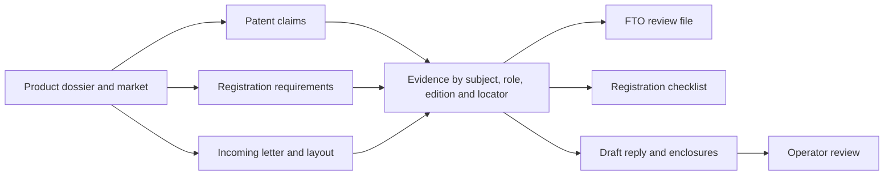

<p align="center"></p>

# Patent-to-Pilot

A Thai-first regulatory affairs workbench for pharmaceutical dossiers. Trace a statement from a patent claim, a regulatory requirement or an official letter back to its source, edition and page.

**Available today:** a local Windows reader for 23 curated Thai and English readings. **In development:** three specialists sharing one dossier to prepare a freedom-to-operate (FTO) evidence file, a registration checklist and an editable response letter. [Verified alpha](docs/evidence-scope/receipts/S4-product-release.md) · [RA Pharma roadmap](docs/ra-pharma/MASTER-PLAN.md)

## Try the reader

Use Python 3.12 with SQLite FTS5. From the repository root, double-click [Start-PTP.cmd](Start-PTP.cmd) on Windows, or run:

```sh
python scripts/ptp_run.py --serve --open
```

Open the structured-document reader and select the taste-masked tablet example. Compare claims **15 and 18**. Both inherit claim 1, but through different parents. Select an edge to inspect the original English passage alongside its Thai explanation. Then open the Electronic Transactions Act example to compare a provision across two editions. Each reading can be reopened from its stored trace or exported as JSON. [Example sources](docs/evidence-scope/receipts/S2-sources.md)

The default lexical workflow uses a local SQLite store and requires no API account. The launcher starts on loopback, tries the next port if occupied and stops with Ctrl+C. Use `--data-dir PATH` for a separate workspace. To verify your installation:

```sh
python scripts/ptp_run.py --doctor
python scripts/ptp_run.py --smoke
```

Optional PDF text extraction and Thai segmentation are available with `python -m pip install -e ".[pdf,thai]"`. The existing fictional sample also supports requirement comparison, local search, source revision and citation replay. [Validated workflows and recovery](docs/evidence-scope/receipts/S4-integrated-verification.md)

## Three specialists, one dossier

| Specialist | Reading task | Planned output |
|---|---|---|
| Patent and FTO | Discover candidates from titles and abstracts, follow claim dependencies, compare product features and check territory and legal status | Claim chart with cited limitations and unresolved checks |
| Regulatory | Identify the issuing authority, edition, applicable market and dossier section; map requirements to the applicant's evidence | Registration checklist with a source for each decision and a list of missing documents |
| Thai correspondence | Read the page layout, sender, emblem, references, questions and enclosures; choose a template for the actual sender | Editable response letter with enclosure list and sentence-level review |

A patent may describe a formulation test that the applicant has never performed. The proposed workflow keeps the patent observation in the claim chart and flags the missing applicant report in the registration checklist. Once the correct report is supplied, a reviewer can trace a sentence in the draft reply to that report's page. Final sign-off and issuance belong to the authorized operator. [Evidence interface and worked example](docs/ra-pharma/EVIDENCE-CONTRACT.md)



## Research

IS1 found that search depth changed whether a known relevant patent family reached the reader. On its separate 725-query analysis, exposure rose from 40.8% at depth 100 to 77.2% at 1,000. The planned experiment asks when a specialist should read deeper, follow a parent claim, open an attachment or request another specialist's evidence. Fixed-depth and adaptive methods will share a cohort, retriever and reading budget. The deeper reranking matrix and the three-agent comparison are **not yet measured**. [Original-source record](docs/evidence-scope/00-organization.md#original-source-corrections) · [Research brief](docs/ra-pharma/research/BRIEF.md)

| Previous result | What it established |
|---|---|
| [A3r1](docs/tracking/owner-note-22112026/receipts/P1-T05_stage_b_and_full_eval.md) | Exploratory +0.0213 ALL Recall@200 on a previously inspected validation cohort |
| [P2 matched screen](docs/tracking/owner-note-22112026/receipts/P2-T04_results.md) | The structural acquisition policy fell below its complete-content control on the 2,000-query cohort |
| [S3](docs/healthtech/audits/S3-20261125/RESULTS.md) | The scope controller solved 3/27 Thai cases versus 6/27 for coverage under a matched budget |
| [Option A](docs/evidence-scope/alternative-evidence/RESULTS.md) | Five methods followed identical evidence-opening sequences on all 45 requests. The Thai primary contrast was null |

## Data and licensing

The [Apache License 2.0](LICENSE) covers the source directories identified in [NOTICE](NOTICE). Check source, model and dataset terms separately. Public demo excerpts have a [source and rights ledger](docs/evidence-scope/receipts/S2-sources.md). Research-only PatEmbed and DAPFAM assets stay outside commercial builds. Protected TEST records and evaluator labels stay outside the runtime. [Data boundaries](data/README.md)

## Work on the project

- [Current plan and branch ownership](docs/ra-pharma/MASTER-PLAN.md) · [Planner handoff](HANDOFF.md)
- [Research session](docs/ra-pharma/research/BRIEF.md) · [Product session](docs/ra-pharma/product/BRIEF.md)
- [Developer instructions](AGENTS.md) · [Documentation guide](.agents/skills/ra-pharma-writing/SKILL.md)
- [Evidence index](INDEX-PLAN.md) · [Workbench source](src/patent_to_pilot/workbench/) · [Release verification](docs/evidence-scope/receipts/S4-integrated-verification.md)
