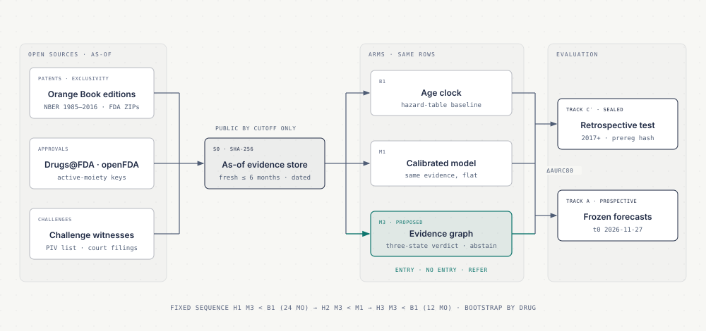

<p align="center"></p>

<h1 align="center">Patent-to-Pilot</h1>

<p align="center"><strong>Evidence-traced forecasting of generic and biosimilar competition from open regulatory records</strong></p>

<p align="center">
  <a href="LICENSE"></a>
  
  
</p>

<p align="center">
  <a href="#loe-bench">LOE-Bench</a> ·
  <a href="#how-evidence-stays-honest">Evidence rules</a> ·
  <a href="#current-status">Status</a> ·
  <a href="#quick-start">Quick start</a> ·
  <a href="#thai-context-and-the-workbench">Thai context</a> ·
  <a href="#project-records">Project records</a>
</p>

---

## LOE-Bench

**Will a first generic or biosimilar reach the US market within 12 or 24 months?** LOE-Bench answers this question from public FDA records available on the forecast date. When the evidence conflicts or is missing, it refers the case to a human freedom-to-operate (FTO) evaluator instead of guessing.

- **Benchmark.** Annual cutoffs from public Orange Book editions, Drugs@FDA approvals, Purple Book files and dated patent-challenge evidence. Each product has a forward time split and a prospective forecast frozen on 27 November 2026.
- **Method.** A three-state evidence graph (OPEN, BLOCKED, CONTESTED) over exclusivity, patents and challenges. It combines a calibrated probability with an abstention policy that ranks the next piece of evidence a reviewer should check.
- **Comparison.** The proposed graph (M3) competes against a strong age-clock baseline (B1) and a matched flat model (M1) that sees the same evidence. All three arms score identical rows.

<p align="center">
  
</p>

The output is a triage aid, not a legal or FTO opinion. A qualified reviewer makes every final decision.

## How evidence stays honest

| Rule | What it prevents |
|---|---|
| **As-of inputs only.** A source counts at a cutoff only if a dated capture or publication shows it was public by then. Patent and exclusivity features come from historical Orange Book editions, never from today's file with backdated fields. | Hindsight leakage |
| **Sealed test.** Code refuses any metric on cutoffs from 2017 onward until the preregistration hash is supplied. | Tuning on the test set |
| **Disclosed exposure.** An early smoke run scored three baselines on part of that test window. The preregistration states exactly what was seen. | Hidden test reuse |
| **Prospective Track A.** Forecasts for currently unchallenged drugs are hashed and tagged before any outcome exists. | Any retrospective bias |
| **Fixed-sequence confirmation.** H1 (M3 beats B1 at 24 months), then H2 (M3 beats M1), then H3 (M3 beats B1 at 12 months). Each step is one-sided at α = 0.025 and is tested only after the previous step succeeds. | Multiplicity and forking paths |
| **Matched arms.** Every shared improvement goes to M1 and M3 under the same tuning budget, and each trial is logged in a [technique ledger](docs/loe-bench/TECHNIQUE-LEDGER.md). | Unfair comparisons and repeated work |

The metric is AURC normalized over a common 0–80% coverage range, with a paired bootstrap that resamples whole drugs ([Geifman et al. 2019](https://arxiv.org/abs/1805.08206); [Field and Welsh 2007](https://doi.org/10.1111/j.1467-9868.2007.00593.x)). The fixed-sequence procedure follows the FDA guidance [*Multiple Endpoints in Clinical Trials*](https://www.fda.gov/regulatory-information/search-fda-guidance-documents/multiple-endpoints-clinical-trials) (2022).

## Current status

| Item | State |
|---|---|
| Prospective Track A inputs | Frozen at tag `loe-S0-input-20261127` |
| Historical Orange Book | 31 NBER annual editions (1985–2016) and 31 dated FDA ZIP editions |
| Patent-challenge evidence | FDA Paragraph IV lists, plus court filings linked through Orange Book patent numbers |
| Drug identity | Active-moiety keys from FDA GSRS; a fresh audit found 57/60 correct |
| Confirmatory result | **None yet.** All results so far are development-only, and the test remains sealed |
| Next | Threshold calibration, final power check, then preregistration |

The [plan](docs/loe-bench/PLAN.md), [lane handoff](docs/loe-bench/HANDOFF.md) and [task receipts](docs/loe-bench/receipts/) record every decision, failure and data source.

## Quick start

LOE-Bench uses the Python 3.12 standard library, with optional NumPy.

```sh
cd loe-bench
python -m unittest discover -s loe_bench/tests -t .
python -m loe_bench.openfda_fetch --out ../../_private_artifacts/loe-bench/raw
python -m loe_bench.run_profile --raw ../../_private_artifacts/loe-bench/raw --out data/profile.json
```

Raw downloads stay outside Git. Each fetch writes a SHA-256 manifest, and you should compare it with [`data/S0_INPUT_MANIFEST.json`](loe-bench/data/S0_INPUT_MANIFEST.json).

## Thai context and the Workbench

The Thai-context demo shows what a US entry forecast means for the Thai market. It covers registration, Thai patent status, the essential-medicines list and reference prices, and marks missing evidence explicitly. [Thai open-data feasibility](docs/loe-bench/THAI-OPEN-DATA.md)

The earlier Thai-first regulatory Workbench remains available as a local Windows reader for 23 curated Thai and English readings. Run [Start-PTP.cmd](Start-PTP.cmd), or:

```sh
python scripts/ptp_run.py --serve --open
python scripts/ptp_run.py --doctor
python scripts/ptp_run.py --smoke
```

[Verified alpha](docs/evidence-scope/receipts/S4-product-release.md) · [RA Pharma history](docs/ra-pharma/MASTER-PLAN.md)

## Data and licensing

The [Apache License 2.0](LICENSE) covers the source directories listed in [NOTICE](NOTICE). Check data terms separately:

- FDA files are public.
- The NBER Orange Book Dataset restricts redistribution and commercial use, so this repository publishes only code and download instructions for it.
- The Rai et al. court table is CC0.

Protected test records and evaluator labels stay outside the runtime. [Data boundaries](data/README.md)

## Project records

- [Agent instructions](AGENTS.md) · [Claude instructions](CLAUDE.md) · [Root handoff](HANDOFF.md)
- [Owner decisions (D40 onward)](docs/maintenance/OWNER-DECISIONS-20261122.md) · [Evidence index](INDEX-PLAN.md)
- [Owner's original LOE-Bench package](docs/loe-bench/owner-source/) · [SciSpace evidence review](docs/loe-bench/owner-source/scispace/)
- Earlier programs (IS1 retrieval, S0–S5, RA Pharma) are kept as history in the [evidence index](INDEX-PLAN.md).
