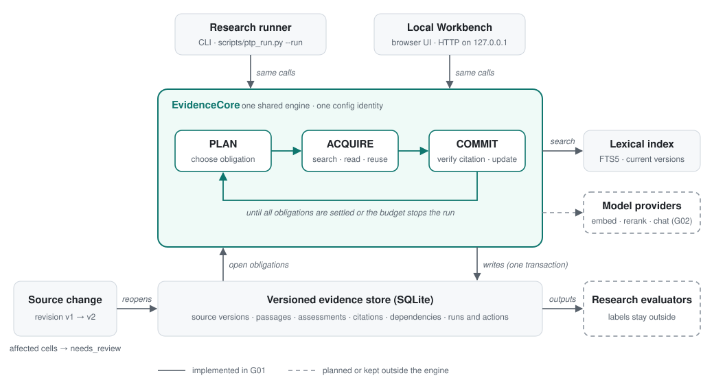
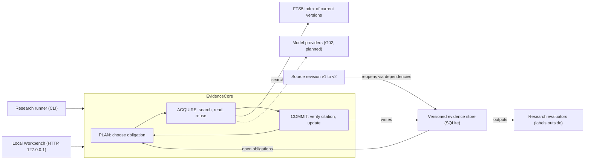

<p align="center">
  
</p>

<p align="center">
  <strong>One versioned evidence engine for reproducible retrieval research and a usable local workbench.</strong>
</p>

<p align="center">
  <a href="#quick-start">Quick start</a> ·
  <a href="#architecture">Architecture</a> ·
  <a href="#status">Status</a> ·
  <a href="#repository-layout">Layout</a> ·
  <a href="#data-ethics-and-licensing">Data and licensing</a>
</p>

---

Patent-to-Pilot studies how a system should spend its retrieval and repair effort when evidence lives in versioned
documents that change. It is run as one program (**PTP-2026-11-21**, toward an Independent Study 2 presentation in March
2027) with two tracks that share a single implementation:

- **Research** — frozen configurations, benchmark adapters, isolated evaluators, ablations and result provenance.
- **Product** — a local Workbench for requirements, candidate comparison, exact source evidence and change review.

The central research question is whether explicit, version-qualified evidence state can allocate retrieval and repair work
better than strong static retrieval and ordinary cache/invalidation controls at a comparable budget. The planned paper
proposes three contributions:

| | Proposed contribution | What has to be shown |
|---|---|---|
| C1 | A support-frontier acquisition and repair policy | Same-model, same-action comparisons, ablations and quality–cost curves |
| C2 | An executable versioned evidence architecture (PLAN → ACQUIRE → COMMIT) | Real traces, restart consistency, one kernel behind CLI and UI |
| C3 | A reproducible evaluation package | Matched patent retrieval (DAPFAM), Thai Gazette transfer, declared update episodes |

These are proposals. Novelty and performance have not yet been established, and no result of the new engine is reported here.

## Status

| Goal | Scope | State |
|---|---|---|
| G01 | Shared core and local vertical slice | **Complete** — real lexical retrieval, versioned citations, persisted runs, source-revision workflow ([receipts](artifacts/owner-program/PTP-2026-11-21/G01/STATUS.md)) |
| G02 | Provider, ingestion and dataset contracts | Next |
| G03 | Baselines and candidate policy on allowed DEV data | Planned |
| G04–G05 | Matched patent benchmark; transfer and evidence maintenance | Planned |
| G06–G07 | English-first product beta; unified paper and evidence audit | Planned |
| G08 | IS2 demonstration and release rehearsal | Planned (March 2027) |

The G01 Workbench runs entirely on the local machine in lexical mode: no model download, API key or paid call. Its sample
project uses fictional documents, including Thai text and unit-bearing ranges, to exercise exact citations and a source
revision (v1 → v2) that reopens only the affected assessments.

## Quick start

Requirements: Windows, macOS or Linux with **Python 3.12+**. The Workbench uses only the standard library (SQLite with FTS5).

**Windows:** double-click [`Start-PTP.cmd`](Start-PTP.cmd) and keep its window open. The browser opens
`http://127.0.0.1:8765/` (or the next free port). Choose **Open sample project → Run comparison**, open a citation, then
**Apply sample source revision**.

**Any platform:**

```bash
python scripts/ptp_run.py --doctor     # environment report
python scripts/ptp_run.py --smoke      # full sample workflow in a temporary store
python scripts/ptp_run.py --serve      # start the Workbench on 127.0.0.1
python scripts/ptp_run.py --run        # same comparison through the CLI path
```

Developer setup and tests:

```bash
python -m venv .venv
.venv/Scripts/python -m pip install -e ".[test]"   # .venv/bin/python on macOS/Linux
.venv/Scripts/python -m pytest
```

The full owner walkthrough is in [OWNER_START.md](artifacts/owner-program/PTP-2026-11-21/G01/OWNER_START.md).

## Architecture

<p align="center">
  
</p>

Both consumers call the same `EvidenceCore` with the same configuration identity, so a research run and a Workbench run are
the same computation. **PLAN** picks the next unresolved or invalidated obligation, **ACQUIRE** searches and reads passages
from the current source versions (or reuses valid evidence), and **COMMIT** verifies each citation against the exact stored
version before writing the assessment, its citations and its dependencies in one transaction. A source revision stores a
new immutable version, moves the current pointer, and uses the stored dependencies to mark only the affected assessments
`needs_review`; the old citation still resolves as superseded. Evaluator labels never enter the engine.

<details>
<summary>Text version (Mermaid)</summary>



</details>

## Repository layout

| Path | Contents |
|---|---|
| `src/patent_to_pilot/workbench/` | G01 engine (`core.py`), SQLite store, bounded parser, local HTTP server and static UI |
| `src/patent_to_pilot/` (other packages) | Earlier retrieval, evaluation and research modules, reused where they hold up |
| `scripts/ptp_run.py`, `Start-PTP.cmd` | Workbench launcher and diagnostics |
| `scripts/` | Research and evaluation scripts (historical runs and future goals) |
| `tests/` | Test suite (`python -m pytest`) |
| `artifacts/owner-program/PTP-2026-11-21/` | Per-goal status, run receipts and decisions |
| `docs/healthtech/research/`, `docs/healthtech/audits/` | Frozen protocols, historical results and audit receipts |
| `docs/writing/` | Manuscript work: `journal/` (the program paper) and `is2/` (Independent Study 2) |
| `literature-review/` | Curated related-work notes and bibliography |
| `CLAUDE.md`, `AGENTS.md`, `HANDOFF.md`, `INDEX-PLAN.md` | Agent rules, current state and the goal/evidence index |

## Research record

Earlier studies remain as evidence with their original scope, not as results of the new engine:

- **Paper 53** (iSAI-NLP 2026 program: *Diagnosing Near-Zero Instruction Effects in Cross-Domain Patent Reranking*) is the
  authors' prior work. The new program studies acquisition and maintenance of the candidate pool that Paper 53 reranked;
  see the [DAPFAM comparability audit](docs/healthtech/research/plans/DAPFAM-PAPER-COMPARABILITY.md).
- **B53** re-implements Paper 53's first stage on DAPFAM for IS2; Stage 1 is
  [measured](docs/writing/is2/results/B53-STAGE1-RESULTS.md) and is exploratory, not a replication.
- **Patent retrieval development studies** (fine-tuning grid, missing-reference study AM-7) are parked with their DEV
  results in [`docs/healthtech/research/paper1-bridgeret/`](docs/healthtech/research/paper1-bridgeret/).

All experiment code follows the same rules: protocols and endpoints are frozen before results exist, failures and unknown
costs are reported, and protected test splits are never used to choose a method.

## Data, ethics and licensing

- **No personal data, no participants.** This is a solo computational study. Workbench sample documents are fictional.
- **Third-party data stays outside Git.** Datasets, model weights and paper PDFs are read from local or remote storage and
  keep their own terms (for example DAPFAM, CC BY-NC-SA 4.0). The repository publishes code, identifiers, hashes and
  aggregate results only.
- **Protected evaluation data are never opened for development**, and benchmark labels never enter the runtime engine.
- **No claim beyond evidence.** A literal quote match proves source integrity, not semantic support; unjudged results are
  not negatives; no output here is legal, regulatory, clinical or investment advice.
- **Local by default.** The Workbench binds to `127.0.0.1` and makes no remote call in lexical mode.

Code in `src/`, `scripts/`, `tests/` and `frontend/` is licensed under the [Apache License 2.0](LICENSE); see
[NOTICE](NOTICE) for the scope and third-party terms.
