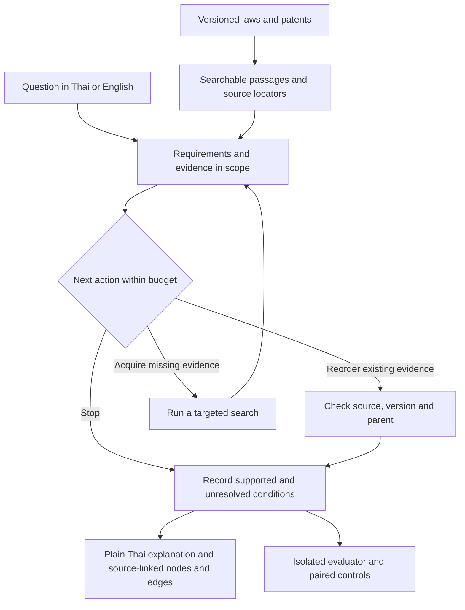

<p align="center"></p>

# Patent-to-Pilot

A local workbench for finding evidence in structured documents and opening each citation at its source. Search in Thai or English, compare requirements against passages, and inspect what changes when a source is revised.

**Try the Thai-first reader.** Compare the wording of Thailand’s Electronic Transactions Act across two editions, or see which material a dependent English patent claim adds. Open the cited passage from the answer or from a graph edge. The local alpha includes 23 preset readings from ten document families and retains each trace on disk. [Alpha receipt](docs/evidence-scope/receipts/S2-workbench.md) · [Master plan](docs/evidence-scope/MASTER-PLAN.md)

[Quick start](#quick-start) · [What works today](#what-works-today) · [Architecture](#architecture) · [Research status](#research-status) · [Project guide](#project-guide)

## Quick start

From a checkout, use Python 3.12+ with SQLite FTS5. The default lexical workflow runs locally without an API account or model download.

**On Windows**, double-click [Start-PTP.cmd](Start-PTP.cmd) and keep its window open. **From a terminal**, run the launcher from the repository root.

```sh
python scripts/ptp_run.py --serve --open
```

The launcher opens a loopback address starting at `127.0.0.1:8765` and tries the next port if it is occupied. Stop the terminal process with Ctrl+C.

For the public-source examples, choose **เปิดโต๊ะอ่านเอกสาร**, select an edition or patent claim, then choose **อ่านพร้อมหลักฐาน**. Run both editions in one family to compare the conclusions. Open a citation to see its precise wording and source. The signature example also shows what happens when a question needs facts from a contract that the reader does not have.

For the existing fictional engineering sample

1. Select **Open sample project**, then **Run comparison**. The sample compares two fictional concepts against three requirements.
2. Open a citation to inspect the quoted text in its stored source version. In **Search**, try the Thai term **ระบายความร้อน** or the English phrase **operating temperature**.
3. Select **Apply sample source revision** to exercise the dependency and recheck path. From the welcome screen, **Load synthetic relation-search example** opens a separate fictional packet with an annex and a footnote.

The launcher also provides diagnostics and a self-contained sample check.

```sh
python scripts/ptp_run.py --doctor
python scripts/ptp_run.py --smoke
```

The smoke command uses a temporary store. For your own workspace, pass `--data-dir PATH` or set `PTP_DATA_DIR`. To add PDF text-layer ingestion and Thai word segmentation, install the optional extras in your project environment.

```sh
python -m pip install -e ".[pdf,thai]"
```

## Example readings

| Open in the Workbench | Follow the source |
|---|---|
| Taste-masked formulation (36 claims) | Follow claim 18 → 17 → 1, then compare the other branch, claim 15 → 2 → 1. Each hop has an English passage and a Thai gloss. |
| Controlled-release metformin (37 claims) | Compare the floating dosage form in claim 3 with the expanding dosage form in claim 4. Each depends on claim 1. Claim 7 asks a separate question about the coating. |
| Dry-powder inhaler (30 claims) and child-resistant blister packaging (32 claims) | Compare shared and separate outlets in the inhaler, or trace which film layers the cuts cross in the two packaging branches. |
| Medical Devices Act and Drug Act | Compare establishment registration with advertising permission, then inspect how the Drug Act addresses exaggerated claims and advertising in print. Each reading names the edition used. |
| National Health Act and Official Information Act | Inspect confidentiality and the statutory emergency provision, or compare which public spending records must be available for inspection with a request for other information. |
| Electronic signatures and the paper-clip patent | Compare historical statutory wording and see the reader abstain when a contract is missing. In English, compare wire and plastic in two dependent patent claims. |

The numbers above count claims in the complete patent publications. The local examples reproduce the selected passages needed for each question. [Source manifest and rights](docs/evidence-scope/receipts/S2-sources.md) · [Public patent branches](docs/evidence-scope/receipts/S2-pharma-source.md) · [Thai health-law provisions](docs/evidence-scope/receipts/S2-health-law-source.md)

## What works today

| Workflow | Available in the local build |
|---|---|
| Thai-first reader | Twenty-three curated readings, passage-level Thai glosses, source-stated and inferred graph edges, keyboard-accessible inspection, cross-edition comparison, JSON export and stored-run replay. |
| Search | Search the current version of each document, including Thai text. Select a result to inspect the canonical passage. Optional provider profiles support dense retrieval and hybrid indexing. |
| Compare and inspect | Compare explicit requirements against candidate documents. Open a citation at its character offsets, follow a supported source relation, and inspect the stored version. A verified quote establishes the location of the text. Its meaning still requires interpretation. |
| Ingest and revise | Import text, Markdown or a PDF with an extractable text layer. The PDF adapter retains the original file hash and page markers. Revisions preserve previous versions and identify assessments that need review. |

The local server, bundled browser UI and SQLite store are implemented in the [Workbench](src/patent_to_pilot/workbench/). The [foundation diagram](docs/assets/architecture.svg) shows the current sample runner and browser workflow. The [synthetic revision receipt](docs/tracking/owner-note-22112026/receipts/P4-T04_revision_comparison.md) records supported scenarios and the remaining corpus-removal limitation.

## Architecture

**The local reader** starts with a preset question and named sections or claims. SQLite FTS5 nominates candidate passages. A deterministic controller checks version, locator and the available scope constraints, then keeps, reranks, searches again or records a missing condition. Each resolved span has a checked source digest, offsets and a human-readable editorial gloss. The Workbench does not generate a legal assessment or answer arbitrary questions in this mode.



The S3 experiment will test whether a learned or fixed policy can infer when to act without the reader’s preset locators. The controller design distinguishes evidence at the top of the pool, evidence buried in the pool and evidence absent from it. Explicit links in a source and model-inferred relations receive separate labels. The diagram a reader explores is built from the evidence used for that answer. The planned comparison with SkillOpt, HarnessOpt and fixed policies runs offline under matched budgets, with labels isolated from the runtime. [Research questions and data design](docs/evidence-scope/FREEZE.md)

## Research status

| Result on record | Scope |
|---|---|
| A3r1 improved ALL Recall@200 by **+0.0213** over its frozen reference on VAL. | Exploratory evidence from a previously inspected validation set and an earlier representation. [A3r1 receipt](docs/tracking/owner-note-22112026/receipts/P1-T05_stage_b_and_full_eval.md) |
| On the 2,000-query P2 DEV screen, the unresolved-relation policy reached **0.44372** versus **0.44998** for complete-content fusion. | The paired change was **−0.00626** with a 95% interval of **[−0.00902, −0.00369]**. The policy was parked under the frozen rule. [Matched screen results](docs/tracking/owner-note-22112026/receipts/P2-T04_results.md) |
| The S1 controlled pilot is frozen. S3 evaluation is **NOT_RUN**. | The research question concerns evidence that matches a topic but belongs to a different edition, exception, table or claim context. The packet has 100 authored requests across ten families and separates runtime sources from evaluator answers. [S1 evidence](docs/evidence-scope/receipts/S1-20261125.md) |

IS1 and the authors' Paper 53, *Diagnosing Near-Zero Instruction Effects in Cross-Domain Patent Reranking*, motivate evaluating candidate exposure separately from changes in rank. Historical protocols, negative results and known limitations retain their original meanings. [Writing guide](docs/writing/README.md) · [Evidence index](INDEX-PLAN.md)

## Data and licensing

The [Apache License 2.0](LICENSE) covers the source-code directories listed in [NOTICE](NOTICE). Dataset access, source documents, annotations, model weights and redistribution each have their own terms.

- The public reader ships short excerpts from five Thai legal families and five English-language US patent publications. Original source bytes and canonical excerpt texts have separate hashes. The older comparison and relation-search examples are fictional. [Source and reuse record](docs/evidence-scope/receipts/S2-sources.md)
- DAPFAM and PatEmbed carry CC BY-NC-SA 4.0 terms and are confined to the research track. Commercial builds require a separately licensed retrieval stack and their own index and measurements.
- Protected TEST data and sealed judgments stay outside development. The evidence engine receives only permitted runtime inputs. [Data roles and freeze](docs/evidence-scope/FREEZE.md)

## Project guide

| Start here | What you will find |
|---|---|
| [Master plan](docs/evidence-scope/MASTER-PLAN.md) | Executable phase briefs, parallel research and product milestones, and the next-goal handoff |
| [Current handoff](HANDOFF.md) and [evidence index](INDEX-PLAN.md) | Verified state, historical results, open dependencies and provenance |
| [Documentation map](docs/README.md) | Product, research, architecture and writing entry points |
| [Workbench source](src/patent_to_pilot/workbench/) and [local launcher](scripts/ptp_run.py) | The evidence core, local UI, provider profiles, source inspection and command-line options |
| [Research scripts](scripts/research/) and [tests](tests/) | Existing experiments and small engineering fixtures |
| [Contributor instructions](AGENTS.md) | Repository rules, data boundaries and evidence requirements |
