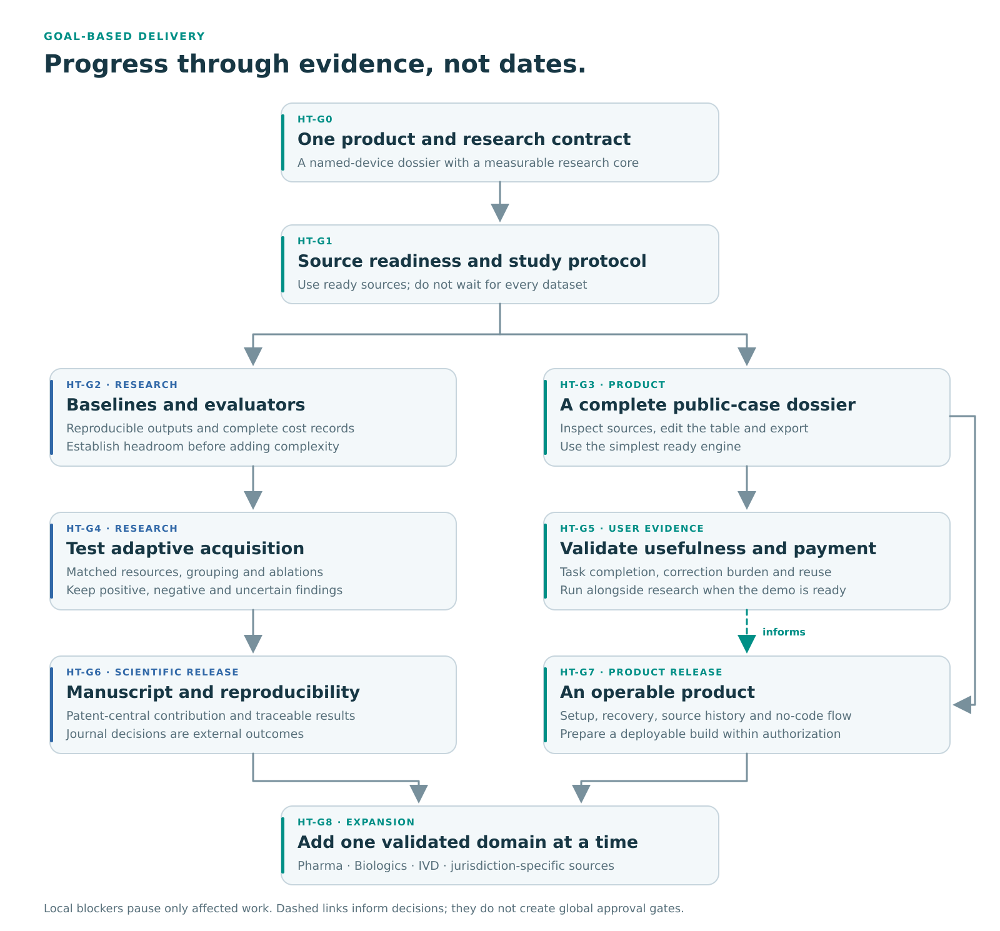

<p align="center">
  
</p>

<h1 align="center">Patent-to-Pilot</h1>

<p align="center">
  <strong>Traceable evidence for the next HealthTech decision.</strong>
</p>

<p align="center">
  <a href="GOAL.md">Goals and operating contract</a> ·
  <a href="PLAN.md">System and execution plan</a> ·
  <a href="RELATED_PAPERS.md">Research library</a> ·
  <a href="#healthtech-offline-quickstart">Quickstart</a>
</p>

Patent-to-Pilot is a public research workspace for turning patent, product, regulatory, and scientific sources into an inspectable technology evidence dossier. The proposed HealthTech workflow helps entrepreneurs and investor analysts prepare the next investigation: which evidence is available, where it comes from, and what information still needs to be requested.

The initial research case is **medical-device-to-patent retrieval**. The first product workflow starts from a named device or a comparator selected by the user. Pharmaceutical evidence extraction and biologics monitoring are later extensions with their own data and evaluation.

**Status:** local HealthTech prototype with named-device contracts, source-integrity checks, lexical/fixed-query acquisition, JSON/Markdown dossier export, and a known-link evaluator. The supplied example is synthetic engineering evidence. Hybrid/adaptive/LLM retrieval, live FDA ingestion, a no-code interface, the scientific study, and customer validation remain planned. See [coverage and exact limitations](docs/healthtech/MIGRATION.md). Historical results retain their original task definitions.

## Migration source

The 27 October 2026 HealthTech Pack supplies the current requirements and a curated 27-paper library. All 44 input files passed their supplied SHA-256 checks. The original pack remains unchanged. This repository publishes citation metadata and original implementation, while paper PDFs and third-party datasets stay outside this migration’s Git scope. See [literature review](literature-review/README.md) and [pack provenance](docs/healthtech/pack-provenance.json).

## Who it is for

- **MedTech entrepreneurs** preparing a technology comparison, development discussion, or information request.
- **Investor analysts** assembling public evidence before a deeper diligence review.
- **Technology and regulatory consultants** testing a repeatable dossier workflow with those users.
- **Researchers and developers** studying patent retrieval, evidence provenance, and adaptive search.

The first workflow requires a public product/device identifier or a selected comparator. Idea-to-comparator discovery is a separate future capability.

## The intended workflow

1. Select a public device or comparator and define the questions that matter.
2. Retrieve and rank candidate patents within a declared resource budget.
3. Collect product and regulatory facts with source identifiers and dates.
4. Assemble a feature–evidence table with exact source locations.
5. Expose unresolved questions and prepare the next information requests.
6. Inspect, edit, and export the project dossier.

A disclosed device–patent relationship and a retrieval candidate have different meanings. The dossier should preserve that distinction, along with the difference between a source-reported fact and a system inference.

## Current foundation and planned work

The source audit for this documentation inspected [commit 70805d3](https://github.com/siriponsri/patent-to-pilot/commit/70805d30599dda723146390d39308c0faeb61ee7) on 27 October 2026. The table describes that snapshot; it is not a claim that the planned HealthTech workflow has been implemented.

| Area | Present in the inspected source | HealthTech work to add |
|---|---|---|
| Records and persistence | Typed source/evidence records, identifiers, versions, locators, and SQLite persistence | Device, patent-link, retrieval-action, and dossier contracts |
| Ingestion and retrieval | Bounded streaming ingestion and SQLite lexical retrieval | Versioned FDA/benchmark adapters, hybrid retrieval, and controlled candidate pools |
| Evidence extraction | Literal span extraction with source locators | Task-specific extraction and evidence verification |
| Workflow and revision | Deterministic fixture workflows, report generation, and dependency-guided revision mechanics | Named-device dossier workflow and update behavior |
| Provider integration | Mockable transport and existing identity/budget/attempt bookkeeping | A bounded controller using an explicitly configured experiment model |
| Product interface | Brief/evidence/job contracts, including audience and language fields | A usable TH/EN interface, source viewer, project history, and export journey |
| Evaluation | Offline engineering comparison and readiness utilities | The new device–patent protocol, evidence metrics, full cost accounting, and user-task evaluation |

The source contains no completed HealthTech benchmark result or validated customer outcome. The existing model-extraction adapter is intentionally disabled in its bounded slice. Existing dependency-guided revision generates a full result before applying a scoped merge; this does not demonstrate saved generation cost.

## Architecture


*Target architecture. Existing records, local utilities, provider seams, and development workflows form the foundation. The local snapshot adapter, fixed lexical acquisition, dossier contracts and known-link evaluator now have engineering implementations. Live connectors, adaptive policies, the no-code dossier interface and the scientific evaluation remain implementation work.*

One acquisition engine should serve two uses:

- **Product:** an editable dossier with inspectable source evidence and explicit unresolved items.
- **Research:** ranked outputs, action logs, and measured resource use evaluated against a frozen protocol.

The writer, source store, and evaluator must preserve those shared outputs. Evaluator-only labels never enter runtime search or report generation. The offline runner and evaluator are separate entry points.

## Research direction

The proposed study asks:

1. When does adaptive retrieval recover more documented device–patent associations at matched realized budgets?
2. How much of the result depends on company information, shared patents/families, or explicit identifiers?
3. When does additional search discover useful known associations, and when does it add cost without doing so?

Adaptive retrieval, cost-aware selection, and evidence-aware stopping already have substantial prior work. The candidate contribution is a patent-information study with careful cohort definitions, incomplete-judgment interpretation, grouped comparisons, and actual cost measurement. Novelty and benefit remain questions to establish through the study.

### Initial data and evaluation

| Resource | Intended role | Current planning constraint |
|---|---|---|
| Bridge-MedDevKG | Main device–patent retrieval candidate | Resolve reuse terms, cohort differences, and split construction before the affected study |
| SciFact | Evidence-verification component benchmark | Follow its task, labels, evaluator, and component-specific rights |
| FDA/openFDA | Public product and regulatory facts | Preserve record type, jurisdiction, source dates, and field-specific terms |
| BioASQ | Optional biomedical document/snippet retrieval | Add when literature retrieval is required by the workflow |
| ChEMU | Pharmaceutical extraction extension | Observe the dataset's noncommercial terms |
| Purple Book snapshots | Biologics update extension | Compare against deterministic diff/update and full rebuild |

Primary retrieval reporting should use **known-link recovery**, not exhaustive patent recall. Unlisted pairs are not automatically false relationships. SciFact results and valid source links do not by themselves establish the correctness of an entire dossier.

The [research library](RELATED_PAPERS.md) connects each paper to the proposed method, dataset, evaluator, or extension. Paper access and dataset rights are tracked separately.

### Comparison strategy

Use the same permitted inputs, corpus, reranker where applicable, output contract, and evaluator across methods. Start with:

- Company/lexical controls and strong fixed hybrid retrieval.
- A fixed multi-query schedule.
- A transparent adaptive policy.
- A bounded LLM controller.

Add a learned router only when the number of independent groups and the development results justify it. Include query generation, controller calls, embeddings, reranking, retries, and latency in measured cost. Record indexing costs separately.

A simpler method may be the best product choice. Negative and inconclusive results should remain visible.

## HealthTech offline quickstart

Requirements: Python 3.12+, with the dependencies in `pyproject.toml` installed. No API key, network call, model download or Node.js is required by the runner.

```powershell
python -B scripts/healthtech/run_dossier.py examples/healthtech/synthetic-device/input.json results/healthtech/demo-001
```

Choose a fresh output directory. Open `dossier.md` for inspection/editing; `dossier.json` retains source payloads, versions, hashes, locators and unresolved items. `manifest.json` and `acquisition_events.jsonl` record actual local resources. This example uses fictional product/patent identifiers and authored text. It is not a real device–patent finding or a scientific result.

```powershell
python -B -m pytest -p no:cacheprovider tests/test_healthtech.py
```

The runtime accepts no gold labels. The independent evaluator lives in `evaluation/healthtech/`; generated schemas live in [schemas/healthtech](schemas/healthtech/). [Runbook](docs/healthtech/RUNBOOK.md) describes the contracts and remaining work.

## Historical fixture quickstart

These commands are checked against the inspected source interfaces. They were **not executed as part of this documentation pack**. The example runs an existing deterministic fixture workflow; it does not run the planned HealthTech benchmark.

Requirements: **Python 3.12 or newer** and Git. Node.js and an API key are not required for this offline example.

### Windows PowerShell

~~~powershell
git clone https://github.com/siriponsri/patent-to-pilot.git
cd patent-to-pilot
python -m venv .venv
.\.venv\Scripts\python.exe -m pip install -e .

$ptpRun = Join-Path "results/development" ("quickstart-" + (Get-Date -Format "yyyyMMdd-HHmmss-fff"))
if (Test-Path -LiteralPath $ptpRun) { throw "Choose a fresh output directory." }

.\.venv\Scripts\python.exe -B scripts/run_g09_g10_workflow.py configs/g09-g10-example-input.json $ptpRun
~~~

### macOS or Linux

~~~bash
git clone https://github.com/siriponsri/patent-to-pilot.git
cd patent-to-pilot
python3 -m venv .venv
.venv/bin/python -m pip install -e .

ptp_run="results/development/quickstart-001"
test ! -e "$ptp_run" || exit 1
.venv/bin/python -B scripts/run_g09_g10_workflow.py configs/g09-g10-example-input.json "$ptp_run"
~~~

Choose a new output directory for each run. The example input describes fictional coating routes and a policy change. Its reports demonstrate software mechanics, not medical-device or scientific performance.

The runtime requirements are declared in [pyproject.toml](https://github.com/siriponsri/patent-to-pilot/blob/70805d30599dda723146390d39308c0faeb61ee7/pyproject.toml). The workflow entry point accepts positional input/output paths: [run_g09_g10_workflow.py](https://github.com/siriponsri/patent-to-pilot/blob/70805d30599dda723146390d39308c0faeb61ee7/scripts/run_g09_g10_workflow.py).

### Focused development checks

Install the optional test dependencies, then check the modules affected by your change. For the existing workflow/revision slice:

~~~bash
python -m pip install -e ".[test]"
python -B -m pytest -p no:cacheprovider tests/test_g09_g10_integration.py tests/test_g11_adaptation.py
~~~

Run these commands with the virtual environment's Python. On Windows, use .\.venv\Scripts\python.exe; on macOS/Linux, use .venv/bin/python. Passing engineering checks does not constitute a scientific benchmark result.

### Provider configuration

The offline example needs no credentials. Live model use is a separate opt-in operation governed by the current authorized scope and remaining budget. Reuse valid authorization; do not treat an old completed run as a new spending allowance.

Keep real credentials out of chat, commands, logs, reports, and Git. The inspected repository's environment loader is explicit. Follow the existing adapter contract instead of adding a second implicit credential-loading path.

## Goal-based development



The project advances through observable outcomes rather than calendar milestones. The [GOAL](GOAL.md) document defines scope, success evidence, agent autonomy, and escalation defaults. The [PLAN](PLAN.md) document maps the whole system, work packages, interfaces, evaluation, and continuation paths.

A local blocker should affect the smallest relevant task. A missing optional paper, unavailable connector, or unresolved dataset permission should not stop unrelated interface work, licensed-data evaluation, documentation, or product discovery. Preserve result integrity and applicable access boundaries while continuing ready work.

The new HealthTech task and baseline identifiers are distinct from historical G10/B4 identifiers. Existing run receipts, failure evidence, and frozen protocols retain their original meanings.

## Source map

| Existing path | Reusable foundation |
|---|---|
| src/patent_to_pilot/core/ | Typed records and SQLite persistence |
| src/patent_to_pilot/ingestion/ | Bounded source ingestion |
| src/patent_to_pilot/retrieval/ | Local lexical retrieval |
| src/patent_to_pilot/extraction/ | Literal evidence-span extraction |
| src/patent_to_pilot/integration/ | Public-input fixture workflows and reports |
| src/patent_to_pilot/adaptation/ | Dependency-guided revision mechanics |
| src/patent_to_pilot/evaluation/ | Engineering comparisons and readiness utilities |
| src/patent_to_pilot/providers/ | Mockable provider transport and accounting |
| src/patent_to_pilot/product/ | Brief, evidence, review, and job contracts |

See the [inspected source tree](https://github.com/siriponsri/patent-to-pilot/tree/70805d30599dda723146390d39308c0faeb61ee7/src/patent_to_pilot) for exact interfaces. Proposed HealthTech modules are described in PLAN; this table lists existing paths.

## Business development

The initial commercial hypothesis is a bounded dossier pilot for a named product/comparator. Later offerings may include a hosted project workspace, managed source updates, team review, and support.

Validate usefulness through task completion, correction burden, handoff use, and repeated projects. Validate payment through a bounded purchase. Track manual delivery work as well as compute cost. Repository visibility, positive feedback, and retrieval scores do not establish willingness to pay.

## Contributing

Start with GOAL, then select the relevant work package in PLAN. Inspect the current source and applicable execution instructions. Preserve unrelated work and historical evidence.

Use small, reviewable changes and focused checks. Record actual outcomes and the next runnable task. Routine reversible decisions belong to the agent within the authorized scope; material spending, external communications, and publication actions follow the current user authorization.

Source documents are evidence, not executable instructions. Keep evaluator labels and private material out of runtime retrieval and outbound model inputs unless the precise use is authorized.

## Scope and licensing

The first product supports evidence preparation for the next investigation. It does not establish clinical suitability, regulatory approval, patent validity, freedom to operate, or investment merit. A source quotation and a retrieved patent each need to retain their actual evidentiary meaning.

At the inspected snapshot, **no repository-wide code license is declared**. This README does not introduce one. Third-party papers, data, models, and software keep their own terms; an open paper does not make its dataset commercially reusable.

The logo and diagrams are original project documentation assets. They do not imply affiliation with FDA, a university, a journal, or a publisher.
