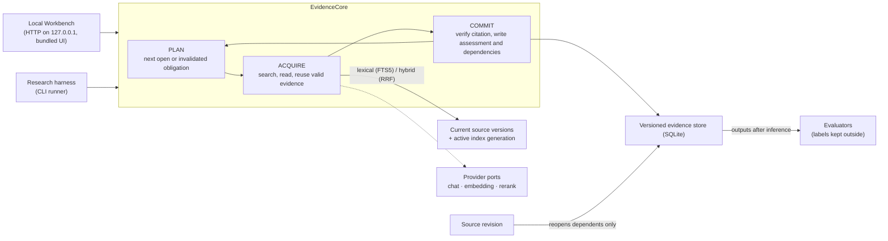

<p align="center">
  
</p>

<p align="center">
  <strong>A local evidence workbench and a reproducible retrieval-research engine, built on one shared core.</strong>
</p>

<p align="center">
  <a href="#quick-start">Quick start</a> ·
  <a href="#architecture">Architecture</a> ·
  <a href="#research-status">Research status</a> ·
  <a href="#phases">Phases</a> ·
  <a href="#repository-layout">Layout</a> ·
  <a href="#testing">Testing</a> ·
  <a href="#data-and-licensing">Data and licensing</a>
</p>

---

## Overview

Patent-to-Pilot is a local workbench for searching structured documents, citing the exact source passage behind every
assessment, and seeing what a document revision changes. The same evidence engine also runs the research harness, so a
product run and a research run are the same computation. The research method under study is **source-grounded structural
expansion**: keep the relation that makes evidence relevant, identify one unresolved requirement, and issue one bounded,
traceable search of the eligible corpus for new evidence. Patents provide continuity with the authors' earlier work; Thai
official and legal documents are the planned transfer test.

**What is and is not claimed.** The Workbench capabilities listed below are implemented and covered by tests. The research
method is a proposal: **no measured retrieval-score improvement over matched baselines exists yet**, and no novelty or
performance claim is made. Earlier experiments are kept with their original scope, including the ones that were parked.

## Key capabilities

Implemented in `src/patent_to_pilot/workbench/` and exercised by `tests/test_ptp_g01_*.py` and `tests/test_ptp_g02_*.py`.

| Capability | What it does |
|---|---|
| Lexical search | SQLite FTS5 (`unicode61`) over the current version of every source. Runs offline with the Python standard library only; this is the default mode. |
| Exact source citations | Every non-unknown assessment cites a literal quote with zero-based, end-exclusive code-point offsets into a stored version, checked as `text[start:end] == quote` before commit. Thai text is stored unnormalised. |
| Versioned sources and selective recheck | A revision stores a new immutable version and moves the current pointer. Stored dependencies mark only the affected assessments `needs_review`; older citations still resolve as superseded. Applying the same change twice is a no-op. |
| Ingestion | Plain text and Markdown (`.txt`, `.md`, `.markdown`) stored byte-exact. PDF via the text layer only (optional `pdf` extra, `pypdf`): one `[page N]` marker per page, the original PDF's SHA-256 kept as provenance; encrypted and scanned PDFs are refused (no OCR). |
| Provider profiles | Separate chat, embedding and rerank ports with three adapters: `ollama` (local server), `openai_compatible` (local servers, or remote APIs such as OpenRouter) and `anthropic_native`. Built-in OpenRouter chat templates use the OpenAI-compatible adapter. A paid route is refused unless its profile records a spend cap (`spend_cap_usd`) and a request cap (`max_requests`); API keys are read from environment variables and never stored. |
| Hybrid dense mode | Optional lexical + dense retrieval fused with reciprocal rank fusion. Dense vectors live in **index generations**: any corpus, chunking or embedding change builds a new generation beside the old one, which is retired rather than overwritten. A failing provider falls back to lexical mode with the reason recorded. |
| Dataset contracts | A registry of dataset metadata and read-only schema inspection (DAPFAM, Thai Gazette evidence retrieval, NitiBench+). Inspection refuses test and qrels paths; evaluator fields never reach runtime records. |

Real paid-API calls through the Workbench have not yet been verified; the adapters are checked against local contract
doubles. See the [G01](artifacts/owner-program/PTP-2026-11-21/G01/STATUS.md) and
[G02](artifacts/owner-program/PTP-2026-11-21/G02/STATUS.md) acceptance receipts.

## Quick start

Requirements: **Python 3.12+** whose SQLite build includes FTS5 (`--doctor` reports it). The Workbench itself needs no
third-party package, model download, API key or network access.

**Windows.** Double-click [`Start-PTP.cmd`](Start-PTP.cmd) and keep its window open. It uses `.venv\Scripts\python.exe`
if present (otherwise `py -3.12`, then `python`), starts the server on `127.0.0.1:8765` (or the next free port) and opens
the browser. In the Workbench choose **Open sample project → Run comparison**, open a citation, then **Apply sample source
revision**.

**Command line** (from the repository root):

```powershell
python scripts/ptp_run.py --doctor     # environment, store, FTS5, assets, port and provider report
python scripts/ptp_run.py --smoke      # full sample workflow in a temporary store (your data untouched)
python scripts/ptp_run.py --serve      # serve the Workbench on 127.0.0.1; add --open to open the browser
python scripts/ptp_run.py --run        # the same sample comparison through the CLI path
python scripts/ptp_run.py --help       # all options, including --providers, --ingest, --build-index, --retrieval-mode
```

Workbench data are stored in `--data-dir`, else `%PTP_DATA_DIR%`, else `%LOCALAPPDATA%\PatentToPilot\workbench`. The
sample project uses fictional documents (CC0), including Thai text, to exercise citations and a v1 → v2 source revision.

**Developer install** (optional extras: `test` for pytest, `pdf` for PDF ingestion):

```powershell
python -m venv .venv
.venv\Scripts\python -m pip install -e ".[test,pdf]"
```

The owner walkthrough for the first slice is in
[OWNER_START.md](artifacts/owner-program/PTP-2026-11-21/G01/OWNER_START.md).

## Architecture

One shared engine, two consumers. The Workbench (local HTTP server and bundled UI) and the research harness call the same
`EvidenceCore` with the same configuration identity. Benchmark labels and scoring stay outside the engine and are applied
only after inference.



- **PLAN** picks the next unresolved or invalidated obligation; **ACQUIRE** searches the current versions or reuses evidence
  that is still valid; **COMMIT** verifies each citation against the exact stored version and writes the assessment, its
  citations and its dependencies in one transaction.
- The proposed research extension keeps this core and SQLite store. It adds source-bound document structure (clauses,
  tables, annexes, date roles, page regions) and one bounded acquisition action chosen from an unresolved relation, under a
  fixed action budget. This extension is **not yet implemented or measured**.
- Design record: [ADR-0001](docs/architecture/ADR-0001-bounded-core-and-local-search.md).

## Research status

Status is reported in three separate fields, so product progress is never read as a research result.

| Field | Current value | Basis |
|---|---|---|
| `method_evidence` | **Not yet demonstrated** | Baseline and candidate-policy work on allowed development data (protocol v1, amendments 1 and 2) is parked without a supported gain ([decision memo](docs/healthtech/research/g03-dev/G03-DEV-DECISION-MEMO.md)). The LLM query-expansion arm (amendment 3) has format smoke calls only and no effectiveness pilot. |
| `product_readiness` | **Core verified; structural slice not built** | Lexical search, citations, revisions, ingestion, provider profiles and hybrid mode are implemented and tested (receipts above). The structural acquisition slice and its UI are not yet built or verified. |
| `publication_readiness` | **Planned, unmeasured** | One paper with three linked contributions is planned. No result of the new method exists to report. |

The live, per-task state is in the [phase board](docs/tracking/owner-note-22112026/PHASE_BOARD.md).

## Phases

Work is organised as phases P0–P5 that advance by verified outcomes and task dependencies, not by dates. A phase is a
workstream; a later task may start once its own prerequisites are met. Task completion and scientific outcome are recorded
as separate fields, so a completed experiment can have a negative result.

| Phase | Goal | Exit evidence |
|---|---|---|
| P0 | Control, setup and execution readiness | Reconciled repository state, live tracker, frozen protocol preparation, budget accounting and a verified synthetic search trace |
| P1 | Reproducible model-panel and query-expansion (A3) experiment | Frozen configuration, format and cost receipts, a scored pilot decision, then a conditional follow-up stage or an explicit skip |
| P2 | Constructive structural candidate acquisition | Strong matched controls, a frozen method, a measured score and an acquisition-attribution receipt |
| P3 | Thai transfer and scope evaluation | Separate Thai scoreboards, source rights and exposure records, and the supported scope |
| P4 | Integrated product usability and explainability | Observed workflow, resolvable evidence, provider modes, revision versus full-rerun comparison, usability |
| P5 | Manuscript, artifact release and IS2 readiness | One manuscript whose claims match the evidence, a licensed reproducible artifact, a verified demonstration and the actual release state |

The completed foundation (local vertical slice; provider, ingestion and dataset contracts) is reused, and earlier goal and
experiment identifiers keep their original meanings in historical records.

## Repository layout

| Path | Contents |
|---|---|
| `src/patent_to_pilot/workbench/` | Evidence engine (`core.py`), SQLite store, ingestion, provider ports and profiles, index generations, dataset registry, local HTTP server and static UI |
| `src/patent_to_pilot/` (other packages) | Earlier retrieval, evaluation and research modules, reused where they hold up |
| `scripts/ptp_run.py`, `Start-PTP.cmd` | Workbench launcher, diagnostics and CLI commands |
| `scripts/research/`, `scripts/` | Research and evaluation scripts (current and historical runs) |
| `tests/` | Test suite |
| `artifacts/owner-program/PTP-2026-11-21/` | Acceptance status, run receipts and decisions for the completed foundation goals |
| `docs/` | Documentation; start at the [documentation map](docs/README.md) |
| `docs/tracking/` | Live phase and task tracking |
| `docs/healthtech/research/`, `docs/healthtech/audits/` | Frozen protocols, research results and audit receipts |
| `docs/writing/` | Manuscript work: `journal/` (the research paper) and `is2/` (Independent Study 2) |
| `literature-review/` | Curated related-work notes and bibliography |
| `frontend/healthtech-web/` | Earlier HealthTech web prototype (not the Workbench UI) |
| `CLAUDE.md`, `AGENTS.md`, `HANDOFF.md`, `INDEX-PLAN.md` | Agent rules, current state and the plan/evidence index |

## Testing

```powershell
python -m pytest                                    # full suite (pytest settings are in pyproject.toml)
python -m pytest tests/test_ptp_g01_workbench.py tests/test_ptp_g02_datasets.py tests/test_ptp_g02_openrouter_profiles.py tests/test_ptp_g02_pdf_ingest.py tests/test_ptp_g02_providers.py
python scripts/ptp_run.py --smoke                   # end-to-end Workbench check
```

- The only accepted pre-existing failures are **8 SACR r2/r3 supervisor budget tests** from earlier research code.
- The PDF ingestion tests are skipped unless `pypdf` is installed (`pip install -e ".[pdf]"`).
- Tests use small fixtures and loopback contract doubles; they make no paid call and need no model download.

## Data and licensing

- **Code** in `src/`, `scripts/`, `tests/` and `frontend/` is licensed under the [Apache License 2.0](LICENSE); see
  [NOTICE](NOTICE) for scope and third-party terms.
- **Datasets and model weights are not redistributed.** They are read from local or remote storage and keep their own
  terms, for example DAPFAM (CC BY-NC-SA 4.0), Thai Gazette evidence retrieval (CC BY 4.0) and NitiBench+ (CC BY 4.0, used
  only within its publicly available settings). **PatEmbed** (CC BY-NC-SA 4.0) is a research-only comparator with a
  [documented possible overlap](docs/healthtech/research/b53-0/PATENTEB-OVERLAP-AUDIT-20261122.md) with DAPFAM; it is not
  part of the default product stack.
- **No test data for development.** Protected test splits and sealed relevance labels are never opened during development
  and never used to select a method. Benchmark labels never enter the runtime engine.
- **No personal data.** Workbench sample documents are fictional. A literal quote match proves source integrity, not
  semantic support, and no output is legal, regulatory, clinical or investment advice.
- **Local by default.** The Workbench binds to `127.0.0.1` and makes no remote call in lexical mode.

## Contributing and agent rules

All contributors, including coding agents, follow [AGENTS.md](AGENTS.md) (shared rules) and [CLAUDE.md](CLAUDE.md).
Current state is in [HANDOFF.md](HANDOFF.md); the plan and evidence index is [INDEX-PLAN.md](INDEX-PLAN.md).

## Citation

This work builds on the authors' prior paper (Paper 53), *Diagnosing Near-Zero Instruction Effects in Cross-Domain Patent
Reranking*, listed in the iSAI-NLP 2026 program. Its DOI has not yet been verified; cite it from the published proceedings
once available. A citation for Patent-to-Pilot itself will be added when a paper or release exists.
