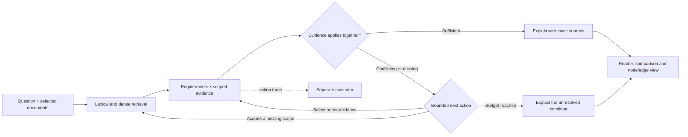

# Patent-to-Pilot master plan

**Effective 25 November 2026 · Organization complete · Implementation awaits a new owner goal.**

Build a Thai-first reader that explains a legal provision or patent claim, shows the source of each condition and lets a reader see which conclusions change when the edition or claim changes. Study the same engine under a fixed search budget. Its hardest case is a plausible explanation assembled from real passages that refer to different editions, tables or embodiments.

A reader comparing two laws should be able to see *which exception changes the answer and on which date*. A Thai reader comparing two English patents should be able to see *what claim 7 inherits from claim 1, what it adds, and whether the two proposed features occur together*. Returning the right PDF alone cannot answer either question.

## Status and dispatch board

Each row has one execution sheet with stable task IDs. Phase numbers express dependencies. S1 and S2 can start in the same session. S3 and S4 can subsequently proceed independently. Keep this table and the task dispositions and receipt links in each phase sheet current when work resumes. Preserve prior evidence under its original identifiers.

| Phase | Workstream and outcome | Starts after | State | Completion evidence or next action |
|---|---|---|---|---|
| [S0 · Organization](00-organization.md) | Governance, baseline inventory, prospective freeze, documentation and handoff | Owner direction | **COMPLETE** | This package and the S0 acceptance record |
| [S1 · Research data](01-research-data.md) | Authorized input manifests, family isolation, three-state fixtures, comparator design | S0 and a new execution goal | **NOT_STARTED** | Pin eligible bytes and fixture assignments before scores |
| [S2 · Product workbench](02-product-workbench.md) | An end-to-end Thai-law and English-patent reading path using one shared contract | S0 and a new execution goal | **NOT_STARTED** | Start on shareable examples and existing Workbench |
| [S3 · Research evaluation](03-research-evaluation.md) | Matched DEV experiment, error attribution and independent result labels | S1 | **NOT_STARTED** | Use the shared contract and frozen fixtures. A polished UI is optional |
| [S4 · Product validation](04-product-release.md) | Reproducible local alpha, rights, installation and usability evidence | S2 | **NOT_STARTED** | Validate both demonstrations independently of S3 scores |
| [S5 · Synthesis and handoff](05-synthesis.md) | Research package, IS2 narrative and product release decision | Either finished lane for its own draft; both dispositions for closure | **NOT_STARTED** | Publish only evidence that each track actually obtained |

The [prospective freeze](FREEZE.md) governs S1 and S3. The new primary is controlled Thai DEV scope-complete success under a maximum of four retrieval actions and eight returned evidence units. English patent transfer is reported separately. Global patent-family retrieval remains a distinct benchmark objective. It fixes the questions, dataset roles, comparison and decision design. S1 will produce the immutable file lists, revisions and hashes for any new inputs. The [historical P0–P5 board](../tracking/owner-note-22112026/PHASE_BOARD.md) retains its 35 original tasks and their outcomes. The [handoff](../../HANDOFF.md) records the next writer, last verified checkpoint and accounting context.

## What both tracks implement

Model the **question**, the **document scope** and the **retrieval trace** separately. Legal scope can depend on an instrument, provision, effective date, exception or incorporated schedule. Patent scope can depend on a publication, a claim's dependency path or an explicitly identified embodiment. A parser records the available scope and preserves unknown values. A missing embodiment identifier cannot justify combining two examples.

| Shared record or operation | Contract between research and Workbench |
|---|---|
| Requirement | A stable ID and an explicit condition, with its original-language text. Keep Thai explanations alongside the English patent source. |
| Evidence | Source ID, revision, content digest, exact locator and excerpt. Store the applicable scope and its provenance. A verified quote establishes text identity; semantic support needs a separate decision. |
| Relation | Typed endpoints, source span, explicit or inferred origin and uncertainty. Examples include “inherits”, “takes effect”, “excepts” and “supports”. Only inspectable edges enter the reader's evidence view. |
| Retrieval state | A requirement-by-evidence table retaining missing, supported, conflicting and scope-incompatible items. Preserve the original ranking for comparison. |
| Action | Keep or rerank the current pool, run a bounded search for the missing scope, or stop and qualify the answer. Store action, affected candidates, cost and reason. |
| Output | Plain Thai explanation, cited original text, changed and stable conclusions and an exportable trace. Node/edge rendering is a view of that trace. |

The prototype starts with one local agent and a deterministic policy. Skill optimization edits task instructions. Harness optimization selects from versioned retrieval, allocation and stopping rules. An optimizer cannot edit the evaluator, source permissions or budget ledger. A benchmark adapter and the Workbench should consume the same trace schema. Keep the product fixtures and research score fixtures in separate families.

## Closest alternatives and the claim worth testing

| Evidence | Implication for design |
|---|---|
| [FinDeCrowd-RAG](https://arxiv.org/abs/2609.35782) corrects scope-induced displacement within a candidate pool. [MAP-Law](https://arxiv.org/abs/2605.01486) uses evidence coverage to control another search. | Compare against both capabilities combined with equal opportunity to search. Test what happens when the right passage is absent from the initial pool. |
| [Conjunctive cross-page retrieval](https://arxiv.org/abs/2607.24165) studies documents satisfying every requested condition. [FiNE-Patents](https://arxiv.org/abs/2605.02392) studies feature evidence within supplied prior art. | Include cases with all terms present but incompatible scopes, plus valid cross-page evidence. Distinguish global discovery from locating evidence in a supplied document. |
| [SkillOpt](https://arxiv.org/abs/2605.23904) learns editable skills. [SkillOpt-Lite and HarnessOpt](https://github.com/EvolvingLMMs-Lab/SkillOpt-Lite) can edit execution routines. | Retain skill-only, harness-only and joint variants. Budget the search for a policy as well as inference. Select on permitted development inputs. |
| [FourCorners](https://aclanthology.org/2026.acl-demo.46/) supports version-aware legal reading. [Thanoy](https://thanoy.ai/mcp) and [Thai Legal](https://legaltech.in.th/docs) provide legal search with sources. [DIP](https://search.ipthailand.go.th/invention-patent) and [PATENTSCOPE](https://www.wipo.int/en/web/patentscope) provide patent discovery. | Compare concrete reader tasks, including opening the passage responsible for a changed answer. Published feature descriptions do not establish comparative accuracy, market demand or willingness to pay. |
| [LightRAG](https://github.com/HKUDS/LightRAG) offers a reference for a locally accessible interface and graph exploration. | Target a simple first run. Compare on the same licensed documents and questions where accessible; record indexing and query costs separately. |

The closest-work search was conducted in SciSpace. Inspect the paper records for [FinDeCrowd](https://scispace.com/papers/financial-evidence-crowding-diagnosing-and-mitigating-7p927nwzciku), [MAP-Law](https://scispace.com/papers/map-law-coverage-driven-retrieval-control-for-multi-turn-bo0fkeuz3qvy), [conjunctive retrieval](https://scispace.com/papers/do-current-retrievers-cover-all-the-evidence-a-controlled-lzmup7t3rho7) and [FiNE-Patents](https://scispace.com/papers/is-it-novel-and-why-fine-grained-patent-novelty-prediction-n20ovv4rr4r0). This targeted comparison motivates a falsifiable test. It establishes no priority claim.

## Delivery and evidence gates

- A lane advances with its smallest inspectable artifact. A hand-checkable synthetic example can unlock engineering. A local demonstration can ship as an alpha under its documented rights and limits, including when a research arm fails. Real-user or commercial impact remains unmeasured until observed.
- S3 can close with a positive, mixed, null, negative or diagnostic result. A positive paired primary DEV estimate permits one bounded follow-up under the freeze. Stronger claims require a matched comparison, uncertainty and the documented independent evidence for the claim. A legacy P2 score win still has its own original criterion. Q1 is a publication ambition.
- Protected TEST stays closed. Keep unjudged material unknown. Maintain family isolation, licenses, source provenance and separate research and redistribution rights. DAPFAM and PatEmbed are research-only. Demo distribution needs an affirmative source-by-source rights record.
- The owner authorizes in-scope installs and dataset downloads for this direction. The organization-only checkpoint performed neither. When execution is activated, record source, version, license, intended use and digest. Third-party gated terms, new expenditure or unclear redistribution rights remain separate decisions. Historical R1/R2/E1R balances cannot be reassigned to new tasks by this plan.
- A solo maintainer can run either lane sequentially or delegate disjoint files. Record the writer and jobs in HANDOFF. Keep one contract owner. A research finding can change a later product policy only through a versioned change and product regression check.

## Prompt for the next goal

Use on the owner’s next activation. For a bounded first goal, complete S1 and S2 and then hand off the resulting evidence.

> GPT 6.2 high: Execute S1 and S2 of the Patent-to-Pilot master plan in parallel. Read CLAUDE.md, HANDOFF.md, docs/evidence-scope/MASTER-PLAN.md, docs/evidence-scope/FREEZE.md, docs/evidence-scope/01-research-data.md and docs/evidence-scope/02-product-workbench.md first. Verify git status, recent commits and writer ownership. Research owns permitted inputs, rights, splits and three-state fixtures. Product owns the existing Workbench, Thai legal and English patent demonstrations and trace rendering. Agree on one trace contract. Use the owner's in-scope install/download approval and record exact versions, rights and hashes. Never open protected TEST, credential files or keys. Obtain the required pod approval, quote its price first and stay inside a recorded envelope. Follow the dr-train memory rules if used. Keep all scores behind their protocol freeze. Capture negative or partial results honestly. Update phase tasks, the master board, HANDOFF and the tracker at material events, commit only explicit owned paths, verify and publish. Report in Thai with per-lane evidence, costs, blockers and the next eligible phase. Stop after S1/S2 dispositions; S3/S4 belong to the next dispatch.
