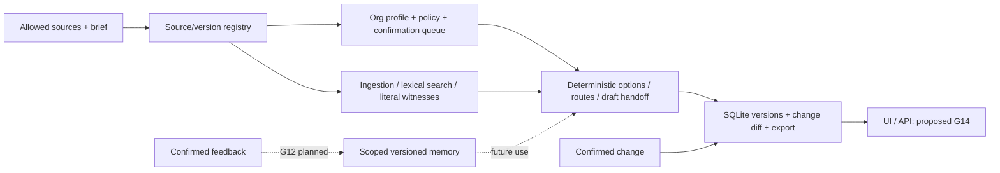

# Patent-to-Pilot — Master Plan และ Claude UX/UI Handoff

**As of:** 26 ตุลาคม 2026 UTC · **เอกสารนี้:** working delivery plan + product handoff · **Live inference:** NOT_RUN

เอกสารนี้อธิบาย G01–G22 ตาม GOAL.md โดยไม่เปลี่ยนเลข milestone หรือ frozen evaluation ใช้ทั้งเป็นแผนของเจ้าของและ brief ให้ Claude สร้าง UX/UI ส่วน Claude handoff รวมอยู่ท้ายไฟล์เดียวกันเพื่อไม่ให้สถานะและ user stories แตกเป็นหลายฉบับ ข้อเสนอ API/screen ที่ยังไม่มี implementation จะระบุว่า “เสนอ” เสมอ

## 1. สรุปสำหรับเจ้าของ

Patent-to-Pilot คือ **Organization-Adaptive R&D Agent**: ผู้ใช้ให้โจทย์และเอกสารองค์กรที่อนุญาต ระบบช่วยจัดหลักฐานจากสิทธิบัตร/งานวิจัย เปรียบเทียบแนวทางพัฒนา ร่างแผนทดสอบและชุดส่งต่องาน แล้วแสดงว่าส่วนใดต้องแก้เมื่อกฎองค์กรหรือหลักฐานเปลี่ยน เป้าหมายคือให้นักวิจัยและผู้ทบทวนทำงานต่อได้ง่ายขึ้น ประโยชน์ด้านเวลา คุณภาพ และต้นทุนยังต้องวัด ไม่ใช่ผลที่พิสูจน์แล้ว

**มีแล้ว:** product/research contract, bounded dataset, fictional organization profiles 3 ชุด, typed records/SQLite, streaming ingestion/lexical retrieval, deterministic extraction, workflow/revision รายกรณี, static reports, bounded adaptation, provider/ledger/dispatcher และ explicit .env loader ที่ทดสอบ offline

**ยังไม่มี:** web product/FastAPI, semantic agent ที่ผ่าน live smoke, full fair multi-method benchmark, product learning memory ข้ามโครงการ, held-out results, validated clinical/legal/manufacturing conclusions หรือ manuscript results

**งานต่อระหว่างรอ key:** Claude ทำ G14 UI prototype จาก handoff นี้ได้ทันทีด้วย public/fictional fixtures ขณะ agent เตรียม DTO/API contract และ scenario test plan แบบ offline ใน task ที่อนุมัติต่อไป ไม่จำเป็นต้องรอ API key เพื่อออกแบบหน้าจอ แต่ห้ามวาดผล live ที่ไม่มีอยู่

คำว่า “bounded slice เสร็จ” หมายถึงขอบเขตที่ส่งมอบและตรวจแล้ว ไม่เท่ากับทั้ง goal เสร็จ และการผ่าน tests ไม่ใช่หลักฐานว่าระบบช่วยวิจัยได้ดีกว่า baseline

## 2. ภาพงานตั้งแต่ต้นจนจบ

```text
โจทย์ R&D + ขอบเขตข้อมูลที่อนุญาต
  → organization capability/policy map พร้อม source และสิ่งที่ต้องยืนยัน
  → ค้น/คัด patent-research evidence และแยกบทบาทวัสดุ/ตัวเลข/เงื่อนไข
  → opportunity cards และ route comparison
  → draft proposed tests + feasibility questions + R&D/RA/Clinical Research handoff
  → technical ready_for_review → คนทบทวน (คนละสถานะกับความพร้อมของเอกสาร)
  → confirmed change → affected/preserved fields → revision diff และ history
  → confirmed feedback ที่มี scope → memory รุ่นถัดไป [G12 ยังเป็นแผน]
```

ระบบไม่ใช่คลินิก/ระบบรักษาผู้ป่วย ไม่อนุมัติ safety, efficacy, regulatory compliance, patentability, freedom-to-operate (FTO) หรือการทดลองกับคน และไม่ใช่ e-commerce ของ Podi ทั้งสองโครงการแยกกัน



สถาปัตยกรรมที่มีจริงใช้ Python 3.12, Pydantic, JSON Schema และ SQLite/FTS5 ไม่ต้องเพิ่ม vector DB/framework ใหม่เพื่อทำ UI prototype ส่วน FastAPI/web และ durable app sessions ยังเป็นงาน G14/G15 ห้ามให้ frontend เรียก OpenRouter โดยตรงหรือถือ key เอง

### คำที่ควรเข้าใจร่วมกัน

| คำ | ความหมายในโครงการ |
|---|---|
| provenance / locator | ที่มาและตำแหน่งที่เปิดตรวจข้อความต้นฉบับได้ ไม่ใช่ชื่อ paper ลอย ๆ |
| basis | เป็น source assertion, fictional stipulation, interpretation หรือ unknown |
| supported | หลักฐาน/validator รองรับตาม contract ที่จำกัด ไม่ใช่รับรอง feasibility ทางวิทยาศาสตร์ |
| unknown / missing | input ปัจจุบันยังไม่พอ ไม่ใช่พิสูจน์ว่าไม่มีความสามารถหรือข้อมูลนั้นในโลก |
| revision | เปลี่ยนโครงการเดิมเมื่อเงื่อนไขใหม่มา ต้องรักษาประวัติและส่วนที่ไม่เกี่ยวข้อง |
| cross-project learning | ใช้ confirmed past feedback กับโครงการใหม่อย่างแยก scope; ยังไม่ใช่ความสามารถที่ปิดแล้ว |
| held-out / leakage | ชุดที่ไม่ใช้จูน และการป้องกันไม่ให้เฉลย/ข้อมูลอนาคตหลุดเข้าระบบ |
| readiness / approval | เอกสารพร้อมตรวจต่างจากคนรับรอง และต่างจากอนุมัติใช้เงินจริง |
| nominal estimate / reservation / actual debit | ตัวอย่างประมาณราคา / วงเงินที่กันก่อนส่ง / ยอดจริงที่ผู้ให้บริการรายงาน ห้ามสลับกัน |

## 3. วิธีอ่านสถานะและหลักฐาน

GOAL.md และ README.md เป็น roadmap snapshot วันที่ 24 ตุลาคม จึงยังมีคำว่า “เสนอ/ยังไม่มี” ในบางส่วนที่ได้ทำ bounded slice ต่อแล้ว เอกสารนี้เทียบกับ handoff และ code ที่ตรวจจริงถึง 26 ตุลาคม ไม่เขียนประวัติเดิมใหม่ ไม่อ้างว่าปิด full goal จากไฟล์มีอยู่เพียงอย่างเดียว

- **DOC/FRAMEWORK DONE:** ปิด deliverable เอกสาร/วิธีศึกษา ไม่ใช่ผลทดลอง
- **BOUNDED DONE:** มี implementation/fixture ตามขอบเขตที่ระบุ ยังมี full-goal gaps
- **PREPARATION READY / LIVE NOT_RUN:** เตรียมและ mock-tested แต่ยังไม่ทดสอบบริการจริง
- **PLANNED / CONDITIONAL:** มีเป้าหมายและ acceptance แต่ยังไม่มี runtime/result หรือยังไม่มีเหตุการณ์เริ่มงาน

หลักฐานสดรอบ .env: **71/71 tests ผ่าน** (ใหม่ 23 + dispatcher/provider/G11 เดิม 48) ปิด socket/DNS ในชุดทดสอบ ไม่มี inference calls ไม่มี actual .env ถูกอ่านหรือสร้าง ส่วน G04/G07/G08 ใช้ผล targeted handoff เดิม ไม่ rerun corpus/asset audit เพื่อเขียนแผนนี้

Source of truth สำหรับรายละเอียด: GOAL.md; docs/product/PRODUCT_CONTRACT.md; docs/product/USER_JOURNEYS.md; docs/research/G02_HANDOFF.md; docs/G03_DATA_ACQUISITION.md; methodology/evaluation/cases/G05_SLICE_A_HANDOFF.md; docs/handoff/LUNA_G04_G07_G08.md; docs/handoff/LUNA_G09_G10_INTEGRATION.md; docs/handoff/LUNA_G11.md; docs/research/PILOT_READINESS.md; docs/provider-pilot/verification.json; docs/provider-pilot/env-file-verification.json และ source paths ที่ระบุในแต่ละ goal

## 4. แผนทุก Goal: G01–G22

แต่ละข้อด้านล่างมีความหมายสำหรับผู้ใช้, dependencies/input/tasks/output/acceptance ตาม GOAL และสถานะจริงแยกต่างหาก Outputs ที่ระบุว่าเป็นแผนไม่ใช่การยืนยันว่ามีครบแล้ว ความเสี่ยงของแต่ละ goal ไม่ใช่ gate ให้รื้อ audit ทั้งระบบใหม่

### G01 — ล็อก product contract และ use cases ที่มีประโยชน์

ให้ผู้ใช้และคนสร้างระบบเห็นตรงกันว่าให้ข้อมูลอะไร ได้ artifact อะไร และอะไรต้องให้คนยืนยัน

- **สถานะที่ยืนยันได้:** `DOC_DONE` — Product contract และ acceptance journeys มีแล้ว รวม authored evidence→proposed test→handoff; ยังไม่ใช่ UI หรือหลักฐานประโยชน์จริง
- **พึ่งพา / input:** คำสั่งเจ้าของล่าสุดและเอกสารที่มี ไม่รอ dataset เต็มหรือ expert panel; Input: GOAL (`GOAL.md`), walkthrough (`docs/FIRST_CASE_WALKTHROUGH.md`), PLAN (`docs/PLAN.md`)
- **งานที่ต้องทำตาม GOAL:**
  1. ระบุ use cases หลัก: capability/policy mapping, opportunity discovery, route comparison, draft pilot/handoff, change impact และ feedback reuse
  2. ทำ user journey แบบรับเอกสาร → ตรวจ card → ทบทวน options → รับ pack → แจ้ง change พร้อมตัวอย่างของที่ต้องได้จริง
  3. แยกสิ่งที่ระบบเสนอได้ สิ่งที่ต้องถามยืนยัน และสิ่งที่อยู่นอก autonomous authority
- **ผลส่งมอบตามแผน:** `docs/product/PRODUCT_CONTRACT.md`, `docs/product/USER_JOURNEYS.md`
- **ปิด full goal เมื่อ:** มี workflow หลักและ acceptance journey ที่อ่านแล้วรู้ว่า input/output คืออะไร ไม่มีการทำ clinical/legal approval อัตโนมัติ Scope แรกเล็กพอส่งมอบได้และยังต่อยอดภาพใหญ่ได้
- **หลักฐาน/วิธีตรวจ:** walkthrough ด้วย authored example หนึ่งเส้นทาง บันทึกข้อไม่ชัดเป็น backlog ไม่บังคับให้ทุก future feature พร้อม
- **สิ่งที่ยังเหลือ:** นำ contract ไปทำ UI และตรวจ owner walkthrough; ไม่เปิด clinical/legal approval ให้ระบบ
- **ความเสี่ยง/ขอบเขต:** agent กลายเป็น chatbot กว้างแต่ไม่มี artifact; แก้ด้วย output contract
- **อ้างอิงสถานะ:** `docs/product/PRODUCT_CONTRACT.md`; `docs/product/USER_JOURNEYS.md`; criteria จาก `GOAL.md` G01


### G02 — Freeze literature/gap แบบมีขอบเขต

ทำให้โจทย์วิจัยตอบคำถามที่ต่างจากงานเดิมอย่างตรวจสอบได้ ไม่เริ่มจากการอ้างว่าของใหม่

- **สถานะที่ยืนยันได้:** `RESEARCH_FRAMEWORK_DONE` — ปิด planning deliverables: claim/evidence map, closest collisions และ RQ-R/RQ-L แยกกัน; novelty ยัง unresolved
- **พึ่งพา / input:** G01; ใช้ collection เดิมก่อน widening search; Input: manifest (`literature-review/manifest.json`), WPI review (`literature-review/notes/29_oltra_garcia_2018.md`), organization reading (`literature-review/notes/30-35_organization_profile_reading.md`), internal ledger (`literature-review/internal/PROVENANCE.md`)
- **งานที่ต้องทำตาม GOAL:**
  1. ใช้ gap matrix (`docs/RESEARCH_GAP_MATRIX.md`) เปรียบเทียบ adaptive search, patent workflows, context/memory และ minimal repair จาก methods ที่อ่านจริง
  2. แยก RQ ภายใน project: source/constraint-linked revision กับ RQ ข้ามงาน: confirmed-feedback adaptation บน later tasks
  3. Freeze claim/evidence table สำหรับ implementation รุ่นแรก ระบุ novel hypothesis, known prior work และ falsifier หากพบคู่แข่งใหม่ให้เพิ่มเฉพาะส่วนที่กระทบ claim
- **ผลส่งมอบตามแผน:** revision ของ `docs/RESEARCH_GAP_MATRIX.md`, `docs/product/CLAIM_EVIDENCE_MAP.md`
- **ปิด full goal เมื่อ:** ทุก candidate claim มี closest collision, ขอบเขต และ experiment ที่อาจหักล้างได้ ไม่มี first adaptive search/first organization memory claim
- **หลักฐาน/วิธีตรวจ:** scoped source review หนึ่งครั้งของข้ออ้างสำคัญพร้อม locators ไม่อ่านใหม่ทั้ง 35 papers เพื่อผ่าน G นี้
- **สิ่งที่ยังเหลือ:** ใช้ controls ที่กำหนดใน pilot; re-open เฉพาะ claim ที่ผล/หลักฐานใหม่กระทบ ไม่ค้นวรรณกรรมวนไม่จบ
- **ความเสี่ยง/ขอบเขต:** novelty ไม่พอสำหรับ algorithm paper; benchmark/empirical boundary อาจเป็น contribution ได้แต่ยังต้องมีผลจริง
- **อ้างอิงสถานะ:** `docs/research/G02_HANDOFF.md`; `docs/research/G02_RESEARCH_GAP_FREEZE.md`; `docs/product/CLAIM_EVIDENCE_MAP.md`; criteria จาก `GOAL.md` G02


### G03 — รับ datasets แบบจำกัด พร้อม provenance/rights/version

ให้มีข้อมูลจริงขนาดที่เครื่องรับไหว พร้อมสิทธิ์และที่มา ก่อนสร้างความสามารถต่อ

- **สถานะที่ยืนยันได้:** `BOUNDED_DATA_DONE_WITH_NOTES` — bounded batch 279,537,042 bytes; PLS 1,421 rows; Enterprise 39Q/39docs ปิด references และแยก evaluator; DAPFAM มี metadata/qrels/5-row samples ไม่ใช่ full corpus
- **พึ่งพา / input:** G01; มี task อนุญาต acquisition ที่ตรงกับ batch; Input: dataset inventory (`methodology/datasets/INVENTORY.md`), access notes (`methodology/datasets/metadata/organization-access-review.json`), pinned URLs/versions ใน GOAL
- **งานที่ต้องทำตาม GOAL:**
  1. รับ starter 5 files ตามตารางด้านบนจาก pinned source พร้อม license/readme snapshots เก็บ originals ไม่ overwrite ข้อมูลเก่า
  2. ตรวจ actual bytes/hash เทียบ upstream, parse CSV/JSONL แบบ streaming และรายงาน columns/counts/duplicates/missingness จริง อย่าเอา reported 1,421 มาอ้างว่า parse แล้ว
  3. คัด enterprise sample ที่รักษา expected-document closure และสร้าง manifest ของ subset; ถ้าไฟล์ที่เกี่ยวข้องไม่ครบให้ exclude หรือ mark incomplete
  4. Register core/optional/deferred/rejected status, acquisition state, research/product-use restrictions และเหตุผลขยาย corpus; สำรวจ DAPFAM domain slice ภายหลังเมื่อเลือก sampling plan
- **ผลส่งมอบตามแผน:** raw/normalized/samples ตาม directory map, `methodology/datasets/acquisition-registry.json`, อัปเดต download manifest/inventory
- **ปิด full goal เมื่อ:** starter files ที่ใช้จริงอ่านได้ มีสิทธิ์/รุ่น/provenance ชัด linked sample ปิดครบ หรือมี exclusion ที่ทำให้ใช้ subset ที่เหลือต่อได้ ไม่มี GB download ที่ไม่จำเป็น
- **หลักฐาน/วิธีตรวจ:** one ingestion/schema/sample-closure check พร้อม intentionally missing reference case; asset integrity เฉพาะไฟล์ที่รับใหม่
- **สิ่งที่ยังเหลือ:** เลือก corpus ให้ตรงงานและสิทธิ์; 1,421 rows ไม่เท่ากับ independent families—pilot-next บันทึก 1,290 normalized PLS keys/131 overlaps แต่ family equivalence ยัง tentative
- **ความเสี่ยง/ขอบเขต:** LFS pointer แทน payload, text enrichment/rights, RAM spike, release mismatch
- **อ้างอิงสถานะ:** `docs/G03_DATA_ACQUISITION.md`; `data/manifests/g03-acquisition-receipt.json`; `data/README.md`; criteria จาก `GOAL.md` G03


### G04 — สร้าง source-linked organization capability/policy map

ให้เห็นว่าองค์กรทำอะไรเอง จ้างอะไร และเรื่องใดยังไม่รู้ ก่อนเลือกเส้นทาง R&D

- **สถานะที่ยืนยันได้:** `BOUNDED_PROFILE_FIXTURES_DONE` — มี fictional profiles A/B/C v1 พร้อม policy/source-map/confirmation queue; ยังไม่ใช่ general org extractor หรือ validated real organization cards
- **พึ่งพา / input:** G01, source access ของ G03; schema design ทำร่วม G07; Input: organization example (`methodology/datasets/organization-profile-example.json`), allowed enterprise documents, owner-approved brief เมื่อมี
- **งานที่ต้องทำตาม GOAL:**
  1. กำหนด capability/policy schema: owned/external/unknown, source assertion, confidence/ambiguity, effective date และ confirmation state
  2. สร้าง fictional profiles เริ่มต้น 3 แบบที่มีข้อจำกัดต่างกัน โดยประกาศทุก stipulation แยกจาก public source descriptions ไม่อ้าง NCATS เป็นลูกค้าหรือรับรอง availability
  3. จัด confirmation queue เฉพาะ critical interpretations เช่น “มีเครื่องเอง” เทียบ “ร่วมงานกับผู้ให้บริการ” และ source conflict ไม่ให้เจ้าของตรวจทุก extracted token
  4. เก็บ policy changes พร้อมรุ่นและขอบเขต; model/feedback ไม่มีสิทธิ์เปลี่ยน hard constraints เอง
- **ผลส่งมอบตามแผน:** `methodology/organizations/<org-id>/<version>/profile.json`, `policy.json`, `source-map.json`, `confirmation-queue.md`
- **ปิด full goal เมื่อ:** critical capability/policy fields มี source หรือ stipulation ชัด unknown ไม่ถูกเติมเอง และได้ profiles ที่พอสร้าง distinct tasks โดยไม่อ้าง validated real org pairing
- **หลักฐาน/วิธีตรวจ:** source-to-field checks, owned-vs-partner trap, stale-policy/conflicting-policy fixture; interpretation ที่ไม่มี oracle แยกจากคะแนนหลัก
- **สิ่งที่ยังเหลือ:** เพิ่ม approved real-source mapping เมื่อมีข้อมูลที่อนุญาต; critical interpretation ต้องมี confirmation และห้ามตีความ public expertise เป็น production capacity
- **ความเสี่ยง/ขอบเขต:** public expertise ถูกตีเป็นพร้อมผลิต/พร้อมรับงานปัจจุบัน
- **อ้างอิงสถานะ:** `docs/handoff/LUNA_G04_G07_G08.md`; `methodology/organizations/`; criteria จาก `GOAL.md` G04


### G05 — สร้าง source-backed development cases ที่มีงานให้ระบบทำจริง

ทำให้โจทย์มีหลายชนิดข้อผิดพลาดจริง ไม่ใช่แค่สลับชื่อวัสดุในเคสเดียว

- **สถานะที่ยืนยันได้:** `DEVELOPMENT_CASE_SLICE_DONE_WITH_NOTES` — PTP-0001–0003 เป็น 3 development source units; Slice A เพิ่ม role/count/cost traps; PN-D01/PN-D03 เป็นอีก 2 prepared fixtures ไม่ใช่ held-out results หรือ 5 independent families ที่พิสูจน์แล้ว
- **พึ่งพา / input:** G02–G04 บางส่วน; เริ่มเพิ่มทีละ independent source/family group ได้; Input: case template (`methodology/evaluation/CASE_TEMPLATE.json`), PTP-0001 (`methodology/evaluation/cases/PTP-0001/README.md`), selected real sources
- **งานที่ต้องทำตาม GOAL:**
  1. ใช้ PTP-0001 ต่อ เลือก case ถัดไปจาก coverage จริง แยก topic, source family, base brief และ change events
  2. แบ่ง checked-fact bookkeeping, open-text extraction/fixed-source revision และ adaptive-search packets ที่มี verified distractors/recoverable evidence
  3. เขียน hidden allowed states/expected changes เฉพาะ explicit checks พร้อม positive และ deliberately wrong fixtures ข้อ science/legal interpretation ที่ตรวจไม่ได้คง unknown
  4. ประกอบกับ fictional org profiles อย่างประกาศชัด ไม่ให้ agent ได้ gold tuples/dependency graph ใน open-text track
- **ผลส่งมอบตามแผน:** case directories ถัดไปใน `methodology/evaluation/cases/`, case manifest, exclusion/coverage notes
- **ปิด full goal เมื่อ:** development pack ที่เลือกมี witness/contract/negative fixture ใช้งานได้ และ case diversity พอ calibration เป้าหมาย 10 เป็นขนาดงานเริ่มต้น หาก source ไม่พอให้ปรับพร้อมเหตุผล ไม่แต่ง facts ให้ครบจำนวน
- **หลักฐาน/วิธีตรวจ:** source witness และ negative fixture ต่อชนิดความผิดหลัก; ไม่ใช้ arbitrary test count เป็นเกณฑ์ผ่าน
- **สิ่งที่ยังเหลือ:** ขยาย independent source/task coverage ตามข้อมูลจริง; 7 candidates+4 reserves เป็น proposal ไม่ใช่ completed cases และห้ามแต่ง facts ให้ครบสิบ
- **ความเสี่ยง/ขอบเขต:** toy rules task หรือ role/value oracle ที่มาจาก model โดยไม่ตรวจ
- **อ้างอิงสถานะ:** `methodology/evaluation/cases/G05_SLICE_A_HANDOFF.md`; `docs/research/pilot-next/README.md`; `docs/research/pilot-next/packets/HANDOFF.md`; criteria จาก `GOAL.md` G05


### G06 — แยก splits และ freeze evaluation contract

กันระบบเห็นเฉลยหรือข้อมูลอนาคต และกัน variants ของเคสเดียวถูกนับเป็นตัวอย่างอิสระ

- **สถานะที่ยืนยันได้:** `DEV_CONTRACT_DONE_WITH_NOTES` — มี dev assignments, grouping/visibility/core/feedback contracts; validation/test/held-out-org ยังไม่เป็น final freeze
- **พึ่งพา / input:** G02/G05; frozen final settings ทำหลัง G13 calibration; Input: protocol (`methodology/evaluation/PROTOCOL.md`), case manifest, org profiles
- **งานที่ต้องทำตาม GOAL:**
  1. แยก family/base brief/template ก่อน variants และเก็บ connected groups ที่แชร์ source ใช้ทำ split/resampling
  2. กำหนด dev/validation/final test, held-out organization track หากจะอ้าง cross-org transfer และ chronological feedback schedule
  3. ระบุ visible input contract, forbidden evaluator paths, allowed online memory updates และ contamination/reset policy
  4. Freeze endpoints/metric denominators/comparisons/stopping rules ก่อน final outputs ไม่เปลี่ยน threshold ตามผลที่ชอบ
- **ผลส่งมอบตามแผน:** `methodology/evaluation/splits/`, `methodology/evaluation/longitudinal/`, protocol revision พร้อม freeze record
- **ปิด full goal เมื่อ:** trace ได้ว่าแต่ละ base group/organization/variant อยู่ไหน ระบบไม่เห็น hidden/future information และแยก frozen global configuration จาก permitted online memory ได้
- **หลักฐาน/วิธีตรวจ:** leakage assertions ของ IDs/template/families และ packet visibility; task ที่มี shared sources จัดกลุ่มหรือเปิดเผย exception
- **สิ่งที่ยังเหลือ:** final freeze หลัง coverage/calibration; แยก future feedback, family/template/org groups และ past-memory ที่อนุญาต; exposed dev ห้ามเรียก untouched test
- **ความเสี่ยง/ขอบเขต:** variants ถูกนับเป็น samples อิสระ; feedback ในอนาคตรั่วสู่ prompt
- **อ้างอิงสถานะ:** `methodology/evaluation/splits/G06_DEV_CONTRACT.md`; `methodology/evaluation/splits/G06_CORE_INTERFACE.md`; `methodology/evaluation/longitudinal/G06_FEEDBACK_CONTRACT.md`; criteria จาก `GOAL.md` G06


### G07 — วาง stack/environment และ typed core

ทำให้ backend/runner/UI พูดด้วย record และ version ชุดเดียวกัน

- **สถานะที่ยืนยันได้:** `BOUNDED_TYPED_CORE_DONE` — มี Pydantic records, immutable canonical IDs, SQLite append-only versions/latest/history และ mock provider; provider HTTP/ledger/dispatcher เพิ่มแล้วแบบ offline-tested แต่ยังไม่มี FastAPI/web
- **พึ่งพา / input:** G01/G04 และ implementation task ภายหลัง; Input: GOAL architecture, tool registry (`docs/TOOLING_REGISTRY.md`), task schemas
- **งานที่ต้องทำตาม GOAL:**
  1. ตั้ง project-local environment/lockfiles ตาม stack หลัก ตรวจ versions ที่รองรับจริงโดยไม่แก้ global tooling
  2. สร้าง typed models/DB migrations สำหรับ sources, org cards, constraints, routes, evidence, changes, feedback และ run accounting
  3. กำหนด state machine/checkpoint และ provider interface ที่ mock ได้ก่อนต่อ paid API
  4. บันทึก ADR เฉพาะการตัดสินใจสำคัญ: SQLite concurrency, corpus/index separation, model boundary และ privacy
- **ผลส่งมอบตามแผน:** `src/patent_to_pilot/`, `configs/`, `docs/architecture/`, Python/Node lockfiles
- **ปิด full goal เมื่อ:** import/core serialization/DB round trip และ mocked provider path ทำงานได้ ไม่มี requirement ให้ติดตั้งทุก optional framework
- **หลักฐาน/วิธีตรวจ:** unit tests ของ states/IDs/version history และ migration rollback/recovery ตามความเสี่ยง; no live paid calls
- **สิ่งที่ยังเหลือ:** ทำ DTO/API adapter และ durable app session ตาม G14; ไม่เพิ่ม optional framework ทั้งชุดหรืออ้าง migrations/recovery เกินที่ทดสอบ
- **ความเสี่ยง/ขอบเขต:** framework มากเกินงาน; SQLite concurrency ใช้ผิด
- **อ้างอิงสถานะ:** `src/patent_to_pilot/core/models.py`; `src/patent_to_pilot/core/repository.py`; `docs/architecture/ADR-0001-bounded-core-and-local-search.md`; `pyproject.toml`; criteria จาก `GOAL.md` G07


### G08 — ทำ ingestion, retrieval และ role-aware extraction

ให้ค้นและเปิดหลักฐานกลับได้ โดยรักษา source version และ text offsets

- **สถานะที่ยืนยันได้:** `BOUNDED_LOCAL_PIPELINE_DONE` — มี atomic streaming PLS→JSONL, FTS5 lexical search/source-label filters และ literal span extractor; model extraction disabled; ยังไม่มี semantic extraction/full corpus indexing และ G09 packet slice ไม่ได้ exercise ingestion/FTS
- **พึ่งพา / input:** G03/G07; เริ่มจาก small selected corpus; Input: pinned raw data, dev cases, organization docs ที่อนุญาต
- **งานที่ต้องทำตาม GOAL:**
  1. Normalize documents/passages โดยคง originals, publication/family/date fields และ extraction version; deduplicate family อย่างตรวจได้
  2. ทำ BM25 baseline และ deterministic filters ตาม allowed corpus/current source version แยก initial candidate exposure จาก reranking/final selection
  3. ทำ lexical/component-window extraction comparator และ one-pass structured extractor interface ให้ budget เดียวกับ proposed path
  4. Source/locator checks และ unknown/conflict handling ก่อนส่ง facts ไปใช้ downstream; embeddings เป็น optional measured addition
- **ผลส่งมอบตามแผน:** normalized Parquet, local FTS index, `src/patent_to_pilot/ingestion/`, `retrieval/`, `extraction/`, extraction diagnostic report
- **ปิด full goal เมื่อ:** selected documents ค้น/อ่านได้ facts มี witness ที่ resolve ได้ และ role confusion ถูกจับแยกจาก policy logic ไม่มีข้ออ้าง semantic correctness จาก substring อย่างเดียว
- **หลักฐาน/วิธีตรวจ:** known ID recovery, material-role trap, duplicate family/date trap, missing evidence; size/RAM checks เฉพาะ pipeline ที่ใช้
- **สิ่งที่ยังเหลือ:** เชื่อม selected-corpus retrieval เข้ากับ workflow เฉพาะเมื่อมี task; แยก integrity/span match จาก semantic support ไม่ใช้ substring แทน scientific truth
- **ความเสี่ยง/ขอบเขต:** parser normalization ทำ offset เสีย, earliest metadata ปน latest consolidated text
- **อ้างอิงสถานะ:** `src/patent_to_pilot/ingestion/pls.py`; `src/patent_to_pilot/retrieval/fts.py`; `src/patent_to_pilot/extraction/interfaces.py`; `docs/handoff/LUNA_G04_G07_G08.md`; criteria จาก `GOAL.md` G08


### G09 — ส่งมอบ draft opportunity → route → pilot/handoff แบบฐาน

ให้ผู้ใช้ได้ draft pack ที่ตรวจและส่งต่อได้ แม้ยังไม่ได้พิสูจน์วิธี adaptive

- **สถานะที่ยืนยันได้:** `BOUNDED_WORKFLOW_DONE_FULL_GOAL_OPEN` — มี deterministic integration/static JSON-MD-HTML: 3 cases/15 states และ generic new-input path 2 states/1 change; factual role/value guards และ SQLite readback; ไม่ใช่ semantic end-to-end generator
- **พึ่งพา / input:** G01/G04/G07/G08; Input: approved/fictional card ตาม track, evidence ledger, brief, output schema
- **งานที่ต้องทำตาม GOAL:**
  1. สร้าง opportunity shortlist ที่ผูกโจทย์/แหล่งข้อมูล ไม่สรุป patent claim เป็น proven effect
  2. ทำ route comparison: declared capabilities, explicit fit, source support, contradictions, unknowns, proposed measurements และ follow-up evidence
  3. Generate draft feasibility/pilot plan และ handoff templates สำหรับ R&D/RA/Clinical Research พร้อม jurisdiction/source/date เมื่อมี regulatory reference
  4. Export structured JSON + readable Markdown ก่อนเพิ่ม document formats ที่ยังไม่จำเป็น; แสดง assumptions/status ทุก pack
- **ผลส่งมอบตามแผน:** `artifacts/<project-id>/<revision>/` ที่มี brief/card/options/route/pilot/evidence/open-questions/handoff
- **ปิด full goal เมื่อ:** เดิน main journey จาก permitted input ถึง draft pack ได้ ผู้ใช้ trace ตัวเลือกและคำถามค้างได้ ไม่ต้องรับรองว่าทดลองจริงแล้วได้ผล
- **หลักฐาน/วิธีตรวจ:** mocked offline E2E pack และ traceability/unknown checks; live generation ใช้เมื่อมี paid/free run authorization ที่ตรงกัน
- **สิ่งที่ยังเหลือ:** เชื่อม UI/API, source retrieval และ draft generation ที่จำกัดอย่างโปร่งใส; handoff บทบาทจริงยังต้องละเอียดขึ้นและ live compatibility ยังไม่ทดสอบ
- **ความเสี่ยง/ขอบเขต:** format ครบแต่เนื้อหาว่าง; ให้แยก schema completeness จาก evidence coverage
- **อ้างอิงสถานะ:** `docs/handoff/LUNA_G09_G10_INTEGRATION.md`; `src/patent_to_pilot/integration/pipeline.py`; `scripts/run_g09_g10_workflow.py`; `configs/g09-g10-example-input.json`; criteria จาก `GOAL.md` G09


### G10 — ทำ baseline/evaluation runner ที่ยุติธรรม

ให้เปรียบเทียบกับวิธีง่ายอย่างยุติธรรมและนับต้นทุนความผิดพลาดด้วย

- **สถานะที่ยืนยันได้:** `BOUNDED_RUNNER_DONE_WITH_NOTES` — DevelopmentEvaluator แยกจาก AgentPacket; actual assertions/reports มีแล้ว แต่ยังไม่มี full B0–B4/proposed multi-method execution หรือ src/patent_to_pilot/evaluation/ ที่เป็น main runner
- **พึ่งพา / input:** G06–G09 บน dev cases; Input: baseline matrix (`methodology/evaluation/PROTOCOL.md`), staged dev packets, provider mocks
- **งานที่ต้องทำตาม GOAL:**
  1. Implement B0/B1/B2/B3/B4-RG/P interface เดียวกัน พร้อม B4-DR diagnostic เมื่อ budget รองรับ
  2. B4 ทบทวน what/where/how จาก intermediate results และ bounded alternatives จริง เป็น implementation interpretation ของ WPI ไม่เรียก exact reproduction
  3. แจก facts/extraction opportunity/schema/validators เท่ากัน จำกัด candidate/tool/token budget และบันทึก consumption จริง
  4. ทำ isolated packet staging ไม่ให้ methods อ่าน source archive/oracle ที่ถอนหรือซ่อนอยู่ และ cost ledger รวม failed runs/retries
- **ผลส่งมอบตามแผน:** `src/patent_to_pilot/evaluation/`, `configs/runs/`, `results/development/<run-id>/`
- **ปิด full goal เมื่อ:** runner รัน methods ที่กำหนดบน packet เดียวกันได้พร้อม raw outputs/checks/costs และ deterministic baseline ผ่าน fixture ที่ควรทำได้
- **หลักฐาน/วิธีตรวจ:** intentionally failing method/timeout/cost inclusion, oracle access denial, same-input contract; ไม่เรียก paid benchmark เพื่อทดสอบ runner ธรรมดา
- **สิ่งที่ยังเหลือ:** implement fair staged methods ด้วย evidence/links/validators/history/budget เท่ากัน; รวม failed attempts, repair, retrieval/reflection/optimizer overhead ตาม track
- **ความเสี่ยง/ขอบเขต:** proposed ได้ข้อมูล/guard มากกว่า baseline; budget ถูกนับแต่ generation calls
- **อ้างอิงสถานะ:** `docs/research/PILOT_READINESS.md`; `docs/research/pilot-next/BASELINE_METRIC_CONTRACT.md`; `docs/handoff/LUNA_G09_G10_INTEGRATION.md`; criteria จาก `GOAL.md` G10


### G11 — เพิ่ม dependency-guided project adaptation

ให้รู้ว่าเงื่อนไขใหม่กระทบอะไรและเห็นว่าข้อมูลส่วนที่ยังใช้ได้ไม่ถูกเขียนทับ

- **สถานะที่ยืนยันได้:** `BOUNDED_ADAPTATION_DONE_WITH_NOTES` — มี explicit-ID dependency graph, impact/preservation, revision readback และ full-vs-scoped comparison; strategy เป็น full_generator_then_scoped_merge—recompute จริงยังเต็ม ไม่ได้พิสูจน์ minimality หรือความเร็วที่เหนือกว่า
- **พึ่งพา / input:** G07–G10; Input: current project state, explicit change event, allowed sources, typed records
- **งานที่ต้องทำตาม GOAL:**
  1. สร้าง dependencies จาก observable inputs และ generated artifacts พร้อม uncertainty ไม่ใช้ hidden gold graph
  2. เมื่อมี policy/capability/source/result change ให้หา affected nodes, invalidate derived fields, retrieve/ask for missing evidence ใน budget แล้ว revise downstream packs
  3. เก็บ source/version history และ diff; facts ไม่เปลี่ยนตามความชอบ ให้ unknown/conflict เมื่อ support ไม่พอ
  4. เปรียบเทียบ deterministic invalidation+same generator โดยตรง และรองรับ no-links/no-gap-retrieval/no-version ablations
- **ผลส่งมอบตามแผน:** `src/patent_to_pilot/adaptation/`, versioned impact map/revision trace/diff ใน artifacts/results
- **ปิด full goal เมื่อ:** explicit affected fields อัปเดตได้ unaffected fields คงอยู่ตาม contract และเห็น why/which evidence ของ revision หาก graph uncertain ให้ widen bounded repair/unknown อย่างเปิดเผย
- **หลักฐาน/วิธีตรวจ:** source withdrawal ≠ material ban, no-op preservation, source replacement, contradictory evidence และ missing results fixtures
- **สิ่งที่ยังเหลือ:** ขยาย artifact/dependency coverage และเปรียบเทียบ deterministic invalidation+same generator; graph ไม่ครบให้ widen/unknown และห้ามอ้างว่าประหยัด recomputation จาก label selective
- **ความเสี่ยง/ขอบเขต:** incomplete runtime graph ทำให้ missed update; “minimal” ถูกอ้างโดยไม่มี proof ให้ใช้ bounded/targeted ตามสิ่งที่ทำได้
- **อ้างอิงสถานะ:** `src/patent_to_pilot/adaptation/models.py`; `src/patent_to_pilot/adaptation/engine.py`; `docs/handoff/LUNA_G11.md`; criteria จาก `GOAL.md` G11


### G12 — เรียนรู้จาก confirmed feedback แบบจำกัดขอบเขต

ให้ประสบการณ์ที่ยืนยันแล้วช่วยงานใหม่ขององค์กรเดียวกัน โดยไม่เอา facts เก่ามาปนงานใหม่

- **สถานะที่ยืนยันได้:** `PLANNED_NOT_IMPLEMENTED` — มี FeedbackRecord และ research memory notes แต่ยังไม่มี product memory runtime ใน src/patent_to_pilot/memory/ หรือผล cross-project learning
- **พึ่งพา / input:** G04/G06/G07/G10; revision tools ของ G11 ใช้ร่วมได้; Input: confirmed past feedback, org/task scope, memory protocol (`docs/MEMORY_PROTOCOL.md`), chronological schedule
- **งานที่ต้องทำตาม GOAL:**
  1. แยก organization preferences, confirmed capabilities/policies, reusable procedures และ experimental/source facts พร้อม scope/date/version
  2. รับ feedback ที่ผู้มีอำนาจหรือ task schedule ยืนยันแล้ว เก็บ provenance; model self-critique ยังเป็น hypothesis ไม่เป็น confirmed feedback เอง
  3. ทำ explicit memory read/write, stale/conflict detection, rollback และ reset ระหว่าง independent organizations ไม่เปิด transcript capture/global profile
  4. เตรียม memory-off, same-feedback-in-prompt, persistent-memory และ contradictory-feedback/rollback controls
- **ผลส่งมอบตามแผน:** `src/patent_to_pilot/memory/`, scoped runtime memory versions, longitudinal logs; research notes ใน `memory/` ยังเป็นคนละชั้น
- **ปิด full goal เมื่อ:** trace ได้ว่า memory ใดถูกใช้เพราะอะไร ยกเลิก/แก้ย้อนหลังได้ และไม่มี future feedback/cross-org leakage ยังไม่ใช้คำว่าเรียนรู้ดีขึ้นจนมี later-task comparison จริง
- **หลักฐาน/วิธีตรวจ:** org isolation, contradictory/stale feedback, rollback, no-confirmation-no-promotion และ same-information control
- **สิ่งที่ยังเหลือ:** ทำ scoped versioned memory/promotion/rollback และ chronological schedule; no-confirmation-no-promotion, no future feedback, same-information comparator ก่อนอ้างว่าเรียนรู้ดีขึ้น
- **ความเสี่ยง/ขอบเขต:** memory poisoning หรือ instruction แฝง; ผลดีมาจากเห็นข้อมูลมากกว่า
- **อ้างอิงสถานะ:** `src/patent_to_pilot/core/models.py`; `docs/MEMORY_PROTOCOL.md`; `docs/research/G02_RESEARCH_GAP_FREEZE.md`; `GOAL.md G12`; criteria จาก `GOAL.md` G12


### G13 — Pilot/calibration ให้รู้ต้นทุนและจุดที่ควรลดความซับซ้อน

ใช้ pilot เล็กวัดต้นทุนและความล้มเหลวจริงก่อนใช้งบหลัก ไม่ต้องได้ผลบวกจึงถือว่าสำเร็จ

- **สถานะที่ยืนยันได้:** `OFFLINE_PREPARATION_READY_LIVE_NOT_RUN` — มี candidate/packet/provider contracts, HTTP/ledger/batch dispatcher/resume และ .env loader; 71 targeted tests ล่าสุด; smoke ที่เสนอ 2 calls เป็น transport engineering test ไม่ใช่ scientific pilot สิบเคส
- **พึ่งพา / input:** dev-ready G05/G07–G12 และ paid batch approval หากมีค่าใช้จ่าย; Input: dev pack, baseline/proposed implementations, current provider prices/model availability ณ วันรัน
- **งานที่ต้องทำตาม GOAL:**
  1. Dry run offline เพื่อตรวจ runner/staging/schema; ทดลอง live calibration เฉพาะ batch ที่อนุมัติ
  2. วัด per-episode input/output tokens, calls, latency, costs, extraction misses, update errors และ failures/retries รวม memory overhead
  3. ตรวจว่า one-pass extraction+rules/direct revision เพียงพอหรือไม่ ถ้าเพียงพอให้ simplify product และลด algorithm claim
  4. เสนอ final sample/run matrix จาก variance/coverage/budget; freeze prompt/metrics/splits หลังแก้ dev findings
- **ผลส่งมอบตามแผน:** `results/pilot/`, `methodology/evaluation/PILOT_REPORT.md`, `configs/runs/main-plan.json`
- **ปิด full goal เมื่อ:** รู้ cost/failure drivers พอเลือก main study ที่จบได้และเสนอ justification ของขนาด ไม่มีข้อกำหนดว่าต้องชนะ baseline จึงถือว่า pilot สำเร็จ
- **หลักฐาน/วิธีตรวจ:** reconcile raw usage/cost ledger, failure examples และ paired pilot summaries; no power/accuracy guarantee จาก sample เล็ก
- **สิ่งที่ยังเหลือ:** รอ exact budget approval+funding+owner key; วัด live usage/latency/failure ก่อนขยาย fair dev comparison; learning track ยังต้อง G12 ไม่ใช้ smoke success แทน calibration
- **ความเสี่ยง/ขอบเขต:** ตัดงานยากออกจนดูดี; ต้องเก็บ exclusions พร้อมเหตุผล
- **อ้างอิงสถานะ:** `docs/research/pilot-next/`; `docs/provider-pilot/PRE_FUNDING_READINESS.md`; `configs/provider-pilot-plan.json`; `docs/provider-pilot/env-file-verification.json`; criteria จาก `GOAL.md` G13


### G14 — ทำ UI/API ให้คนใช้จบงานได้

ให้เจ้าของทำงานผ่านหน้าจอแทนการอ่าน JSON และคำสั่งซ้ำ

- **สถานะที่ยืนยันได้:** `CLAUDE_HANDOFF_DRAFTED_UI_API_NOT_BUILT` — ไฟล์นี้ส่ง user stories/journey/screens/contracts ให้ Claude; metadata inspection ไม่พบ apps/web/ หรือ src/patent_to_pilot/api/ ณ รอบนี้
- **พึ่งพา / input:** G07/G09; mock UI เริ่มได้ตั้งแต่ schemas พร้อม G11/G12 เติมทีหลัง; Input: product journeys, typed API/output schema, offline sample artifacts
- **งานที่ต้องทำตาม GOAL:**
  1. ทำหน้าจอ project/brief, source import/status, capability confirmation queue, opportunity/route comparison, draft pack และ change diff
  2. แสดง source witness, source/stipulation/interpretation labels, unknown/conflict และ “ต้องตรวจเพิ่มอะไร” ในจุดที่ตัดสินใจ
  3. API ครอบคลุม import, card confirmation, plan/revision jobs, feedback, source lookup และ export พร้อม job status/cancel/resume
  4. เก็บ model keys ฝั่ง backend; failure ต้องให้ next action ที่ชัด ไม่บังคับผู้ใช้ debug stack trace
- **ผลส่งมอบตามแผน:** `apps/web/`, FastAPI endpoints ใน `src/patent_to_pilot/api/`, UI/API usage guide
- **ปิด full goal เมื่อ:** ผู้ใช้ทำ core journey ถึง exported pack และดูผล change ได้ใน interface เดียว ไม่ต้องมี billing/team admin/mobile/native app เพื่อผ่านระยะแรก
- **หลักฐาน/วิธีตรวจ:** Playwright critical journeys บน fixtures/mocked providers และ API contract tests; formative owner walkthrough หนึ่งรอบแบบรวมประเด็น
- **สิ่งที่ยังเหลือ:** Claude สร้าง mock UI ก่อน แล้วเชื่อม API ที่ตกลงแยกใน task ต่อไป; ไม่ย้าย UI ownership มาที่ agent รอบนี้ และไม่สร้าง endpoint ขึ้นมาอ้างว่ามีแล้ว
- **ความเสี่ยง/ขอบเขต:** UI ซ่อน unknown หรือแสดง “ผ่าน” เหมือนรับรอง feasibility
- **อ้างอิงสถานะ:** `docs/product/PRODUCT_CONTRACT.md`; `docs/product/USER_JOURNEYS.md`; `Claude handoff ในไฟล์นี้`; `GOAL.md G14`; criteria จาก `GOAL.md` G14


### G15 — ทดสอบ E2E, security และ reliability ตามความเสี่ยงจริง

ให้ slice ที่เปิดใช้ไม่ทำข้อมูลเสีย ส่งข้อมูลผิดขอบเขต หรือใช้เงินวนไม่หยุด

- **สถานะที่ยืนยันได้:** `TARGETED_ENGINEERING_CHECKS_ONLY` — มี targeted source/schema/revision/provider/ledger/env checks; ยังไม่ใช่ full app security/E2E acceptance เพราะ UI/API/auth/upload/export recovery ยังไม่มี
- **พึ่งพา / input:** G07–G14 เฉพาะ slice ที่จะเปิดใช้; Input: app slice, threat assumptions, permitted data classes
- **งานที่ต้องทำตาม GOAL:**
  1. ทดสอบ main import→map→plan→change→export journey รวม restart/resume, timeout, provider error และ duplicate request
  2. จำกัด file paths/types/sizes, safe archive extraction, approved outbound sources, prompt-injection boundary และไม่รันคำสั่งจากเอกสาร
  3. ตรวจ secret redaction, local project isolation, per-run spend/tool ceilings, cancellation และ atomic writes/backups ที่ตรงความเสี่ยง
  4. ถ้ายัง local single-user ให้ bind local interface ตาม scope ไม่อ้าง production multi-tenant security; auth/access-control เพิ่มก่อน network exposure จริง
- **ผลส่งมอบตามแผน:** `tests/` critical suites, `docs/release/OPERATIONS.md`, risk/known-limits record
- **ปิด full goal เมื่อ:** core journey ไม่ทำข้อมูลเสีย/รั่วหรือหลุดงบที่กำหนด และมี recovery path ข้อจำกัด noncritical ระบุได้โดยไม่ขวาง release ภายใน
- **หลักฐาน/วิธีตรวจ:** targeted failure-injection และ data-boundary tests หนึ่ง scoped review; fix/retest เฉพาะ affected paths ไม่เริ่ม global audit ใหม่ทุก fix
- **สิ่งที่ยังเหลือ:** ทำ critical UI/API journeys, source/evaluator isolation, private-data egress, injection/XSS, cancellation/recovery และ spend tests เฉพาะ slice ที่จะ release
- **ความเสี่ยง/ขอบเขต:** evaluator files หลุด runtime, private text หลุด logs/provider, archive path traversal
- **อ้างอิงสถานะ:** `tests/`; `docs/provider-pilot/verification.json`; `docs/provider-pilot/env-file-verification.json`; `GOAL.md G15`; criteria จาก `GOAL.md` G15


### G16 — รัน main study และ essential ablations

สร้างหลักฐานบน held-out tasks เพื่อแยกผล revision และ learning อย่างเป็นธรรม

- **สถานะที่ยืนยันได้:** `MAIN_STUDY_NOT_RUN` — ไม่พบ results/main/ และไม่มี held-out model result ใน sources ที่ตรวจ; dev/fixture assertions ไม่ใช่ main-study results
- **พึ่งพา / input:** G06 freeze, G10–G13, critical runner isolation ของ G15 และ authorization ของ paid main batch; Input: frozen task/split/run manifests, pinned model/provider settings, approved budget
- **งานที่ต้องทำตาม GOAL:**
  1. รัน paired held-out comparison ตาม frozen plan แยก fixed-source/extraction/adaptive-search/longitudinal tracks
  2. ทำ baselines และ essential mechanism/memory ablations ตาม budget ที่อนุมัติ ไม่เพิ่มทุก model เพื่อให้ตารางดูใหญ่
  3. เก็บ raw outputs, passages, traces, versions, seeds, usage/cost/time/retries/fails ครบ; checkpoint ต่อ batch และ enforce spending stop
  4. บันทึก protocol deviations หาก test ถูกใช้ debug ให้ mark contaminated และจัด fresh evaluation เท่าที่งบ/claims รองรับ ไม่แกล้งเรียก untouched test
- **ผลส่งมอบตามแผน:** `results/main/<run-id>/`, evaluator summaries, deviations/exclusions ledger
- **ปิด full goal เมื่อ:** planned core comparisons มีผลหรือ documented failed attempts ที่วิเคราะห์ได้ ค่าใช้จ่ายไม่เกินขอบเขต และไม่มี hidden leakage ที่ทำให้ core result ใช้ไม่ได้ ไม่ต้องได้ผลบวกจึงถือว่าเก็บข้อมูลสำเร็จ
- **หลักฐาน/วิธีตรวจ:** run manifest completeness และ targeted staging/usage reconciliation; ห้าม retune แล้ว rerun test จนชนะ
- **สิ่งที่ยังเหลือ:** ต้อง freeze G06, fair G10, calibrated G13 และ critical G15 พร้อม main-batch authorization ก่อนรัน; เก็บ failures/deviations ไม่จูน test จนชนะ
- **ความเสี่ยง/ขอบเขต:** cost overrun, provider/model drift, insufficient valid samples
- **อ้างอิงสถานะ:** `GOAL.md G16`; `methodology/evaluation/PROTOCOL.md`; `docs/research/PILOT_READINESS.md`; criteria จาก `GOAL.md` G16


### G17 — วิเคราะห์ผลและยอมรับขอบเขตที่ agent ไม่ช่วย

แปลผลเป็นข้อสรุปที่ย้อนกลับ run ได้ รวมกรณีวิธีซับซ้อนไม่ช่วย

- **สถานะที่ยืนยันได้:** `RESEARCH_RESULT_ANALYSIS_NOT_STARTED` — ยังไม่มี main effect sizes/results/analysis/; data-quality reports ที่มีเป็น parse/integrity ไม่ใช่ผลประโยชน์ของ agent
- **พึ่งพา / input:** G16; analysis scripts/empty table templates เตรียมก่อนรันได้; Input: raw results/evaluator logs, frozen analysis plan, exclusions/deviations
- **งานที่ต้องทำตาม GOAL:**
  1. รายงาน metric แยก extraction/retrieval, organization grounding, revision และ longitudinal learning พร้อม denominators/coverage
  2. ทำ paired cost–correctness frontier และ clustered uncertainty ตามหน่วยที่เหมาะ ไม่เลือกเฉพาะ seed/method ที่ชนะ
  3. วิเคราะห์ required updates, collateral changes, stale sources, family/date confusion, unknown failures, memory contamination และ rollback
  4. ตัดสิน falsification: proposed แพ้ rules/direct revision, gain มาจาก gold graph/ตรวจน้อยลง หรือ learning gain มาจากข้อมูลเพิ่ม ให้ลด claim/ความซับซ้อนตามผล
- **ผลส่งมอบตามแผน:** `results/analysis/`, claim-evidence map ที่เติม observed findings, error taxonomy/plots/tables
- **ปิด full goal เมื่อ:** ทุก conclusion หลักย้อนกลับ runs ได้ มี failure/negative results และไม่ขยายผล owner-reviewed cases เป็น independent efficacy/clinical validation
- **หลักฐาน/วิธีตรวจ:** reproduce key tables จาก raw run IDs หนึ่งรอบ และ inspect representative failures ตาม taxonomy; ไม่ rerun models หากแค่จัดตารางผิด
- **สิ่งที่ยังเหลือ:** เตรียม analysis templates offline ได้; ผลจริงต้องมาจาก G16 และรายงาน failures/uncertainty/grouping โดยไม่เรียก formative owner review ว่า independent gold
- **ความเสี่ยง/ขอบเขต:** sample/organization น้อยแต่สรุปทั่วไป; ต้องระบุ applicability boundary
- **อ้างอิงสถานะ:** `GOAL.md G17`; `docs/product/CLAIM_EVIDENCE_MAP.md`; `docs/research/PILOT_READINESS.md`; criteria จาก `GOAL.md` G17


### G18 — ทำ reproducibility pack และแยก private/public release

ให้คนหรือ session ถัดไปทำซ้ำได้โดยไม่ต้องรับไฟล์ส่วนตัวทั้งเครื่อง

- **สถานะที่ยืนยันได้:** `PARTIAL_PROVENANCE_NO_STUDY_RELEASE` — มี manifests/receipts/local handoffs และ ignore boundaries บางส่วน; ยังไม่มี study release candidate/reproducibility pack ที่ตรวจครบ
- **พึ่งพา / input:** G03/G06/G07/G16–G17; packaging เริ่มระหว่าง main ได้; Input: raw/normalized manifests, run configs/logs, licenses, submission checklist (`docs/SUBMISSION_CHECKLIST.md`)
- **งานที่ต้องทำตาม GOAL:**
  1. รวม code/config versions, dependency locks, data fetch manifests, task schemas/generation/validators, allowed splits และ instructions
  2. แยก local canonical raw data/results กับ small redistributable pack; NC/restricted data ใช้ lawful fetch instructions หรือ access conditions ตามสิทธิ์ ไม่ push PDFs ทั้งคลัง
  3. ทำ offline smoke reproduction จาก permitted tiny fixture และ regenerate key analysis tables จาก released/sanitized data ตามสิทธิ์
  4. จัด release plan ว่าอะไร public/private/redacted และอะไรยัง reproduce ไม่ได้พร้อมเหตุผล
- **ผลส่งมอบตามแผน:** `docs/release/REPRODUCIBILITY.md`, `release-manifest.json`, sanitized artifact bundle; ยังไม่เผยแพร่
- **ปิด full goal เมื่อ:** มี concrete reviewable release candidate ที่ไม่มี secrets/private org docs/owner manuscript/PDF library ปะปน และบอกขอบเขต reproduction ตามจริง ไม่จำเป็นต้องแจกทุกข้อความที่ใช้ศึกษา
- **หลักฐาน/วิธีตรวจ:** clean small-fixture replay และ artifact/link/rights check เฉพาะ release candidate; expensive exact-model replay ไม่ต้องทำซ้ำเพียงเพื่อแพ็กไฟล์
- **สิ่งที่ยังเหลือ:** จัด sanitized release candidate แยก code/data rights/secrets/evaluator/private org/Paper53/PDF library; replay small fixture เฉพาะ candidate ก่อน publish ที่ต้องขออนุมัติแยก
- **ความเสี่ยง/ขอบเขต:** shareable code ถูกปนกับ NC/ND data หรือ confidential traces
- **อ้างอิงสถานะ:** `data/manifests/`; `docs/G03_DATA_ACQUISITION.md`; `docs/SUBMISSION_CHECKLIST.md`; `GOAL.md G18`; criteria จาก `GOAL.md` G18


### G19 — ทำ portfolio ที่แสดงทักษะ RA / R&D / Clinical Research

ใช้ผลงานอธิบายทักษะ R&D/RA/Clinical Research ของเจ้าของได้ แม้วารสารยังไม่ตอบรับ

- **สถานะที่ยืนยันได้:** `PORTFOLIO_PLANNED_ARTIFACT_INPUTS_EXIST` — มี authored walkthrough และ bounded reports เป็นวัตถุดิบ แต่ยังไม่มี portfolio/ ที่เป็น ready case pack
- **พึ่งพา / input:** G09/G14; ใช้ sanitized formative cases ได้ก่อน main study; Input: sanitized artifacts และ real result subset ที่มีแล้วตามเวลา
- **งานที่ต้องทำตาม GOAL:**
  1. R&D pack: approved/fictional brief, opportunity/route matrix, evidence gaps, draft pilot และ change diff
  2. RA pack: requirements–evidence checklist พร้อม jurisdiction/source/date, unresolved questions และ reviewer handoff ไม่ label ว่า compliance approved
  3. Clinical Research pack: draft research question, evidence summary, proposed next-review questions ไม่ออก clinical recommendation หรือ protocol คนไข้จริง
  4. ทำ case narrative และ demo walkthrough แยก authored fixtures, owner observations และ actual model results ชัด
- **ผลส่งมอบตามแผน:** `portfolio/` case packs, demo script, one-page project explanation
- **ปิด full goal เมื่อ:** ผู้ดูผลงานเข้าใจโจทย์ กระบวนการ หลักฐาน และบทบาทเจ้าของได้ ไม่มี fabricated impact/time saving/expert endorsement
- **หลักฐาน/วิธีตรวจ:** trace claims กับ artifact และตรวจ privacy ของ pack ที่จะใช้จริง ไม่ต้องรอวารสารหรือ clinical experts
- **สิ่งที่ยังเหลือ:** คัด sanitized artifact อธิบายบทบาท/ข้อจำกัดและงานที่จะวัดจริง; ไม่แต่ง time saving, expert endorsement, clinical value หรือผล impact
- **ความเสี่ยง/ขอบเขต:** portfolio เล่าเกิน empirical evidence
- **อ้างอิงสถานะ:** `docs/FIRST_CASE_WALKTHROUGH.md`; `docs/product/PRODUCT_CONTRACT.md`; `GOAL.md G19`; criteria จาก `GOAL.md` G19


### G20 — เขียน manuscript ที่พร้อมให้ทบทวนสำหรับ World Patent Information

เล่าปัญหาสารสนเทศสิทธิบัตรและ empirical boundary ที่มีหลักฐานจริง

- **สถานะที่ยืนยันได้:** `MANUSCRIPT_PLANNED_NO_RESULTS` — มี research framework/claim map แต่ไม่พบ manuscript/ และไม่มี results manuscript; WPI เป็นเป้าหมาย ไม่ใช่ acceptance guarantee
- **พึ่งพา / input:** G02/G06; introduction/methods draft เริ่มก่อนผล ส่วน results/discussion ใช้ G16–G18; Input: claim-evidence map, analysis, reproducibility pack, internal provenance (`literature-review/internal/PROVENANCE.md`)
- **งานที่ต้องทำตาม GOAL:**
  1. วางบทความรอบคำถามที่ผลตอบได้: source/constraint-linked handoff revision และ/หรือ longitudinal organization adaptation ตาม evidence จริง ไม่บังคับรวมสอง claims ถ้าข้อมูลไม่พอ
  2. แสดง patent-specific failure modes: family/publication/date/version confusion, withdrawn support, role attribution และ downstream accountability
  3. เขียน methods/limitations ที่แยก deterministic contracts, semantic proxies, owner formative review และไม่มี expert gold; รายงาน baselines/negative results/costs
  4. Resolve Paper53 reuse/citation-pending ตามสิ่งที่ใช้จริงก่อน public submission ไม่อ้าง inherited ideas/results เป็นใหม่หรือซ่อน reuse เพราะยังไม่ accepted
- **ผลส่งมอบตามแผน:** `manuscript/` text, tables/figures, external references, limitations และ submission-ready checklist
- **ปิด full goal เมื่อ:** draft มี evidence รองรับ claims หลักและ citations/version/limitations ตรงของจริง พร้อมให้ review ได้ ไม่ต้องรับรองว่าจะ accepted
- **หลักฐาน/วิธีตรวจ:** manuscript-level scoped claim/source/table/reuse review หนึ่งรอบ; แก้เฉพาะประเด็นที่พบ ไม่เปิด literature hunt ไม่มีจุดจบ
- **สิ่งที่ยังเหลือ:** ร่าง introduction/methods จากหลักฐานที่มีได้ก่อน; results/discussion รอ G16–G18; citation/reuse/limitations ต้องตรงจริง ห้ามเติม firstness
- **ความเสี่ยง/ขอบเขต:** novelty ไม่พอ/fit ไม่ตรง; วาง contribution benchmark/empirical boundary ตามผล ไม่เพิ่ม firstness
- **อ้างอิงสถานะ:** `docs/research/G02_RESEARCH_GAP_FREEZE.md`; `docs/product/CLAIM_EVIDENCE_MAP.md`; `docs/SUBMISSION_CHECKLIST.md`; `GOAL.md G20`; criteria จาก `GOAL.md` G20


### G21 — เตรียมและยื่นบทความเมื่อมี authorization

เตรียม package และส่งเมื่อเจ้าของเห็นของจริงและอนุมัติ

- **สถานะที่ยืนยันได้:** `SUBMISSION_NOT_AUTHORIZED_NOT_RUN` — ไม่มี submission receipt หรือ manuscript/submission/; author guidelines/APC ปัจจุบันยังไม่ถือว่าตรวจครบ
- **พึ่งพา / input:** G18/G20; explicit submission/publication authorization; Input: manuscript/release candidate, submission checklist (`docs/SUBMISSION_CHECKLIST.md`)
- **งานที่ต้องทำตาม GOAL:**
  1. ตรวจ official journal scope, article type, author instructions, declarations, data/AI-use policies และ fees ณ เวลาส่งจริง ไม่อาศัย guideline ที่เข้าไม่ถึงเดิม
  2. เตรียม cover letter, highlights/metadata/declarations ตามข้อกำหนดที่ใช้จริง พร้อม reuse/data availability statements
  3. ยืนยัน authorship, Paper53 citation/disclosure และ shareable data/figures แล้วจัด final submission package ให้ owner ดูของจริงได้
  4. Submit เฉพาะเมื่อได้รับอนุมัติและมี access ที่อนุญาต เก็บ receipt/version; ถ้า portal blocked ให้ส่ง package และ exact smallest owner action ไม่วนลอง security/paywall
- **ผลส่งมอบตามแผน:** `manuscript/submission/`, approval/receipt record เมื่อเกิดขึ้นจริง
- **ปิด full goal เมื่อ:** preparation package พร้อม หรือ submission มี receipt ตาม task ที่อนุมัติ แยกสองสถานะนี้ ไม่ใช้ “พร้อมส่ง” แทน “ส่งแล้ว”
- **หลักฐาน/วิธีตรวจ:** current requirements checklist ของ package จริง; no repeat global app/benchmark audit
- **สิ่งที่ยังเหลือ:** ตรวจ requirements ปัจจุบันกับ candidate จริงหลัง G18/G20 แล้วขอ submission/publication/fee authorization; แยก preparation complete จาก submitted
- **ความเสี่ยง/ขอบเขต:** fees นอก $200, portal/account restrictions, acceptance ไม่รับประกัน
- **อ้างอิงสถานะ:** `GOAL.md G21`; `docs/SUBMISSION_CHECKLIST.md`; criteria จาก `GOAL.md` G21


### G22 — รับ reviewer feedback และปิด revision อย่างมีขอบเขต

ตอบ reviewer ตามหลักฐานโดยไม่เปลี่ยนคำถามวิจัยหรือรันซ้ำทุกอย่าง

- **สถานะที่ยืนยันได้:** `FUTURE_CONDITIONAL_NO_REVIEWER_EVENT` — ยังไม่มี actual reviewer/editor comments หรือ submitted version ให้ตอบ; จึงไม่สร้างสมมติ reviewer response
- **พึ่งพา / input:** G21 และ comments/decision จริง; Input: actual reviewer/editor decision, submitted version, preserved runs/provenance
- **งานที่ต้องทำตาม GOAL:**
  1. ทำ response matrix: comment → interpretation → action → changed locator/evidence หรือเหตุผลที่ไม่ทำ
  2. Agent จัดลำดับ fixes ที่ต้องทำก่อนกับ improvement ที่อธิบายข้อจำกัดได้ แก้ text/analysis ด้วยข้อมูลเดิมก่อนเสนอ expensive new experiments
  3. หากต้องทดลองเพิ่ม ให้เสนอ targeted run matrix/cost/claim impact และแยกใหม่จาก frozen main study ไม่ rewrite ประวัติ protocol
  4. เตรียม tracked changes/clean manuscript และ response letter; resubmit เมื่อมี authorization ที่ตรงกัน
- **ผลส่งมอบตามแผน:** `manuscript/revisions/<round>/`, response matrix/letter และ result supplement ถ้ามีจริง
- **ปิด full goal เมื่อ:** ทุก comment มี concrete response/action/deferred rationale และ revised package พร้อมหรือ resubmitted ตาม task ไม่ต้องแก้ทุกคำขอด้วยโค้ดหรือ model run ใหม่
- **หลักฐาน/วิธีตรวจ:** ตรวจเฉพาะ changed claims/tables/analysis และ requested experiments ที่ทำจริง
- **สิ่งที่ยังเหลือ:** เมื่อมี feedback จริง ทำ response matrix: comment→action/evidence/deferred reason ตรวจเฉพาะเปลี่ยนแปลง; requested paid experiments/resubmission ต้อง authorization ตามขอบเขต
- **ความเสี่ยง/ขอบเขต:** เปลี่ยนคำถามวิจัยจนเกินข้อมูล/งบ; ไม่รับรอง acceptance หลัง revision
- **อ้างอิงสถานะ:** `GOAL.md G22`; criteria จาก `GOAL.md` G22

## 5. ลำดับเดินงานและ critical path

ไม่ใช้เปอร์เซ็นต์เสร็จหรือวันส่งที่ไม่มีฐาน งานอิสระทำขนานเชิงลำดับได้โดยรักษาผู้รับผิดชอบไฟล์ ไม่ต้องรอ goal ทั้งก้อนก่อนทุกงาน

| ระยะ | ทำอะไรต่อ | ทำ offline ได้หรือไม่ | เงื่อนไขก่อนย้ายระยะ |
|---|---|---|---|
| ตอนนี้ | .env template/loader; master plan; Claude handoff และ mock UI ตาม G14 | ได้; .env path ทดสอบแล้ว 71 tests | Claude/owner ตรงกันเรื่อง main journey และไม่มีข้อมูลลับใน demo |
| Prototype ที่ใช้งานได้ | G14 mock screens + DTO/API adapter ที่มีขอบเขต, public fixture journey, version/history/export, critical G15 checks | เริ่มได้โดยไม่มี API key | core journey จบในหน้าจอ; ผู้ใช้แยก unknown/review/approval ได้; API ที่ยังไม่มีต้องติด mock |
| Transport smoke | Phase A ตาม matrix 2 attempts; ตรวจ response schema/usage/debit/timeout จริง | ไม่ใช่ offline; ยัง NOT_RUN | exact approval + funding + owner-provided key + unchanged approved plan/state |
| Development calibration | ขยาย G05/G06 และ fair G10 comparisons; ต่อ G08 selected retrieval; G11 realistic scope; G12 หากทดสอบ learning | ส่วนเตรียมทำ offline ได้; model runs ต้องอนุมัติ batch | coverage/controls/cost พอ และเลือกลด optional complexity ได้จากข้อมูลจริง |
| Publishable research | freeze splits, G16 core+essential ablations, G17 analysis, G18 reproducibility | preparation offline; runs ตามอนุมัติ | complete run evidence รวม failures/negative results; no leakage; claims ไม่เกินข้อมูล |
| Portfolio/manuscript | G19 ทำได้ก่อนวารสาร; G20 เขียน methods ก่อนได้; G21/G22 ตามเหตุการณ์จริง | draft ได้; publish/submit ต้องอนุมัติ | concrete reviewed package, rights/privacy/fees และ receipt เมื่อทำจริง |

**เส้นทาง prototype:** G07/G09 bounded → G14 UI/API adapter → G15 critical journeys → owner formative walkthrough; provider smoke เพิ่มความรู้เรื่อง interface ไม่ใช่ prerequisite ของ mock UI

**เส้นทางงานวิจัย:** G02 + broader G05/G06 → fair G10 + G11/G12 ตามคำถาม → G13 calibration → final freeze → G16 → G17 → G18 → G20/G21 แยกการทดลอง revision ในเคสเดิมจาก learning บนโครงการใหม่ตลอดสาย

### งาน offline อื่นที่มีประโยชน์ (ข้อเสนอ ยังไม่ลงมือทำ backend เพิ่มในรอบนี้)

| ลำดับ | งานย่อยภายใต้ goal เดิม | ต้องมีอะไร | ประโยชน์ / endpoint ที่เล็กพอ |
|---|---|---|---|
| 1 | ตกลง DTO adapter ของ WorkflowInput/IntegrationResult กับ Claude (G07/G09/G14) | handoff นี้และ core models | จบที่ schema + mapping + fixtures; ลด UI ที่สวยแต่รับข้อมูลจริงไม่ได้ |
| 2 | UI scenario pack จาก public PTP-0001–0003/generic input (G14/G15) | public inputs และ source-linked outputs | จบที่ initial/change/withdrawal/no-op/invalid-input states; ไม่ส่ง evaluator-only |
| 3 | E2E/privacy/error test plan ของ UI/API slice (G15) | screen/contract ที่เลือกแล้ว | จบที่ critical flow, forbidden fields, conflict/permission/budget/recovery tests; ไม่ต้องมี provider |
| 4 | ปิด grouping/coverage ของ pilot candidates แบบเลือกเฉพาะส่วน (G05/G06) | existing candidate inventory และ current source witnesses | แยก source records/normalized keys/true families และไม่ใช้ PN variants เติม independent N |
| 5 | longitudinal memory schema/schedule draft (G06/G12) | RQ-L freeze และ feedback contract | จบที่ scope/version/promotion/rollback/no-future contract ไม่ทำ generic optimizer ใหม่ |
| 6 | portfolio narrative + empty analysis tables (G17/G19/G20) | artifact ที่มีแล้ว | อธิบาย technical contribution/limits และเตรียมตารางเปล่า ห้ามเติมผลสมมติ |

ข้อเสนอเหล่านี้ไม่ใช่ goal ใหม่ G23 และไม่ใช่การอนุมัติขยาย backend/research pipeline หรือ model runs อัตโนมัติ

## 6. งบ API และการเปิดใช้ที่ยังรออนุมัติ

| ทางเลือก | Matrix | nominal inference estimate | Hard application spend cap |
|---|---|---:|---:|
| **A แนะนำให้เริ่ม** | Gemini Flash-Lite/google-ai-studio 1 attempt + GPT-4.1 mini/openai 1 attempt; ไม่มี retry | $0.005064 | **$0.60 สะสม / 2 attempts** |
| B หลัง A และอนุมัติขยาย | synthetic packets 2 แบบต่อโมเดล, ต่อ job ไม่เกิน 2 attempts รวม retry; ทั้งโครงการไม่เกิน 10 | สูงสุดประมาณ $0.02532 ที่ nominal 5 attempts ต่อโมเดล | **$1.00 สะสมรวม A** |

อ้างอิง editable `configs/provider-pilot-plan.json`; hash ปัจจุบัน `6cf9bd14059f1df9f11ff6f913d31bcc5e5c60f3f993ac4766621bf1c7c148b2` การแก้ prompt/matrix/rates/limits เปลี่ยน hash และไม่ใช้ approval เดิมกับแผนใหม่

ราคาจาก public endpoint snapshot 26 October 2026 UTC: [Gemini endpoint](https://openrouter.ai/api/v1/models/google/gemini-2.5-flash-lite/endpoints) input/output $0.10/$0.40 ต่อ 1M; [OpenAI endpoint](https://openrouter.ai/api/v1/models/openai/gpt-4.1-mini/endpoints) $0.40/$1.60 ทั้งสอง route รายงาน max_tokens, structured_outputs, response_format Snapshot เป็น catalog evidence ไม่รับประกัน account/service availability ขณะรัน

Nominal input 4,000 + schema/framing allowance 128 กับ output 1,500 เป็นตัวอย่างราคา ไม่ใช่ guaranteed tokenizer bound ตัว dispatcher กัน reservation จาก advertised input context 1,048,576/1,047,576 บวก output 1,500: $0.1054576/$0.4214304 ต่อ attempt รวม Phase A $0.526888 จึงเลือก cap $0.60 ยอด actual ใช้ usage.cost ที่รายงานจริง เมื่อ unknown จะไม่ถือว่า free และหยุดทั้ง batch Worst-case ที่ใช้เต็ม reservation ทุกครั้งอาจทำได้ไม่ครบ 10 เพราะ cap $1 จะหยุดก่อน request ที่งบไม่พอ

เพดานนี้เป็นการควบคุมของแอปโดยอาศัย provider เคารพ context/max_tokens/max_price และไม่มี auxiliary service ที่ไม่ร้องขอ ไม่ใช่การรับประกัน invoice แบบไร้เงื่อนไข ทุก request pin provider.only, allow_fallbacks=false, require_parameters=true และ max_price ไม่ใช้ tools/web/tier/reasoning override ใน smoke นี้

**ยอดเติมเงินต่างจากงบใช้เครดิต:** [Terms](https://openrouter.ai/terms) ระบุขั้นต่ำซื้อเครดิต $5 ต่อ transaction; [Pricing](https://openrouter.ai/pricing) ระบุ Standard purchase fee 5.5% (Business 8%) เสนอ $5 credits บวก fees/taxes/FX ที่ checkout แสดงจริง ไม่ยืนยัน minimum fee $0.50/$0.80 หรือยอดจ่าย $5.80 สำหรับ account นี้ เครดิตที่เหลือไม่เป็นการอนุมัติให้ใช้เพิ่ม แผน $200 ใน roadmap เดิมเป็น proposed study budget ไม่ใช่ funding/spending approval ปัจจุบัน

### เงื่อนไขก่อน live ที่ต้องครบจริง

1. เจ้าของระบุ phase, วงเงิน และจำนวน attempts ที่อนุมัติชัดเจน (A ที่เสนอคือ 2/$0.60)
2. เจ้าของยืนยันว่า funding/เครดิตพร้อมใช้ การเชื่อมบัญชีหรืออนุมัติสร้างที่เก็บ key ไม่ใช่ข้อ 1–2
3. มี approval receipt ที่ตรง plan hash, phase/cap/attempts, owner reference และ canonical state path; funding_confirmed=true ต้องมาจากคำยืนยันจริง
4. Key พร้อมใน environment หรือไฟล์ .env ที่ผู้ใช้ระบุเองและมีสิทธิ์อ่าน เฉพาะหลัง approval ผ่าน
5. ใช้ state เดิมและ activation marker ห้ามเปลี่ยนชื่อ state/ลบ DB เพื่อเริ่มนับงบใหม่; unknown_pending ต้อง reconcile ด้วยหลักฐาน ไม่ retry เดาว่าฟรี

## 7. Secret setup, privacy และ release boundary

**เส้นทางที่ติดตั้งแล้ว:** `.env.example` ไม่มี secret; root `.gitignore` กัน `.env`/`.env.*` และยกเว้น `.env.example` CLI รองรับ `--env-file` แบบ explicit ไม่มี auto-load; default dry-run/mock และ live ที่ไม่ผ่าน approval ไม่อ่านไฟล์ ค่า process environment ที่มีอยู่ก่อนมี precedence ไฟล์จริงเป็น **plaintext ไม่เข้ารหัส** และ ignore ไม่ใช่ access control

เจ้าของกลับบ้าน: ทำสำเนา template เป็น `.env` โดยไม่ทับไฟล์เดิม เปิดด้วย Notepad ใส่ key ในเครื่อง ไม่ใส่ใน `.env.example`/แชท/command literal/ภาพหน้าจอ ดูขั้นตอนและรูปแบบที่รองรับใน `docs/provider-pilot/ENV_FILE_SETUP_TH.md` ชื่อไฟล์ต้องไม่กลายเป็น `.env.txt`

Preflight ที่ไม่อ่าน key:

```powershell
python -B scripts/dispatch_provider_pilot.py --env-file .env
```

คำสั่งต่อไปนี้เป็น **prepared command เท่านั้น ยังไม่มี live authorization**:

```powershell
python -B scripts/dispatch_provider_pilot.py --live --env-file .env --phase smoke --approval results/development/provider-pilot/approval-smoke.json --state results/development/provider-pilot/live.sqlite3
```

DPAPI helper เป็นอีกงาน staging: 36 fake-only tests แต่ native owner-mode ยังไม่ผ่าน/ยังไม่ติดตั้ง จึงไม่อ้างว่าใช้ encrypted store อัตโนมัติได้ Normal executor เป็นคนละ Windows SID กับ owner การขอ “ทำต่อ” ไม่แก้ OS access denial งาน .env นี้เป็นเส้นทาง project ที่ได้รับอนุญาตใหม่ ไม่ได้อ่าน/สร้างไฟล์ DPAPI ที่ถูกปฏิเสธซ้ำ ไม่เปลี่ยน ACL, security policy หรือ global environment

- Runtime/agent เห็นเฉพาะ current allowed packet ห้าม expected_doc_ids, gold_answer, answer_facts, hidden/future events หรือ evaluator-only folders
- Master plan/curator notes นี้เป็น developer/owner material ไม่ mount ทั้ง repository เข้า evaluated agent
- Private org text ออกนอกเครื่องได้เฉพาะสิทธิ์ที่อนุมัติต่อ provider นั้น ข้อความเอกสารเป็น data ไม่ใช่คำสั่งเพิ่มสิทธิ์ tool
- แยก code license ออกจาก data/release-asset terms; DAPFAM research-only NC ไม่ปน commercial corpus; ไม่แจก PDF library/owner manuscript/Paper53/secret traces
- UI ต้อง escape source content, ไม่ใช้ raw HTML/unsafe command eval และไม่วาง secret ใน browser/localStorage/static assets
- External deployment, public publishing, account linking, human studies, journal submission และ paid main run ต้องมี task/authorization ที่ตรง ไม่เกิดจาก draft นี้

## 8. Research/evaluation integrity ที่ทุกสายต้องรักษา

RQ-R คือ revision บนโครงการเดิม; RQ-L คือใช้ confirmed past feedback กับโครงการใหม่ family-disjoint และอยู่ใน scope ที่ถูกต้อง ความสำเร็จของ revision ไม่ได้พิสูจน์ learning ทั่วไป

Comparator ต้องได้รับ current evidence, source links, policy/event, validators, history และ budget เท่ากัน รวม deterministic extraction+rules, full regeneration, direct revision, deterministic invalidation+same generator และ adaptive-search/memory controls ตาม track ไม่ให้ proposed method มี oracle/extra links มากกว่า baseline

Feedback ที่ model วิจารณ์ตนเองไม่เป็น confirmed fact ด้วยตัวมันเอง เจ้าของเป็นเภสัชกรและไม่มี independent expert gold; owner walkthrough เป็น formative ไม่ใช่ clinical/legal validation ไม่ต้องหา expert panel เพื่อผ่าน prototype แต่ไม่อ้างผลแบบ independent efficacy

รายงาน source/role/value support, false-unknown, policy false pass/fail, route-local vs whole-pack blocking, unaffected preservation, schemas และ actual calls/tokens/cost/retries/latency แยกกัน ไม่ใช้ chart “accuracy” ก้อนเดียวกลบข้อจำกัด ต้องเก็บ failed/negative results และ deviations ไม่มี main results ให้กรอกตัวเลขตอนนี้

<a id="claude-handoff"></a>
## 9. Claude-ready UX/UI handoff

**ผู้รับ:** Claude ที่เจ้าของจะมอบหมายให้สร้าง UX/UI เอง · **สิ่งที่ส่งในรอบนี้:** design/development brief เท่านั้น ไม่ได้ build UI หรือส่งข้อความไปบัญชี Claude

### 9.1 Product brief และขอบเขตการออกแบบ

สร้าง workspace สำหรับเปลี่ยนโจทย์ R&D + allowed organization/patent evidence เป็น draft route/pilot/handoff และ revision ที่ตรวจได้ จุดศูนย์กลางคือ “งานและเอกสารของโครงการ” ไม่ใช่กล่องแชท หรือ dashboard เติมเครดิต provider

รุ่นแรกเป็น local/private single-owner prototype ใช้ fictional profiles และ approved public fixtures ก่อน ออกแบบให้คนไม่เขียนโค้ดทำ journey หลักได้ มี demo/offline badge ชัดเจน ไม่แสดงว่ากำลังเชื่อม live ถ้ายังไม่มี backend การ login/team billing/marketplace/native mobile เป็น backlog ไม่ใช่ acceptance รุ่นแรก ห้ามนำ theme/e-commerce/Traditional Medicine Hub ของ Podi มาปนโดยอัตโนมัติ

UI mock เริ่มได้จาก public fixtures โดยไม่ใช้ key การมี mock UI ไม่อนุญาตให้เปลี่ยน accepted engine หรือ freeze methods เพื่อให้ demo สวยขึ้น

### 9.2 Personas และงานที่ต้องทำ

| Persona | เป้าหมาย / งาน | ความสำเร็จที่ผู้ใช้มองเห็น |
|---|---|---|
| R&D owner / project requester (ผู้ใช้หลัก; owner เป็นเภสัชกร) | เขียน brief, ตรวจทรัพยากร/constraints, เลือก allowed sources, เปรียบเทียบ routes และส่งต่อ draft | เห็นเหตุผล ที่มา สิ่งที่ยังไม่รู้ และ next measurement โดยไม่อ่าน JSON |
| Technical reviewer / collaborator | ตรวจ source-role/value, ambiguity, policy scope และ change diff | เปิด quote/version ได้ ยืนยันเฉพาะเรื่องสำคัญ และเห็นส่วนที่คงเดิม |
| R&D/RA/Clinical Research recipient | รับ evidence ledger, test specification, requirements/open questions ตามบทบาท | รู้ว่าเอกสารเป็น draft และเรื่องใดต้องตัดสินหรือวัดจริงเอง |
| Curator/developer (บทบาทรอง แยกจาก evaluated agent) | จัด fixture/source versions และตรวจ visibility/rights | ไม่ทำ evaluator-only หรือ future states หลุดเข้า product/model input |

เจ้าของอาจเป็น requester และ formative reviewer คนเดียวกันใน prototype ไม่ออกแบบให้ต้องมี independent expert panel ก่อนสร้าง draft และไม่สร้างผู้รับรองสมมติหรือ patient workflow

### 9.3 Prioritized User Stories พร้อม acceptance

P0 คือ demo/core journey; P1 ทำเมื่อ contract/backend พร้อม; P2 เป็น later capability ไม่ใช่ข้ออ้างว่าทำงานแล้ว

| ID / priority / goal | Story | Acceptance criteria ที่ต้องตรวจได้ |
|---|---|---|
| US01 P0 G01/G09/G14 | ในฐานะ requester ฉันสร้าง project brief และระบุ output target ได้ | required goal/scope/allowed-source boundary ครบหรือบอก field ที่ขาด; ไม่เดา organization; บันทึก project/profile/version ที่เลือก |
| US02 P0 G03/G08/G14 | ฉันเลือกเฉพาะแหล่งที่อนุญาตได้ | source ID/version/rights/availability แสดงชัด; restricted/unavailable source ไม่ถูกส่ง model; ไม่เปิด evaluator-only/future packet ผ่าน UI |
| US03 P0 G04/G14 | ฉันตรวจ capability/policy card ก่อนใช้ตัดสิน route | แยก owned/external/unknown, basis, source, effective date และ confirmation; fictional badge ติดตลอด; critical ambiguity เข้า queue ไม่เติมเอง |
| US04 P0 G08/G09 | ฉันเปิดหลักฐานของแต่ละข้ออ้างได้ | click evidence เปิด source locator/quote/version และ integrity state; invalid/missing locator แสดงปัญหา; Unicode offsets ไม่ถูกใช้แบบ UTF-16 ผิดตำแหน่ง |
| US05 P0 G09 | ฉันเห็น option ที่เกี่ยวกับโจทย์ พร้อมแยก fact/assumption | option IDs/evidence links/selected component มีที่มา; generic input ปัจจุบันรับ options จาก caller จึงไม่อ้างว่าค้น opportunity ใหม่อัตโนมัติ; hypothesis ไม่เป็น fact |
| US06 P0 G09/G10 | ฉันเปรียบเทียบ routes และรู้ว่าแต่ละทางผ่าน check ใด | แสดง per-check pass/fail/unknown พร้อม scope/role/value; ไม่ใช้ green badge เดียวแทน clinical/manufacturing approval; cost/count-kind/units แยกกัน |
| US07 P0 G09/G14 | ฉันได้ proposed tests และ draft handoff ที่ตรวจต่อได้ | test specification แยกจาก measured result; unknown yield/cost ไม่ถูกแต่งเป็นตัวเลข; มี evidence ledger, risks, open questions และ recipient role |
| US08 P0 G01/G04/G09 | ฉันยืนยันเฉพาะ critical interpretation ได้ | queue ระบุผลต่อ route และแหล่งที่ขัด; pending/rejected ไม่กลายเป็น confirmed; เรื่องที่ไม่เกี่ยวข้องไม่ block ทั้ง project |
| US09 P0 G11/G14 | ฉันใส่ confirmed change แล้วดู impact ก่อน apply | preview มี affected/preserved fields, before/after versions และเหตุผล; version เก่าต้องแจ้ง conflict; apply ไม่ลบประวัติ |
| US10 P0 G09/G11 | ฉันเปลี่ยนชื่อ project ได้โดยข้อมูลวิจัยไม่เปลี่ยน | rename-only event ไม่เปลี่ยน routes/evidence/policy; metadata ที่จำเป็นเปลี่ยนเท่านั้น แสดง no-op result ใน diff ได้ |
| US11 P0 G09/G11 | ฉันถอน source support โดยไม่ตีเป็น material ban | route ที่อาศัย support นั้นเปลี่ยนเป็น unknown/blocked เฉพาะจุด; unrelated route คงเดิม; source history ยังอยู่ |
| US12 P0/P1 G07/G11/G14 | ฉันดู revision history และ journal ของงานได้ | version history อิง real records/fixture; full actor/session journal ระบุว่า proposed; ไม่อ้าง audit log backend ที่ยังไม่มี; restore ถ้ามีภายหลังสร้าง revision ใหม่ ไม่แก้ทับอดีต |
| US13 P0 G09/G14/G19 | ฉันส่งออก pack ให้คนรับช่วงต่อได้ | export ระบุ project/org/version, draft/review state, evidence and unknowns; รูปแบบแรก JSON/MD/HTML ตามที่มีจริง; ไม่แนบ private PDFs หรือ secret/evaluator fields |
| US14 P1 G07/G14/G15 | ฉันรู้ว่า job กำลังทำอะไรและกู้คืนหลังล้มเหลวได้ | แสดง queued/running/failed/cancelled/outcome-unknown ตาม backend ที่มี; ไม่ทำ progress percentage ปลอม; retry ไม่ลบ charge/history และไม่ replay completed job |
| US15 P1 G13/G15 | ฉันตรวจความพร้อม API/งบก่อน live ได้โดยไม่เผย key | UI แสดง boolean/configured status เท่านั้น; budget/funding approval และ phase/hash/state gates ต้อง server-side; browser ไม่ถือ key และ balance/latency ที่ยังไม่วัดใช้ NOT_RUN |
| US16 P1/P2 G12/G14 | ฉันบันทึก feedback โดยไม่ทำให้ระบบเรียนรู้อัตโนมัติผิด scope | draft feedback แยก confirmed; org/project/route/evidence scope ชัด; G12 promotion/rollback ยัง disabled/proposed จน backend พร้อม; ไม่แชร์ข้ามองค์กร |
| US17 P1 G08/G14 | ฉันค้น/กรองหลักฐานใน selected corpus ได้ | ใช้ source/label filters ที่ FTS มีจริง; แสดง lexical baseline label; วันที่/family ที่ไม่มีไม่เติมเอง; ไม่อ้าง full-corpus semantic search |
| US18 P0 G14/G15 | ฉันใช้หน้าจอได้ด้วย keyboard และบนหน้าจอเล็ก | focus/labels/error association ชัด; status มีข้อความไม่พึ่งสี; source panel อ่านไทย/อังกฤษได้; ตารางบนมือถือ stack/scroll โดยไม่ซ่อน source/unknown |

### 9.4 User Journeys และจุดที่ต้องให้คนทบทวน

**Journey A: brief → source-linked draft pack** (อิง PRODUCT_CONTRACT/USER_JOURNEYS)

1. สร้าง project ใส่เป้าหมาย ขอบเขต output target และ profile/version (US01)
2. เลือก public/approved sources ตรวจสิทธิ์และความพร้อม ไม่เริ่มด้วย upload คลังก้อนใหญ่ (US02)
3. ตรวจ capability/policy fields และยืนยันเฉพาะ ambiguity ที่กระทบ hard constraint (US03/08)
4. ทบทวน evidence/options เปิด quote จาก assertion แต่ละข้อได้ แสดง missing/conflict แยกจาก hypothesis (US04/05)
5. เปรียบเทียบ routes ด้วย explicit scoped checks (US06)
6. สร้าง proposed test/open questions/handoff; readiness เกิดจาก completeness+traceability ไม่ต้องรอ scientific approval (US07)
7. ผู้ใช้ review แล้ว export draft; claim ที่ยังขาดหลักฐานยังแสดง block เฉพาะจุด (US13)

**Journey B: confirmed change → impact → revision**

เลือก change type/scope/effective date/reason → ตรวจว่าขัดกับ policy version หรือไม่ → preview affected/preserved → ยืนยัน apply → ดู diff/history → export revision ใหม่ (US09–12) ถ้า scope ไม่ชัดให้ถาม ไม่เปลี่ยนเป็น global rule แทนผู้ใช้

**Journey C: missing/conflicting/restricted source**

แสดง field/route และสาเหตุที่ affected → เปิด provenance ที่เข้าถึงได้ → เสนอคำถาม/หลักฐานที่ต้องหา → เก็บสถานะ unknown/conflict → ให้ draft ส่วนที่ไม่พึ่ง source นี้เดินต่อ ไม่มี whole-pack blocking โดยไม่มีเหตุ

**Journey D: recipient review + journal**

เลือก recipient R&D/RA/Clinical Research → ตรวจสิ่งที่ต้องทำ/วัดจริง → บันทึกความเห็นและ confirmation scope → journal ผูกกับ revision/source → จะ promote เป็น memory ได้เฉพาะ G12 ภายหลัง ไม่เปลี่ยน source facts ตามความชอบ

คำว่า “Journal” จาก owner ตีความแบบ reversible ว่าต้องการทั้ง User Journey และ activity/research decision journal ที่ trace ได้ ไม่ตีความเป็น clinical patient journal หรือการบันทึกแชททั้งก้อนโดยอัตโนมัติ

### 9.5 Navigation และ key screens

Global navigation เสนอ Projects / Sources / Organization Cards / Review Queue; Settings เป็นส่วนรอง ภายใน project ใช้ Brief / Evidence / Options & Routes / Handoff / Changes / Journal พร้อม persistent project-org-version และ Demo/Offline badge

| Screen | Data / actions | Loading / empty | Error / blocked / unknown |
|---|---|---|---|
| Projects | project ID/name/current revision/profile/version/readiness; create/open | skeleton เฉพาะโครง; empty มี Create project/import public fixture | load error มี retry ที่ไม่สร้าง job ซ้ำ; ห้ามแสดง project stats ปลอม |
| Brief workspace | goal/scope/output target/source boundary/selected profile; save draft | empty form พร้อมตัวอย่างที่ระบุ authored | required field inline errors; source access ยังไม่อนุมัติให้ save draft แต่ไม่ run |
| Organization card | owned/external/unknown, basis/source/effective date/confirmation; inspect/confirm | ไม่มี card เลือก fictional demo ได้พร้อม badge | ambiguous hard rule เข้า queue; conflict ไม่ overwrite policy เดิม |
| Evidence inspector | source/version/license/locator/quote/integrity; open citation/filter | no hits ระบุ searched scope; source loading ไม่สร้าง quote แทน | missing/withdrawn/restricted/invalid locator แยกกัน; ไม่มีสิทธิ์ให้แสดง metadata ที่อนุญาตเท่านั้น |
| Options & routes | options, scoped check results, facts/unknowns/trade-offs; compare/select for draft | ยังไม่มี options ให้บอกว่าต้องมี caller input/adapter ไม่แต่ง live suggestions | unsupported role/value/count kind ติด unknown; policy fail แยก evidence missing และไม่ block unrelated option |
| Pilot/handoff | rationale, proposed test, evidence ledger, risks/questions, recipient; preview/export | ยังไม่มี pack แสดงสิ่งที่ขาด ไม่ใช้ข้อความ boilerplate เป็นผลสำเร็จ | `ready_for_review` แยก review-pending; export error คง draft/history ไม่ลบข้อมูล |
| Change impact | event scope/reason/date, affected/preserved/before-after; preview/apply | no changes เป็น state ที่มีความหมาย ไม่บังคับให้มี diff | stale version/conflicting event แจ้งก่อน apply; partial failure ไม่โชว์ revision สำเร็จ |
| Journal/history | timeline versions/actions/reasons/source links; filter/open revision | no history ให้เริ่มด้วย initial revision/explicit empty | unavailable session/audit data ใช้ not implemented ไม่สร้าง actor/time สมมติ |
| Review queue | critical questions/impact/sources/status; confirm/reject/defer | empty = ไม่มี pending critical items ณ revision นี้ ไม่ใช่ทั้ง project validated | missing authority ไม่ให้ auto-confirm; decision ผูก actor/time ใน proposed API |
| Settings/run readiness | mode/provider config/cap/approval state/key-configured boolean; preflight | key/funding absent แสดงขั้นตอน local setup โดยไม่ขอ paste ใน browser | live disabled จน gates ผ่าน; unknown_pending เป็น billing/outcome unknown ไม่ใช่ zero cost |

Layout เสนอ project workspace + inspector ด้านข้างบน desktop และเรียง section บน mobile ไม่กำหนดสี KMITL/brand ของโครงการอื่นโดยไม่มีคำขอ ไม่กำหนด style ที่ทำให้ research uncertainty ดูเป็นการรับรอง

### 9.6 Data contracts: สิ่งที่มีจริงและ adapter ที่ต้องเสนอ

**มีจริงเป็น Python/Pydantic/CLI ไม่ใช่ HTTP API:**

| Record / source | Fields ที่ UI ต้องเข้าใจ | ข้อจำกัด |
|---|---|---|
| RecordBase — core/models.py | record_id, integer version, created_at | canonical external ID เปลี่ยนไม่ได้ใน history เดิม; profile_version เป็น string อีกชั้น อย่าสลับกับ record version |
| SourceRecord | source_id/type/uri/version_label/license_note, optional locator/sha256/retrieved_at, limits | ค่าว่างต้องแสดงว่าไม่มี ไม่สร้างปี/สิทธิ์ขึ้นเอง |
| OrganizationProfile/Capability | profile_id/profile_version/label/kind/status, capabilities, stipulations, unknowns/source_refs; capability field/state/basis/confirmation/source_ref/locator | state เป็น owned/external/unknown; source_assertion ต้องมี source_ref/locator |
| ConstraintRecord | constraint_id/organization_id/scope/state/statement/basis/effective_date/confirmation/source_refs/supersedes | state allowed/prohibited/conditional/unknown; effective date ไม่ใช่วันแก้ UI |
| EvidenceRecord | evidence_id/source_id/locator/claim/role/state/quote/char_start/char_end | role source_fact/stipulation/interpretation/unknown; EvidenceState supported/contradicted/missing/unknown |
| RouteRecord | route_id/project_id/label/status/evidence_ids/constraint_ids/unknowns | status draft/candidate/blocked_by_missing_evidence/unknown/ready_for_review; ไม่ใช่ numeric score หรือ approval |
| ChangeRecord | change_id/entity_type/entity_id/before_version/after_version/affected_fields/preserved_fields/reason/source_refs | history append-only ไม่แก้ record เก่าให้เหมือนเกิดเหตุการณ์ใหม่ |
| FeedbackRecord | feedback_id/scope/target_id/statement/confirmation/source_refs/effective_date | typed storage ไม่ใช่ G12 learning manager; confirmed feedback ไม่ทำให้ facts เปลี่ยนอัตโนมัติ |
| WorkflowInput — integration/pipeline.py:153 | project_id, brief, profile, policy, options, evidence, event, unknowns | case-independent input ที่มีจริง; options caller-supplied; nested schemas ปิด extra/evaluator fields |
| IntegrationResult — integration/pipeline.py:264 | case_id/state_id/project_display_name/profile IDs/brief, allowed_evidence/source_integrity/interface_status/source_facts/options/routes/unknowns/contradictions/proposed_next_tests/handoff | legacy case/state naming ต้องมี adapter ไป project/revision DTO; object บางส่วนยังเป็น dictionaries ไม่ใช่ public API schema ที่ freeze แล้ว |
| AdaptationInput/Report — adaptation/models.py | project/profile/evidence/options/policy/change_event; report states/revisions/graph/comparisons/metrics | แสดง generator_invocations, actual_recomputed_nodes, selective_strategy ตามจริง; ไม่วาด savings จากชื่อ selective |

Basis ใน core ได้แก่ source_assertion/stipulation/confirmed_interpretation/unknown; ConfirmationState ได้แก่ not_required/pending/confirmed/rejected UI ต้องไม่เอา basis, support state, policy check และ review state มารวมเป็น enum เดียว

PublicEvidence มี source_id/version, document_id/family_id optional, source_locator, canonical locator, text_sha256, origin และ span โดย canonical offset unit เป็น **Unicode code points, end-exclusive** optional top-level aliases ต้องตรง locator Browser JS ใช้ UTF-16 จึงห้าม String.slice ตาม codepoint index โดยไม่แปลง หรือให้ adapter ส่ง resolved quote มาโดยรักษา canonical metadata

WorkflowInput.event ใช้ PublicEvent(type, event_order, scope, effective_at, description, policy_rule_id) ส่วน AdaptationInput.change_event ใช้ ChangeEvent(event_id, event_type, changed_ids/fields, reason, event_order, version) เป็นคนละ contract ต้องทำ explicit mapping ห้ามเดา field rename แล้วถือว่า integration สำเร็จ

**เสนอสำหรับ G14 เท่านั้น — ยังไม่มี endpoints:**

| Proposed endpoint | Purpose / contract anchor | ขอบเขตที่ต้องชัด |
|---|---|---|
| GET/POST /api/projects | project list/brief draft; eventual WorkflowInput adapter | initial UI ใช้ fixture service; project/session/auth store ยังเป็นแผน |
| GET /api/projects/{id}/revisions/{rev} | public project artifact DTO จาก IntegrationResult/RouteRecord | คืนเฉพาะ allowed evidence; artifact_status แยก review_state/engine_mode |
| GET /api/sources/{id}/passages | source version/locator/quote และ rights | ไม่ expose filesystem path, raw archives หรือ evaluator folder; source permission server-side |
| POST /api/projects/{id}/drafts | generate deterministic/mock pack ตาม approved source scope | input options/evidence จริง; ยังไม่อ้าง general natural-language generator |
| POST .../changes/preview และ .../changes/apply | ChangeEvent→impact/diff→new revision | expected_previous_version ต้อง match; confirmed scope; operation id ป้องกัน duplicate apply |
| GET .../history และ .../journal | version/readback และ proposed activity entries | full user/session audit backend ยังไม่มี; ห้ามโชว์ fabricated actors/timestamps |
| POST .../feedback | scoped pending/confirmed feedback draft | ไม่เปิด memory promotion จน G12 พร้อม |
| GET .../exports/{format} | sanitized JSON/MD/HTML handoff | enforce source rights และ include draft/unknown metadata |
| GET /api/run-readiness | non-secret mode/cap/approval/credential-presence booleans | ไม่ส่ง key, .env bytes หรือ auth headers; ไม่เชื่อ UI เป็น spending authority |

ข้อเสนอ error mapping สำหรับ API adapter: 422 invalid/forbidden fields; 409 version/event conflict; 403 source/authorization denied; 409 billing unknown that needs reconciliation; 503 provider unavailable ทั้งหมดเป็นการออกแบบ ไม่ใช่ HTTP behavior ที่มีแล้ว เพราะ current CLI ใช้ exit/status JSON

Proposed view DTO ต้องระบุ project_id, organization/profile/version, revision_id, engine_mode=fixture/deterministic/mock/live, artifact_status, review_state, provenance summary, gaps และ permitted_actions ส่วนที่ไม่พร้อมใช้ null/explicit state ไม่เติม metric 0 หรือ probabilistic confidence

### 9.7 Provenance/confidence presentation และ human checkpoints

หน้าจอ evidence แสดง 3 แกนแยกกัน: **ที่มา** (source/stipulation/interpretation/unknown), **การตรวจเชิงเทคนิค** (locator/hash/span/status), **การทบทวน** (pending/confirmed/rejected ตาม authority) ไม่มี validated probability จึงไม่แสดง “confidence 92%” จากความรู้สึก model

ทุก assertion/route มี citation เปิดได้อย่างน้อย source ID, version, locator, quote ที่อนุญาต, retrieval/effective date เมื่อมี และ limitation support หมายถึง contract ที่ตรวจได้ ไม่ใช่ legal/scientific truth ถ้า source quote ถูกถอน ให้เห็น withdrawn/superseded history ไม่ซ่อน citation เก่า

Human checkpoints: (1) สิทธิ์ใช้แหล่งและโจทย์ (2) critical owned-vs-partner/policy interpretation (3) scope ของ change ก่อน apply (4) review draft handoff และสิ่งที่จะวัดจริง (5) live spend/data-egress activation และ (6) promotion/rollback ของ confirmed feedback ภายหลัง ไม่มี checkpoint ใดต้องให้ reviewer รับรองทุก field ก่อนสร้าง draft

### 9.8 Session/history/research journal

รองรับการกลับมาเปิด project revision เดิมโดยไม่ generate ใหม่เพียงเพราะ refresh หน้าจอ มี last-saved vs unsaved indicator และไม่ล้าง selection/source links เมื่อ job fail เงื่อนไขเหล่านี้เป็น proposed G14/G15 requirements ไม่ใช่ current multi-user session backend

Journal ที่เสนอเป็น append-only activity/research decision record: entry_id, project_id, org/profile/version, actor_type/id, created_at_utc, action_type, target IDs, before/after revision, reason, source/evidence refs, confirmation state, data classification และ optional run_ref แยก “user action”, “system derivation” และ “review decision” ให้เห็น ใส่เฉพาะสิ่งที่มีจริง ไม่อนุมาน actor/time จากชื่อไฟล์

รองรับ filter by revision/event/source, เปิดรายละเอียดการตัดสิน, export audit subset และสร้าง corrective entry แทนลบอดีต ห้ามบันทึก key, .env content, auth headers, private screenshots หรือ chat transcripts ทั้งหมดโดยอัตโนมัติ Journal ไม่ใช่ product memory และไม่ย้ายความรู้ข้ามองค์กร ถ้าจะ restore/rollback ภายหลังต้องประกาศ authority และสร้าง version ใหม่ตาม core history semantics

### 9.9 Demo fixtures และ acceptance ที่ owner ตรวจได้

| Fixture | สิ่งที่ต้องแสดง | ขอบเขต |
|---|---|---|
| PTP-0001 + fictional A | substrate silicon/glass initial; silicon-only substrate ban; rename no-op; withdrawal ทำให้ support ที่ได้รับผลเป็น unknown | public development journey ไม่ใช่ actual device feasibility |
| PTP-0002 + fictional B | carrier แยก crystallization inhibitor; scope-specific PVP ban; HPMC support withdrawal กระทบเฉพาะทางที่พึ่งมัน | ตาม public case input/contract ไม่เปิด evaluator-only |
| PTP-0003 + fictional C | intermediate stages แยก BTC-used stages/operations; inexpensive ไม่เป็น numeric cost; unknown measured outcome | ห้ามเอาจำนวนคนละชนิดมาตอบแทนกัน |
| Generic new input | new project ID + provided evidence/options/policy → initial + one change | consume configs/g09-g10-example-input.json โดยติด deterministic badge; ไม่ผูก route กับ case ID lookup |
| Missing/conflict/error variants | missing source, invalid locator, pending interpretation, stale version, job error, billing unknown | authored UI fixtures พร้อม provenance/mock label ไม่แต่ง research score |
| PN-D01/PN-D03 (optional later) | candidate source-backed branch distinctions ตาม packet handoff | ต้องทำ adapter ตาม SCHEMA_AND_STAGING; ไม่ถือว่า core constructor รับตรง หรือเป็น held-out benchmark |

Claude ใช้เฉพาะ public-input/current-state fixtures ที่ตกลง ห้าม mount evaluator-only, sibling future states, raw source archives หรือ curator notes ลง evaluated agent การมี acceptance behavior ของ development UI ในเอกสารนี้ไม่ใช่สิทธิ์ใช้เป็น test gold ของ model

**Demo acceptance ที่เสนอให้ Claudeส่งตรวจ:**

1. จาก empty workspace สร้าง brief/เลือก fictional org เปิด citation เปรียบเทียบ options สร้าง draft handoff และ export ได้ครบหนึ่งเส้นทาง โดยไม่อ่าน JSON/logs
2. แสดง initial→confirmed policy change→diff→new revision พร้อม affected/preserved source-linked fields; rename-only ไม่ collateral rewrite
3. source withdrawal ทำให้ unknown เฉพาะที่พึ่งมัน ไม่มี automatic material ban หรือ whole-pack blocking
4. source_fact/stipulation/interpretation/unknown และ ready_for_review/review state แยกชัด ผู้ใช้ไม่เข้าใจว่าเป็น clinical/legal approval
5. UI fixture/mock ทำงานโดยไม่มี key/API; ไม่มี network inference/secret ใน client bundle; Run live disabled จน server gate มีจริงและ authorized
6. keyboard-only critical journey, focus/labels/Thai-English wrapping, readable contrast และ responsive source/diff panels ใช้งานได้ เสนอ WCAG 2.2 AA เป็น design target ไม่ใช่ certification ที่ได้แล้ว
7. empty/loading/error/blocked states ของ screen tableตรวจได้ มี visible mock mode ไม่ใช้ fabricated statistics/latency/balance
8. frontend tests/fixture contract checks และ owner walkthrough รวมประเด็นหนึ่งรอบ ไม่บังคับ benchmark/G12/full corpus ก่อนรับ mock UI

### 9.10 ขอบเขตการทำงานของ Claude และรูปแบบส่งมอบ

ตาม GOAL เสนอ React + TypeScript + Vite SPA ใน apps/web/ เชื่อม FastAPI ภายหลัง ไม่เพิ่ม SSR/framework/hosted tracing โดยไม่มีเหตุที่วัดได้ ปัจจุบันยังไม่มี web/API dependency install ใน project ห้ามอ้างว่ามีแล้ว

Claude ส่งกลับ: screen/navigation inventory, source UI files/fixture service ที่แยก live adapter, responsive/accessibility notes, key journey tests, รายการ mock-vs-connected behavior และ walkthrough จาก public fixtures ให้ ownerอนุมัติ UI ก่อน deployment ถ้าต้องเปลี่ยน backend contract ให้เสนอ mapping/diff แยก ไม่แก้ accepted core เงียบ ๆ

**Do not change:** accepted G09/G10/G11 logic/history/accounting, frozen methodology/evaluator/splits, source witnesses/expected checks เพื่อให้ UI ผ่าน, provider budget/activation/secret policies, G03 raw data, source licenses/rights หรือ files ของโครงการอื่น ห้ามเรียก paid/free inference/GPU, publish/deploy, commit/push หรือสื่อสารกับบัญชีภายนอกเพียงเพราะได้รับ brief นี้

## 10. Owner decisions, next actions และ handoff checklist

มีเพียง 3 เรื่องที่ควรให้ ownerตัดสิน ไม่ใช่ให้ ownerออกแบบ backend:

1. **ก่อน paid smoke:** อนุมัติ Phase A 2 attempts/$0.60 ตาม exact plan หรือปรับขอบเขตก่อนอนุมัติ พร้อมยืนยัน funding แยก ตอนนี้ยังไม่มีทั้งสองอย่าง
2. **เมื่อ review UI:** เลือก first showcase track ถ้าต้องการเปลี่ยนจาก public PTP-0001–0003/generic defaults ไป domain อื่น ค่าเริ่มต้นตอนนี้ใช้ข้อมูลที่มี ไม่รอคำตอบเพื่อ draft
3. **ก่อนเปิดให้คนอื่นใช้:** เลือก local/private demo หรือ external deployment/data class ค่าเริ่มต้นคือ private/local ไม่มีการเผยแพร่โดยอัตโนมัติ

Assumptions ที่ย้อนกลับได้: single-owner requester/reviewer, fictional org fixtures, User Journey + bounded research journal, neutral research-workspace UI และ no live results ทั้งหมดปรับได้จาก formative walkthrough ไม่ทำให้ draft นี้ค้างรอคำตอบ

### ทำอะไรต่ออย่างเป็นรูปธรรม

- **Pepo ส่งตอนนี้:** master plan นี้ + Claude handoff ที่อยู่ในไฟล์เดียวกัน; .env.example/explicit loader/setup docs และ 71-test receipt
- **Claude หลัง owner ส่ง brief:** ทำ G14 mock UI ตาม P0 stories/screens/demo acceptance ไม่รอ key ไม่เปลี่ยน backend/frozen tests
- **Backend lane ใน task ถัดไป:** เสนอ DTO/API adapter ที่ผูก real models และ route/history behavior ก่อนเชื่อม UI; จบที่ contract tests/one offline E2E ไม่ขยาย pipelineทั้งชุด
- **Owner ตอนพร้อม:** กรอก key ใน local ignored .env โดยไม่ส่งใน chat แล้วแจ้งเฉพาะสถานะพร้อม; approval budget/funding ต้องระบุชัด agentไม่ตรวจ balanceหรือเริ่ม run เองจากการกรอก key
- **หลังเปิดใช้ smokeอย่างถูกต้อง:** เก็บ response/usage/debit/failure จริง แล้วตัดสินความพร้อมของ development calibration ไม่ประกาศ scientific result จากสอง calls

### Handoff / release checklist

- [x] goal inventory G01–G22 และ historical-vs-current bounded status แยกชัด
- [x] product vision, real personas, stories/journeys/screens/contracts และ do-not-change boundary
- [x] ไม่ปลอม UI/API/model results; proposed contracts มี label; journal ไม่อ้างว่าเป็น G12 learning
- [x] .env template ไม่มี keyจริง; explicit loader/ignore/gating fake testsผ่าน; ไม่อ่าน actual .env
- [ ] ownerอนุมัติ UI draft หลัง Claude build; ยังไม่มีการสร้าง UIในงานนี้
- [ ] API adapter + durable app sessions + critical E2E/security slice พร้อมตาม task
- [ ] exact budget authorization, funding และ permitted runtime key access ครบก่อน live
- [ ] live compatibility/measured pilot results และ broader fair comparison; ยัง NOT_RUN
- [ ] final splits/learning schedule/main study/release/manuscript และ publication authorization ตาม dependencies

เอกสารนี้ไม่ยืนยันว่าทั้งโครงการเสร็จและไม่ขอให้เจ้าของตัดสิน technical details ราย field งานอิสระที่ทำได้ไม่ต้องหยุดรอ API key ส่วน paid/clinical/legal/publication boundaries ยังเป็นสิทธิ์แยก

## 11. Source index และความหมายของหลักฐาน

- `GOAL.md` G01–G22/architecture/stack: authoritative agreed roadmap; status labelsบางส่วนเก่ากว่า implementation
- `README.md`, `docs/product/PRODUCT_CONTRACT.md`, `docs/product/USER_JOURNEYS.md`: vision/core deliverables/authority/journey contracts; ไม่ใช้ข้อความ pending เก่าเพื่อลบ bounded completion ใหม่
- `docs/research/G02_HANDOFF.md`, `G02_RESEARCH_GAP_FREEZE.md`, `docs/product/CLAIM_EVIDENCE_MAP.md`: scoped research framework/closest collisions/RQ-R vs RQ-L; no novelty/efficacy proof
- `docs/G03_DATA_ACQUISITION.md`, data manifests: dated acquisition/schema/provenance/rights; ไม่ rehash raw corpus ในรอบเขียนแผน
- `methodology/evaluation/cases/G05_SLICE_A_HANDOFF.md`, splits/G06_DEV_CONTRACT.md, G06_CORE_INTERFACE.md, longitudinal/G06_FEEDBACK_CONTRACT.md: dev case/group/visibility/feedback boundaries; ไม่ใช่ final freeze
- `docs/research/pilot-next/README.md`, packets/HANDOFF.md และ SCHEMA_AND_STAGING.md: bounded candidate/packet preparation; curator/developer-only ไม่ใช่ evaluated-agent payload
- `docs/handoff/LUNA_G04_G07_G08.md`, `LUNA_G09_G10_INTEGRATION.md`, `LUNA_G11.md`: scoped implementation and limits; old test countsเป็นหลักฐานรอบนั้น ไม่แทน current full-goal status
- `src/patent_to_pilot/core/models.py`, core/repository.py, ingestion/pls.py, retrieval/fts.py, extraction/interfaces.py: actual typed/version/local-search interfaces
- `src/patent_to_pilot/integration/pipeline.py`, adaptation/models.py, adaptation/engine.py: actual public inputs/outputs/revision/accounting; no general semantic generation or product memory claim
- `docs/research/PILOT_READINESS.md`, pilot-next/BASELINE_METRIC_CONTRACT.md: equal-information controls/measurements/limitations
- `configs/provider-pilot-plan.json`, `docs/provider-pilot/verification.json`, `env-file-verification.json`, `ENV_FILE_SETUP_TH.md`, providers/env_file.py และ scripts/dispatch_provider_pilot.py: executable offline preparation/current key/budget gates; inference NOT_RUN
- `docs/SUBMISSION_CHECKLIST.md`, `docs/PLAN.md`, `docs/MEMORY_PROTOCOL.md`: supporting release/research governance ไม่ให้ spending/submission/global memory authorizationเอง

**Verification ของเอกสาร:** ตรวจ G01–G22 ครบหนึ่งครั้ง, IDs/story/navigation links และ source paths, actual model field/state names, numbers/hash/cost formula และ absence/proposal labels ใช้เฉพาะ sources ที่เข้าถึงได้ ไม่อ่าน real secrets/blocked staging ไม่รัน models หรือ corpus audit ใหม่
