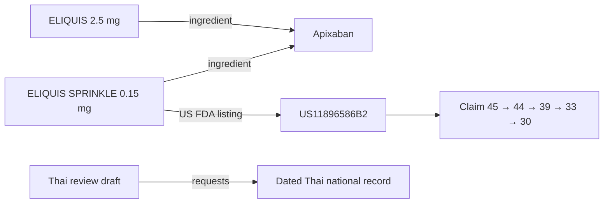

# Agentic FTO for pharmaceutical IP
### Portfolio proposal, architecture review and two public-data pilots · 26 November 2026

**Recommendation.** Build one dossier that a reviewer can take apart. Start with ELIQUIS SPRINKLE, open its exact US product record, follow a listed patent into a dependent claim, then switch the review country to Thailand. The dossier should keep the verifiable US facts, identify the Thai evidence still needed and prepare a Thai draft requesting it. A visitor can inspect every step in a few minutes. The owner wants a portfolio demonstration. Customer demand, legal suitability and reviewer time savings remain open questions. [Worked grant](https://patents.google.com/patent/US11896586B2/en#claims) · [FDA field dictionary](https://www.fda.gov/drugs/drug-approvals-and-databases/orange-book-data-files) · [WIPO FTO guide](https://www.wipo.int/edocs/pubdocs/en/wipo_pub_1062.pdf)

**Research question.** Under identical source access and budgets, does choosing *which missing evidence to obtain next* help a system complete more correct, source-supported dossier statements than a fixed checklist with an exact database join and a cached claim walk? Count unsupported conclusions separately. A Thai interface, more agents, claim charts, evidence graphs and revision tracking each have strong precedents. The reproducible opportunity is this particular cross-language task, the comparison and any measured advantage. Novelty, journal placement and a positive result are undetermined. [PatentAgentBench](https://arxiv.org/abs/2610.35031) · [Closest open competitor](https://github.com/Peter-McCann-Strain/chemical-patent-analysis/tree/e50f08614cb272ceff1bfffb1ffbf83fb087b376) · [Priorbit FTO skill](https://github.com/Lawless-Inc/priorbit/blob/d6753fc1bb4fa55be2c060140297eca1f45eaf00/skills/priorbit/SKILL.md)

**What exists today.** The [source review](SOURCES.md) covers all 21 owner files and the ten named repositories. The [shared KM graph](knowledge-graph.json) contains source versions, typed edges and a real case. The two [FDA](FDA-PILOT.md) and [claim](CLAIM-PILOT.md) pilots below ran locally. The three-agent workflow, Thai national status lookup on this case, comparator leaderboard and new product interface are proposed. Earlier commercial chat evidence remains preserved separately. [Commercial baseline receipt](../OPTION-A-IMPORT.md)

## One case a portfolio visitor can investigate

1. Select **apixaban**. Two real products appear, including ELIQUIS 2.5 mg (NDA 202155, product 001) and ELIQUIS SPRINKLE 0.15 mg (NDA 220073, product 001). In the pinned US archive, patent number 11896586 is listed for the latter. A match on ingredient alone would also attach that listing to the former. Show the exact row and a link to the source. A product reviewer can still search either product for related patents. [FDA data and schema](https://www.fda.gov/drugs/drug-approvals-and-databases/orange-book-data-files) · [Historical research dataset](https://pmc.ncbi.nlm.nih.gov/articles/PMC10731339/)
2. Open **US11896586B2, Apixaban formulations**. Select claim 45. Display its explicit dependency chain **45 → 44 → 39 → 33 → 30**. Let the visitor open each passage, then attach disclosed product evidence to individual limitations or leave them unknown. The pilot verified the chain only. It did not assess whether either marketed product satisfies any claim. [Grant, claims 30–45](https://patents.google.com/patent/US11896586B2/en#claims) · [PatentFinder](https://arxiv.org/abs/2412.07819)
3. Change the question to **“Which facts can go into a Thai IP review memo today?”** Preserve the US listing in its own column. Set Thai member, national claim text and dated status to **evidence needed** until verified against the relevant Thai sources. Generate a clearly marked draft asking for the national application/publication number, applicable claim version and official status record on the review date. Include source IDs, addressee, subject, reference and enclosure list. Use Thai formal-document conventions appropriate to the sender. An official crest or letterhead in an example is a layout feature and cannot establish issuer authority. An ordinary company draft uses the sender's own identity. [Thai DIP search service](https://www.ipthailand.go.th/th/dip-law-2/item/42-281.html) · [Thai correspondence regulation, external-letter form](https://circular.otepc.go.th/files/sarabun-thaigov-2526.pdf) · [WIPO process](https://www.wipo.int/publications/en/details.jsp?id=4501&plang=EN)

## What two experiments actually showed

### 1 · Where an FDA listing belongs

The protocol and runnable comparator were committed at `28145fe127cf044395519b09edabf1e7d2ac25ab` before acquiring the archive. The six preselected single ingredients yielded 34 distinct NDA products and 85 source-listed product–patent pairs. Both shortcuts below include every listed pair by construction. The quantity that distinguishes them is how many extra pairs they present as listed. [Frozen protocol](FDA-PILOT.md) · [FDA product-number definition](https://www.fda.gov/drugs/drug-approvals-and-databases/orange-book-data-files)

| Join rule | Extra product–patent pairs | Product records with an extra | Missed listed pairs |
|---|---:|---:|---:|
| Same ingredient | 48 | 29/34 | 0 |
| Same application | 5 | 2/34 | 0 |
| Exact application type, application number and product number | 0 | 0/34 | 0 |

| Ingredient | Products | Listed pairs | Extra by ingredient | Extra by application |
|---|---:|---:|---:|---:|
| Apixaban | 4 | 16 | 8 | 0 |
| Rivaroxaban | 7 | 8 | 13 | 2 |
| Sitagliptin phosphate | 3 | 6 | 0 | 0 |
| Omeprazole | 5 | 3 | 12 | 0 |
| Metformin hydrochloride | 13 | 1 | 12 | 0 |
| Empagliflozin | 2 | 51 | 3 | 3 |

**Design consequence.** Use the broad matches for discovery and the exact FDA key for a “listed for this product” statement. An extra pair means absent from this source at that key. An unlisted patent may still matter. No patent scope, validity, exclusivity, present enforceability or Thai right was decided. The exact join reproduces the reference definition. An additional SQL implementation using distinct sets and set difference confirmed the five overall counts for each rule. [FDA listing FAQ](https://www.fda.gov/drugs/drug-approvals-and-databases/frequently-asked-questions-orange-book) · [NBER Orange Book study](https://pmc.ncbi.nlm.nih.gov/articles/PMC10731339/)

### 2 · How much a one-hop claim reader loses

After the first pilot, the first sorted apixaban mismatch supplied the patent for a second, separately frozen experiment at `9e94eceed09a138ec277a3f1c92c9d99b4924ac1`. A second agent independently read the complete grant and transcribed the parent numbers before seeing the reader outputs. The comparison checks exact ancestor *sets* for all numbered claims. Two claims had no parent and 43 had one explicit parent apiece. All 45 were evaluable. [Frozen protocol](CLAIM-PILOT.md) · [Grant text](https://patents.google.com/patent/US11896586B2/en#claims)

| Reading method | Claims with exactly the reference set of ancestors |
|---|---:|
| Read each claim alone | 2/45 |
| Include its immediately referenced claim | 13/45 |
| Follow explicit references to the root | 45/45 |

For independent reproduction, the transcribed child-to-parent groups were 1→none, 2–4→1, 5→4, 6–8→1, 9–13→8, 14–16→13, 17→1, 18–19→17, 20→8, 21–28→20, 29→28, 30→none, 31–33→30, 34–36→33, 37→30, 38→37, 39–43→33, 44→39 and 45→44. Select numbered `div.claim[num]` inside the claims section and verify that the numbering is continuous and matches its declared total. For each claim compare the empty set, its immediate parent set and its transitive parent set against the independently transcribed path. Keep the precise source representation since websites can change.

A direct-only reader missed at least one ancestor on 32 claims. Another four-link example runs **29 → 28 → 20 → 8 → 1**. A simple cached parent walk can produce the exact answer. Implement that deterministic operation once. Reserve an adaptive agent for decisions the walk cannot resolve, such as which document can support a missing product limitation. Numerals within one exposed patent are correlated observations. The second agent is a structural cross-check, with no independent patent counsel or legal assessment. [Earlier cached-walk comparison](../READING-ARCHITECTURE-REVIEW.md) · [Claim mapper baseline](https://github.com/mjtiv/patent-claim-mapper/blob/799010657392423ca0187b91910deb468c6f1b9c/patent_claim_analysis_1.5.py)

**Reproduction record.** The two originals and the independent parent transcription are retained in the private sibling folder `ptp-ip-pharma-landscape-20261126`. The FDA HTTP Last-Modified was 13 Nov 2026, 16:03:15 UTC. Its ZIP is 1,104,034 bytes. For the apixaban example the line numbers including the header are 34,469 and 9,053 in products.txt, and 7,130 in patent.txt. For the grant, read the numbered claim elements in the Claims section and inspect every literal parent reference. All outputs cover public, exposed data. No paid inference, GPU, pod, new clinical data or protected TEST access. No paper-level model comparison was run.

| Artifact | SHA-256 |
|---|---|
| FDA ZIP | `d4dbc9d85df4fbd78c5e448f130a55b05054f529d2054a46df10735437792241` |
| FDA products.txt | `02274827ecc0e63ae63cc0cfec9e755bcd947c144b2b7b4e66fe585db139cfa0` |
| FDA patent.txt | `ae5e64d61b4ae1ea9ea1c3a86e4ec49141bba81b1f9e3078f763a46b9c8e0352` |
| FDA original comparison | `c7b1081d91d80f128a600f12fc9018ef838286bd90403be182c42b4761b7e40e` |
| US11896586B2 HTML | `dab046852767298848a2b864f40d49fe518aaee55aa5592c760b18c9f3e7ded8` |
| Claim reader outputs | `79203c7dbe2ca3ed31e646befe70a086266706e4a172fbfaf2764b78c4726b85` |
| Independent parent transcription and scored counts | `7b92999c537a817f9898364fcfa60a48c8fe6dc3ebf85f68925f16b4ed6cd287` |

## Disposition of all eight owner proposals

| Idea | Evidence we can use | Decision and fair comparison |
|---|---|---|
| **A. Exposure-aware search** | Paper 53 reports a known OUT family in 257/692 fixed top-100 pools. The historical run cannot be independently replayed. Dynamic depth already has a direct precedent. | **First adaptive research candidate.** Compare fixed-cost hybrid expansion, a bounded reflection loop and one choice among identifier, claim, family or status lookup. Use actual action diversity and additional known-family discovery per fixed budget. Only evaluators see relevance labels. Retriever agreement measures agreement and can be high when both miss. [Dynamic search depth](https://ieeexplore.ieee.org/document/11486528/) · [Patent Deep Research](https://doi.org/10.1007/978-3-032-34374-1_20) |
| **B. Cross-domain query abstraction** | The old instruction null is a reranking result. It gives no score for query rewriting. | **One optional retrieval ablation.** Compare the original words, a fixed function/mechanism template and one model rewrite at equal retrieval depth and calls. Judge family retrieval separately from pharmaceutical element coverage; log rewrites that delete a material feature. [Non-factoid patent QA](https://doi.org/10.1016/j.eswa.2021.114910) · [PQAI](https://github.com/pqaidevteam/pqai) |
| **C. Claim-element reasoning** | Earlier EP mechanical source tied a cached walk. The new US pharma case quantifies the one-hop loss; element-to-product entailment remains open. | **Build as a core dossier feature.** Anchor each limitation to the correct branch and product passage. Compare exact traversal plus a fixed chart, direct LLM and an adaptive request for missing evidence. Scope MolPatent-240 to molecule/Markush membership. [PatentFinder](https://arxiv.org/abs/2412.07819) · [DIKWP](https://doi.org/10.3390/electronics15112449) · [Patent Claim Mapper](https://github.com/mjtiv/patent-claim-mapper) |
| **D. Country and status** | The FDA pilot tested US product identity only. Earlier Thai registry and correspondence exercises tested identity/authority on other tasks. National patent status on the demo family remains unknown. | **Build the typed boundary now.** Require a dated national event, version and country before a national-status statement. Compare against the exact identifier/date checklist and Priorbit. A case without a Thai member record can demonstrate a specific missing-evidence request. [Fu et al., pharma FTO](https://iced.designsociety.org/publication/34865/using_design_database_structures_to_characterize_freedom-to-operate_in_a_design_space_a_legal_case_study) · [Priorbit](https://github.com/Lawless-Inc/priorbit) |
| **E. Funnel diagnosis** | Paper 53's fixed-pool identity is descriptive. D31 demonstrated that a correct document link can coexist with incomplete extracts. | **Use for all arms.** Count candidate found → right version → evidence complete → supported sentence with nested denominators. For nested success, multiply stage conditionals *within* each arm and subtract the two end-to-end rates. A product of stage deltas has no such interpretation. Conditional rates alone cannot identify causal effects. [PANORAMA](https://proceedings.neurips.cc/paper_files/paper/2025/hash/4aab82c8d6b77c0b6b010145c1bfcdd3-Abstract-Datasets_and_Benchmarks_Track.html) · [D31 receipt](../THAI-INQUIRY-AUDIT.md) |
| **F. Reranker gate** | Within the reported historic setting, generic was close to no rerank; BGE underperformed that control. The parked eight cells provide no new result. | **Defer learning a router.** Start with first-stage order and one fixed reranker. Fit a gate only if enough disjoint development families show reproducible paired reversals. Report regressions and extra cost. [PROARTSearch](https://arxiv.org/abs/2009.09132) · [PQAI reranking](https://github.com/pqaidevteam/pqai/blob/56342aaac5d9bf626f9413e5e49819e70709ce2f/core/reranking.py) |
| **G. Replay and audit trail** | Existing sealed runs, saved commercial chats and the two source-pinned pilots already support replay at specified levels. Legal sufficiency or compliance is unmeasured. | **Keep as infrastructure.** Track what each source can attest, model/interface version, actions, contemporaneous artifact digest and source locator. Compare sentence traceability and correct update handling against the existing competitor and plain checklist. [DEXA agent](https://doi.org/10.1007/978-3-032-34374-1_20) · [Competitor dependency tracking](https://github.com/Peter-McCann-Strain/chemical-patent-analysis/blob/e50f08614cb272ceff1bfffb1ffbf83fb087b376/api/src/api/services/monitor_conclusion_dependencies.py) |
| **H. FTO benchmark** | PatentAgentBench already includes court-derived FTO retrieval and claim charting. Its overall score combines tasks. An Orange Book association is a listing label; an examiner citation is a prior-art proxy. | **Reuse external tasks with their original labels.** Add a separate Thai/English evidence-support track only when source rights, independent labels and enough distinct matters are available. Keep authored cases for exposed debugging. [PatentAgentBench](https://arxiv.org/abs/2610.35031) · [PatentMatch](https://hpi.de/en/database-group/projects/data-integration-projects/web-science/paar-patent-analysis-and-retrieval/patentmatch/) |

**IS1 continuity.** Preserve query family, date cutoff, title/abstract and rank cutoff for an explicitly comparable retrieval track. Paper 53 reports patent-aware minus generic +0.0008 and claim-focused minus generic −0.0007 in one fixed pool. A wider/deeper pool changes which families can contribute. Run any legally reusable new retrieval track under its own name, preserve family-wise pairing and report which known targets became reachable. The eight matched IS1 successor cells remain **NOT_RUN** under the owner's exposure decision. Keep DAPFAM and PatEmbed outside the commercial demo. [IS1 bridge](../../healthtech/audits/S3-20261125/BRIDGE.md) · [Successor source and admission](https://github.com/siriponsri/patent-to-pilot/tree/7f5d799ce561d183bdecc82a86935698e83b5eca/docs/ra-pharma/research/successor)

## How the three agents share knowledge

The two product nodes share an ingredient. Only the SPRINKLE node has this listing edge. The Thai request is deliberately disconnected from the US grant until a national source supports a link. [Inspectable node and edge records](knowledge-graph.json)

Use two layers. The versioned **research KM** stores papers, implementations, benchmark labels, comparator roles, receipts and limitations. The **case graph** stores only evidence authorized for that matter. The starter JSON includes a public worked example of both layers, with type and provenance on the records. In a deployed system, separate case visibility and writes. Literature may suggest where to search. Only a case source can support a dossier assertion. A graph database is optional at this scale. The existing SQLite reader and a versioned JSON export are enough for a portfolio. [Shared graph](knowledge-graph.json) · [PEMT](https://doi.org/10.1093/bioinformatics/btac716) · [Competitor MatterGraph](https://github.com/Peter-McCann-Strain/chemical-patent-analysis/blob/e50f08614cb272ceff1bfffb1ffbf83fb087b376/praviar_pipeline/src/praviar_pipeline/models/report_evidence_graph.py)

| Specialist | Reads and may propose | Shared record or draft |
|---|---|---|
| Patent | Title and abstract for discovery; publication kind, claim hierarchy and product material for scope review | Claim branch, limitation, product source passage and supported/contradicted/unknown. Chemical name hits create candidate edges only. |
| Legal | Jurisdiction, as-of date, official national member and dated event; statute and edition where applicable | A status assertion limited to the issuer's evidence, or a specific missing document. Regulatory approval, a court holding in another matter and a patent listing retain separate roles. |
| Thai formal documents | Authorized sender/receiver, document type, reference, round, date, enclosure and accepted case assertions | An English-source-linked Thai draft; sentence-to-evidence map; outstanding requests; sign-off state. The agent may propose wording, never create source evidence by drafting it. |

The coordinator chooses the next permitted operation from the unresolved dossier rows. Store each proposed edge with subject, relation, object, version, scope, locator, digest and author. An evidence reviewer accepts or rejects it. Preserve older revisions and contradictions. A changed source invalidates the assertions that depend on that version; the draft displays which statements require review. Other agents read the accepted snapshot and attach proposals against its version. The Planner merges shared KM on main; executors record new candidate entries in their own lane. No evaluator keys, private source bodies, generated answers passed off as evidence or test outcomes enter runtime memory. [Evidence contract](../EVIDENCE-CONTRACT.md) · [Grounded Revision](https://arxiv.org/abs/2609.36550) · [Existing reassessment implementation](https://github.com/Peter-McCann-Strain/chemical-patent-analysis/blob/e50f08614cb272ceff1bfffb1ffbf83fb087b376/api/src/api/services/monitor_conclusion_dependencies.py)

## Bounded autoresearch and the product decision

| Phase | Executor deliverable | Comparator or decision |
|---|---|---|
| **0 · Completed here** | Existing-system survey, KM seed, real product join, real claim traversal, pin and error accounting. | Exact join and cached walk are the reference implementations. [Protocols and receipts](#what-two-experiments-actually-showed) |
| **1 · Next, Research** | Assemble one replayable dossier for the case above. Separately find admissible fresh, family-disjoint development matters with genuine choices between two source actions. Inventory official Thai coverage, dates, import rights and independent reference availability. | Reconstruct the dossier with a fixed checklist. If the next action is predetermined, ship it as a deterministic portfolio example and end that research branch. [PatentAgentBench](https://arxiv.org/abs/2610.35031) · [Priorbit](https://github.com/Lawless-Inc/priorbit) |
| **2 · Baseline sheet** | Use identical permitted evidence. Run direct LLM zero-shot, fixed few-shot, full context plus checklist, ordinary BM25+dense hybrid RAG, and deterministic exact join/claim walk with a fixed evidence order. Include commercial ChatGPT and NotebookLM on fresh sessions, with uniform sources and prompts, actual mode, original chat and citations. | Separate fixed-packet reading from open discovery. Give the reflection baseline the same retrieval interface. Commercial UIs have opaque compute; report their observations in a separate column. Historical Thai zero-shot recovered a known omission on one exposed file. Fresh IP Pharma, few-shot and general RAG comparisons are **NOT_RUN**. [Previous receipt](../OPTION-A-IMPORT.md) · [Patent Deep Research](https://doi.org/10.1007/978-3-032-34374-1_20) |
| **3 · At most three development changes per approved batch** | One hypothesis and change per trial: adaptive choice of evidence source; query abstraction; or a fixed-vs-adaptive reread when a genuine version changes. Keep the same model, tools and budgets for the mechanism comparison. Log action traces, decisions, regressions, time and costs. | Pair adaptive vs fixed policy on the same matters. Ablate only the chosen mechanism. Stop early on identical actions, a saturated comparator or exhausted budget. Preserve every null, negative and discarded trial. [Autoresearch workflow](https://github.com/karpathy/autoresearch) · [Dynamic depth paper](https://ieeexplore.ieee.org/document/11486528/) |
| **4 · Confirmation and product handoff** | Freeze the selected policy, cohort, scorer, budget and stopping rule before one new eligible DEV capture. Reserve protected TEST. | Primary proposed endpoint is complete, correctly scoped dossier assertions per matter. Co-report unsupported issued assertions, wrong-country/version links, over-abstention, cost and family-level paired uncertainty. Without independent labels, report engineering only. Product integration can proceed as a portfolio decision after owner review, including if the checklist wins. [Fu expert comparison](https://iced.designsociety.org/publication/34865/using_design_database_structures_to_characterize_freedom-to-operate_in_a_design_space_a_legal_case_study) · [PatentAgentBench](https://arxiv.org/abs/2610.35031) |

**Promotion rule to freeze with the owner before a scored study.** Prefer the simplest method that matches the strongest comparator. Promote an adaptive method only when a predeclared useful gain, an acceptable unsupported-assertion rate and a resource cap are met on fresh evidence. Choose the numerical thresholds from the intended use and available independent matters, before results. “Best” applies only to that endpoint, cohort and budget. An autorun that optimizes the same exposed cases until positive would answer a different question. A solo implementation can still deliver the traceable portfolio dossier when independent review is unavailable. [Earlier identical-action finding](../../evidence-scope/alternative-evidence/RESULTS.md) · [PatentAgentBench](https://arxiv.org/abs/2610.35031)

**Next handoff.** Research Executor, GPT 6.2 Sol medium, should take Phase 1 on the research branch. Return one source-to-draft walkthrough, an inventory of what is known and missing on the Thai side, one meaningful competing action or an explicit stop, and the source-rights register. The Product branch stays at its existing demo until the owner reviews that handback. The current recommendation is the portfolio prototype plus a falsifiable research question. There is no evidence here of customer demand or superiority over ChatGPT, NotebookLM or an FTO practitioner. [Source register](SOURCES.md) · [Research-first mandate](../RESEARCH-FIRST.md)
