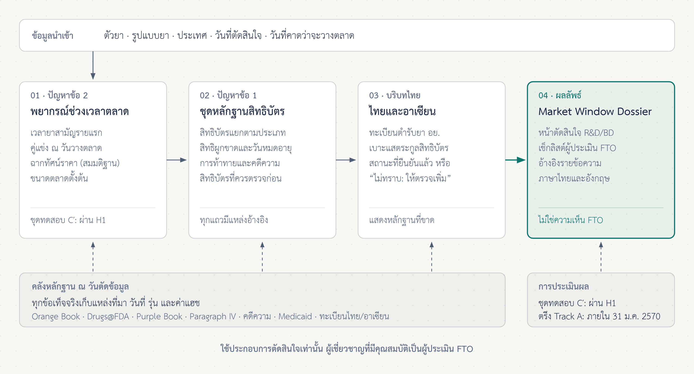

# IS2 figure and table plan

Use the KMITL AI4BA short-paper template. Place captions below figures and above tables. Keep the numbering and data identical across editions and localize labels at layout.

## Figure 1

- **TH** รูปที่ 1 แสดงขั้นตอนที่ออกแบบไว้ตั้งแต่รับข้อมูลผลิตภัณฑ์จนถึงส่งต่อแฟ้มหลักฐาน คิวจัดลำดับชุดส่วนออกฤทธิ์ของตัวยา (active-moiety set) ส่วนแฟ้มบันทึกรูปแบบยาและเขตอำนาจเพื่อให้ผู้เชี่ยวชาญตรวจว่าหลักฐานระดับตัวยาใช้กับผลิตภัณฑ์ได้เพียงใด ผลด้านความต้องการและราคาเป็นสถานการณ์จำลอง ข้อมูลที่ขาดหรือขัดกันจะอยู่ในรายการที่ต้องตรวจเพิ่ม

*รูปที่ 1 ขั้นตอนการจัดทำแฟ้มที่ออกแบบไว้สำหรับผู้เชี่ยวชาญ ประเมินชุดพัฒนาและให้คะแนนชุดทดสอบย้อนหลัง C′ แล้ว โดย H1 ผ่านใน C′ ส่วนการตรึงคำพยากรณ์ไปข้างหน้าของ Track A มีกำหนดภายใน 31 มกราคม 2027 ผลด้านความต้องการและราคาเป็นสถานการณ์จำลอง
- **EN** Figure 1. Proposed dossier workflow for specialist review. Development evaluation and historical C′ scoring are complete, and H1 passed on C′. The prospective Track A prediction freeze is due by 31 January 2027. Demand and price are scenario outputs.
- Embedded in §3.1 as `figures/fig1_flow_{en,th}.png`. The artwork status labels were updated for the completed C′ scoring on 28 November 2026 (main-planner audit). Use full width. [SCORE](../../../loe-bench/receipts/SCORE.md)

## Figure 2

- **TH** รูปที่ 2 ผลต่างการครอบคลุมการอนุมัติครั้งแรกแบบจับคู่ในชุดพัฒนาและ C′ ที่ความจุคิวร้อยละ 20 จุดแสดงค่าประมาณ เส้นช่วงแสดงช่วงความเชื่อมั่น 95% สองด้านจากการสุ่มซ้ำระดับตัวยา เส้นแนวตั้งอยู่ที่ศูนย์และ +10 จุดร้อยละ ชุดพัฒนามีตัวยาที่เกิดเหตุการณ์แบบไม่นับซ้ำ 67 รายการที่ระยะ 24 เดือน และ 90 รายการที่ระยะ 12 เดือน ส่วน C′ มี 202 รายการในแต่ละระยะ ช่วงของ H3 ใน C′ ใช้อธิบายผลเชิงพรรณนา
- **EN** Figure 2. Paired differences in first-approval recall at the 20% review budget on development data and C′. Points show estimates and bars show two-sided 95% whole-drug bootstrap intervals. Vertical lines mark zero and +10 percentage points. Development had 67 distinct event drugs at 24 months and 90 at 12 months; C′ had 202 at each horizon. The C′ H3 interval is descriptive.
- Place at the layout marker in §4.1. Plot H1, H2 and H3 as three horizontal rows, with two vertically offset point-and-interval marks per row. Distinguish development and C′ by marker shape and legend. Use a common linear axis in percentage points, with distinct vertical lines at zero and the prespecified +10-point practical-usefulness threshold. Label each contrast and horizon and identify the distinct event-drug count for each panel. Mark the C′ H3 estimate and interval as descriptive. [FREEZE development results](../../../loe-bench/receipts/FREEZE.md#development-results) · [SCORE C′ results](../../../loe-bench/receipts/SCORE.md#primary-family) · [Preregistration protocol](../../../loe-bench/PREREGISTRATION.md)

| Row | Horizon | Contrast | Development event drugs | Development estimate [95% CI] (pp) | C′ event drugs | C′ estimate [95% CI] (pp) |
| --- | ---: | --- | ---: | ---: | ---: | ---: |
| H1 | 24 months | M3 − B1 | 67 | +9.80 [+0.14, +19.65] | 202 | +20.37 [+14.37, +26.16] |
| H2 | 24 months | M3 − M1 | 67 | +5.49 [−2.00, +11.25] | 202 | +1.36 [−2.20, +3.01] |
| H3 | 12 months | M3 − B1 | 90 | +13.00 [+3.27, +23.17] | 202 | +16.69 [+9.98, +24.21] |

`make_fig2.py` renders the development and C′ paired plot for both editions. It is embedded in §4.1 as `figures/fig2_effects_{en,th}.png`; event-drug counts are in the caption.

## Table 1

- **TH** ตารางที่ 1 การครอบคลุมที่ความจุคิวร้อยละ 20 ในชุดทดสอบย้อนหลัง C′
- **EN** Recall at the 20% review budget on the sealed historical test (C′).
- Rows, event rows, slots and recall for B1, M1, M3, L1 and L1e at both horizons. The cutoff schedule moved into §3.2 prose (Astra critique, 28 Nov). [SCORE](../../../loe-bench/receipts/SCORE.md) · [SCORELLM](../../../loe-bench/receipts/SCORELLM.md)

## Table 2

- **TH** ผลต่างการครอบคลุมแบบจับคู่ใน C′ ที่ความจุคิวร้อยละ 20 และผลการทดสอบตามลำดับ
- **EN** C′ paired recall differences at the 20% review budget and fixed-sequence decisions.
- Use the §4.1 table with the point estimates, two-sided intervals, one-sided lower bounds, reached-step decisions and +10-point checks. Mark H3 descriptive. [SCORE](../../../loe-bench/receipts/SCORE.md#primary-family)

## Table 3

- **TH** ผลต่าง MAE ของยอดเบิกจ่ายเทียบกับการยกค่าล่าสุดในชุดย่อยขั้นพัฒนาที่เชื่อมกับคิว
- **EN** Paired reimbursement MAE differences relative to carry-forward on the linked development subset.
- Retain both reimbursement units, paired intervals and the retrospective, vintage-uncontrolled qualifier. Include B1-adjusted, M3-adjusted and drift, each relative to carry-forward. A positive difference means greater MAE. Keep the queue-linked denominators and reserved-origin NOT_RUN status next to the table. [C4b queue-linked results](../../../loe-bench/receipts/C4b.md) · [SCORE C4](../../../loe-bench/receipts/SCORE.md#c4--medicaid-demand-and-reimbursement)

## Table 4

- **TH** ผลขั้นพัฒนาของแบบจำลองภาษาที่ได้รับหลักฐานและวิธีเปรียบเทียบ
- **EN** Evidence-matched language model and comparator results on development data.
- Present native recall, precision and grouped average precision. Keep paired recall contrasts, intervals and the exploratory status in the adjacent text. [C2 development results](../../../loe-bench/receipts/C2.md#development-results)

Keep the C3b single-cutoff development result and the exploratory C′ C3 estimates in adjacent paragraphs in §4.2. [C3b development result](../../../loe-bench/receipts/C3b.md#c3-development-queue-result) · [SCORE C3](../../../loe-bench/receipts/SCORE.md#c3--competition-at-launch)
