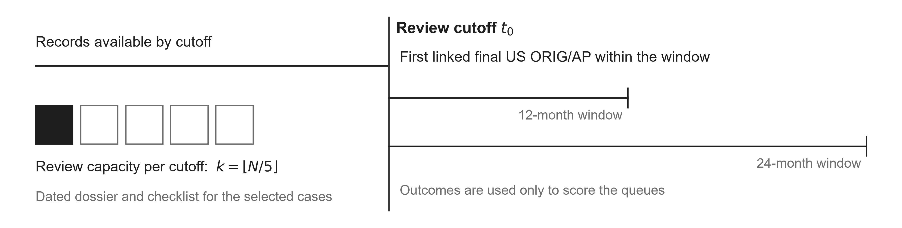
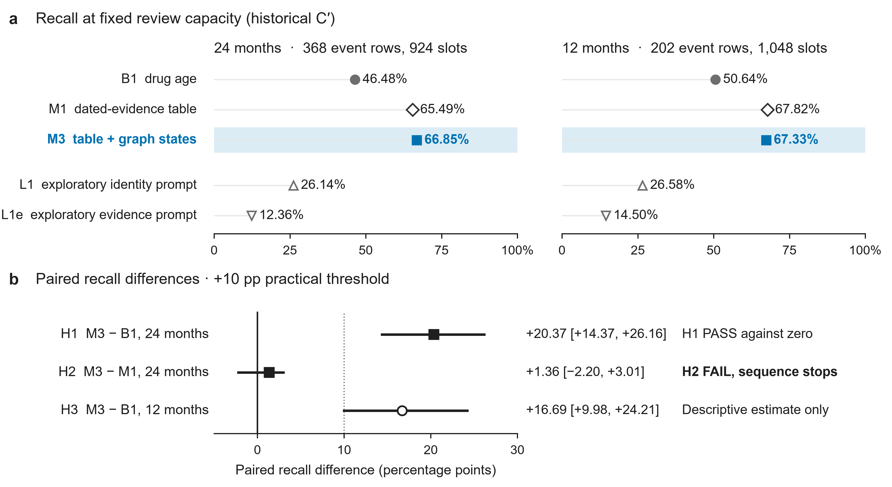

# การประเมินหลักฐานด้านการกำกับดูแลยาเพื่อจัดลำดับการทบทวนรายการยาก่อนการอนุมัติยาสามัญครั้งแรกในสหรัฐอเมริกา

# Review Queues for First US Generic Approvals Using Dated Evidence

นายศิริพล ศรีเฮงไพบูลย์\*¹ และ ผศ.ดร.ทัศนัย พลอยสุวรรณ²\
คณะเทคโนโลยีสารสนเทศ สถาบันเทคโนโลยีพระจอมเกล้าเจ้าคุณทหารลาดกระบัง\
เลขที่ 1 ซอยฉลองกรุง 1 แขวงลาดกระบัง เขตลาดกระบัง กรุงเทพฯ 10520

Siripon Srihangpiboon\*¹ and Tuchsanai Ploysuwan²\
School of Information Technology, King Mongkut's Institute of Technology Ladkrabang\
1 Chalong Krung 1 Alley, Lat Krabang, Bangkok 10520

## บทคัดย่อ

งานนี้ประเมินการจัดลำดับรายการยาโดยให้ทบทวนได้หนึ่งในห้าของรายการที่เข้าเกณฑ์ในแต่ละปีและปัดเศษลง ผู้วิจัยใช้หลักฐานที่มี ณ วันตัดข้อมูลและทดสอบย้อนหลังกับชุด C′ ซึ่งปิดผลรายรายการไว้จนได้รับอนุญาตให้ให้คะแนน เหตุการณ์คือการอนุมัติขั้นสุดท้ายครั้งแรกในสหรัฐฯ ของคำขอยาสามัญแบบย่อฉบับยื่นครั้งแรก (ANDA, ORIG/AP) ที่เชื่อมกับตัวยาได้และอยู่ในช่วงติดตาม ที่ระยะ 24 เดือน ตารางหลักฐานที่เพิ่มสถานะกราฟ (M3) ครอบคลุมร้อยละ 66.85 ของรายการที่เกิดเหตุการณ์ เทียบกับร้อยละ 46.48 จากวิธีตามอายุยา (B1) และร้อยละ 65.49 จากตารางหลักฐาน (M1) ผลต่างแบบจับคู่ระหว่าง M3 กับ B1 เท่ากับ +20.37 จุดร้อยละ (ช่วงความเชื่อมั่น 95% [+14.37, +26.16]) ผลนี้สนับสนุนการใช้คิวเพื่อจัดลำดับงานทบทวน ส่วนประโยชน์ที่ได้จากการเพิ่มสถานะกราฟยังไม่ชัดเจน และกฎยกเว้นอัตโนมัติไม่ผ่านเกณฑ์ความปลอดภัย รายการนอกคิวจึงยังต้องทบทวนตามปกติ

**คำสำคัญ** ยาสามัญ, ช่วงเวลาเข้าสู่ตลาด, กราฟหลักฐาน, การจัดลำดับการทบทวน, เสรีภาพในการดำเนินการ

## Abstract

We ranked drug cases using evidence available at each annual cutoff and allocated one review slot per five eligible cases, rounded down. Historical C′ row-level outcomes were sealed until authorized scoring. The endpoint was the first linked, dated, final original US abbreviated new drug application approval (ANDA, ORIG/AP) within 12 or 24 months of each cutoff. At 24 months, the dated-evidence table with graph states (M3) captured 66.85% of event rows, compared with 46.48% for drug age (B1) and 65.49% for the dated-evidence table (M1). The paired M3−B1 gain was +20.37 percentage points (95% CI [+14.37, +26.16]). The results support review prioritization. The incremental gain from adding graph states remained unconfirmed, and automatic clearance failed the safety check. Cases outside the queue still require routine review.

**Keywords** generic drugs, market window, evidence graph, review prioritization, freedom to operate

\* 68076060@kmitl.ac.th\
¹ นักศึกษาปริญญาโท สาขาวิชาปัญญาประดิษฐ์เพื่อการวิเคราะห์เชิงธุรกิจ / Postgraduate Student, Artificial Intelligence for Business Analytics Program\
² ผู้ช่วยศาสตราจารย์ คณะเทคโนโลยีสารสนเทศ / Assistant Professor, School of Information Technology, KMITL

## 1. Introduction

In an earlier study of cross-domain patent reranking [1], no known relevant document appeared among the first 100 candidates for 435 of 692 queries. Here we compare fixed-capacity review queues on their capture of first linked, dated, final original US ANDA approvals within 12 or 24 months of each cutoff.

LOE-Bench evaluates rankings on historical US records. The review capacity represents a prioritization decision before investing in bioequivalence studies. Market Window Dossier provides ranked cases, dated evidence and a checklist for freedom-to-operate (FTO) specialists. The endpoint excludes commercial launch, Thai entry and FTO determinations.

### Research objectives

- RQ1 compared recall at fixed review capacity for M3 versus drug age (B1) and for M3 versus dated tabular evidence (M1), in that order.
- RQ2 comprised three exploratory analyses: recall under a 7B language model given the same upstream evidence, capture of cases with at least three approved applicants within 36 months, and reimbursement error after a price factor.
- RQ3 assessed which dossier claims could be traced to a dated source and which required further specialist verification.

## 2. Background and Related Work

### 2.1 Estimating generic entry and review priority

Beall et al. estimated generic entry from patents and exclusivity [2], [3]. LOE-Bench compares fixed-capacity queues built from dated evidence. Other studies measure time to approval [4] or forecast first submission [5], [6]. FDA documents delays from approval to marketing [7].

Patent challenges and stays inform entry timing [8], [9]. The NBER Orange Book archive [10] was used in earlier development only. The frozen replay used FDA editions with verified public availability. Court filing dates approximate when the records became public [11].

### 2.2 Applicants, producers and reimbursement

In the FDA’s average manufacturer price (AMP) analysis, the median generic-to-brand ratio was 46.5% with two marketed producers and 21.2% with four [12]. A price scenario uses an assumed count of marketed producers and documented pre-entry brand AMP in matching units. Prior studies cover entry, prices and first-entrant share [13]–[16].

### 2.3 Evidence hand-off and Thai applicability

WIPO distinguishes patent landscaping from FTO analysis and describes the evidence needed for specialist review [17], [18]. PatentAgentBench offers FTO search and design tasks as a comparator for task design [19]. Studies of Thai patent examination inform the checklist [20], [21]. Regional records guide checks against national drug registers.

### 2.4 Evaluation

Language models may encounter historical outcomes in training or input [22]. Time-consistent models and ForecastBench illustrate controls [23], [24]. We draw on preregistration, selective classification, clustered resampling, fixed-sequence testing [25]–[28] and outcome-based RL [29]. These studies and the submission, challenge and prescription literature inform task and method design. The historical head-to-head used the same US FDA approval rosters. Open-input Cox and random survival forest adaptations are frozen exploratory Track A arms with scores pending.

## 3. Methods

### 3.1 The cutoff decision and evidence hand-off

Each method ranks eligible active-moiety sets from records available by cutoff (Figure 1). Dossiers record formulation, jurisdiction, source ID, version, hash when available, exact locator and basis for availability. Dossiers label observations, estimates and scenarios for specialist review.

*Figure 1. Each cutoff allocates one slot per five eligible cases, rounded down. Scoring uses the first linked, dated, final original US ANDA approval observed within each 12- or 24-month forecast window.*

### 3.2 Eligible cases, cutoff evidence and outcome

A case is an active-moiety set at an annual cutoff. Eligibility requires a usable ingredient key, a dated final original new drug application (NDA), a final original NDA classified exactly TYPE 1 by cutoff, no prior linked final ANDA approval and complete follow-up. The first linked, dated, final original US ANDA approval (ORIG/AP) counts if it occurs after the cutoff and on or before the horizon end.

Drugs@FDA and a later 2026 Global Substance Registration System snapshot link approvals to ingredients. C′ used the latest hash-matched FDA Orange Book edition dated within six calendar months and proven public by cutoff. Fresh, availability-proven Paragraph IV lists and qualifying court records inform challenge status. A matched undated submission stays unknown unless another timely witness confirms it, even in a fresh list. A qualifying list otherwise supports operational non-observation. Incomplete listings, retrospective mapping and challenge archive gaps can affect eligibility, predictor availability and event linkage [30].

Both horizons train on 2010. Development uses 2012–2015 at 12 months and 2013–2014 at 24 months. C′ uses 2017–2025 and 2017–2024, respectively. Row-level outcomes were sealed until authorized scoring. Before registration, exposure included 36-month B0–B2 aggregates for 4,162 overlapping rows, mixed-period preflight and NDA-only candidate counts. Development informed the endpoint and model choices. The record documents no C′-based selection or inspection of row-level outcomes. Upstream checks are still incomplete [30].

### 3.3 Queues and registered test sequence

The drug-age baseline (B1) estimates approval hazard from age since first NDA approval. The dated-evidence table model (M1) uses L2 logistic regression on age, dated evidence and the B1 logit. The table model with added graph states (M3), called the graph queue, adds OPEN, BLOCKED and CONTESTED indicators. The graph uses patent and exclusivity expiries and observed challenges, carrying unknowns through Kleene three-valued logic. OPEN is a model variable. Specialists make legal determinations separately [30].

At each cutoff and horizon, the evaluation allocated one fifth of eligible cases to review, rounded down. We ranked cases by native scores before calibration or deferral, with fractional credit at boundary ties. Recall divides expected captured event cases by all event cases across cutoffs.

The fixed sequence tests 24-month M3−B1 (H1), 24-month M3−M1 (H2) and 12-month M3−B1 (H3) at one-sided α = 0.025. One approval can contribute two overlapping 24-month event rows. We rebuild queues in 2,000 paired whole-drug bootstrap draws, preserving dependence and conditioning on fitted models and observed periods. A nonpositive lower bound or undefined interval stops testing. Estimates use two-sided 95% percentile intervals. Secondary and exploratory intervals carry no family-wise error guarantee [30].

### 3.4 Registration and prospective replication

The original OSF submission omitted ten intended attachments. Approved update 1 bound the release to the canonical original OSF record in place of the unavailable PDF. Historical scoring used approved updates 1 and 2 after the verdict-only gate passed edition coverage and the minimum of 50 distinct 24-month event drugs on 28 November 2026 at 05:12 UTC [30].

Update 3 changed C9 training timing after historical scoring. Update 4 recorded the prospective freeze and listed the historical supplement as unrun at filing. The later export-only supplement is descriptive [30], [31].

Track A retrained on windows mature by the 27 November 2026 forecast origin. The freeze and OSF update on 28 November preceded access to post-origin outcomes. See Section 5 for details. [TRACKA-FREEZE](../../../loe-bench/receipts/TRACKA-FREEZE.md)

### 3.5 Exploratory comparisons

Qwen2.5-7B-Instruct uses a common checkpoint and decoder. L1 receives ingredient, cutoff and horizon. L1e also receives M3’s upstream fields and instructions, excluding fitted scores, B1 hazard, graph verdicts, actions and outcomes. Prospective C9 pairs group relative policy optimization (GRPO) with supervised fine-tuning (SFT) on Qwen2.5-1.5B-Instruct at 24 months.

The approved-applicant analysis evaluates frozen 24-month queues on 36-month outcomes at mature 2013 development and 2017–2023 C′ cutoffs. It counts distinct legal applicants with final original ANDAs, using the first eligible Orange Book listing within 12 months of approval, documented overrides and a current-sponsor sensitivity analysis. We grouped strengths and repeat records and retained unknown labels for unresolved identities.

C4b retrospectively matches State Drug Utilization Data without verified release vintages. In the 12-month queues, the later FDA two-producer factor (0.465) adjusts carry-forward for queued ingredients only, with common boundary ordering. We also tested extrapolating the recent trend.

The measures are gross matched reimbursements before rebates, including Medicaid and other recorded amounts. They cover fourth-quarter payment per prescription where counts are positive and payments over four quarters. Paired errors use the same ingredient-origin pairs with resampling by ingredient. [C4b](../../../loe-bench/receipts/C4b.md)

## 4. Results

### 4.1 Recall at fixed review capacity

Historical C′ contained 4,639 rows from 771 drugs at 24 months (368 event rows from 202 drugs, 924 slots) and 5,259 rows from 803 drugs at 12 months (202 event rows from 202 drugs, 1,048 slots). Only H1 passed. M3 captured 66.85% of 24-month event rows versus 46.48% for B1, a paired +20.37 percentage points (95% CI [+14.37, +26.16]). The lower bound exceeded both zero and the separate +10-point practical criterion for the point estimate. Capture includes fractional credit at ties. [SCORE](../../../loe-bench/receipts/SCORE.md#primary-family)

*Figure 2. Historical C′ recall and paired whole-drug bootstrap intervals. Events are counted by drug and cutoff. L1 and L1e are exploratory. Superiority uses the zero line. The dotted line marks the separate +10-point practical criterion.*

M1 captured 65.49% at 24 months. H2 failed (+1.36 points, 95% CI [−2.20, +3.01]), leaving both the graph increment and equivalence unestablished. H3 was unreached and descriptive (+16.69 points, [+9.98, +24.21]) despite exceeding +10 at the point estimate. Secondary M1−B1 gains were +19.01 [+13.34, +25.62] points at 24 months and +17.18 [+9.88, +24.06] at 12 months, with no attribution to individual features. [SCORE](../../../loe-bench/receipts/SCORE.md#secondary-analyses)

Development results moved the auto-clear safety criterion from acceptance to a secondary outcome before registration. In C′, five estimable missed-clear upper bounds exceeded 3%. M3 missed 16 of 1,678 clears at 12 months and 28 of 1,413 at 24 months (upper bounds 4.39% and 6.39%). B1 cleared zero cases at 24 months, making that rate unevaluable. Cases outside the queue still require routine review. [FREEZE](../../../loe-bench/receipts/FREEZE.md#development-results) [SCORE](../../../loe-bench/receipts/SCORE.md#secondary-analyses)

Descriptive export follow-ups [31] report ten-bin calibration and eligibility with row-level Wilson intervals that ignore repeated drugs and small-count and complementary suppression. Fifteen of 28 C′ predictor summaries and the pre-dated-NDA exclusion split are unavailable. A second follow-up reports pooled native-score ROC AUC and threshold accuracy. The calibrated threshold yielded zero true positives in all six panels. M3 at 24 months had one false positive (92.05% accuracy versus 92.07% always negative). Horizon-restricted C-index is NOT_ESTIMABLE without event dates. [CPRIME-DESC](../../../loe-bench/receipts/CPRIME-DESC.md) [CPRIME-SUPP](../../../loe-bench/receipts/CPRIME-SUPP.md)

### 4.2 Recall of the 7B language model

Both language-model arms returned 9,898 schema-valid outputs each, including valid abstentions with probabilities. L1e−M3 was −54.48 points at 24 months (95% CI [−61.18, −47.61]) and −52.83 [−59.34, −45.19] at 12 months. L1e−L1 was −13.78 [−17.71, −10.32] and −12.08 [−16.41, −7.45], respectively. These unadjusted exploratory comparisons cover the tested checkpoint, decoder and prompts. Evidence and instructions varied together. Pretraining may have included historical outcomes. [SCORELLM](../../../loe-bench/receipts/SCORELLM.md) [Development comparison](../../../loe-bench/receipts/C2.md#development-results)

### 4.3 Approved-applicant recall and reimbursement forecast error

The 2013 development cutoff favored M3 over B1. Across seven mature C′ cutoffs, exploratory C3 used 4,024 eligible drug-cutoff rows. Recall used 173 known-positive rows from 92 drugs. Four unknowns remained eligible for slot allocation. M3 captured 79.8% versus 49.7% for B1 (+30.11 points, 95% CI [+20.16, +36.86]). The pinned snapshot-sponsor rule gave +30.16 points. The receipt gives the unknown-label sensitivity bounds [31]. Applicant counts indicate potential competition. Identifying marketed producers requires sales data. [C3b](../../../loe-bench/receipts/C3b.md) [SCORE, C3](../../../loe-bench/receipts/SCORE.md#c3--competition-at-launch)

C4b mapped seven development origins and linked four to queues. Applying 0.465 as a scenario factor increased mean absolute error (MAE) on both gross reimbursement measures (Table 1). Drift reduced both errors. The queue-linked subset supplied 160 ingredient-origin pairs from 68 ingredients for payment per prescription and 150 pairs from 64 for annual payment.

*Table 1. Paired MAE differences versus carry-forward (95% CI) in the retrospectively matched development subset linked to queues.*

| Arm | USD/Rx in Q4 | USD million/year |
| --- | ---: | ---: |
| B1 | +372.05 [193.27, 587.26] | +4.98 [2.24, 8.29] |
| M3 | +381.24 [203.61, 606.77] | +21.43 [4.07, 53.21] |
| Trend | −172.13 [−292.12, −66.37] | −3.69 [−8.41, −0.20] |

Reserved historical C4 was NOT_RUN because the frozen specification admitted no 2017 origin and lacked the required 2018 outcome payload. The C4b as-of arm had zero verified origins (NOT_RUN). The available fields cannot estimate full national ingredient totals. [C4b](../../../loe-bench/receipts/C4b.md) [SCORE, C4](../../../loe-bench/receipts/SCORE.md#c4--medicaid-demand-and-reimbursement)

### 4.4 Dossier claim traceability and verification

In the Solifenacin development dossier, the drug fell outside the 2014 queue. The FDA letter links Teva’s later approval eligibility to dismissal of litigation over US patent 6017927. That letter belongs to the retrospective outcome record. The dossier identifies the cited pages and the outstanding Thai verification items. [EVP, case evidence and registry lookup](../../../loe-bench/receipts/EVP.md)

The registered audit of 32 development dossiers traced 1,789/1,789 claims by URL or hash, with zero flagged future-dated claims. Strict C8 hash backing was SHORT at 1,757/1,789 (98.21%), with 32 Thai FDA claims backed by URL only. Specialists must still assess semantic support. Six purposively selected development cases yielded historical restriction support for three of five applicable cases (two unknown, one of six inapplicable) and family leads for 17/17 US grants. Verified Thai family membership was 0/17. Patent and registration status each remained unknown in 6/6 cases. All 24 planned submissions were blocked across four inaccessible routes. No submissions entered the denominator for a success rate. [CLOSE-DISP](../../../loe-bench/receipts/CLOSE-DISP.md#c8-claim-inventory) [EVP](../../../loe-bench/receipts/EVP.md)

## 5. Conclusion

Only H1 passed historically. The full M3 queue improved prioritization over age alone, with the graph increment unresolved and routine review still required. C10 was NOT_RUN because no ethics review was sought and no approved participant protocol was recorded. Reviewer time and decision benefit remain unmeasured. The research track closed on 29 November 2026 after ten external review rounds, with no remaining findings at revision 2cee4a62 and planner concurrence [31].

No tested central expansion design reached 80% simulated H2 power at +1.36 points. The +5-point screens depend on synthetic incidence, score dependence and custody and completion assumptions. The independent filing grid and T4c raw replay were NOT_RUN. The filing gate remains unmet, and any expansion requires separate registration and an owner decision. The final design is US-only. Neither Canada nor Japan established complete historical versions for evidence admission at the relevant cutoffs. Canada’s fixed-calendar power gain at +5 points was ceiling-limited. Faster readout was untested and materiality is unresolved. Thai and ASEAN work remains descriptive evidence hand-off. [POWER-SIM](../../../loe-bench/receipts/POWER-SIM.md) [JURIS-COUNT](../../../loe-bench/receipts/JURIS-COUNT.md) [Decision rule](../../../loe-bench/JURISDICTION-DECISION-RULE.md)

Track A froze 651 active-moiety sets and 130 review slots per horizon at 11:18:44 UTC on 28 November 2026 (tag loe-track-a-freeze-20261127). OSF update 4 was submitted at 11:30:06 UTC and verified approved. Eight arms cover 12 months and ten cover 24 months, including the C9 pair. GRPO abstained on 651/651 and SFT on 0/651, with probabilities retained and paired performance pending. Both horizons are PENDING. Follow-up ends on 27 November 2027 at 12 months and on 27 November 2028 at 24 months.

The 12-month release is descriptive. The first canonical 24-month publication tests H1 then H2 and reaches formal 12-month H3 only if both pass, using the retained first 12-month panel with verified digests. The scoring guide [32] requires blind capture before scoring, from maturity through day seven inclusive, and Sigstore attestations. All trusted issue witnesses must be checked before documented canonical absence permits a revised vintage. Disputed or unresolved continuity leaves new estimates descriptive and preserves any published family. The measure map lists which secondary outputs can be estimated. Production capture, attestation, scoring, publication and Worker deployment remain unrun. [Readout guide](../../../loe-bench/HOW-TO-SCORE-TRACK-A.md) [Closure](../../../loe-bench/JOINT-SIGNOFF.md#final-research-track-closure-29-november-2026-0219-bangkok-by-the-system-clock)

Data and code availability. The benchmark card [31] distinguishes three levels. The first is public verification of aggregates. The second is independent recomputation from two authenticated score-and-event exports and is conditional on those exports. Exact independent historical source-to-result replay, including source reconstruction, linkage, eligibility and fitting, is NOT_RUN. Public restoration of the exact C′ dataset is unavailable, and row-level labels remain restricted. SCORE requires live OSF update 2, while update 4 is current. An authorized replay needs authenticated as-of update 2 evidence and independently reconstructed inputs.

The Track A version 1.0.0 archive [33] was recovered anonymously by an independent executor. Its frozen bytes verified, and the bundled scorer on clean Windows CPU returned PENDING at both horizons and passed known-answer and tamper checks. This verifies archive execution before outcome maturity. [REPRO-C1](../../../loe-bench/receipts/REPRO-C1.md) [RESTORE-DOI](../../../loe-bench/receipts/RESTORE-DOI.md)

Acknowledgment. The authors used AI assistants (Anthropic Claude, OpenAI GPT and SciSpace) for planning, code, drafting, figures and literature search. The authors reviewed all content and take full responsibility for it.

## References

[1] S. Srihangpiboon and T. Ploysuwan, “Diagnosing near-zero instruction effects in cross-domain patent reranking,” in *Proc. iSAI-NLP*, 2026, paper 53. [Online]. Available: https://isai-nlp2026.aiat.or.th/program

[2] R. F. Beall, J. J. Darrow, and A. S. Kesselheim, “A method for approximating future entry of generic drugs,” *Value Health*, vol. 21, no. 12, pp. 1382–1389, Dec. 2018. [doi: 10.1016/j.jval.2018.04.1827](https://doi.org/10.1016/j.jval.2018.04.1827).

[3] R. F. Beall et al., “Comparing onset of biosimilar versus generic competition in the United States,” *Clin. Pharmacol. Ther.*, vol. 108, no. 6, pp. 1308–1314, 2020. [doi: 10.1002/cpt.1981](https://doi.org/10.1002/cpt.1981).

[4] K. W. Kerr and L. J. Glos, “Effective market exclusivity of new molecular entities for rare and non-rare diseases,” *Pharmaceut. Med.*, vol. 34, no. 1, pp. 19–29, 2020. [doi: 10.1007/s40290-019-00317-9](https://doi.org/10.1007/s40290-019-00317-9).

[5] M. Hu et al., “Predictive analysis of first abbreviated new drug application submission for new chemical entities based on machine learning methodology,” *Clin. Pharmacol. Ther.*, vol. 106, no. 1, pp. 174–181, 2019. [doi: 10.1002/cpt.1479](https://doi.org/10.1002/cpt.1479).

[6] R. Hopefl et al., “Predictive analysis for first submission of generic drug application for orphan drug products using random survival forest,” *Clin. Transl. Sci.*, vol. 18, no. 10, e70365, 2025. [doi: 10.1111/cts.70365](https://doi.org/10.1111/cts.70365).

[7] H. S. Chahal, R. Patel, and M. Shimer, “Marketing of first generic drugs approved by U.S. FDA from January 2010 to June 2017,” U.S. Food and Drug Administration, Nov. 2021. [Report](https://www.fda.gov/media/154101/download).

[8] C. S. Hemphill and B. N. Sampat, “Evergreening, patent challenges, and effective market life in pharmaceuticals,” *J. Health Econ.*, vol. 31, no. 2, pp. 327–339, 2012. [Article](https://www.sciencedirect.com/science/article/abs/pii/S0167629612000057).

[9] S. Kannappan, J. J. Darrow, A. S. Kesselheim, and R. F. Beall, “The timing of 30-month stay expirations and generic entry: A cohort study of first generics, 2013–2020,” *Clin. Transl. Sci.*, vol. 14, no. 5, pp. 1917–1923, 2021. [doi: 10.1111/cts.13046](https://doi.org/10.1111/cts.13046).

[10] M. Durvasula *et al.*, “The NBER Orange Book dataset: A user’s guide,” *Res. Policy*, vol. 52, no. 7, Art. no. 104791, 2023. [doi: 10.1016/j.respol.2023.104791](https://doi.org/10.1016/j.respol.2023.104791).

[11] A. K. Rai, S. Vishnubhakat, J. Lemus, and E. Hovenkamp, “Replication data for: Post-grant adjudication of drug patents: Agency and/or court?,” Harvard Dataverse, ver. 1.0, 2021. [doi: 10.7910/DVN/YCMKVU](https://doi.org/10.7910/DVN/YCMKVU).

[12] R. Conrad and R. Lutter, “Generic competition and drug prices: New evidence linking greater generic competition and lower generic drug prices,” US FDA, 2019. [Report](https://www.fda.gov/media/133509/download).

[13] F. M. Scott Morton, “Entry decisions in the generic pharmaceutical industry,” *RAND J. Econ.*, vol. 30, no. 3, pp. 421–440, 1999. [doi: 10.2307/2556056](https://doi.org/10.2307/2556056).

[14] D. Reiffen and M. R. Ward, “Generic drug industry dynamics,” *Rev. Econ. Stat.*, vol. 87, no. 1, pp. 37–49, 2005. [doi: 10.1162/0034653053327694](https://doi.org/10.1162/0034653053327694).

[15] A. Hollis, “The importance of being first: Evidence from Canadian generic pharmaceuticals,” *Health Econ.*, vol. 11, no. 8, pp. 723–734, 2002. [doi: 10.1002/hec.698](https://doi.org/10.1002/hec.698).

[16] K. Nikolopoulos, S. Buxton, M. Khammash, and P. Stern, “Forecasting branded and generic pharmaceuticals,” *Int. J. Forecast.*, vol. 32, no. 2, pp. 344–357, 2016. [doi: 10.1016/j.ijforecast.2015.08.001](https://doi.org/10.1016/j.ijforecast.2015.08.001).

[17] A. Trippe, *Guidelines for Preparing Patent Landscape Reports*, prepared for the World Intellectual Property Organization, WIPO Publ. 946, 2015. [Guide](https://www.wipo.int/edocs/pubdocs/en/wipo_pub_946.pdf).

[18] World Intellectual Property Organization, *Identifying Inventions in the Public Domain: A Guide for Inventors and Entrepreneurs*, WIPO Publ. 1062, 2020. [Guide](https://www.wipo.int/publications/en/details.jsp?id=4501).

[19] Y. Hu *et al.*, “PatentAgentBench: Benchmarking LLM agents with professional patent task suites,” arXiv:2610.35031, 2026. [Online]. Available: https://arxiv.org/abs/2610.35031

[20] P. Leela and N. Kessomboon, “Challenges of examination processes of pharmaceutical patent application in Thailand,” *Isan J. Pharm. Sci.*, vol. 11, suppl., pp. 179–189, 2016. [Article](https://he01.tci-thaijo.org/index.php/IJPS/article/view/48601).

[21] D. Vachanavuttivong, P. Naboriboon, and A. Homhuan, “Expediting the patent examination system in Thailand: Recent developments,” Tilleke & Gibbins, Bangkok, Thailand, Mar. 3, 2014. [Online]. Available: https://www.tilleke.com/insights/expediting-patent-examination-system-thailand-recent-developments/

[22] D. Paleka, S. Goel, J. Geiping, and F. Tramèr, “Pitfalls in evaluating language model forecasters,” in *Proc. ICLR*, 2026. [Conference paper](https://proceedings.iclr.cc/paper_files/paper/2026/hash/b9d69c72e4587ddf3fa6352890aefc4f-Abstract-Conference.html).

[23] S. He, L. Lv, A. Manela, and J. Wu, “Chronologically consistent large language models,” *J. Financ. Econ.*, vol. 185, Art. no. 104374, 2026. [doi: 10.1016/j.jfineco.2026.104374](https://doi.org/10.1016/j.jfineco.2026.104374).

[24] E. Karger et al., “ForecastBench: A dynamic benchmark of AI forecasting capabilities,” in *Proc. ICLR*, 2025. [Conference paper](https://proceedings.iclr.cc/paper_files/paper/2025/hash/ea74e45a229dac70b5b63b28d8934db6-Abstract-Conference.html).

[25] O. R. van den Akker *et al.*, “Preregistration of secondary data analysis: A template and tutorial,” *Meta-Psychology*, vol. 5, 2021. [doi: 10.15626/MP.2020.2625](https://doi.org/10.15626/MP.2020.2625).

[26] J. Traub et al., “Overcoming common flaws in the evaluation of selective classification systems,” in *Adv. Neural Inf. Process. Syst.*, vol. 37, pp. 2323–2347, 2024. [Paper](https://proceedings.neurips.cc/paper_files/paper/2024/file/047c84ec50bd8ea29349b996fc64af4b-Paper-Conference.pdf).

[27] C. A. Field and A. H. Welsh, “Bootstrapping clustered data,” *J. R. Stat. Soc. B*, vol. 69, no. 3, pp. 369–390, 2007. [doi: 10.1111/j.1467-9868.2007.00593.x](https://doi.org/10.1111/j.1467-9868.2007.00593.x).

[28] U.S. Food and Drug Administration, *Multiple Endpoints in Clinical Trials: Guidance for Industry*, Oct. 2022. [Guidance](https://www.fda.gov/regulatory-information/search-fda-guidance-documents/multiple-endpoints-clinical-trials).

[29] B. Turtel, D. Franklin, K. Skotheim, L. Hewitt, and P. Schoenegger, “Outcome-based reinforcement learning to predict the future,” *Trans. Mach. Learn. Res.*, Nov. 2025. [Journal article](https://openreview.net/pdf/6854ebdc1a775820ad158c9a284cbe20d6241201.pdf).

[30] S. Srihangpiboon, “Market Window Dossier / LOE-Bench: evidence-graph review queues for forecasting US first generic approvals from dated open regulatory records,” OSF preregistration, 28 Nov. 2026. [doi: 10.17605/OSF.IO/P2SMD](https://doi.org/10.17605/OSF.IO/P2SMD).

[31] S. Srihangpiboon, “patent-to-pilot: Market Window Dossier and LOE-Bench,” GitHub repository, commit 3e06537b (C′ scoring), 2026. [Online]. Available: https://github.com/siriponsri/patent-to-pilot

[32] S. Srihangpiboon, “How to score LOE-Bench Track A,” Patent-to-Pilot, rev. 2cee4a62, Nov. 2026. [Source](https://github.com/siriponsri/patent-to-pilot/blob/2cee4a62/docs/loe-bench/HOW-TO-SCORE-TRACK-A.md)

[33] S. Srihangpiboon and T. Ploysuwan, “LOE-Bench Track A prediction release,” Zenodo dataset, ver. 1.0.0, Nov. 28, 2026. [doi: 10.5281/zenodo.24629100](https://doi.org/10.5281/zenodo.24629100).
