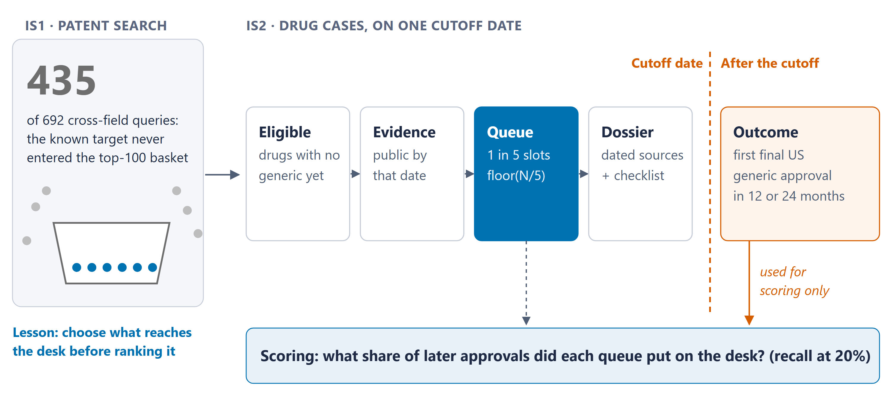

# เมื่อทบทวนยาได้หนึ่งในห้า หลักฐานทางทะเบียนช่วยให้คิวครอบคลุมการอนุมัติยาสามัญครั้งแรกในสหรัฐฯ ได้เพียงใด

# When Only One Drug in Five Can Be Reviewed, How Well Does Regulatory Evidence Capture First US Generic Approvals?

นายศิริพล ศรีเฮงไพบูลย์\*¹ และ ผศ.ดร.ทัศนัย พลอยสุวรรณ²\
คณะเทคโนโลยีสารสนเทศ สถาบันเทคโนโลยีพระจอมเกล้าเจ้าคุณทหารลาดกระบัง\
เลขที่ 1 ซอยฉลองกรุง 1 แขวงลาดกระบัง เขตลาดกระบัง กรุงเทพฯ 10520

Siripon Srihangpiboon\*¹ and Tuchsanai Ploysuwan²\
School of Information Technology, King Mongkut's Institute of Technology Ladkrabang\
1 Chalong Krung 1 Alley, Lat Krabang, Bangkok 10520

## บทคัดย่อ

ทีมทบทวนยาได้เพียงหนึ่งในห้าของรายการที่เข้าเกณฑ์ ผู้วิจัยจำลองการเลือกย้อนหลังจากหลักฐานที่มี ณ วันตัดข้อมูล แล้วให้คะแนนคิวจากการอนุมัติยาสามัญขั้นสุดท้ายครั้งแรกในสหรัฐฯ ในชุดทดสอบย้อนหลังแบบปิดผนึก (C′) ที่ระยะ 24 เดือน คิวจากตารางหลักฐานที่เพิ่มสถานะกราฟ (M3) ครอบคลุมร้อยละ 66.85 ของรายการยา ณ วันตัดข้อมูลที่ต่อมาเกิดการอนุมัติในช่วงติดตาม เทียบกับร้อยละ 46.48 ของคิวตามอายุยา (B1) และร้อยละ 65.49 ของคิวจากตารางหลักฐานตามวันที่ (M1) คิวกราฟครอบคลุมมากกว่าคิวตามอายุยา 20.37 จุดร้อยละ (ช่วงความเชื่อมั่น 95% [14.37, 26.16]) ผลทดสอบยังยืนยันประโยชน์ส่วนเพิ่มจากสถานะกราฟไม่ได้ ทีมใช้คิวเลือกกรณีที่จะตรวจได้ แต่กฎคัดกรณีออกอัตโนมัติไม่ผ่านการตรวจความปลอดภัย ทีมยังต้องทบทวนกรณีนอกคิวตามปกติ

**คำสำคัญ** ยาสามัญ, ช่วงเวลาเข้าสู่ตลาด, กราฟหลักฐาน, การจัดลำดับการทบทวน, เสรีภาพในการดำเนินการ

## Abstract

A drug team can review only one in five eligible drugs. We reconstructed that choice from records available at each cutoff and scored the queues on subsequent first final US generic approvals in a sealed historical test (C′). At 24 months, the table model with added graph states (M3) captured 66.85% of drug cases at cutoff with an approval in the window, compared with 46.48% for the drug-age baseline (B1) and 65.49% for the dated-evidence table model (M1). The graph queue gained 20.37 percentage points over drug age (95% CI 14.37 to 26.16). The study did not establish a gain from adding graph states to the table. Teams can use the queue to prioritize cases, but automatic clearance failed the safety check. Cases outside the queue still need routine review.

**Keywords** generic drugs, market window, evidence graph, review prioritization, freedom to operate

\* 68076060@kmitl.ac.th\
¹ นักศึกษาปริญญาโท สาขาวิชาปัญญาประดิษฐ์เพื่อการวิเคราะห์เชิงธุรกิจ / Postgraduate Student, Artificial Intelligence for Business Analytics Program\
² ผู้ช่วยศาสตราจารย์ คณะเทคโนโลยีสารสนเทศ / Assistant Professor, School of Information Technology, KMITL

## 1. Introduction

In IS1, we changed the instructions used to rerank patents across technical fields [1]. For 435 of 692 queries, no known relevant target reached the first 100 candidates. No reordering could put those documents on the reviewer’s desk. In IS2, the reviewer must choose among drug cases. Before committing to a bioequivalence study, suppose a team can examine only one in five eligible drugs. How many cases followed by a first final US generic approval can the team capture using the records available on the day it chooses?

LOE-Bench tests that choice on historical US records. Market Window Dossier turns the queue into an evidence packet and checklist for freedom-to-operate (FTO) specialists.

- **RQ1.** At the same review capacity, how much more can the graph queue capture than a drug-age queue? How much does adding graph states contribute beyond the dated-evidence table?
- **RQ2 (exploratory).** How well does a 7B language model queue the same cases with the same upstream evidence? Can the queues flag cases with at least three approved applicants within 36 months, and does a price adjustment improve Medicaid reimbursement forecasts?
- **RQ3 (dossier audit).** When a specialist opens a dossier, which claims can they trace to a source, and what still needs verification?

## 2. Background and Related Work

### 2.1 From an entry estimate to a review decision

Beall et al. estimated generic entry from patents and exclusivity [2], [3]. LOE-Bench turns the gap into a review question. At equal capacity, which queue built from records available at the cutoff captures more later first approvals? Other studies measure time to approval [4] or predict first submission [5], [6]. The FDA documents a lag between approval and marketing [7].

Patent challenges and stays inform entry timing [8], [9]. Historical Orange Book editions can reconstruct listings when the team verifies public availability [10]. Court filing dates can serve as availability proxies [11].

### 2.2 Applicants, producers and reimbursement

In the FDA’s average manufacturer price (AMP) analysis, the median generic-to-brand price ratio was 46.5% with two marketed producers and 21% with four [12]. Prior studies examine entry, prices and first-entrant share [13]–[16]. Approved applicants indicate potential competition. Applying AMP ratios to Medicaid reimbursement tests transfer across payment measures.

### 2.3 Evidence hand-off and Thai applicability

WIPO distinguishes patent landscaping from FTO analysis and describes the evidence needed for specialist review [17], [18]. PatentAgentBench offers FTO search and design tasks as a comparator for task design [19]. Studies of Thai patent examination inform the checklist [20], [21]. Regional records provide leads for national verification.

### 2.4 Evaluation

Historical language models can encounter outcomes in training or input [22]. Time-consistent models and ForecastBench illustrate controls [23], [24]. We draw on preregistration, selective classification, clustered resampling, fixed-sequence testing [25]–[28] and outcome-based reinforcement learning [29].

## 3. Methods

### 3.1 The cutoff decision and evidence hand-off

Figure 1 follows the eligible list through dated evidence and the review queue to a specialist dossier. The queue ranks active-moiety sets. The dossier records formulation and jurisdiction so specialists can check whether the evidence applies to the product. It identifies each material claim by source, version, content hash, exact locator and availability basis. It labels observations, estimates and scenarios and flags gaps for review.

### 3.2 Eligible cases, cutoff evidence and outcome

A drug case at cutoff is an active-moiety set at an annual cutoff. The study requires a usable ingredient key, a dated original final new drug application (NDA) approval, a final original NDA classified exactly TYPE 1 by the cutoff and no first final generic approval by that date. The outcome is the first dated final approval of an original abbreviated new drug application (ANDA, ORIG/AP) after cutoff through the horizon end. The study requires complete follow-up.

Drugs@FDA and the Global Substance Registration System link approvals to ingredients. For the sealed historical test (C′), the team admitted the latest hash-matched Orange Book edition dated within six calendar months with independent proof of public availability by cutoff. The team used fresh, availability-proven FDA Paragraph IV lists and qualifying court records for challenge status. A fresh list can support operational non-observation. Without a qualifying list or positive witness, the team retained an unknown state [30].

Both horizons use 2010 for training. Development uses 2012–2015 at 12 months and 2013–2014 at 24 months. C′ uses 2017–2025 and 2017–2024, respectively. Before registration, overlapping 36-month B0–B2 aggregates, mixed-period preflight checks and power-simulation candidate counts exposed some C′ information. The record reports no per-case outcome inspection or test-based method selection [30]. The same drug can contribute at successive annual cutoffs. Cases and distinct event drugs therefore have separate counts.

### 3.3 Queues and registered test sequence

The drug-age baseline (B1) estimates approval hazard from age since first NDA approval. The dated-evidence table model (M1) uses L2 logistic regression on age, dated evidence and the B1 logit. The table model with added graph states (M3), called the graph queue, adds OPEN, BLOCKED and CONTESTED indicators. The graph uses patent and exclusivity expiries and observed challenges, carrying unknowns through Kleene three-valued logic. OPEN is a model variable. Specialists make legal determinations separately [30].

At each cutoff and horizon, the team queues one fifth of eligible cases, rounded down, by native scores before calibration or deferral. Ties at the boundary receive fractional credit. Recall divides expected captured event cases by all event cases across cutoffs.

The registered sequence tests M3 versus B1 at 24 months (H1), M3 versus M1 at 24 months (H2), and M3 versus B1 at 12 months (H3), at one-sided α = 0.025. The team ran 2,000 paired whole-drug bootstrap draws per horizon with fixed models and recomputed queues. A nonpositive lower bound or undefined interval stops the sequence. Estimable contrasts receive two-sided 95% percentile intervals, and unreached steps are descriptive. The +10-point usefulness threshold is assessed separately [30].

### 3.4 Registration and prospective replication

The team registered the analysis publicly on Open Science Framework (OSF) before scoring on 28 November 2026. The blinded gate checked edition coverage and required at least 50 distinct 24-month event drugs. It released only its verdict. The custodian issued that verdict at 05:12 UTC. Updates 1 and 2, approved before the gate, clarified the hash and attachments and allowed C9 training in December or January.

*Figure 1. IS1 found no known target in the first 100 candidates for 435 of 692 queries. In IS2, the team uses evidence published by the cutoff to queue one in five eligible drug cases for specialist review. The 24-month outcomes enter scoring only.*

Update 3 removed the month restriction at 09:09 UTC after scoring, preserving the historical inference rules and the requirement to train between admission and the prospective freeze [30].

For prospective follow-up (Track A), the team retrained on windows mature at the 27 November 2026 origin. The core includes B1, M1, M3 and the descriptive expiry-only baseline B3. The protocol requires a hash, Git tag and OSF timestamp before 31 January 2027 at 23:59 UTC and before post-origin outcome access. A late freeze leaves only exploratory analyses [30].

### 3.5 Exploratory comparisons

Qwen2.5-7B-Instruct given the same upstream evidence (L1e) uses the checkpoint and decoder of the identity-only prompt (L1), which gets the ingredient, cutoff and horizon. L1e also receives M3’s upstream evidence and instructions, excluding fitted risks, B1 hazard, graph verdicts, actions and outcomes. The optional prospective comparison (C9) pairs group relative policy optimization (GRPO) with supervised fine-tuning (SFT) on Qwen2.5-1.5B-Instruct at 24 months.

The approved-applicant analysis evaluates frozen 24-month queues on 36-month outcomes at mature 2013 development and 2017–2023 C′ cutoffs. It counts distinct legal applicants with final original ANDAs, using the first eligible Orange Book listing within 12 months of approval, documented overrides and a current-sponsor sensitivity analysis. The team collapses strengths and repeats and keeps unresolved identities unknown.

The Medicaid analysis links State Drug Utilization Data retrospectively. For matched origins and ingredients, the frozen 12-month queues apply the FDA two-producer AMP factor (0.465) to carry-forward forecasts for queued ingredients, with common boundary ordering. Other ingredients retain carry-forward. Drift is a secondary baseline. Historical release vintages are unverified and the factor postdates the origins.

For paired intervals the team resampled matched cases by ingredient. [C4b](../../../loe-bench/receipts/C4b.md)

## 4. Results

### 4.1 What does the graph queue gain?

*Table 1. Recall at the 20% review budget on the sealed historical test (C′).*

| Horizon | Eligible cases | Event cases | Slots | B1 age | M1 table | M3 graph | L1 identity prompt | L1e evidence prompt |
| --- | ---: | ---: | ---: | ---: | ---: | ---: | ---: | ---: |
| 24 months | 4,639 | 368 | 924 | 46.48% | 65.49% | 66.85% | 26.14% | 12.36% |
| 12 months | 5,259 | 202 | 1,048 | 50.64% | 67.82% | 67.33% | 26.58% | 14.50% |

*Figure 2. Paired recall differences at 20% capacity (pp, two-sided 95% whole-drug bootstrap CIs). C′ H1 +20.37 [+14.37, +26.16] passed. H2 +1.36 [−2.20, +3.01] failed and stopped testing. H3 +16.69 [+9.98, +24.21] is descriptive. One-sided bounds are the listed lower endpoints. H1 and H3 estimates exceed +10 pp. Lines mark zero and +10 pp. Distinct event drugs at 24 and 12 months were 67 and 90 in development and 202 each in C′.*

The blinded gate passed, and the team scored C′ as registered. Each horizon had 202 distinct event drugs. At 24 months the graph queue captured 66.85% versus 46.48% for drug age. The paired gain was +20.37 percentage points (95% CI [14.37, 26.16]). H1 passed against zero, and the interval exceeded the separate +10-point threshold. With the same number of slots, the queue put more cases with later approvals on the team’s desk in this historical test. [GATE](../../../loe-bench/receipts/GATE.md) [SCORE](../../../loe-bench/receipts/SCORE.md#primary-family)

Does the gain require the graph? At 24 months the dated-evidence table captured 65.49%. H2 estimated a +1.36-point gain over that table (95% CI [−2.20, +3.01]). H2 failed and stopped the sequence. H3 is descriptive (+16.69 points, 95% CI [+9.98, +24.21]). In secondary comparisons, the table gained +19.01 [+13.34, +25.62] points over drug age at 24 months and +17.18 [+9.88, +24.06] at 12 months. Teams with these tables already in hand have insufficient evidence to add graphs for better queue coverage. [SCORE](../../../loe-bench/receipts/SCORE.md#secondary-analyses)

Development estimates for H1, H2 and H3 were +9.80 [+0.14, +19.65], +5.49 [−2.00, +11.25] and +13.00 [+3.27, +23.17] points (95% CIs, Figure 2). Only the H3 estimate reached +10 points in development. Auto-clear failed for all estimable development arms and for M3 at both historical test horizons. The team can prioritize review with the queue and should keep cases outside it in routine review. [FREEZE](../../../loe-bench/receipts/FREEZE.md#development-results) [SCORE](../../../loe-bench/receipts/SCORE.md#secondary-analyses)

### 4.2 What if a 7B model reads the same evidence?

On C′ each language-model arm returned 9,898 schema-valid forecasts. Relative to the graph queue, L1e’s paired recall differences were −54.48 points at 24 months (95% CI [−61.18, −47.61]) and −52.83 at 12 months [−59.34, −45.19]. On the same cases, L1e − L1 was −13.78 [−17.71, −10.32] and −12.08 [−16.41, −7.45], respectively. This comparison is exploratory. It covers one checkpoint, decoder and prompt pair. L1e changes both evidence fields and instructions, and training exposure to outcomes is unknown. In this test, the team would have captured fewer event cases by sending the same upstream evidence to the 7B model. [SCORELLM](../../../loe-bench/receipts/SCORELLM.md)

Development differences for L1e − M3 were −36.87 [−47.40, −23.92] points at 12 months and −30.37 [−43.08, −16.44] at 24 months (paired 95% CIs, exploratory and unadjusted). The team observed lower coverage with that prompt in development as well. [C2](../../../loe-bench/receipts/C2.md#development-results)

### 4.3 Can the queues flag competition or improve reimbursement forecasts?

At the 2013 development cutoff, M3 captured 71.43% versus B1’s 45.83% of 21 events across 539 cases and 107 slots per arm (+25.60 points, 95% CI [6.25, 45.00]). The current-sponsor rule gave the same result. On mature C′ cutoffs, the exploratory approved-applicant analysis (C3) found 173 known-positive cases across 92 drugs. M3 captured 79.8% and B1 49.7% (+30.11 points, 95% CI [+20.16, +36.86]). The denominator excludes four cases with unknown labels. The snapshot-sponsor difference was +30.16 points. The team can flag potential competition using approved applicants and needs sales data to count marketed producers. [C3b](../../../loe-bench/receipts/C3b.md) [SCORE, C3](../../../loe-bench/receipts/SCORE.md#c3--competition-at-launch)

*Table 2. Reimbursement MAE versus carry-forward.*

| Comparison with carry-forward | Fourth-quarter USD per prescription [95% CI] | Annual USD millions [95% CI] |
| --- | ---: | ---: |
| B1-adjusted | +372.05 [193.27, 587.26] | +4.98 [2.24, 8.29] |
| M3-adjusted | +381.24 [203.61, 606.77] | +21.43 [4.07, 53.21] |
| Drift minus carry-forward | −172.13 [−292.12, −66.37] | −3.69 [−8.41, −0.20] |

The 0.465 factor increased mean absolute error (MAE) for both reimbursement measures in the retrospectively matched subset (Table 2). Four origins supplied 160 ingredient-origin pairs from 68 ingredients for reimbursement per prescription and 150 from 64 for annual reimbursement. Drift reduced MAE on both measures. These descriptive comparisons are unadjusted. Gross pre-rebate payments include both Medicaid and other amounts in the matched source fields. Reserved C4 was not run because the 2018 outcome payload was absent from the freeze. The team can use the price factor as a scenario assumption, with higher observed error on these reimbursement measures. [C4b](../../../loe-bench/receipts/C4b.md) [SCORE, C4](../../../loe-bench/receipts/SCORE.md#c4--medicaid-demand-and-reimbursement)

### 4.4 What can a specialist check in one dossier?

In the Solifenacin development dossier, the drug fell outside the 2014 queue. The FDA letter links Teva’s later approval eligibility to dismissal of litigation over US patent 6017927. That letter belongs to the retrospective outcome record. The specialist can open the letter at the cited pages and see which Thai evidence still needs to be found. [EVP, case evidence and registry lookup](../../../loe-bench/receipts/EVP.md)

The demo’s automated audit traced 1,789 material claims across 32 dossiers to source records, 1,757 with content hashes, and found none dated after the dossier cutoff. The six demonstration cases yielded support for three of five attempted patent-restriction labels and family leads for 17 of 17 key US grants. The team verified Thai patent status in zero of six cases and Thai FDA registration in zero of six. Four source routes blocked access or automation, leaving Thai status unknown. Specialists still need to check whether each cited passage supports the claim and resolve the Thai checklist items. [UIBUILD](../../../loe-bench/receipts/UIBUILD.md) [EVP](../../../loe-bench/receipts/EVP.md)

## 5. Conclusion

The historical test supports prioritizing review for first approvals. It leaves the added value of graph states unresolved. The exploratory checks support flagging potential competition by approved applicants, and the FDA factor increased reimbursement error in the matched subset. The tested 7B configuration captured fewer later approvals. The dossier gives specialists source links and a checklist for unresolved items.

The cohort covers eligible US new molecular entity histories. Historical edition gaps, later ingredient linkage, uncertain challenge dates and the number of independent event drugs limit inference. The Medicaid analysis lacks verified historical vintages, and the language-model comparison uses one checkpoint with unknown training exposure. Measuring commercial launch, Thai demand and reviewer time requires direct observation. Specialists still need to verify source support and Thai and ASEAN records for product-specific FTO review.

The team finished training both C9 arms. Their predictions await the freeze. As of 27 November 2026, the team had generated forecasts for 651 drugs per horizon. The timestamped freeze is in progress. Follow-up at 12 and 24 months will end on 27 November 2027 and 27 November 2028, respectively.

Data and code availability. Code, frozen configurations, task receipts and the preregistration are available in the project repository [31] and the OSF registration [30]. The repository includes aggregate C′ results. Row-level test labels remain access-restricted.

Acknowledgment. The authors used AI assistants (Anthropic Claude, OpenAI GPT and SciSpace) for planning, code, drafting, figures and literature search. The authors reviewed all content and take full responsibility for it.

## References

[1] S. Srihangpiboon and T. Ploysuwan, “Diagnosing near-zero instruction effects in cross-domain patent reranking,” in *Proc. iSAI-NLP*, 2026, paper 53. [Online]. Available: https://isai-nlp2026.aiat.or.th/program

[2] R. F. Beall, J. J. Darrow, and A. S. Kesselheim, “A method for approximating future entry of generic drugs,” *Value Health*, vol. 21, no. 12, pp. 1382–1389, Dec. 2018. [doi: 10.1016/j.jval.2018.04.1827](https://doi.org/10.1016/j.jval.2018.04.1827).

[3] R. F. Beall et al., “Comparing onset of biosimilar versus generic competition in the United States,” *Clin. Pharmacol. Ther.*, vol. 108, no. 6, pp. 1308–1314, 2020. [doi: 10.1002/cpt.1981](https://doi.org/10.1002/cpt.1981).

[4] K. W. Kerr and L. J. Glos, “Effective market exclusivity of new molecular entities for rare and non-rare diseases,” *Pharmaceut. Med.*, vol. 34, no. 1, pp. 19–29, 2020. [doi: 10.1007/s40290-019-00317-9](https://doi.org/10.1007/s40290-019-00317-9).

[5] M. Hu et al., “Predictive analysis of first abbreviated new drug application submission for new chemical entities based on machine learning methodology,” *Clin. Pharmacol. Ther.*, vol. 106, no. 1, pp. 174–181, 2019. [doi: 10.1002/cpt.1479](https://doi.org/10.1002/cpt.1479).

[6] R. Hopefl et al., “Predictive analysis for first submission of generic drug application for orphan drug products using random survival forest,” *Clin. Transl. Sci.*, vol. 18, no. 10, e70365, 2025. [doi: 10.1111/cts.70365](https://doi.org/10.1111/cts.70365).

[7] H. S. Chahal, R. Patel, and M. Shimer, “Marketing of first generic drugs approved by U.S. FDA from January 2010 to June 2017,” U.S. Food and Drug Administration, Nov. 2021. [Report](https://www.fda.gov/media/154101/download).

[8] C. S. Hemphill and B. N. Sampat, “Evergreening, patent challenges, and effective market life in pharmaceuticals,” *J. Health Econ.*, vol. 31, no. 2, pp. 327–339, 2012. [Article](https://www.sciencedirect.com/science/article/abs/pii/S0167629612000057).

[9] S. Kannappan, J. J. Darrow, A. S. Kesselheim, and R. F. Beall, “The timing of 30-month stay expirations and generic entry: A cohort study of first generics, 2013–2020,” *Clin. Transl. Sci.*, vol. 14, no. 5, pp. 1917–1923, 2021. [doi: 10.1111/cts.13046](https://doi.org/10.1111/cts.13046).

[10] M. Durvasula *et al.*, “The NBER Orange Book dataset: A user’s guide,” *Res. Policy*, vol. 52, no. 7, Art. no. 104791, 2023. [doi: 10.1016/j.respol.2023.104791](https://doi.org/10.1016/j.respol.2023.104791).

[11] A. K. Rai, S. Vishnubhakat, J. Lemus, and E. Hovenkamp, “Replication data for: Post-grant adjudication of drug patents: Agency and/or court?,” Harvard Dataverse, ver. 1.0, 2021. [doi: 10.7910/DVN/YCMKVU](https://doi.org/10.7910/DVN/YCMKVU).

[12] R. Conrad and R. Lutter, “Generic competition and drug prices: New evidence linking greater generic competition and lower generic drug prices,” US FDA, 2019. [Report](https://www.fda.gov/media/133509/download).

[13] F. M. Scott Morton, “Entry decisions in the generic pharmaceutical industry,” *RAND J. Econ.*, vol. 30, no. 3, pp. 421–440, 1999. [doi: 10.2307/2556056](https://doi.org/10.2307/2556056).

[14] D. Reiffen and M. R. Ward, “Generic drug industry dynamics,” *Rev. Econ. Stat.*, vol. 87, no. 1, pp. 37–49, 2005. [doi: 10.1162/0034653053327694](https://doi.org/10.1162/0034653053327694).

[15] A. Hollis, “The importance of being first: Evidence from Canadian generic pharmaceuticals,” *Health Econ.*, vol. 11, no. 8, pp. 723–734, 2002. [doi: 10.1002/hec.698](https://doi.org/10.1002/hec.698).

[16] K. Nikolopoulos, S. Buxton, M. Khammash, and P. Stern, “Forecasting branded and generic pharmaceuticals,” *Int. J. Forecast.*, vol. 32, no. 2, pp. 344–357, 2016. [doi: 10.1016/j.ijforecast.2015.08.001](https://doi.org/10.1016/j.ijforecast.2015.08.001).

[17] A. Trippe, *Guidelines for Preparing Patent Landscape Reports*, prepared for the World Intellectual Property Organization, WIPO Publ. 946, 2015. [Guide](https://www.wipo.int/edocs/pubdocs/en/wipo_pub_946.pdf).

[18] World Intellectual Property Organization, *Identifying Inventions in the Public Domain: A Guide for Inventors and Entrepreneurs*, WIPO Publ. 1062, 2020. [Guide](https://www.wipo.int/publications/en/details.jsp?id=4501).

[19] Y. Hu *et al.*, “PatentAgentBench: Benchmarking LLM agents with professional patent task suites,” arXiv:2610.35031, 2026. [Online]. Available: https://arxiv.org/abs/2610.35031

[20] P. Leela and N. Kessomboon, “Challenges of examination processes of pharmaceutical patent application in Thailand,” *Isan J. Pharm. Sci.*, vol. 11, suppl., pp. 179–189, 2016. [Article](https://he01.tci-thaijo.org/index.php/IJPS/article/view/48601).

[21] D. Vachanavuttivong, P. Naboriboon, and A. Homhuan, “Expediting the patent examination system in Thailand: Recent developments,” Tilleke & Gibbins, Bangkok, Thailand, Mar. 3, 2014. [Online]. Available: https://www.tilleke.com/insights/expediting-patent-examination-system-thailand-recent-developments/

[22] D. Paleka, S. Goel, J. Geiping, and F. Tramèr, “Pitfalls in evaluating language model forecasters,” in *Proc. ICLR*, 2026. [Conference paper](https://proceedings.iclr.cc/paper_files/paper/2026/hash/b9d69c72e4587ddf3fa6352890aefc4f-Abstract-Conference.html).

[23] S. He, L. Lv, A. Manela, and J. Wu, “Chronologically consistent large language models,” *J. Financ. Econ.*, vol. 185, Art. no. 104374, 2026. [doi: 10.1016/j.jfineco.2026.104374](https://doi.org/10.1016/j.jfineco.2026.104374).

[24] E. Karger et al., “ForecastBench: A dynamic benchmark of AI forecasting capabilities,” in *Proc. ICLR*, 2025. [Conference paper](https://proceedings.iclr.cc/paper_files/paper/2025/hash/ea74e45a229dac70b5b63b28d8934db6-Abstract-Conference.html).

[25] O. R. van den Akker *et al.*, “Preregistration of secondary data analysis: A template and tutorial,” *Meta-Psychology*, vol. 5, 2021. [doi: 10.15626/MP.2020.2625](https://doi.org/10.15626/MP.2020.2625).

[26] J. Traub et al., “Overcoming common flaws in the evaluation of selective classification systems,” in *Adv. Neural Inf. Process. Syst.*, vol. 37, pp. 2323–2347, 2024. [Paper](https://proceedings.neurips.cc/paper_files/paper/2024/file/047c84ec50bd8ea29349b996fc64af4b-Paper-Conference.pdf).

[27] C. A. Field and A. H. Welsh, “Bootstrapping clustered data,” *J. R. Stat. Soc. B*, vol. 69, no. 3, pp. 369–390, 2007. [doi: 10.1111/j.1467-9868.2007.00593.x](https://doi.org/10.1111/j.1467-9868.2007.00593.x).

[28] U.S. Food and Drug Administration, *Multiple Endpoints in Clinical Trials: Guidance for Industry*, Oct. 2022. [Guidance](https://www.fda.gov/regulatory-information/search-fda-guidance-documents/multiple-endpoints-clinical-trials).

[29] B. Turtel, D. Franklin, K. Skotheim, L. Hewitt, and P. Schoenegger, “Outcome-based reinforcement learning to predict the future,” *Trans. Mach. Learn. Res.*, Nov. 2025. [Journal article](https://openreview.net/pdf/6854ebdc1a775820ad158c9a284cbe20d6241201.pdf).

[30] S. Srihangpiboon, “Market Window Dossier / LOE-Bench: evidence-graph review queues for forecasting US first generic approvals from dated open regulatory records,” OSF preregistration, 28 Nov. 2026. [doi: 10.17605/OSF.IO/P2SMD](https://doi.org/10.17605/OSF.IO/P2SMD).

[31] S. Srihangpiboon, “patent-to-pilot: Market Window Dossier and LOE-Bench,” GitHub repository, commit 3e06537b (C′ scoring), 2026. [Online]. Available: https://github.com/siriponsri/patent-to-pilot
