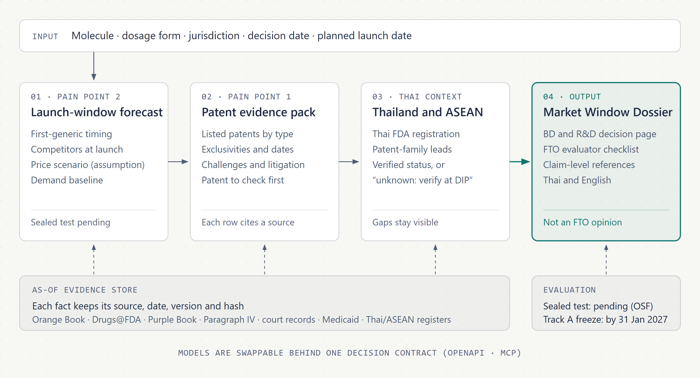
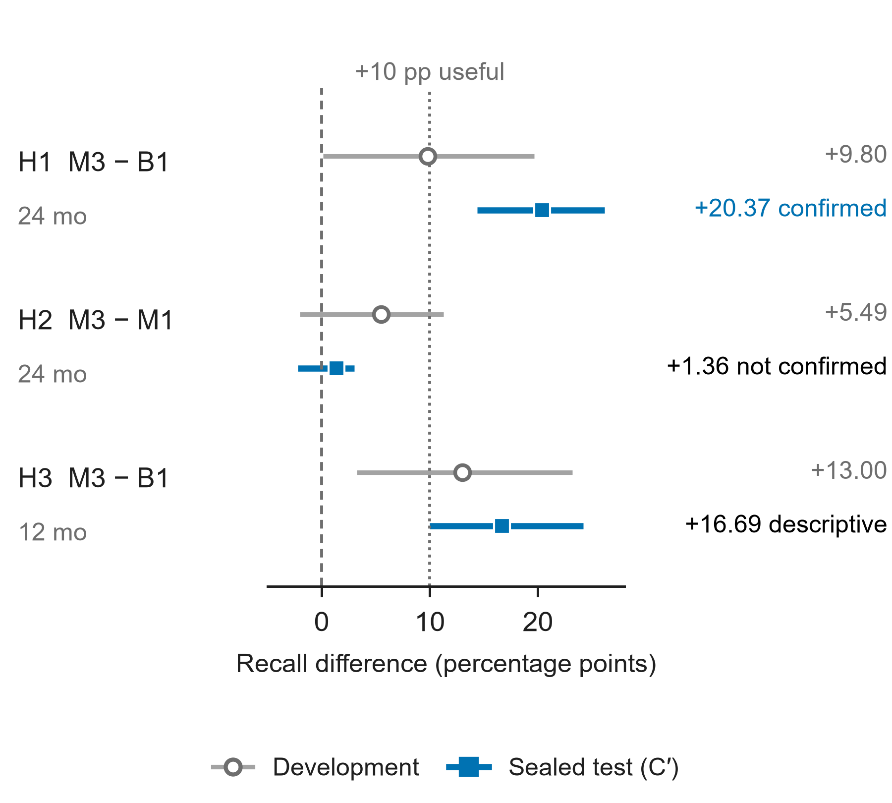

# แฟ้มข้อมูลช่วงเวลาเข้าสู่ตลาดยาสามัญและเกณฑ์มาตรฐาน LOE-Bench สำหรับจัดลำดับการทบทวนหลักฐาน

# Market Window Dossier and LOE-Bench for Prioritizing Generic Drug Evidence Review

นายศิริพล ศรีเฮงไพบูลย์\*¹ และ ผศ.ดร.ทัศนัย พลอยสุวรรณ²\
คณะเทคโนโลยีสารสนเทศ สถาบันเทคโนโลยีพระจอมเกล้าเจ้าคุณทหารลาดกระบัง\
เลขที่ 1 ซอยฉลองกรุง 1 แขวงลาดกระบัง เขตลาดกระบัง กรุงเทพฯ 10520

Siripon Srihangpiboon\*¹ and Tuchsanai Ploysuwan²\
School of Information Technology, King Mongkut's Institute of Technology Ladkrabang\
1 Chalong Krung 1 Alley, Lat Krabang, Bangkok 10520

## บทคัดย่อ

Market Window Dossier จัดหลักฐานตามวันที่เพื่อส่งให้ผู้เชี่ยวชาญประเมินเสรีภาพในการดำเนินการ (FTO) งานนี้ใช้ LOE-Bench ทดสอบการจัดคิวทบทวนไม่เกินร้อยละ 20 ของตัวยาที่เข้าเกณฑ์ ณ วันตัดข้อมูลแต่ละปี โดยใช้หลักฐานทางทะเบียนแบบเปิดของสหรัฐฯ ชุดทดสอบย้อนหลัง C′ ผ่านการตรวจรับแบบปกปิดผลและให้คะแนนตามแผนที่ลงทะเบียนบน OSF (doi:10.17605/OSF.IO/P2SMD) ที่ระยะ 24 เดือน แบบจำลองกราฟ (M3) ครอบคลุมการอนุมัติยาสามัญขั้นสุดท้ายครั้งแรกได้ร้อยละ 66.85 เทียบกับร้อยละ 46.48 ของวิธีฐานตามอายุยา (B1) ผลต่าง +20.37 จุดร้อยละ (ช่วงความเชื่อมั่น 95% [14.37, 26.16]) ผ่าน H1 และสูงกว่าเกณฑ์ +10 จุดร้อยละ ผลต่างเมื่อเทียบกับแบบจำลองที่ใช้หลักฐานเดียวกัน (M1) คือ +1.36 จุดร้อยละ [−2.20, 3.01] จึงไม่ผ่าน H2 ผลต่างระยะ 12 เดือน (+16.69 จุดร้อยละ [9.98, 24.21]) จึงรายงานเชิงพรรณนา ที่ระยะ 24 เดือน M1 สูงกว่า B1 อยู่ 19.01 จุดร้อยละ สอดคล้องกับข้อสังเกตว่าผลที่ดีขึ้นส่วนใหญ่มาจากหลักฐานที่ระบุวันที่ ในการวิเคราะห์เชิงสำรวจ M3 ครอบคลุมกรณีที่มีผู้ยื่นคำขอได้รับอนุมัติอย่างน้อยสามรายภายใน 36 เดือนได้ร้อยละ 79.8 เทียบกับร้อยละ 49.7 ของ B1 การตรวจความปลอดภัยของการคัดกรณีออกอัตโนมัติของ M3 ไม่ผ่าน การประเมินไปข้างหน้า Track A ยังรอดำเนินการ

**คำสำคัญ** ยาสามัญ, ช่วงเวลาเข้าสู่ตลาด, กราฟหลักฐาน, การจัดลำดับการทบทวน, เสรีภาพในการดำเนินการ

## Abstract

Market Window Dossier organizes dated evidence for freedom-to-operate specialists. LOE-Bench tests it under an assumed capacity of one review slot per five eligible drugs at each annual cutoff, with the first final US generic approval as the endpoint. The sealed historical test (C′) was scored after blinded admission under the registered OSF protocol (doi:10.17605/OSF.IO/P2SMD). At 24 months, the evidence-graph queue (M3) captured 66.85% of event rows versus 46.48% for the age baseline (B1), a gain of 20.37 percentage points (95% CI 14.37 to 26.16). H1 passed, and the whole interval exceeded the prespecified 10-point usefulness threshold. The matched flat model (M1) captured 65.49%, so the gain of M3 over M1 (1.36 points, −2.20 to 3.01) failed H2, and the 12-month gain over B1 (16.69 points, 9.98 to 24.21) is descriptive. In exploratory analyses, M3 captured 79.8% of cases reaching at least three approved applicants within 36 months, versus 49.7% for B1, and a 7B language model given the same evidence captured 12.36% of 24-month event rows. M3 failed the auto-clear safety check. The results support prioritizing US review, not the added value of graph state. Prospective Track A remains pending.

**Keywords** generic drugs, market window, evidence graph, review prioritization, freedom to operate

\* 68076060@kmitl.ac.th\
¹ นักศึกษาปริญญาโท สาขาวิชาปัญญาประดิษฐ์เพื่อการวิเคราะห์เชิงธุรกิจ / Postgraduate Student, Artificial Intelligence for Business Analytics Program\
² ผู้ช่วยศาสตราจารย์ คณะเทคโนโลยีสารสนเทศ / Assistant Professor, School of Information Technology, KMITL

## 1. Introduction

At an assumed review capacity of one in five eligible active-moiety sets, the LOE-Bench graph queue captured 66.85% of first final US generic approval rows at 24 months versus 46.48% for the age baseline (+20.37 percentage points, 95% CI 14.37 to 26.16). The matched flat model captured 65.49%, leaving the incremental value of graph state unconfirmed.

Before investing in bioequivalence or comparative trials, developers need to assess the market window. The FDA found that the median generic price was 46.5% of the pre-entry brand price with two marketed producers and 21% with four [1]. Our earlier work examined patent reranking instructions with fixed candidates [2]. Here the constraints are dated evidence and review capacity.

LOE-Bench evaluates a dated-evidence queue using open US records, a sealed test, a preregistered analysis and planned prospective replication. Market Window Dossier links the queue to an evidence packet and checklist for qualified freedom-to-operate (FTO) specialists using US, Thai and ASEAN sources.

- **RQ1 (confirmatory, specified in the preregistration protocol).** Using each model’s native scores before deferral, does M3 achieve higher recall of first final original abbreviated new drug application (ANDA) approvals at the 20% review budget? The ordered contrasts are M3 versus B1 at 24 months (H1), M3 versus M1 at 24 months (H2), and M3 versus B1 at 12 months (H3), tested at one-sided α = 0.025.
- **RQ2 (exploratory).** Do the frozen queues identify drugs with at least three distinct approved generic applicants within 36 months? Does an FDA price-erosion factor improve forecasts of Medicaid reimbursement when applied to queued ingredients?
- **RQ3 (system and exploratory evaluation).** Can open records support a dossier whose material claims can be traced to source records? How does L1e, a language model given the same upstream evidence, compare with M3 on the same forecast rows?

## 2. Background and Related Work

### 2.1 Endpoints and dated regulatory evidence

Patent expiry, ANDA submission, final approval and launch are distinct endpoints. Prior studies estimated entry from patents and exclusivity [3], [4], measured time to first generic approval [5], or predicted first submission [6], [7]. FDA documented a lag from approval to marketing [8].

Challenge and stay studies relate patent events to entry timing [9], [10]. Digitized Orange Book records reconstruct historical listings, whose public availability requires separate verification [11]. Court filing dates can serve as availability proxies [12].

### 2.2 Applicants, marketed producers and price scenarios

Studies of generic competition cover entry decisions, prices and the first entrant's share [1], [13]–[16]. Approval counts indicate potential competition. FDA price ratios use marketed producers and average manufacturer price (AMP). Applying those ratios to Medicaid reimbursement tests transfer across payment measures.

### 2.3 Evidence hand-off and Thai applicability

WIPO distinguishes patent landscaping from FTO analysis and describes the evidence needed for specialist review [17], [18]. PatentAgentBench offers FTO search and design tasks as a comparator for task design [19]. Studies of Thai patent examination inform the checklist [20], [21]. Regional records provide leads for national verification.

### 2.4 Evaluation and research gap

Historical language-model forecasts risk exposure through training or supplied evidence [22]. Chronologically consistent models and ForecastBench illustrate training-time and prospective controls [23], [24]. Preregistration, selective classification, clustered resampling and fixed-sequence testing inform the evaluation [25]–[28]. Outcome-based reinforcement learning motivates the optional prospective comparison [29].

The gap is whether graph state improves first-approval recall over matched dated inputs at fixed review capacity. The study also examines approved-applicant counts and whether dossier claims trace to dated records.

## 3. Methods

### 3.1 Dossier workflow and traceability

Figure 1 shows the proposed workflow from product intake to the evidence hand-off. The queue ranks active-moiety sets. The dossier records the formulation and jurisdiction so specialists can judge whether the ingredient-level evidence applies to the product. Demand and price outputs are scenarios, and missing or inconsistent records become checklist items for review.

Each material claim carries a source identifier, version, content hash, exact locator and availability basis in the proposed design. The dossier labels observations, estimates and scenario assumptions, and sends unknowns for manual verification. The audit checks source integrity and whether the cited passage supports the claim.

The Thai inventory covers domestic patent, drug, reference-price and procurement records. ASEAN records supply family and status leads for national verification.

### 3.2 As-of cohort and outcome

Each row represents an active-moiety set at an annual cutoff. Eligibility requires a usable ingredient key, a dated original final new drug application (NDA) approval, an original final NDA classified exactly TYPE 1 by the cutoff, and no first final ANDA by that date. The endpoint is the first dated original final ANDA approval (ORIG/AP) after the cutoff through the horizon end. All rows require full follow-up.

Drugs@FDA and the Global Substance Registration System (GSRS) support approval and ingredient linkage. C′ uses the latest hash-matched Orange Book edition dated within six calendar months, with independent evidence it was public by the cutoff. Challenge status uses fresh, availability-proven FDA Paragraph IV lists and timely qualifying court records. A fresh list can establish operational non-observation. Without a qualifying list or positive witness the state is unknown [30].

Both horizons train on the 2010 cutoff. Development uses 2012–2015 (12 months) and 2013–2014 (24 months). C′ uses 2017–2025 and 2017–2024, respectively. Before registration, overlapping 36-month B0–B2 aggregates, mixed-period preflight checks and candidate counts for power simulations exposed some C′ information. The record reports no per-row outcome inspection or test-based method selection [30].

### 3.3 Models, queues and inference

B1 estimates approval hazard from age since first NDA approval. M1 uses L2 logistic regression on age and dated regulatory evidence, including the B1 logit. M3 adds OPEN, BLOCKED and CONTESTED graph indicators to M1. The graph uses patent and exclusivity expiries and observed challenges, with unknowns propagated by Kleene three-valued logic [30].

At each cutoff and horizon, the queue takes one fifth of the roster, rounded down, by native scores before calibration or deferral, with fractional credit at ties. Recall divides expected captured event rows by all event rows across cutoffs.

We use 2,000 paired whole-drug bootstrap draws per horizon with fixed models and recomputed queues. A step passes when its one-sided lower bound exceeds zero. Failure or an undefined interval stops testing. All estimable contrasts receive two-sided 95% percentile intervals. Unreached steps are descriptive. The +10-point usefulness threshold is assessed separately [30].

*Figure 1. Proposed dossier workflow for specialist review. Development evaluation and historical C′ scoring are complete, and H1 passed on C′. The prospective Track A prediction freeze is due by 31 January 2027. Demand and price are scenario outputs.*

### 3.4 Registration, blinded admission and prospective follow-up

The public Open Science Framework (OSF) registration preceded scoring on 28 November 2026. The gate checked edition coverage and required at least 50 distinct 24-month event drugs, releasing only a verdict [30].

Update 1 substituted the public record hash for the unavailable OSF PDF hash and linked omitted attachments. Update 2 allowed December or January C9 training. C′ was scored under both updates, approved before the 05:12 UTC gate. Update 3, approved after scoring at 09:09 UTC, removed the month restriction while keeping C9 training after admission and before the core Track A freeze. The C′ inference rules remained as registered.

Track A retrains the fitted arms on windows mature at the 27 November 2026 origin. The core includes B1, M1, M3 and the descriptive expiry-only baseline B3. The protocol requires hashing, Git tagging and OSF timestamping before 31 January 2027 at 23:59 UTC and before post-origin outcome access. The follow-up windows mature on 27 November 2027 and 27 November 2028. Late freezes leave only exploratory analyses. With completed confirmatory scoring on C′, Track A is a replication [30].

### 3.5 Exploratory analyses

The frozen 24-month queues are evaluated on the 36-month outcome at mature 2013 development and 2017–2023 C′ cutoffs. The outcome requires final original ANDA approvals for at least three distinct legal applicants. The first eligible Orange Book listing within 12 months of approval identifies each applicant, with documented overrides and a current-sponsor sensitivity analysis. Strengths and repeat approvals are collapsed. Unresolved identities remain unknown. Queue membership and tie weights come from the frozen roster.

Retrospectively mapped State Drug Utilization Data provide prescription counts, annual gross reimbursement and fourth-quarter reimbursement per prescription. On matched origins and ingredients, the frozen 12-month queues apply the FDA two-producer AMP ratio (0.465) to carry-forward reimbursement forecasts for queued cases. Unqueued ingredients retain carry-forward. Drift is a secondary baseline. The queued arms use the same deterministic boundary order. Historical release vintages are unverified and the ratio postdates the origins.

L1 and L1e share the Qwen2.5-7B-Instruct checkpoint and decoder. L1 receives ingredient, cutoff and horizon. L1e adds M3's upstream evidence and instructions for its use, omitting fitted risks, B1 hazard, graph verdicts, actions and outcomes. The optional 24-month prospective comparison pairs group relative policy optimization (GRPO) with supervised fine-tuning (SFT) on common inputs before the core freeze.

## 4. Results

### 4.1 RQ1: First-approval review queues

**Sealed historical test (C′).** The blinded admission gate returned PASS. The first author authorized scoring, which ran on 28 November 2026 under OSF registration 10.17605/OSF.IO/P2SMD and its approved updates 1 and 2, with no deviation from the registered inference procedure. The 24-month panel covered annual cutoffs in 2017–2024 and had 4,639 rows, including 368 event rows from 202 distinct event drugs. The 12-month panel covered 2017–2025 and had 5,259 rows, including 202 event rows from 202 distinct event drugs. [GATE](../../../loe-bench/receipts/GATE.md) [SCORE](../../../loe-bench/receipts/SCORE.md#primary-family)

Table 1 gives the recall of every arm on C′. Recall pools event rows across annual cutoffs, with fractional credit for boundary ties. The language-model arms are exploratory (§4.3). Table 2 gives the registered contrasts. All primary bootstrap draws were defined. [SCORE](../../../loe-bench/receipts/SCORE.md#secondary-analyses) [SCORELLM](../../../loe-bench/receipts/SCORELLM.md)

H1 passed the superiority test against zero, and its entire interval also exceeded the separate +10-point usefulness threshold. H2 failed and stopped the sequence. H3 is descriptive because H2 stopped testing; its point estimate reached +10 points. The secondary M1 − B1 differences were +19.01 [+13.34, +25.62] points at 24 months and +17.18 [+9.88, +24.06] at 12 months. They show how much of the gain the flat model achieved, without isolating a causal contribution of dated evidence. The secondary auto-clear diagnostic failed for M3 at both horizons, and cases outside the priority queue remain in routine review. [SCORE](../../../loe-bench/receipts/SCORE.md#secondary-analyses)

**Development.** The 24-month panel had 1,083 rows, 91 event rows from 67 drugs and 215 slots, and the 12-month panel had 2,161 rows, 90 event rows from 90 drugs and 430 slots. The H1, H2 and H3 contrasts were +9.80 [+0.14, +19.65], +5.49 [−2.00, +11.25] and +13.00 [+3.27, +23.17] percentage points, respectively (95% CIs, Figure 2). Only the H3 point estimate reached the +10-point usefulness threshold. The auto-clear diagnostic failed for every estimable arm and horizon.

Track A predictions await the prospective freeze and the outcomes remain pending.

*Table 1. Recall at the 20% review budget on the sealed historical test (C′).*

| Horizon | Eligible rows | Event rows | Slots | B1 age | M1 flat | M3 graph | L1 identity prompt | L1e evidence prompt |
| --- | ---: | ---: | ---: | ---: | ---: | ---: | ---: | ---: |
| 24 months | 4,639 | 368 | 924 | 46.48% | 65.49% | 66.85% | 26.14% | 12.36% |
| 12 months | 5,259 | 202 | 1,048 | 50.64% | 67.82% | 67.33% | 26.58% | 14.50% |

*Table 2. C′ paired recall differences at the 20% review budget and fixed-sequence decisions.*

| Step | Horizon | Contrast | Difference (pp) | Two-sided 95% CI (pp) | One-sided lower bound (pp) | Decision | Point estimate ≥ +10 pp |
| --- | ---: | --- | ---: | --- | ---: | --- | --- |
| H1 | 24 months | M3 − B1 | +20.37 | [+14.37, +26.16] | +14.37 | PASS | Yes |
| H2 | 24 months | M3 − M1 | +1.36 | [−2.20, +3.01] | −2.20 | FAIL | No |
| H3 | 12 months | M3 − B1 | +16.69 | [+9.98, +24.21] | +9.98 | Not reached, descriptive | Yes |

*Figure 2. Paired recall differences at 20% capacity with two-sided 95% whole-drug bootstrap intervals. Lines mark zero and +10 percentage points. Distinct event drugs at 24 and 12 months were 67 and 90 in development and 202 at each horizon in C′. C′ H3 is descriptive.*

### 4.2 RQ2: Approved applicant counts and Medicaid reimbursement

At the mature 2013 development cutoff, M3 recalled 71.43% and B1 45.83% of 21 events across 539 rows and 107 slots per arm. The paired difference was +25.60 points (95% CI [6.25, 45.00]), with the same result in the current-sponsor sensitivity analysis.

On the C′ rosters with mature 36-month follow-up (2017–2023 cutoffs), the exploratory C3 analysis found 173 known-positive rows from 92 distinct event drugs under the primary applicant rule. M3 captured 79.8% of known-positive rows and B1 captured 49.7%, a paired difference of +30.11 percentage points (95% CI [+20.16, +36.86]). Four rows had unknown labels and were excluded from the primary recall denominator. The snapshot-sponsor sensitivity gave +30.16 points. These counts measure approved applicants as an indicator of potential competition. [SCORE, C3](../../../loe-bench/receipts/SCORE.md#c3--competition-at-launch)

Applying the 0.465 factor increased mean absolute error (MAE) on both reimbursement endpoints in the retrospectively mapped Medicaid subset, relative to unadjusted carry-forward. Table 3 reports paired ingredient-cluster percentile intervals. The linked analyses cover four origins. They use 160 ingredient-origin pairs from 68 ingredients for reimbursement per prescription and 150 pairs from 64 ingredients for annual reimbursement.

Drift reduced MAE on both endpoints. The contrasts are descriptive and unadjusted for multiplicity. Gross pre-rebate payments include Medicaid and non-Medicaid source fields for mapped packages. Reserved-origin C4 was not run because the manifest lacked a pinned 2018 target payload. [SCORE, C4](../../../loe-bench/receipts/SCORE.md#c4--medicaid-demand-and-reimbursement)

*Table 3. Reimbursement MAE versus carry-forward.*

| Comparison with carry-forward | Fourth-quarter USD per prescription [95% CI] | Annual USD millions [95% CI] |
| --- | ---: | ---: |
| B1-adjusted | +372.05 [193.27, 587.26] | +4.98 [2.24, 8.29] |
| M3-adjusted | +381.24 [203.61, 606.77] | +21.43 [4.07, 53.21] |
| Drift minus carry-forward | −172.13 [−292.12, −66.37] | −3.69 [−8.41, −0.20] |

### 4.3 RQ3: Source trace and evidence-matched language model

The demonstration build produced 32 development dossiers. Its automated audit traced all 1,789 material claims to a cited source record, 1,757 of them with a content hash, and found no claim dated after its dossier's as-of date. This audit checks source integrity. Whether each cited passage semantically supports its claim still requires a reviewer-level audit. For six demonstration cases, documentary support was found for three of five attempted patent-restriction labels. Patent family traces were found for 17 of 17 key US grants, but Thai patent status and Thai FDA registration were verified for none of the six cases, because four source routes blocked access or automation. The dossier therefore shows Thai status as unknown and routes it to the specialist checklist.

On development data, L1e − M3 recall was −36.87 percentage points at 12 months (paired 95% CI [−47.40, −23.92]) and −30.37 at 24 months [−43.08, −16.44], exploratory and unadjusted for multiplicity.

On C′, both language-model arms produced 9,898 schema-valid forecasts, and their recall is shown in Table 1. At 24 months, L1e − M3 was −54.48 percentage points [−61.18, −47.61] and L1e − L1 was −13.78 [−17.71, −10.32]. At 12 months, the differences were −52.83 [−59.34, −45.19] and −12.08 [−16.41, −7.45]. These findings apply to one frozen Qwen2.5-7B-Instruct checkpoint, one decoder and one pair of prompts. L1e changed both the evidence fields and their instructions, and the model's pretraining exposure to the historical outcomes is unknown.

The optional prospective comparison uses Qwen2.5-1.5B-Instruct for GRPO and SFT. Its training was in progress at the time of writing, and its outcomes await Track A.

## 5. Conclusion

**RQ1.** M3 improved 24-month C′ recall over B1 by 20.37 points, above the +10-point usefulness threshold. H2 left the incremental value of graph state unconfirmed. H3 is descriptive because H2 stopped testing.

**RQ2.** M3 captured more drugs reaching the approved-applicant threshold. In the mapped Medicaid subset, the FDA price factor worsened forecast error. Its use remains a scenario assumption.

**RQ3.** The dossier audit traced material claims to source records. The evidence-matched language model ranked below M3 on the tested rows. Unresolved items go to qualified specialists.

The US cohort covers eligible new molecular entity histories and regulatory approvals. Historical edition gaps, later identity records, uncertainty in challenge dates and limited independent event drugs constrain inference. Applicant counts indicate potential competition. Medicaid release vintages are unverified, and the LLM test uses a single checkpoint with unknown pretraining exposure.

Track A requires timestamped predictions before outcome access. Follow-up work should verify whether sources support individual claims, check Thai and ASEAN records, and use commercial records for launch and Thai procurement and utilization records for demand. Reviewer time savings need direct evaluation. Product-specific FTO conclusions require qualified review.

Data and code availability. Code, frozen configurations, task receipts and the preregistration are available in the project repository [31] and the OSF registration [30]. The repository includes aggregate C′ results. Row-level test labels remain access-restricted.

Acknowledgment. The authors used AI assistants (Anthropic Claude, OpenAI GPT and SciSpace) for planning, code, drafting, figures and literature search. The authors reviewed all content and take full responsibility for it.

## References

[1] R. Conrad and R. Lutter, “Generic competition and drug prices: New evidence linking greater generic competition and lower generic drug prices,” US FDA, 2019. [Report](https://www.fda.gov/media/133509/download).

[2] S. Srihangpiboon and T. Ploysuwan, “Diagnosing near-zero instruction effects in cross-domain patent reranking,” in *Proc. iSAI-NLP*, 2026, paper 53. [Online]. Available: https://isai-nlp2026.aiat.or.th/program

[3] R. F. Beall, J. J. Darrow, and A. S. Kesselheim, “A method for approximating future entry of generic drugs,” *Value Health*, vol. 21, no. 12, pp. 1382–1389, Dec. 2018. [doi: 10.1016/j.jval.2018.04.1827](https://doi.org/10.1016/j.jval.2018.04.1827).

[4] R. F. Beall et al., “Comparing onset of biosimilar versus generic competition in the United States,” *Clin. Pharmacol. Ther.*, vol. 108, no. 6, pp. 1308–1314, 2020. [doi: 10.1002/cpt.1981](https://doi.org/10.1002/cpt.1981).

[5] K. W. Kerr and L. J. Glos, “Effective market exclusivity of new molecular entities for rare and non-rare diseases,” *Pharmaceut. Med.*, vol. 34, no. 1, pp. 19–29, 2020. [doi: 10.1007/s40290-019-00317-9](https://doi.org/10.1007/s40290-019-00317-9).

[6] M. Hu et al., “Predictive analysis of first abbreviated new drug application submission for new chemical entities based on machine learning methodology,” *Clin. Pharmacol. Ther.*, vol. 106, no. 1, pp. 174–181, 2019. [doi: 10.1002/cpt.1479](https://doi.org/10.1002/cpt.1479).

[7] R. Hopefl et al., “Predictive analysis for first submission of generic drug application for orphan drug products using random survival forest,” *Clin. Transl. Sci.*, vol. 18, no. 10, e70365, 2025. [doi: 10.1111/cts.70365](https://doi.org/10.1111/cts.70365).

[8] H. S. Chahal, R. Patel, and M. Shimer, “Marketing of first generic drugs approved by U.S. FDA from January 2010 to June 2017,” U.S. Food and Drug Administration, Nov. 2021. [Report](https://www.fda.gov/media/154101/download).

[9] C. S. Hemphill and B. N. Sampat, “Evergreening, patent challenges, and effective market life in pharmaceuticals,” *J. Health Econ.*, vol. 31, no. 2, pp. 327–339, 2012. [Article](https://www.sciencedirect.com/science/article/abs/pii/S0167629612000057).

[10] S. Kannappan, J. J. Darrow, A. S. Kesselheim, and R. F. Beall, “The timing of 30-month stay expirations and generic entry: A cohort study of first generics, 2013–2020,” *Clin. Transl. Sci.*, vol. 14, no. 5, pp. 1917–1923, 2021. [doi: 10.1111/cts.13046](https://doi.org/10.1111/cts.13046).

[11] M. Durvasula *et al.*, “The NBER Orange Book dataset: A user’s guide,” *Res. Policy*, vol. 52, no. 7, Art. no. 104791, 2023. [doi: 10.1016/j.respol.2023.104791](https://doi.org/10.1016/j.respol.2023.104791).

[12] A. K. Rai, S. Vishnubhakat, J. Lemus, and E. Hovenkamp, “Replication data for: Post-grant adjudication of drug patents: Agency and/or court?,” Harvard Dataverse, ver. 1.0, 2021. [doi: 10.7910/DVN/YCMKVU](https://doi.org/10.7910/DVN/YCMKVU).

[13] F. M. Scott Morton, “Entry decisions in the generic pharmaceutical industry,” *RAND J. Econ.*, vol. 30, no. 3, pp. 421–440, 1999. [doi: 10.2307/2556056](https://doi.org/10.2307/2556056).

[14] D. Reiffen and M. R. Ward, “Generic drug industry dynamics,” *Rev. Econ. Stat.*, vol. 87, no. 1, pp. 37–49, 2005. [doi: 10.1162/0034653053327694](https://doi.org/10.1162/0034653053327694).

[15] A. Hollis, “The importance of being first: Evidence from Canadian generic pharmaceuticals,” *Health Econ.*, vol. 11, no. 8, pp. 723–734, 2002. [doi: 10.1002/hec.698](https://doi.org/10.1002/hec.698).

[16] K. Nikolopoulos, S. Buxton, M. Khammash, and P. Stern, “Forecasting branded and generic pharmaceuticals,” *Int. J. Forecast.*, vol. 32, no. 2, pp. 344–357, 2016. [doi: 10.1016/j.ijforecast.2015.08.001](https://doi.org/10.1016/j.ijforecast.2015.08.001).

[17] A. Trippe, *Guidelines for Preparing Patent Landscape Reports*, prepared for the World Intellectual Property Organization, WIPO Publ. 946, 2015. [Guide](https://www.wipo.int/edocs/pubdocs/en/wipo_pub_946.pdf).

[18] World Intellectual Property Organization, *Identifying Inventions in the Public Domain: A Guide for Inventors and Entrepreneurs*, WIPO Publ. 1062, 2020. [Guide](https://www.wipo.int/publications/en/details.jsp?id=4501).

[19] Y. Hu *et al.*, “PatentAgentBench: Benchmarking LLM agents with professional patent task suites,” arXiv:2610.35031, 2026. [Online]. Available: https://arxiv.org/abs/2610.35031

[20] P. Leela and N. Kessomboon, “Challenges of examination processes of pharmaceutical patent application in Thailand,” *Isan J. Pharm. Sci.*, vol. 11, suppl., pp. 179–189, 2016. [Article](https://he01.tci-thaijo.org/index.php/IJPS/article/view/48601).

[21] D. Vachanavuttivong, P. Naboriboon, and A. Homhuan, “Expediting the patent examination system in Thailand: Recent developments,” Tilleke & Gibbins, Bangkok, Thailand, Mar. 3, 2014. [Online]. Available: https://www.tilleke.com/insights/expediting-patent-examination-system-thailand-recent-developments/

[22] D. Paleka, S. Goel, J. Geiping, and F. Tramèr, “Pitfalls in evaluating language model forecasters,” in *Proc. ICLR*, 2026. [Conference paper](https://proceedings.iclr.cc/paper_files/paper/2026/hash/b9d69c72e4587ddf3fa6352890aefc4f-Abstract-Conference.html).

[23] S. He, L. Lv, A. Manela, and J. Wu, “Chronologically consistent large language models,” *J. Financ. Econ.*, vol. 185, Art. no. 104374, 2026. [doi: 10.1016/j.jfineco.2026.104374](https://doi.org/10.1016/j.jfineco.2026.104374).

[24] E. Karger et al., “ForecastBench: A dynamic benchmark of AI forecasting capabilities,” in *Proc. ICLR*, 2025. [Conference paper](https://proceedings.iclr.cc/paper_files/paper/2025/hash/ea74e45a229dac70b5b63b28d8934db6-Abstract-Conference.html).

[25] O. R. van den Akker *et al.*, “Preregistration of secondary data analysis: A template and tutorial,” *Meta-Psychology*, vol. 5, 2021. [doi: 10.15626/MP.2020.2625](https://doi.org/10.15626/MP.2020.2625).

[26] J. Traub et al., “Overcoming common flaws in the evaluation of selective classification systems,” in *Adv. Neural Inf. Process. Syst.*, vol. 37, pp. 2323–2347, 2024. [Paper](https://proceedings.neurips.cc/paper_files/paper/2024/file/047c84ec50bd8ea29349b996fc64af4b-Paper-Conference.pdf).

[27] C. A. Field and A. H. Welsh, “Bootstrapping clustered data,” *J. R. Stat. Soc. B*, vol. 69, no. 3, pp. 369–390, 2007. [doi: 10.1111/j.1467-9868.2007.00593.x](https://doi.org/10.1111/j.1467-9868.2007.00593.x).

[28] U.S. Food and Drug Administration, *Multiple Endpoints in Clinical Trials: Guidance for Industry*, Oct. 2022. [Guidance](https://www.fda.gov/regulatory-information/search-fda-guidance-documents/multiple-endpoints-clinical-trials).

[29] B. Turtel, D. Franklin, K. Skotheim, L. Hewitt, and P. Schoenegger, “Outcome-based reinforcement learning to predict the future,” *Trans. Mach. Learn. Res.*, Nov. 2025. [Journal article](https://openreview.net/pdf/6854ebdc1a775820ad158c9a284cbe20d6241201.pdf).

[30] S. Srihangpiboon, “Market Window Dossier / LOE-Bench: evidence-graph review queues for forecasting US first generic approvals from dated open regulatory records,” OSF preregistration, 28 Nov. 2026. [doi: 10.17605/OSF.IO/P2SMD](https://doi.org/10.17605/OSF.IO/P2SMD).

[31] S. Srihangpiboon, “patent-to-pilot: Market Window Dossier and LOE-Bench,” GitHub repository, commit 3e06537b (C′ scoring), 2026. [Online]. Available: https://github.com/siriponsri/patent-to-pilot
