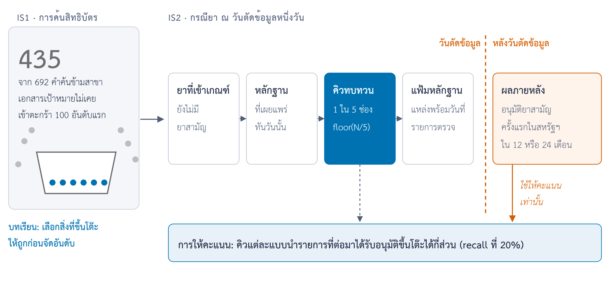
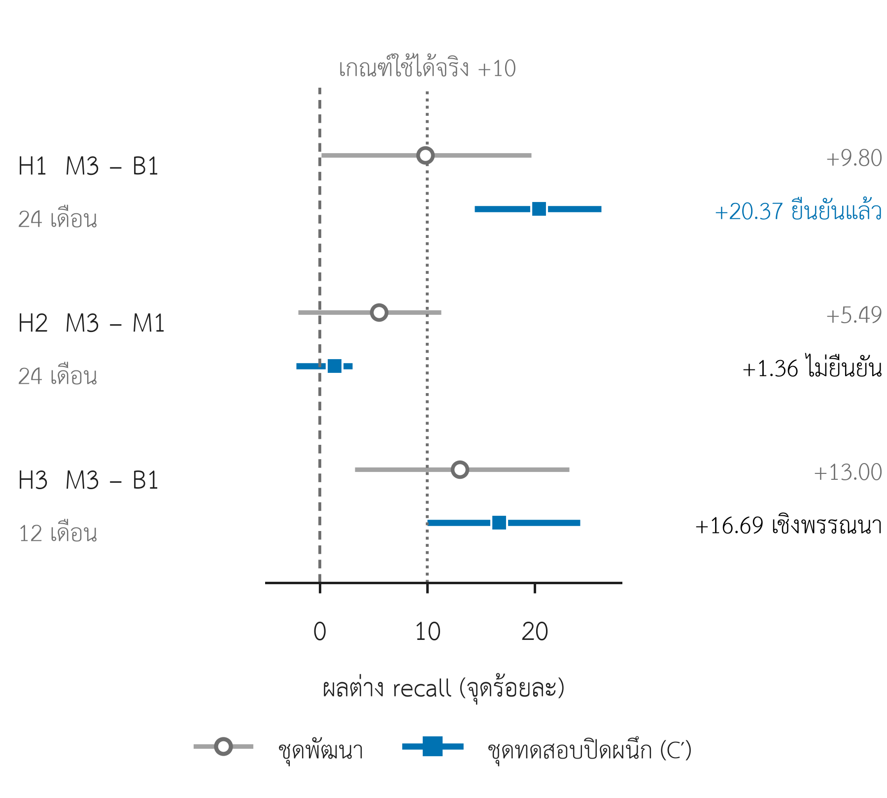

# เมื่อทบทวนยาได้หนึ่งในห้า หลักฐานทางทะเบียนช่วยให้คิวครอบคลุมการอนุมัติยาสามัญครั้งแรกในสหรัฐฯ ได้เพียงใด

# When Only One Drug in Five Can Be Reviewed, How Well Does Regulatory Evidence Capture First US Generic Approvals?

นายศิริพล ศรีเฮงไพบูลย์\*¹ และ ผศ.ดร.ทัศนัย พลอยสุวรรณ²\
คณะเทคโนโลยีสารสนเทศ สถาบันเทคโนโลยีพระจอมเกล้าเจ้าคุณทหารลาดกระบัง\
เลขที่ 1 ซอยฉลองกรุง 1 แขวงลาดกระบัง เขตลาดกระบัง กรุงเทพฯ 10520

Siripon Srihangpiboon\*¹ and Tuchsanai Ploysuwan²\
School of Information Technology, King Mongkut's Institute of Technology Ladkrabang\
1 Chalong Krung 1 Alley, Lat Krabang, Bangkok 10520

## บทคัดย่อ

ทีมทบทวนยาได้เพียงหนึ่งในห้าของรายการที่เข้าเกณฑ์ ผู้วิจัยจำลองการเลือกย้อนหลังจากหลักฐานที่มี ณ วันตัดข้อมูล แล้วให้คะแนนคิวจากการอนุมัติยาสามัญขั้นสุดท้ายครั้งแรกในสหรัฐฯ ในชุดทดสอบย้อนหลังแบบปิดผนึก (C′) ที่ระยะ 24 เดือน คิวจากตารางหลักฐานที่เพิ่มสถานะกราฟ (M3) ครอบคลุมร้อยละ 66.85 ของรายการยา ณ วันตัดข้อมูลที่ต่อมาเกิดการอนุมัติในช่วงติดตาม เทียบกับร้อยละ 46.48 ของคิวตามอายุยา (B1) และร้อยละ 65.49 ของคิวจากตารางหลักฐานตามวันที่ (M1) คิวกราฟครอบคลุมมากกว่าคิวตามอายุยา 20.37 จุดร้อยละ (ช่วงความเชื่อมั่น 95% [14.37, 26.16]) ผลทดสอบยังยืนยันประโยชน์ส่วนเพิ่มจากสถานะกราฟไม่ได้ ทีมใช้คิวเลือกกรณีที่จะตรวจได้ แต่กฎคัดกรณีออกอัตโนมัติไม่ผ่านการตรวจความปลอดภัย ทีมยังต้องทบทวนกรณีนอกคิวตามปกติ

**คำสำคัญ** ยาสามัญ, ช่วงเวลาเข้าสู่ตลาด, กราฟหลักฐาน, การจัดลำดับการทบทวน, เสรีภาพในการดำเนินการ

## Abstract

A drug team can review only one in five eligible drugs. We reconstructed that choice from records available at each cutoff and scored the queues on subsequent first final US generic approvals in a sealed historical test (C′). At 24 months, the table model with added graph states (M3) captured 66.85% of drug cases at cutoff with an approval in the window, compared with 46.48% for the drug-age baseline (B1) and 65.49% for the dated-evidence table model (M1). The graph queue gained 20.37 percentage points over drug age (95% CI 14.37 to 26.16). The study did not establish a gain from adding graph states to the table. Teams can use the queue to prioritize cases, but automatic clearance failed the safety check. Cases outside the queue still need routine review.

**Keywords** generic drugs, market window, evidence graph, review prioritization, freedom to operate

\* 68076060@kmitl.ac.th\
¹ นักศึกษาปริญญาโท สาขาวิชาปัญญาประดิษฐ์เพื่อการวิเคราะห์เชิงธุรกิจ / Postgraduate Student, Artificial Intelligence for Business Analytics Program\
² ผู้ช่วยศาสตราจารย์ คณะเทคโนโลยีสารสนเทศ / Assistant Professor, School of Information Technology, KMITL

## 1 บทนำ

ในงาน IS1 ผู้วิจัยลองเปลี่ยนคำสั่งให้แบบจำลองจัดอันดับสิทธิบัตรข้ามสาขา [1] แต่ใน 435 จาก 692 คำค้น เอกสารเป้าหมายที่ทราบไม่ติด 100 อันดับแรกตั้งแต่ขั้นค้นคืน ต่อให้เปลี่ยนวิธีเรียง เอกสารเหล่านั้นก็ไม่มีโอกาสขึ้นโต๊ะให้ตรวจ ใน IS2 สิ่งที่ทีมต้องเลือกคือกรณียา ก่อนลงทุนศึกษาชีวสมมูล หากทีมมีเวลาตรวจยาเพียงหนึ่งในห้าของรายการที่เข้าเกณฑ์ หลักฐานที่มีอยู่ในวันนั้นจะช่วยให้ทีมเลือกตรวจยาที่กำลังจะได้รับการอนุมัติยาสามัญครั้งแรกในสหรัฐฯ ได้ครอบคลุมเพียงใด

LOE-Bench ใช้ระเบียนย้อนหลังของสหรัฐฯ ทดสอบการเลือกนี้ แฟ้มข้อมูลช่วงเวลาเข้าสู่ตลาด (Market Window Dossier) เชื่อมคิวกับชุดหลักฐานและรายการตรวจสอบสำหรับผู้เชี่ยวชาญด้านเสรีภาพในการดำเนินการ (freedom to operate หรือ FTO)

- **RQ1** เมื่อทีมตรวจได้เท่าเดิม คิวกราฟครอบคลุมการอนุมัติครั้งแรกได้มากกว่าคิวตามอายุยาเพียงใด เมื่อทีมมีตารางหลักฐานอยู่แล้ว การเพิ่มสถานะกราฟช่วยให้คิวครอบคลุมเพิ่มเพียงใด
- **RQ2 (เชิงสำรวจ)** เมื่อแบบจำลองภาษา 7B ได้หลักฐานต้นทางชุดเดียวกัน แบบจำลองจัดคิวกรณีเดิมได้ดีเพียงใด คิวครอบคลุมรายการที่มีผู้ยื่นคำขอได้รับอนุมัติอย่างน้อยสามรายภายใน 36 เดือนได้เพียงใด และตัวคูณราคาช่วยให้ทีมพยากรณ์ยอดเบิกจ่าย Medicaid ได้แม่นขึ้นหรือไม่
- **RQ3 (ตรวจสอบแฟ้ม)** เมื่อผู้เชี่ยวชาญเปิดแฟ้ม ผู้เชี่ยวชาญย้อนข้อความข้อใดไปถึงต้นทางได้ และข้อใดยังต้องตรวจเพิ่ม

## 2 ทฤษฎีและงานวิจัยที่เกี่ยวข้อง

### 2.1 จากการประมาณวันเข้าสู่ตลาดสู่การเลือกเรื่องตรวจ

Beall และคณะใช้สิทธิบัตรและระยะคุ้มครองประมาณวันเข้าสู่ตลาดของยาสามัญ [2], [3] LOE-Bench ใช้ช่องว่างนี้ตั้งคำถามว่า เมื่อทีมตรวจได้เท่าเดิม คิวใดที่สร้างจากระเบียน ณ วันตัดข้อมูลจะครอบคลุมการอนุมัติครั้งแรกที่เกิดภายหลังได้มากกว่า งานอื่นวัดเวลาถึงการอนุมัติ [4] หรือพยากรณ์การยื่นครั้งแรก [5], [6] FDA พบว่าการอนุมัติกับการเริ่มขายเกิดต่างเวลากัน [7]

งานด้านการโต้แย้งสิทธิบัตรและการชะลออนุมัติเชื่อมเหตุการณ์เหล่านี้กับเวลาเข้าสู่ตลาด [8], [9] ทีมใช้ Orange Book ฉบับย้อนหลังสร้างรายการได้เมื่อยืนยันวันเผยแพร่ [10] และใช้วันยื่นคดีประมาณวันที่เข้าถึงระเบียนได้ [11]

### 2.2 ผู้ยื่นคำขอ ผู้ผลิตที่ขายจริง และยอดเบิกจ่าย

FDA ใช้ราคาผู้ผลิตเฉลี่ย (average manufacturer price หรือ AMP) คำนวณสัดส่วนราคามัธยฐานเทียบกับยาต้นแบบก่อนมียาสามัญ ได้ร้อยละ 46.5 เมื่อมีผู้ผลิตขายจริงสองราย และร้อยละ 21 เมื่อมีสี่ราย [12] งานก่อนหน้าศึกษาการเข้าสู่ตลาด ราคา และส่วนแบ่งของผู้เข้าตลาดรายแรก [13]–[16] ทีมใช้จำนวนผู้ได้รับอนุมัติเป็นตัวชี้การแข่งขันที่อาจเกิดขึ้น การนำอัตราส่วน AMP มาปรับยอดเบิกจ่าย Medicaid เป็นการทดสอบการใช้ข้ามฐานราคา

### 2.3 การส่งต่อหลักฐานและการใช้ในบริบทไทย

WIPO แยกการสำรวจภาพรวมสิทธิบัตรออกจากการประเมิน FTO และอธิบายหลักฐานที่ผู้เชี่ยวชาญใช้ [17], [18] งานค้นและออกแบบด้าน FTO ใน PatentAgentBench ใช้เทียบการกำหนดโจทย์ [19] งานศึกษาการตรวจสอบสิทธิบัตรไทยใช้ประกอบรายการตรวจสอบ [20], [21] ระเบียนภูมิภาคให้เบาะแสสำหรับตรวจต่อกับแหล่งข้อมูลของประเทศ

### 2.4 กรอบการประเมิน

การทดสอบย้อนหลังของแบบจำลองภาษาอาจได้รับข้อมูลภายหลังจากชุดฝึกหรือหลักฐานที่ป้อน [22] แบบจำลองที่ควบคุมช่วงข้อมูลฝึกและ ForecastBench เป็นตัวอย่างการควบคุมตามเวลาและการประเมินไปข้างหน้า [23], [24] งานนี้อาศัยการลงทะเบียนล่วงหน้า การจำแนกแบบเลือกตอบ การสุ่มซ้ำระดับกลุ่ม และการทดสอบตามลำดับ [25]–[28] ส่วนการเรียนรู้แบบเสริมกำลังจากผลลัพธ์ใช้ประกอบการออกแบบการเปรียบเทียบไปข้างหน้าเชิงสำรวจ [29]

## 3 วิธีดำเนินการวิจัย

### 3.1 การตัดสินใจ ณ วันตัดข้อมูลและการส่งต่อหลักฐาน

ทีมเริ่มจากรายการที่เข้าเกณฑ์ ใช้หลักฐานตามวันที่จัดคิว และส่งแฟ้มให้ผู้เชี่ยวชาญตามรูปที่ 1 คิวจัดลำดับชุดส่วนออกฤทธิ์ของตัวยา (active-moiety set) แฟ้มระบุรูปแบบยาและเขตอำนาจเพื่อให้ผู้เชี่ยวชาญตรวจว่าหลักฐานใช้กับผลิตภัณฑ์ได้หรือไม่ แฟ้มระบุรหัสแหล่งข้อมูล ฉบับ ค่าแฮช ตำแหน่ง และหลักฐานวันเข้าถึงของข้อความสำคัญแต่ละข้อ พร้อมแยกข้อสังเกต ค่าประมาณ และสถานการณ์จำลอง และระบุข้อที่ต้องตรวจเพิ่ม

### 3.2 รายการที่เข้าเกณฑ์ หลักฐาน และผลลัพธ์

รายการยา ณ วันตัดข้อมูลหมายถึงชุดส่วนออกฤทธิ์ของตัวยาที่พิจารณา ณ วันตัดข้อมูลประจำปี ทีมรับรายการที่มีรหัสเชื่อมตัวยา มีคำขออนุมัติยาใหม่ (new drug application หรือ NDA) ฉบับยื่นครั้งแรกที่อนุมัติขั้นสุดท้ายพร้อมวันที่ มี NDA ฉบับยื่นครั้งแรกที่อนุมัติขั้นสุดท้ายและจัดเป็น TYPE 1 ภายในวันตัดข้อมูล และยังไม่มีการอนุมัติยาสามัญขั้นสุดท้ายครั้งแรกภายในวันนั้น ทีมติดตามทุกรายการจนครบระยะและนับการอนุมัติขั้นสุดท้ายครั้งแรกของคำขออนุมัติยาสามัญแบบย่อ (abbreviated new drug application หรือ ANDA, ORIG/AP) หลังวันตัดข้อมูลจนถึงวันสิ้นสุดระยะ

ทีมเชื่อมข้อมูลการอนุมัติกับตัวยาผ่าน Drugs@FDA และ Global Substance Registration System สำหรับชุดทดสอบย้อนหลังแบบปิดผนึก (C′) ทีมเลือก Orange Book ฉบับล่าสุดที่ลงวันที่ไม่เกินหกเดือนปฏิทินก่อนวันตัดข้อมูล มีค่าแฮชตรงกัน และมีหลักฐานว่าประชาชนเข้าถึงได้ทันวันนั้น ทีมใช้รายการ Paragraph IV ของ FDA ฉบับที่ทันวันตัดข้อมูลและยืนยันวันเผยแพร่ได้ รวมถึงระเบียนคดีที่เข้าเกณฑ์ เพื่อระบุสถานะการโต้แย้ง รายการฉบับที่ทันวันตัดข้อมูลช่วยระบุว่าไม่พบการโต้แย้งตามเกณฑ์ หากขาดทั้งรายการที่เข้าเกณฑ์และหลักฐานว่ามีการโต้แย้ง ทีมคงสถานะไม่ทราบ [30]

ทีมใช้ปี 2010 ฝึกทั้งสองระยะ ชุดพัฒนาใช้ปี 2012–2015 ที่ระยะ 12 เดือนและปี 2013–2014 ที่ระยะ 24 เดือน ส่วน C′ ใช้ปี 2017–2025 และ 2017–2024 ตามลำดับ ก่อนลงทะเบียนทีมเห็นข้อมูลบางส่วนที่ซ้อนกับ C′ ได้แก่ ผลรวม B0–B2 ที่ระยะ 36 เดือน การตรวจระบบเบื้องต้นที่ใช้ข้อมูลหลายช่วง และจำนวนรายการสำหรับจำลองกำลังทดสอบ บันทึกระบุว่าทีมไม่ได้ตรวจผลรายกรณีหรือเลือกวิธีจากชุดทดสอบ [30] ตัวยาเดิมอาจปรากฏในหลายวันตัดข้อมูล ทีมจึงนับจำนวนรายการที่เกิดเหตุการณ์รวมจากทุกวันตัดข้อมูล และนับจำนวนตัวยาที่เกิดเหตุการณ์แบบไม่นับซ้ำแยกกัน

### 3.3 คิวและลำดับการทดสอบที่ลงทะเบียน

คิวตามอายุยา (B1) ประมาณอัตราอนุมัติจากเวลาหลัง NDA ครั้งแรก คิวจากตารางหลักฐานตามวันที่ (M1) ใช้การถดถอยโลจิสติกแบบมีพจน์ลงโทษ L2 กับอายุยา หลักฐานตามวันที่ และค่าลอจิตของ B1 คิวจากตารางหลักฐานที่เพิ่มสถานะกราฟ (M3) หรือคิวกราฟ เพิ่มตัวบ่งชี้ OPEN, BLOCKED และ CONTESTED กราฟใช้วันหมดอายุของสิทธิบัตร ระยะคุ้มครอง และการโต้แย้งที่พบ โดยคงค่าที่ไม่ทราบตามตรรกะสามค่าของคลีนี ทีมใช้ OPEN เป็นตัวแปรของแบบจำลอง ส่วนผู้เชี่ยวชาญพิจารณาข้อกฎหมายแยกต่างหาก [30]

ในแต่ละวันตัดข้อมูลและระยะพยากรณ์ ทีมจัดหนึ่งในห้าของรายการที่เข้าเกณฑ์เข้าคิวโดยปัดลง ใช้คะแนนเดิมก่อนปรับเทียบหรือพักการตัดสิน และแบ่งน้ำหนักเมื่อคะแนนเสมอตรงขอบคิว ทีมคำนวณการครอบคลุม (recall) โดยหารจำนวนรายการที่เกิดเหตุการณ์และคาดว่าจะเข้าคิวด้วยจำนวนรายการที่เกิดเหตุการณ์ทั้งหมดรวมทุกวันตัดข้อมูล

ทีมลงทะเบียนลำดับทดสอบ M3 เทียบกับ B1 ที่ระยะ 24 เดือน (H1) แล้วเทียบกับ M1 ที่ระยะ 24 เดือน (H2) และเทียบกับ B1 ที่ระยะ 12 เดือน (H3) โดยใช้ α ด้านเดียวเท่ากับ 0.025 ทีมสุ่มซ้ำแบบจับคู่ระดับตัวยา 2,000 รอบต่อระยะ โดยคงแบบจำลองเดิมและคำนวณคิวใหม่ ทีมหยุดเมื่อขอบล่างด้านเดียวไม่สูงกว่าศูนย์หรือคำนวณช่วงไม่ได้ ทีมรายงานช่วงความเชื่อมั่น 95% แบบเปอร์เซ็นไทล์สองด้านสำหรับผลต่างที่คำนวณได้ รายงานขั้นที่ไปไม่ถึงเชิงพรรณนา และประเมินเกณฑ์ประโยชน์เชิงปฏิบัติ +10 จุดร้อยละแยกต่างหาก [30]

### 3.4 การลงทะเบียนและการทดสอบซ้ำไปข้างหน้า

ทีมลงทะเบียนแผนวิเคราะห์สาธารณะบน Open Science Framework (OSF) ก่อนให้คะแนนเมื่อ 28 พฤศจิกายน 2026 ผู้ตรวจรับตรวจความครบถ้วนของฉบับข้อมูล กำหนดให้มีตัวยาที่เกิดเหตุการณ์ระยะ 24 เดือนอย่างน้อย 50 รายการแบบไม่นับซ้ำ และเปิดเผยเฉพาะคำตัดสิน การแก้ไขครั้งที่ 1 และ 2 ก่อนตรวจรับระบุเรื่องค่าแฮช เอกสารแนบ และการฝึก C9 ในเดือนธันวาคมหรือมกราคม การแก้ไขครั้งที่ 3 หลังให้คะแนนยกเลิกข้อจำกัดตามเดือน แต่คงกฎให้คะแนนย้อนหลังและเงื่อนไขฝึกหลังตรวจรับและก่อนตรึงชุดไปข้างหน้า [30]

สำหรับชุดติดตามไปข้างหน้า (Track A) ทีมฝึกแบบจำลองใหม่จากช่วงที่ติดตามครบ ณ วันอ้างอิง 27 พฤศจิกายน 2026 ชุดหลักใช้ B1, M1, M3 และ B3 ซึ่งใช้เฉพาะวันหมดอายุและรายงานเชิงพรรณนา

*รูปที่ 1 ใน IS1 ขั้นค้นคืนไม่พบเอกสารเป้าหมายที่ทราบใน 100 อันดับแรกสำหรับ 435 จาก 692 คำค้น ใน IS2 ทีมใช้หลักฐานที่เผยแพร่แล้ว ณ วันตัดข้อมูลเพื่อจัดยาเข้าเกณฑ์หนึ่งในห้าเข้าคิวส่งแฟ้มให้ผู้เชี่ยวชาญ ทีมใช้ผลที่เกิดขึ้นใน 24 เดือนสำหรับให้คะแนนเท่านั้น*

ผู้ตรวจรับประกาศผลเมื่อ 05:12 UTC และทีมได้รับอนุมัติการแก้ไขครั้งที่ 3 เมื่อ 09:09 UTC หลังให้คะแนน C′ โพรโทคอลกำหนดให้ทีมบันทึกค่าแฮช ติดแท็ก Git และประทับเวลาบน OSF ก่อน 31 มกราคม 2027 เวลา 23:59 UTC และก่อนเข้าถึงผลลัพธ์หลังวันอ้างอิง หากตรึงไม่ทัน ทีมวิเคราะห์ได้ในขอบเขตเชิงสำรวจ [30]

### 3.5 การเปรียบเทียบเชิงสำรวจ

ทีมใช้แบบจำลองและการถอดรหัสเดียวกันกับ Qwen2.5-7B-Instruct ที่ได้รับหลักฐานชุดเดียวกัน (L1e) และแบบที่รับเฉพาะตัวยา วันตัดข้อมูล และระยะพยากรณ์ (L1) ทีมป้อนหลักฐานต้นทางของ M3 และคำสั่งการใช้ให้ L1e โดยเว้นคะแนนจากแบบจำลอง อัตราจาก B1 ผลตัดสินจากกราฟ คำสั่งปฏิบัติ และผลลัพธ์ การเปรียบเทียบไปข้างหน้าเชิงสำรวจ (C9) จับคู่ GRPO (group relative policy optimization) กับ SFT (supervised fine-tuning) บน Qwen2.5-1.5B-Instruct ที่ระยะ 24 เดือน

การวิเคราะห์จำนวนผู้ยื่นคำขอที่ได้รับอนุมัติใช้คิวระยะ 24 เดือนที่ตรึงไว้และติดตามผล 36 เดือนในชุดพัฒนาปี 2013 และ C′ ปี 2017–2023 ทีมใช้ Orange Book ฉบับแรกที่เข้าเกณฑ์ภายใน 12 เดือนหลังอนุมัติและหลักฐานโดยตรงที่บันทึกไว้เพื่อระบุนิติบุคคลที่ได้รับอนุมัติ ANDA ฉบับยื่นครั้งแรก ทีมรวมความแรงและคำขอซ้ำ คงสถานะไม่ทราบเมื่อระบุผู้ยื่นไม่ได้ และทดสอบความไวด้วยชื่อผู้รับอนุญาตปัจจุบัน

ทีมจับคู่ State Drug Utilization Data ของ Medicaid ย้อนหลังตามจุดตั้งต้นพยากรณ์และตัวยา สำหรับตัวยาในคิวระยะ 12 เดือน ทีมใช้ตัวคูณ AMP ของ FDA สำหรับผู้ผลิตสองราย (0.465) ปรับค่าพยากรณ์แบบยกค่าล่าสุดและใช้กฎตัดคะแนนเสมอเดียวกัน ตัวยานอกคิวใช้ค่าล่าสุด ส่วนวิธีฐานรองใช้การต่อแนวโน้ม ทีมยังยืนยันฉบับเผยแพร่ย้อนหลังไม่ได้ และ FDA เผยแพร่ตัวคูณหลังจุดตั้งต้นพยากรณ์

ทีมวัดยอดเบิกจ่ายสองแบบ ยอดต่อใบสั่งยาใช้ยอดรวมในไตรมาสสุดท้ายหารด้วยจำนวนใบสั่งยาที่มากกว่าศูนย์ ยอดรายปีรวมยอดจ่ายสี่ไตรมาสถัดไป ทีมคำนวณผลต่างความคลาดเคลื่อนจากตัวยาและจุดตั้งต้นคู่เดียวกัน และสุ่มซ้ำระดับตัวยาเพื่อหาช่วงความเชื่อมั่น จุดตั้งต้นสี่จุดให้ข้อมูล 160 คู่จากตัวยา 68 ตัวสำหรับยอดต่อใบสั่งยา และ 150 คู่จากตัวยา 64 ตัวสำหรับยอดรายปี ยอดก่อนหักเงินคืนรวมยอด Medicaid และยอดส่วนอื่นตามระเบียนที่จับคู่ได้ [C4b](../../../loe-bench/receipts/C4b.md)

## 4 ผลการวิจัย

### 4.1 คิวกราฟครอบคลุมเพิ่มเพียงใด

*ตารางที่ 1 การครอบคลุมที่ความจุคิวร้อยละ 20 ในชุดทดสอบย้อนหลัง C′*

| ระยะพยากรณ์ | รายการที่เข้าเกณฑ์ | รายการที่เกิดเหตุการณ์ | ตำแหน่งในคิว | B1 อายุยา | M1 ตาราง | M3 กราฟ | L1 ชื่อตัวยา | L1e หลักฐาน |
| --- | ---: | ---: | ---: | ---: | ---: | ---: | ---: | ---: |
| 24 เดือน | 4,639 | 368 | 924 | 46.48% | 65.49% | 66.85% | 26.14% | 12.36% |
| 12 เดือน | 5,259 | 202 | 1,048 | 50.64% | 67.82% | 67.33% | 26.58% | 14.50% |

*รูปที่ 2 ผลต่างการครอบคลุมแบบจับคู่ที่ความจุร้อยละ 20 (จุดร้อยละ ช่วงความเชื่อมั่น 95% สองด้านจากการสุ่มซ้ำระดับตัวยา) ใน C′ ผล H1 +20.37 [+14.37, +26.16] ผ่าน ส่วน H2 +1.36 [−2.20, +3.01] ไม่ผ่าน ทีมจึงหยุดทดสอบและรายงาน H3 +16.69 [+9.98, +24.21] เชิงพรรณนา ขอบล่างด้านเดียวตรงกับขอบล่างที่ระบุ ค่าประมาณ H1 และ H3 สูงกว่า +10 จุดร้อยละ เส้นอยู่ที่ศูนย์และ +10 จุดร้อยละ ชุดพัฒนามีตัวยาที่เกิดเหตุการณ์แบบไม่นับซ้ำ 67 และ 90 ตัวที่ระยะ 24 และ 12 เดือน ส่วน C′ มี 202 ตัวในแต่ละระยะ*

ชุด C′ ผ่านการตรวจรับแบบปกปิดผล ทีมให้คะแนนตามแผนที่ลงทะเบียน แต่ละระยะมีตัวยาที่เกิดเหตุการณ์ 202 ตัวแบบไม่นับซ้ำ ที่ระยะ 24 เดือน คิวกราฟครอบคลุมร้อยละ 66.85 เทียบกับร้อยละ 46.48 ของคิวตามอายุยา ผลต่างแบบจับคู่เท่ากับ +20.37 จุดร้อยละ (ช่วงความเชื่อมั่น 95% [14.37, 26.16]) H1 ผ่านการทดสอบเทียบกับศูนย์ และช่วงความเชื่อมั่นอยู่เหนือเกณฑ์ประโยชน์เชิงปฏิบัติ +10 จุดร้อยละ เมื่อมีที่ตรวจเท่าเดิม คิวกราฟนำกรณีที่ต่อมามีการอนุมัติเข้ามาให้ทีมตรวจได้มากขึ้นในการทดสอบย้อนหลัง [GATE](../../../loe-bench/receipts/GATE.md) [SCORE](../../../loe-bench/receipts/SCORE.md#primary-family)

คิวต้องใช้กราฟจึงจะครอบคลุมได้มากขึ้นหรือไม่ ที่ระยะ 24 เดือน คิวจากตารางครอบคลุมร้อยละ 65.49 ผล H2 ประมาณส่วนเพิ่มจากคิวตารางที่ +1.36 จุดร้อยละ (ช่วงความเชื่อมั่น 95% [−2.20, +3.01]) H2 ไม่ผ่าน ทีมจึงหยุดลำดับทดสอบและรายงาน H3 เชิงพรรณนา (+16.69 จุดร้อยละ ช่วงความเชื่อมั่น 95% [+9.98, +24.21]) ในการเปรียบเทียบรอง คิวตารางครอบคลุมมากกว่าคิวตามอายุยา +19.01 [+13.34, +25.62] จุดร้อยละที่ระยะ 24 เดือน และ +17.18 [+9.88, +24.06] ที่ระยะ 12 เดือน ถ้าทีมมีตารางชุดนี้อยู่แล้ว ผลทดลองยังให้หลักฐานไม่พอที่จะเพิ่มกราฟเพื่อหวังให้คิวครอบคลุมมากขึ้น [SCORE](../../../loe-bench/receipts/SCORE.md#secondary-analyses)

ชุดพัฒนาให้ผลต่างสำหรับ H1, H2 และ H3 ที่ +9.80 [+0.14, +19.65], +5.49 [−2.00, +11.25] และ +13.00 [+3.27, +23.17] จุดร้อยละ (ช่วงความเชื่อมั่น 95% ในรูปที่ 2) เฉพาะค่าประมาณ H3 ในชุดพัฒนาถึงเกณฑ์ +10 จุดร้อยละ กฎคัดกรณีออกอัตโนมัติไม่ผ่านในทุกวิธีและระยะที่ประเมินได้ในชุดพัฒนา และไม่ผ่านสำหรับ M3 ทั้งสองระยะใน C′ ทีมใช้คิวเลือกเรื่องตรวจเร่งด่วนได้ ส่วนกรณีนอกคิวยังต้องเข้ากระบวนการตรวจตามปกติ [FREEZE](../../../loe-bench/receipts/FREEZE.md#development-results) [SCORE](../../../loe-bench/receipts/SCORE.md#secondary-analyses)

### 4.2 เมื่อแบบจำลองภาษา 7B อ่านหลักฐานชุดเดียวกัน คิวครอบคลุมเพียงใด

ใน C′ แบบจำลองภาษาแต่ละวิธีให้คำพยากรณ์ที่ถูกรูปแบบครบ 9,898 รายการ L1e ให้ผลต่างแบบจับคู่เทียบกับคิวกราฟที่ −54.48 จุดร้อยละในระยะ 24 เดือน (ช่วงความเชื่อมั่น 95% [−61.18, −47.61]) และ −52.83 จุดในระยะ 12 เดือน [−59.34, −45.19] ผลต่าง L1e − L1 เท่ากับ −13.78 [−17.71, −10.32] และ −12.08 [−16.41, −7.45] ตามลำดับ การเปรียบเทียบเชิงสำรวจนี้ใช้แบบจำลองรุ่นเดียว การถอดรหัสแบบเดียว และคำสั่งหนึ่งคู่ ทีมเปลี่ยนทั้งช่องหลักฐานและคำสั่งใน L1e และยังไม่ทราบว่าชุดฝึกมีผลลัพธ์ในอดีตหรือไม่ สำหรับการจัดคิวครั้งนี้ การส่งหลักฐานต้นทางชุดเดิมให้แบบจำลองภาษา 7B อ่านให้ผลครอบคลุมต่ำกว่า [SCORELLM](../../../loe-bench/receipts/SCORELLM.md)

ชุดพัฒนาให้ผลต่าง L1e − M3 ที่ −36.87 [−47.40, −23.92] จุดร้อยละที่ระยะ 12 เดือน และ −30.37 [−43.08, −16.44] ที่ระยะ 24 เดือน (ช่วงความเชื่อมั่น 95% แบบจับคู่ ผลเชิงสำรวจยังไม่ปรับสำหรับหลายคู่เปรียบเทียบ) ทีมพบว่าคิวจากคำสั่งนี้ครอบคลุมต่ำกว่าในชุดพัฒนาด้วย [C2](../../../loe-bench/receipts/C2.md#development-results)

### 4.3 คิวช่วยชี้การแข่งขันหรือพยากรณ์ยอดเบิกจ่ายได้เพียงใด

ณ วันตัดข้อมูลขั้นพัฒนาปี 2013 M3 ครอบคลุมร้อยละ 71.43 เทียบกับร้อยละ 45.83 ของ B1 จาก 21 เหตุการณ์ใน 539 รายการ โดยแต่ละวิธีมี 107 ตำแหน่ง (ผลต่าง +25.60 จุดร้อยละ ช่วงความเชื่อมั่น 95% [6.25, 45.00]) วิธีใช้ชื่อผู้รับอนุญาตปัจจุบันให้ผลเท่าเดิม ใน C′ ที่ติดตามครบ การวิเคราะห์เชิงสำรวจเรื่องผู้ยื่นคำขอที่ได้รับอนุมัติ (C3) พบ 173 รายการที่ยืนยันว่าถึงเกณฑ์จากตัวยา 92 ตัว M3 ครอบคลุมร้อยละ 79.8 และ B1 ร้อยละ 49.7 (ผลต่าง +30.11 จุดร้อยละ ช่วงความเชื่อมั่น 95% [+20.16, +36.86]) ทีมเว้น 4 รายการที่ยังไม่ทราบผลจากตัวหาร และได้ผลต่าง +30.16 จุดเมื่อใช้ชื่อผู้รับอนุญาตปัจจุบัน ทีมใช้จำนวนผู้ได้รับอนุมัติเพื่อชี้การแข่งขันที่อาจเกิดขึ้น ส่วนการนับผู้ผลิตที่ขายจริงต้องใช้ข้อมูลการจำหน่าย [C3b](../../../loe-bench/receipts/C3b.md) [SCORE, C3](../../../loe-bench/receipts/SCORE.md#c3--competition-at-launch)

*ตารางที่ 2 ผลต่าง MAE เทียบกับการยกค่าล่าสุด*

| วิธีเทียบกับการยกค่าล่าสุด | ดอลลาร์สหรัฐต่อใบสั่งยาในไตรมาสสุดท้าย [ช่วงความเชื่อมั่น 95%] | ล้านดอลลาร์สหรัฐต่อปี [ช่วงความเชื่อมั่น 95%] |
| --- | ---: | ---: |
| ปรับตามคิว B1 | +372.05 [193.27, 587.26] | +4.98 [2.24, 8.29] |
| ปรับตามคิว M3 | +381.24 [203.61, 606.77] | +21.43 [4.07, 53.21] |
| ต่อแนวโน้มลบยกค่าล่าสุด | −172.13 [−292.12, −66.37] | −3.69 [−8.41, −0.20] |

ตัวคูณ 0.465 เพิ่มค่าเฉลี่ยความคลาดเคลื่อนสัมบูรณ์ (mean absolute error หรือ MAE) ของยอดเบิกจ่ายทั้งสองแบบในชุดย่อย Medicaid ที่จับคู่ย้อนหลัง (ตารางที่ 2) วิธีต่อแนวโน้มลด MAE ทั้งสองแบบ ทีมรายงานผลเชิงพรรณนาโดยยังไม่ปรับสำหรับหลายคู่เปรียบเทียบ ทีมไม่ได้ประเมิน C4 ส่วนที่กันไว้ เพราะชุดตรึงขาดข้อมูลผลลัพธ์ปี 2018 ทีมใช้ตัวคูณราคาเป็นสมมติฐานจำลองได้ โดยตัวคูณนี้เพิ่มความคลาดเคลื่อนของยอดเบิกจ่ายที่ศึกษา [C4b](../../../loe-bench/receipts/C4b.md) [SCORE, C4](../../../loe-bench/receipts/SCORE.md#c4--medicaid-demand-and-reimbursement)

### 4.4 เมื่อเปิดแฟ้มหนึ่งกรณี ผู้เชี่ยวชาญตรวจอะไรได้บ้าง

ในแฟ้มชุดพัฒนาของ Solifenacin ยานี้อยู่นอกคิวปี 2014 หนังสือของ FDA ระบุว่าการยกฟ้องคดีสิทธิบัตรสหรัฐฯ เลขที่ 6017927 เกี่ยวข้องกับการเข้าเกณฑ์อนุมัติของ Teva ในเวลาต่อมา แฟ้มเก็บหนังสือฉบับนี้เป็นหลักฐานผลย้อนหลัง ผู้เชี่ยวชาญเปิดเอกสารตามหน้าที่อ้างและเห็นว่าข้อใดยังต้องหาหลักฐานไทยเพิ่ม [EVP](../../../loe-bench/receipts/EVP.md)

การตรวจอัตโนมัติตามรอยข้อความสำคัญ 1,789 ข้อจาก 32 แฟ้มไปถึงระเบียนต้นทาง ในจำนวนนี้ 1,757 ข้อมีค่าแฮช และระบบไม่พบข้อความที่ลงวันที่หลังวันตัดข้อมูลของแฟ้ม ในกรณีสาธิตหกกรณี ทีมพบหลักฐานรองรับข้อจำกัดสิทธิบัตรสามจากห้าข้อที่ตรวจและพบเบาะแสตระกูลครบ 17 จาก 17 สิทธิบัตรหลักของสหรัฐฯ ทีมยืนยันสถานะสิทธิบัตรไทยได้ศูนย์จากหกกรณี และยืนยันทะเบียนยา อย. ได้ศูนย์จากหกกรณี แหล่งข้อมูลสี่ช่องทางปิดกั้นการเข้าถึงหรือการค้นอัตโนมัติ ทีมจึงคงสถานะไทยเป็นไม่ทราบ ผู้เชี่ยวชาญยังต้องตรวจว่าระเบียนรองรับแต่ละข้อความจริงและตรวจข้อค้างในไทย [UIBUILD](../../../loe-bench/receipts/UIBUILD.md) [EVP](../../../loe-bench/receipts/EVP.md)

## 5 สรุปผล

ผลย้อนหลังสนับสนุนให้ทีมใช้คิวเลือกกรณีตรวจเพื่อครอบคลุมการอนุมัติครั้งแรก ส่วนหลักฐานเรื่องประโยชน์ที่เพิ่มจากกราฟยังไม่เพียงพอ ผลเชิงสำรวจชี้ว่าทีมใช้จำนวนผู้ได้รับอนุมัติบ่งชี้การแข่งขันที่อาจเกิดขึ้นได้ ส่วนตัวคูณของ FDA เพิ่มความคลาดเคลื่อนในชุดย่อยที่จับคู่ได้ แบบจำลองภาษา 7B ที่ทดสอบครอบคลุมการอนุมัติภายหลังได้น้อยกว่า แฟ้มให้ผู้เชี่ยวชาญย้อนถึงต้นทางและเห็นข้อที่ยังต้องตรวจ

กลุ่มศึกษาครอบคลุมประวัติตัวยาใหม่ที่เข้าเกณฑ์ในสหรัฐฯ ฉบับข้อมูลที่ขาด การเชื่อมรหัสตัวยาจากข้อมูลภายหลัง วันที่เข้าถึงหลักฐานโต้แย้งที่ไม่แน่นอน และจำนวนตัวยาที่เกิดเหตุการณ์แบบไม่นับซ้ำจำกัดการตีความ ทีมยังยืนยันฉบับย้อนหลังของ Medicaid ไม่ได้ และใช้แบบจำลองภาษาเพียงรุ่นเดียวโดยไม่ทราบว่าชุดฝึกมีผลลัพธ์หรือไม่ หากจะวัดวันเริ่มขาย ความต้องการในไทย และเวลาที่ผู้ทบทวนประหยัดได้ ทีมต้องเก็บข้อมูลโดยตรง ผู้เชี่ยวชาญยังต้องตรวจข้อความกับหลักฐานและตรวจทะเบียนไทยและอาเซียนเพื่อประเมิน FTO ของผลิตภัณฑ์

ทีมฝึกแบบจำลอง C9 ทั้งสองวิธีเสร็จแล้ว และจะสร้างคำพยากรณ์ของ C9 ในขั้นตรึงชุด ณ วันที่ 27 พฤศจิกายน 2026 ทีมได้สร้างคำพยากรณ์สำหรับยา 651 รายการต่อกรอบเวลา การตรึงชุดพร้อมตราเวลาอยู่ระหว่างดำเนินการ กรอบติดตาม 12 และ 24 เดือนจะครบวันที่ 27 พฤศจิกายน 2027 และ 27 พฤศจิกายน 2028 ตามลำดับ

การเข้าถึงข้อมูลและโค้ด โค้ด ค่ากำหนดที่ตรึงไว้ บันทึกงาน และแผนการวิเคราะห์ที่ลงทะเบียนล่วงหน้า เข้าถึงได้จากคลังโค้ดของโครงการ [31] และบันทึกการลงทะเบียนบน OSF [30] คลังโค้ดเผยแพร่ผลรวมของ C′ ส่วนป้ายกำกับระดับแถวของชุดทดสอบยังจำกัดการเข้าถึง

กิตติกรรมประกาศ ผู้เขียนใช้ผู้ช่วยปัญญาประดิษฐ์ (Anthropic Claude, OpenAI GPT และ SciSpace) ในการวางแผน เขียนโค้ด ร่างบทความ สร้างรูป และค้นวรรณกรรม ผู้เขียนตรวจเนื้อหาทั้งหมดและรับผิดชอบเนื้อหาทั้งหมด

## เอกสารอ้างอิง

[1] S. Srihangpiboon and T. Ploysuwan, “Diagnosing near-zero instruction effects in cross-domain patent reranking,” in *Proc. iSAI-NLP*, 2026, paper 53. [Online]. Available: https://isai-nlp2026.aiat.or.th/program

[2] R. F. Beall, J. J. Darrow, and A. S. Kesselheim, “A method for approximating future entry of generic drugs,” *Value Health*, vol. 21, no. 12, pp. 1382–1389, Dec. 2018. [doi: 10.1016/j.jval.2018.04.1827](https://doi.org/10.1016/j.jval.2018.04.1827).

[3] R. F. Beall et al., “Comparing onset of biosimilar versus generic competition in the United States,” *Clin. Pharmacol. Ther.*, vol. 108, no. 6, pp. 1308–1314, 2020. [doi: 10.1002/cpt.1981](https://doi.org/10.1002/cpt.1981).

[4] K. W. Kerr and L. J. Glos, “Effective market exclusivity of new molecular entities for rare and non-rare diseases,” *Pharmaceut. Med.*, vol. 34, no. 1, pp. 19–29, 2020. [doi: 10.1007/s40290-019-00317-9](https://doi.org/10.1007/s40290-019-00317-9).

[5] M. Hu et al., “Predictive analysis of first abbreviated new drug application submission for new chemical entities based on machine learning methodology,” *Clin. Pharmacol. Ther.*, vol. 106, no. 1, pp. 174–181, 2019. [doi: 10.1002/cpt.1479](https://doi.org/10.1002/cpt.1479).

[6] R. Hopefl et al., “Predictive analysis for first submission of generic drug application for orphan drug products using random survival forest,” *Clin. Transl. Sci.*, vol. 18, no. 10, e70365, 2025. [doi: 10.1111/cts.70365](https://doi.org/10.1111/cts.70365).

[7] H. S. Chahal, R. Patel, and M. Shimer, “Marketing of first generic drugs approved by U.S. FDA from January 2010 to June 2017,” U.S. Food and Drug Administration, Nov. 2021. [Report](https://www.fda.gov/media/154101/download).

[8] C. S. Hemphill and B. N. Sampat, “Evergreening, patent challenges, and effective market life in pharmaceuticals,” *J. Health Econ.*, vol. 31, no. 2, pp. 327–339, 2012. [Article](https://www.sciencedirect.com/science/article/abs/pii/S0167629612000057).

[9] S. Kannappan, J. J. Darrow, A. S. Kesselheim, and R. F. Beall, “The timing of 30-month stay expirations and generic entry: A cohort study of first generics, 2013–2020,” *Clin. Transl. Sci.*, vol. 14, no. 5, pp. 1917–1923, 2021. [doi: 10.1111/cts.13046](https://doi.org/10.1111/cts.13046).

[10] M. Durvasula *et al.*, “The NBER Orange Book dataset: A user’s guide,” *Res. Policy*, vol. 52, no. 7, Art. no. 104791, 2023. [doi: 10.1016/j.respol.2023.104791](https://doi.org/10.1016/j.respol.2023.104791).

[11] A. K. Rai, S. Vishnubhakat, J. Lemus, and E. Hovenkamp, “Replication data for: Post-grant adjudication of drug patents: Agency and/or court?,” Harvard Dataverse, ver. 1.0, 2021. [doi: 10.7910/DVN/YCMKVU](https://doi.org/10.7910/DVN/YCMKVU).

[12] R. Conrad and R. Lutter, “Generic competition and drug prices: New evidence linking greater generic competition and lower generic drug prices,” US FDA, 2019. [Report](https://www.fda.gov/media/133509/download).

[13] F. M. Scott Morton, “Entry decisions in the generic pharmaceutical industry,” *RAND J. Econ.*, vol. 30, no. 3, pp. 421–440, 1999. [doi: 10.2307/2556056](https://doi.org/10.2307/2556056).

[14] D. Reiffen and M. R. Ward, “Generic drug industry dynamics,” *Rev. Econ. Stat.*, vol. 87, no. 1, pp. 37–49, 2005. [doi: 10.1162/0034653053327694](https://doi.org/10.1162/0034653053327694).

[15] A. Hollis, “The importance of being first: Evidence from Canadian generic pharmaceuticals,” *Health Econ.*, vol. 11, no. 8, pp. 723–734, 2002. [doi: 10.1002/hec.698](https://doi.org/10.1002/hec.698).

[16] K. Nikolopoulos, S. Buxton, M. Khammash, and P. Stern, “Forecasting branded and generic pharmaceuticals,” *Int. J. Forecast.*, vol. 32, no. 2, pp. 344–357, 2016. [doi: 10.1016/j.ijforecast.2015.08.001](https://doi.org/10.1016/j.ijforecast.2015.08.001).

[17] A. Trippe, *Guidelines for Preparing Patent Landscape Reports*, prepared for the World Intellectual Property Organization, WIPO Publ. 946, 2015. [Guide](https://www.wipo.int/edocs/pubdocs/en/wipo_pub_946.pdf).

[18] World Intellectual Property Organization, *Identifying Inventions in the Public Domain: A Guide for Inventors and Entrepreneurs*, WIPO Publ. 1062, 2020. [Guide](https://www.wipo.int/publications/en/details.jsp?id=4501).

[19] Y. Hu *et al.*, “PatentAgentBench: Benchmarking LLM agents with professional patent task suites,” arXiv:2610.35031, 2026. [Online]. Available: https://arxiv.org/abs/2610.35031

[20] P. Leela and N. Kessomboon, “Challenges of examination processes of pharmaceutical patent application in Thailand,” *Isan J. Pharm. Sci.*, vol. 11, suppl., pp. 179–189, 2016. [Article](https://he01.tci-thaijo.org/index.php/IJPS/article/view/48601).

[21] D. Vachanavuttivong, P. Naboriboon, and A. Homhuan, “Expediting the patent examination system in Thailand: Recent developments,” Tilleke & Gibbins, Bangkok, Thailand, Mar. 3, 2014. [Online]. Available: https://www.tilleke.com/insights/expediting-patent-examination-system-thailand-recent-developments/

[22] D. Paleka, S. Goel, J. Geiping, and F. Tramèr, “Pitfalls in evaluating language model forecasters,” in *Proc. ICLR*, 2026. [Conference paper](https://proceedings.iclr.cc/paper_files/paper/2026/hash/b9d69c72e4587ddf3fa6352890aefc4f-Abstract-Conference.html).

[23] S. He, L. Lv, A. Manela, and J. Wu, “Chronologically consistent large language models,” *J. Financ. Econ.*, vol. 185, Art. no. 104374, 2026. [doi: 10.1016/j.jfineco.2026.104374](https://doi.org/10.1016/j.jfineco.2026.104374).

[24] E. Karger et al., “ForecastBench: A dynamic benchmark of AI forecasting capabilities,” in *Proc. ICLR*, 2025. [Conference paper](https://proceedings.iclr.cc/paper_files/paper/2025/hash/ea74e45a229dac70b5b63b28d8934db6-Abstract-Conference.html).

[25] O. R. van den Akker *et al.*, “Preregistration of secondary data analysis: A template and tutorial,” *Meta-Psychology*, vol. 5, 2021. [doi: 10.15626/MP.2020.2625](https://doi.org/10.15626/MP.2020.2625).

[26] J. Traub et al., “Overcoming common flaws in the evaluation of selective classification systems,” in *Adv. Neural Inf. Process. Syst.*, vol. 37, pp. 2323–2347, 2024. [Paper](https://proceedings.neurips.cc/paper_files/paper/2024/file/047c84ec50bd8ea29349b996fc64af4b-Paper-Conference.pdf).

[27] C. A. Field and A. H. Welsh, “Bootstrapping clustered data,” *J. R. Stat. Soc. B*, vol. 69, no. 3, pp. 369–390, 2007. [doi: 10.1111/j.1467-9868.2007.00593.x](https://doi.org/10.1111/j.1467-9868.2007.00593.x).

[28] U.S. Food and Drug Administration, *Multiple Endpoints in Clinical Trials: Guidance for Industry*, Oct. 2022. [Guidance](https://www.fda.gov/regulatory-information/search-fda-guidance-documents/multiple-endpoints-clinical-trials).

[29] B. Turtel, D. Franklin, K. Skotheim, L. Hewitt, and P. Schoenegger, “Outcome-based reinforcement learning to predict the future,” *Trans. Mach. Learn. Res.*, Nov. 2025. [Journal article](https://openreview.net/pdf/6854ebdc1a775820ad158c9a284cbe20d6241201.pdf).

[30] S. Srihangpiboon, “Market Window Dossier / LOE-Bench: evidence-graph review queues for forecasting US first generic approvals from dated open regulatory records,” OSF preregistration, 28 Nov. 2026. [doi: 10.17605/OSF.IO/P2SMD](https://doi.org/10.17605/OSF.IO/P2SMD).

[31] S. Srihangpiboon, “patent-to-pilot: Market Window Dossier and LOE-Bench,” GitHub repository, commit 3e06537b (C′ scoring), 2026. [Online]. Available: https://github.com/siriponsri/patent-to-pilot
