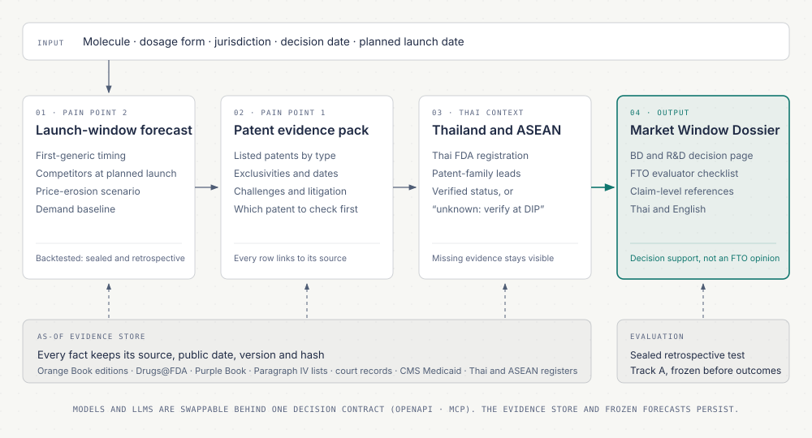

# แฟ้มข้อมูลช่วงเวลาเข้าสู่ตลาดยาสามัญและเกณฑ์มาตรฐาน LOE-Bench สำหรับจัดลำดับการทบทวนหลักฐาน

# Market Window Dossier and LOE-Bench for Prioritizing Generic Drug Evidence Review

นายศิริพล ศรีเฮงไพบูลย์\*¹ และ ผศ.ดร.ทัศนัย พลอยสุวรรณ²\
คณะเทคโนโลยีสารสนเทศ สถาบันเทคโนโลยีพระจอมเกล้าเจ้าคุณทหารลาดกระบัง\
เลขที่ 1 ซอยฉลองกรุง 1 แขวงลาดกระบัง เขตลาดกระบัง กรุงเทพฯ 10520

Mr. Siripon Srihangpiboon\*¹ and Asst. Prof. Dr. Tuchsanai Ploysuwan²\
School of Information Technology, King Mongkut's Institute of Technology Ladkrabang\
1 Chalong Krung 1 Alley, Lat Krabang, Bangkok 10520

## บทคัดย่อ

หากทบทวนได้หนึ่งในห้าของชุดส่วนออกฤทธิ์ของยา (active-moiety set) ที่เข้าเกณฑ์ หลักฐานทางทะเบียนที่ระบุวันที่จะช่วยให้คิวครอบคลุมการอนุมัติยาสามัญขั้นสุดท้ายครั้งแรกของสำนักงานคณะกรรมการอาหารและยาสหรัฐฯ (FDA) ได้มากขึ้นหรือไม่ LOE-Bench วัดการครอบคลุม ส่วน Market Window Dossier กำหนดแฟ้มหลักฐานสำหรับผู้เชี่ยวชาญ

ในชุดพัฒนา ที่ระยะ 24 เดือน ผลต่าง M3 เทียบกับวิธีฐานตามอายุยา B1 และแบบจำลอง M1 ที่ไม่มีสถานะกราฟ เท่ากับ +9.80 [0.14, 19.65] และ +5.49 [−2.00, 11.25] จุดร้อยละ ต่ำกว่าเกณฑ์ประโยชน์เชิงปฏิบัติ +10 จุดร้อยละที่กำหนดไว้ล่วงหน้า ที่ระยะ 12 เดือน M3 สูงกว่า B1 +13.00 [3.27, 23.17] จุดร้อยละ และเท่ากับ M1 ที่ร้อยละ 61.11 วงเล็บเหลี่ยมแสดงช่วงความเชื่อมั่น 95%

ในชุดพัฒนา L1e (Qwen2.5-7B-Instruct) ครอบคลุมเหตุการณ์น้อยกว่า M3 ใน C2 ช่องหลักฐานและคำสั่งเปลี่ยนพร้อมกันจาก L1 เป็น L1e ตัวคูณ 0.465 เพิ่มความคลาดเคลื่อนเฉลี่ยสัมบูรณ์ในชุดย่อย Medicaid ที่จับคู่ได้ การตรวจรับและให้คะแนน C′ การตรึงคำพยากรณ์ Track A และการตรวจแฟ้มรายข้อความยังรออยู่ หลักฐานทางทะเบียนที่ระบุวันที่ควรได้รับการประเมินต่อ ส่วนประโยชน์ที่เพิ่มจากกราฟยังไม่แน่นอน [FREEZE](../../../loe-bench/receipts/FREEZE.md) · [C2](../../../loe-bench/receipts/C2.md) · [C4b](../../../loe-bench/receipts/C4b.md) · [โพรโทคอล](../../../loe-bench/PREREGISTRATION.md)

**คำสำคัญ** ยาสามัญ, ช่วงเวลาเข้าสู่ตลาด, กราฟหลักฐาน, การจัดลำดับการทบทวน, เสรีภาพในการดำเนินการ

## Abstract

Given review capacity for one in five eligible active-moiety sets, can dated US regulatory evidence bring more impending first final generic approvals by the US Food and Drug Administration (FDA) into review? LOE-Bench measures event capture, and Market Window Dossier specifies the evidence packet for specialist follow-up.

On development data, the 24-month recall gains for M3 versus the age baseline B1 and versus M1, which omits graph states, were +9.80 [0.14, 19.65] and +5.49 [−2.00, 11.25] percentage points, respectively. Both point estimates fell below the prespecified +10-point practical-usefulness threshold. At 12 months, M3 exceeded B1 by +13.00 [3.27, 23.17] points and tied M1 at 61.11% recall. Brackets give 95% confidence intervals.

On development data, L1e (Qwen2.5-7B-Instruct) captured fewer events than M3. C2 changed evidence fields and prompt instructions together between L1 and L1e. Applying the 0.465 price factor increased mean absolute error on the mapped Medicaid subset. C′ admission and scoring, the prospective Track A prediction freeze and the dossier’s claim-level audit remain pending. Dated regulatory predictors warrant further evaluation. The graph’s incremental value remains uncertain. [FREEZE](../../../loe-bench/receipts/FREEZE.md) · [C2](../../../loe-bench/receipts/C2.md) · [C4b](../../../loe-bench/receipts/C4b.md) · [Preregistration protocol](../../../loe-bench/PREREGISTRATION.md)

**Keywords** generic drugs, market window, evidence graph, review prioritization, freedom to operate

\* 68076060@kmitl.ac.th\
¹ นักศึกษาปริญญาโท สาขาวิชาปัญญาประดิษฐ์เพื่อการวิเคราะห์เชิงธุรกิจ / Postgraduate Student, Artificial Intelligence for Business Analytics Program\
² ผู้ช่วยศาสตราจารย์ คณะเทคโนโลยีสารสนเทศ / Assistant Professor, School of Information Technology, KMITL

## 1 บทนำ

หากทบทวนได้หนึ่งในห้าของชุดส่วนออกฤทธิ์ของยาที่เข้าเกณฑ์ หลักฐานทางทะเบียนที่ระบุวันที่จะช่วยให้คิวครอบคลุมการอนุมัติยาสามัญขั้นสุดท้ายครั้งแรกในสหรัฐฯ ได้มากขึ้นหรือไม่ LOE-Bench วัดการครอบคลุมเหตุการณ์ ส่วนแฟ้มข้อมูลช่วงเวลาเข้าสู่ตลาด (Market Window Dossier) กำหนดหลักฐานสำหรับส่งต่อให้ผู้เชี่ยวชาญ งานนี้กำหนดความจุคิวร้อยละ 20 เป็นสมมติฐานในการออกแบบ [โพรโทคอล](../../../loe-bench/PREREGISTRATION.md)

ก่อนลงทุนศึกษาชีวสมมูล (bioequivalence study) หรือการศึกษาเปรียบเทียบ ทีมพัฒนายาสามัญและยาชีววัตถุคล้ายคลึงต้องเลือกผลิตภัณฑ์ที่จะศึกษาต่อ การเข้าสู่ตลาดของคู่แข่งอาจทำให้ช่วงเวลาขายที่คาดไว้สั้นลง เมื่อส่งเรื่องให้ผู้เชี่ยวชาญด้านเสรีภาพในการดำเนินการ (freedom to operate หรือ FTO) ทีมยังต้องระบุผลิตภัณฑ์ ข้อถือสิทธิที่เกี่ยวข้อง และประเด็นที่ต้องตรวจเพิ่ม

แฟ้มข้อมูลใช้ตัวยาสำคัญ รูปแบบยา เขตอำนาจ วันที่ตัดสินใจ และวันคาดว่าจะเริ่มขาย เพื่อจัดคิว รวบรวมหลักฐานตามวันตัดข้อมูล เสนอสถานการณ์จำลองด้านตลาด และจัดทำรายการที่ต้องตรวจเพิ่ม ผู้เชี่ยวชาญประเมินขอบเขตข้อถือสิทธิ สถานะทางกฎหมาย และความเกี่ยวข้องกับผลิตภัณฑ์ LOE-Bench ประเมินการพยากรณ์ในสหรัฐฯ ส่วนข้อมูลไทยและอาเซียนใช้เตรียมแฟ้มในบริบทท้องถิ่น

การศึกษาอิสระก่อนหน้าถามว่า การเปลี่ยนคำสั่งทำให้อันดับเปลี่ยนไปหรือไม่เมื่อใช้ชุดเอกสารสิทธิบัตรที่นำมาจัดอันดับชุดเดิม ผู้วิจัยรายงานว่าผลต่างจากการเปลี่ยนคำสั่งในชุดนั้นใกล้ศูนย์ กำหนดการประชุมของ Paper 53 [1] ยืนยันชื่อเรื่องและชื่อผู้เขียน ส่วนบันทึกการรันเดิมไม่พร้อมให้วิเคราะห์ซ้ำโดยอิสระ งานนี้ถามว่าผู้ทบทวนจะพบเหตุการณ์ที่กำลังจะเกิดขึ้นได้มากเพียงใด เมื่อกำหนดหลักฐานตามวันตัดข้อมูลและความจุคิวไว้ล่วงหน้า

- **RQ1 (เชิงยืนยัน ตามโพรโทคอลการลงทะเบียนล่วงหน้า)** ที่ความจุคิวร้อยละ 20 M3 ครอบคลุมการอนุมัติยาสามัญครั้งแรกในระยะ 24 เดือนได้มากกว่า B1 (H1) และ M1 (H2) หรือไม่ และครอบคลุมได้มากกว่า B1 ที่ระยะ 12 เดือน (H3) หรือไม่ ทดสอบตามลำดับที่ระบุโดยใช้ α ด้านเดียวเท่ากับ 0.025
- **RQ2 (เชิงสำรวจ)** คิวที่ตรึงไว้ครอบคลุมตัวยาที่มีผู้ยื่นคำขอยาสามัญต่างรายกันและได้รับอนุมัติตั้งแต่สามรายขึ้นไปภายใน 36 เดือนได้เพียงใด และตัวคูณการลดลงของราคาจาก FDA ช่วยพยากรณ์ยอดเบิกจ่าย Medicaid สำหรับตัวยาในคิวหรือไม่
- **RQ3 (ด้านระบบและการประเมินเชิงสำรวจ)** ข้อมูลเปิดรองรับการจัดทำแฟ้มที่ตรวจสอบหลักฐานได้ถึงระดับข้อความอ้างอิงหรือไม่ และ L1e ซึ่งเป็นแบบจำลองภาษาที่ได้รับหลักฐานต้นทางชุดเดียวกัน จัดคิวได้เพียงใดเมื่อเทียบกับ M3 บนชุดประเมินเดียวกัน

## 2 ทฤษฎีและงานวิจัยที่เกี่ยวข้อง

### 2.1 การพยากรณ์การอนุมัติและสัญญาณทางทะเบียน

Hu และคณะพยากรณ์การยื่นคำขออนุมัติยาสามัญแบบย่อ (abbreviated new drug application หรือ ANDA) ครั้งแรกสำหรับสารเคมีใหม่ [2] ส่วน Hopefl และคณะใช้ป่าสุ่มสำหรับการวิเคราะห์การรอดชีพ (random survival forest) พยากรณ์การยื่น ANDA ครั้งแรกสำหรับยารักษาโรคหายาก [3] LOE-Bench วัดการอนุมัติขั้นสุดท้ายของ ANDA ครั้งแรก ซึ่งเป็นเหตุการณ์ทางทะเบียนในขั้นถัดมา ทั้งสองงานเป็นงานอ้างอิงภายนอก โดยยังไม่มีผลเปรียบเทียบโดยตรง Beall และคณะศึกษาเวลาเริ่มแข่งขันของยาชีววัตถุคล้ายคลึงกับยาสามัญ [4] ส่วน FDA ติดตามว่าผู้ได้รับอนุมัติรายแรกนำยาออกจำหน่ายหรือไม่ [5] การเริ่มขายต้องใช้หลักฐานการจำหน่ายโดยตรง

Hemphill และ Sampat ศึกษาความสัมพันธ์ระหว่างการโต้แย้งและการขึ้นรายการสิทธิบัตรกับช่วงเวลาที่มีผลในตลาด [6] ส่วน Kannappan และคณะเทียบวันสิ้นสุดการชะลออนุมัติกับเวลาที่ยาสามัญเข้าสู่ตลาด [7] ทั้งสองงานสนับสนุนการพิจารณาหลักฐานโต้แย้งควบคู่กับวันหมดอายุ ชุดข้อมูลของ Rai และคณะ [8] ให้หลักฐานการยื่นคดีที่อาจใช้ได้ การจับคู่บางรายการใช้วันยื่นคดีแทนวันที่ค้นพบหลักฐานจริง ซึ่งยังไม่แน่นอน

### 2.2 การแข่งขัน ราคา และความต้องการ

Reiffen และ Ward สร้างแบบจำลองการเข้าสู่ตลาดและราคา [9] ส่วน Conrad และ Lutter ศึกษาความสัมพันธ์ระหว่างจำนวนผู้ผลิตกับราคาที่ลดลงจากข้อมูล FDA [10] งานนี้ใช้จำนวนผู้ได้รับอนุมัติเป็นสัญญาณทางทะเบียน ส่วนจำนวนผู้ขายจริงต้องใช้หลักฐานแยก การใช้ตัวคูณราคาผู้ผลิตเฉลี่ยกับยอดเบิกจ่าย Medicaid เป็นการทดสอบกับตัวชี้วัดต่างชนิด ตามแนวทางของ Nikolopoulos และคณะ [11] งานนี้ใช้การยกค่าล่าสุดและการต่อแนวโน้มเป็นวิธีเปรียบเทียบ

### 2.3 การทบทวนสิทธิบัตรและหลักฐานในบริบทไทย

องค์การทรัพย์สินทางปัญญาโลก (WIPO) ให้แนวทางจัดทำภาพรวมสิทธิบัตร [12] และสืบค้นข้อมูลเพื่อประเมิน FTO [13] แฟ้มส่งต่อควรระบุผลิตภัณฑ์ เขตอำนาจ ข้อถือสิทธิ และสถานะล่าสุด รายการที่ค้นไม่สำเร็จต้องส่งให้ตรวจเพิ่ม Leela และ Kessomboon ให้บริบทการตรวจคำขอสิทธิบัตรยาในไทย [14] ส่วน ASEAN IP Register ใช้ค้นระเบียนในภูมิภาค [15] ความครอบคลุมย้อนหลังและความแม่นยำของการพยากรณ์ในไทยยังต้องประเมินแยก

### 2.4 ขอบเขตข้อมูลตามเวลาและการจัดคิว

Paleka และคณะอธิบายความเสี่ยงจากข้อมูลรั่วไหลตามเวลา (temporal leakage) ในการพยากรณ์ย้อนหลัง รวมถึงโอกาสที่แบบจำลองภาษาเคยเห็นผลลัพธ์ในข้อมูลฝึก [16] เกณฑ์มาตรฐานจึงตรวจทั้งวันที่ในเนื้อหาและวันที่เข้าถึงเอกสารฉบับนั้นได้ ส่วน ForecastBench เป็นตัวอย่างการตรึงคำพยากรณ์ก่อนทราบผล [17]

การพยากรณ์แบบเลือกตอบ (selective prediction) ศึกษาความสัมพันธ์ระหว่างความคลาดเคลื่อนกับสัดส่วนกรณีที่ระบบจัดการ [18] งานนี้วัดการครอบคลุมเหตุการณ์ที่ความจุคิวคงที่ การสุ่มซ้ำแบบจับคู่ระดับตัวยา (paired whole-drug bootstrap) เก็บข้อสังเกตจากชุดส่วนออกฤทธิ์ของยาเดียวกันไว้ด้วยกัน และใช้ชุดที่สุ่มได้ชุดเดียวกันสำหรับวิธีที่เปรียบเทียบ [19] การทดสอบตามลำดับคงที่ใช้แนวทาง FDA [20] งานด้านการเรียนรู้แบบเสริมกำลังจากผลลัพธ์เป็นที่มาของ C9 [21] ซึ่งใช้แบบจำลองที่ปรับละเอียดแบบมีผู้สอนจากจุดตรวจเดียวกันเป็นตัวเปรียบเทียบ

## 3 วิธีดำเนินการวิจัย

### 3.1 ขั้นตอนจัดทำแฟ้มและการตรวจสอบที่มา

รูปที่ 1 แสดงขั้นตอนที่ออกแบบไว้ตั้งแต่รับข้อมูลผลิตภัณฑ์จนถึงส่งต่อแฟ้มหลักฐาน คิวจัดลำดับชุดส่วนออกฤทธิ์ของยา ส่วนแฟ้มบันทึกรูปแบบยาและเขตอำนาจเพื่อให้ผู้เชี่ยวชาญตรวจว่าหลักฐานระดับตัวยาใช้กับผลิตภัณฑ์ได้เพียงใด ผลด้านความต้องการและราคาเป็นสถานการณ์จำลอง ข้อมูลที่ขาดหรือขัดกันจะอยู่ในรายการที่ต้องตรวจเพิ่ม

*รูปที่ 1 ขั้นตอนการจัดทำแฟ้มที่ออกแบบไว้สำหรับผู้เชี่ยวชาญ ประเมินย้อนหลังในขั้นพัฒนาแล้ว ส่วนการตรวจรับและให้คะแนน C′ การตรึงคำพยากรณ์ Track A และการตรวจหลักฐานรายข้อความในแฟ้มยังรอดำเนินการ ผลด้านความต้องการและราคาเป็นสถานการณ์จำลอง*

ตามแบบที่กำหนด ข้อความสาระสำคัญต้องมีรหัสแหล่งข้อมูล ฉบับ ค่าแฮช ตำแหน่ง และหลักฐานวันเข้าถึง แฟ้มแยกข้อสังเกต ค่าประมาณ และสมมติฐานของสถานการณ์จำลอง พร้อมส่งรายการที่ยังไม่ทราบให้ตรวจเพิ่ม การตรวจแฟ้มต้องยืนยันทั้งไฟล์ต้นทางและเนื้อหาที่รองรับข้อความ

การสำรวจในไทยครอบคลุมสิทธิบัตร ทะเบียนยา ราคาอ้างอิง และการจัดซื้อ ส่วนระเบียนอาเซียนให้เบาะแสเรื่องตระกูลและสถานะเพื่อตรวจสอบกับทะเบียนประเทศ [แหล่งข้อมูลไทย](../../../loe-bench/THAI-OPEN-DATA.md) · [ข้อกำหนดแฟ้ม](../../../loe-bench/PLAN.md)

### 3.2 ประชากรศึกษา วันตัดข้อมูล และผลลัพธ์

หน่วยวิเคราะห์คือชุดส่วนออกฤทธิ์ของยา ณ วันตัดข้อมูล ตัวยาต้องมีรหัสที่ใช้ได้ และมีคำขอขึ้นทะเบียนยาใหม่ (new drug application: NDA) ฉบับแรกที่ได้รับอนุมัติขั้นสุดท้ายภายในวันตัดข้อมูล โดยมีระเบียน NDA ที่เข้าเงื่อนไขเดียวกันและระบุ TYPE 1 ด้วย ตัวยาที่มี ANDA อนุมัติขั้นสุดท้ายแล้วในวันตัดข้อมูลหรือก่อนหน้าไม่เข้าเกณฑ์ ผลลัพธ์คือการอนุมัติขั้นสุดท้ายของ ANDA ฉบับยื่นครั้งแรก (ORIG/AP) หลังวันตัดข้อมูลถึงวันสิ้นสุดระยะพยากรณ์ การอนุมัติเบื้องต้น ยาสามัญภายใต้ NDA และคำขอเพิ่มเติมไม่นับเป็นเหตุการณ์ ทุกแถวต้องติดตามครบระยะ แม้เกิดเหตุการณ์แล้ว ตัวยาที่ปรากฏหลายปีใช้กลุ่มเดียวกันเมื่อสุ่มซ้ำ

งานนี้ใช้ Drugs@FDA และทะเบียนสาร GSRS (Global Substance Registration System) เชื่อมระเบียนการอนุมัติกับตัวยา หากเชื่อมกับรหัสสารไม่ได้ ให้ใช้ชื่อที่ปรับรูปแบบพร้อมธงความเชื่อมั่นต่ำ ระเบียนที่ขาดวันที่หรือเชื่อมตัวยาไม่ได้ใช้ยืนยันเหตุการณ์ไม่ได้ แต่แถวที่เข้าเกณฑ์และขาดเพียงตัวแปรพยากรณ์ยังอยู่ในชุดศึกษา สำหรับสิทธิบัตร ระยะคุ้มครอง และรูปแบบยา C′ ใช้ Orange Book ฉบับล่าสุดในช่วงหกเดือนปฏิทินถึงวันตัดข้อมูล โดยต้องยืนยันวันเข้าถึงและค่าแฮช ตัดรายการผลิตภัณฑ์และการยื่นสิทธิบัตรหลังวันตัดข้อมูลออก ส่วนวันหมดอายุในอนาคตใช้ได้หากมีบันทึกในฉบับที่เข้าเกณฑ์

ข้อมูลโต้แย้งมาจากรายชื่อ Paragraph IV ฉบับที่ยืนยันวันเข้าถึงและผ่านเกณฑ์ความใหม่ หรือจากหลักฐานคดีที่ทันเวลา รายการตรงกันที่ไม่ระบุวันที่และไม่มีหลักฐานประกอบให้เป็นไม่ทราบ การไม่พบในฉบับที่ผ่านเกณฑ์ใช้เป็นค่าลบตามนิยามปฏิบัติการ หากไม่มีฉบับดังกล่าวหรือหลักฐานยืนยัน ให้คงสถานะไม่ทราบ การเชื่อมคดีเพิ่มเติมใช้วันที่ยื่นแทนวันเข้าถึง บางรายการยังยืนยันวันเชื่อมโยงสิทธิบัตรกับคดีไม่ได้ ระบบตัดผลคดี การอนุมัติ และข้อมูลจำหน่ายในภายหลังออก ตารางที่ 1 ระบุวันตัดข้อมูลแต่ละชุด [โพรโทคอล](../../../loe-bench/PREREGISTRATION.md)

*ตารางที่ 1 ปีของวันตัดข้อมูลสำหรับแต่ละระยะพยากรณ์*

| ระยะพยากรณ์ | ปีฝึกแบบจำลอง | ปีตรวจสอบขั้นพัฒนา | ปีทดสอบปิดผนึก C′ |
| --- | ---: | --- | --- |
| 12 เดือน | 2010 | 2012–2015 | 2017–2025 |
| 24 เดือน | 2010 | 2013–2014 | 2017–2024 |

วันตัดข้อมูลคือวันที่ 1 มกราคมของแต่ละปี ใช้ผลลัพธ์สำหรับฝึกแบบจำลองได้ถึงวันก่อนเริ่มช่วงตรวจสอบขั้นพัฒนา ระยะติดตามของชุดก่อนหน้าต้องสิ้นสุดก่อนชุดถัดไปเริ่มต้น วันที่สิ้นสุดการสังเกตสำหรับ C′ คือ 27 พฤศจิกายน 2026 การประเมินก่อนหน้าที่ระยะ 36 เดือนเปิดเผยผลรวมของ B0–B2 บนช่วงเวลาและประวัติยาที่ซ้อนทับกับ C′ โพรโทคอลยังระบุการเข้าถึงข้อมูลเพื่อสำรวจรายการและตรวจระบบเบื้องต้น การให้คะแนน C′ ยังรอดำเนินการ [โพรโทคอล](../../../loe-bench/PREREGISTRATION.md)

### 3.3 แบบจำลอง การจัดคิว และการอนุมาน

B1 ประมาณโอกาสเกิดเหตุการณ์จากอายุยานับตั้งแต่วันที่ NDA ได้รับอนุมัติครั้งแรก โดยปรับค่าของช่วงอายุให้เข้าใกล้อัตราเกิดเหตุการณ์ในชุดฝึก หากไม่มีช่วงอายุนั้นในชุดฝึก ให้ใช้อัตรารวมของชุดฝึก M1 ใช้การถดถอยโลจิสติกแบบปรับมาตรฐานและมีพจน์ลงโทษ L2 ตัวแปรประกอบด้วยอายุยา ตัวบ่งชี้จาก NDA ข้อมูลทางทะเบียน ความหลากหลายของรูปแบบผลิตภัณฑ์ สิทธิบัตร ระยะคุ้มครอง หลักฐานการโต้แย้ง ตัวบ่งชี้ข้อมูลขาดหาย และค่าลอจิตของ B1 ส่วน M3 ใช้ตัวแปรและวิธีฝึกเดียวกับ M1 โดยเพิ่มตัวบ่งชี้สถานะของกราฟหลักฐาน ได้แก่ OPEN, BLOCKED และ CONTESTED

กราฟถามว่าระยะคุ้มครองตามทะเบียนที่บันทึกไว้สิ้นสุดภายในระยะพยากรณ์ทั้งหมดหรือไม่ และสิทธิบัตรที่บันทึกไว้หมดอายุภายในระยะดังกล่าวทั้งหมดหรือมีหลักฐานการโต้แย้งหรือไม่ ตรรกะสามค่าของคลีนี (Kleene three-valued logic) กำหนดให้แต่ละเงื่อนไขมีค่าเป็นจริง เท็จ หรือไม่ทราบ หากไม่มีวันที่ครบกำหนดให้ตรวจ เงื่อนไขส่วนนั้นมีค่าไม่ทราบ สถานะที่ได้เป็นตัวแปรสำหรับพยากรณ์การอนุมัติจาก FDA และไม่มีผลกำหนดสถานะทางกฎหมายของผลิตภัณฑ์

คิวเรียงคะแนนความเสี่ยงดิบก่อนปรับเทียบหรือใช้นโยบายกราฟ รับหนึ่งในห้าของกรณีโดยปัดลง หากคะแนนเสมอตรงขอบคิว ให้แบ่งโอกาสเข้าคิวเท่ากันตามจำนวนตำแหน่งที่เหลือ การครอบคลุมเหตุการณ์ (recall) คือจำนวนเหตุการณ์ที่คาดว่าจะเข้าคิวรวมทุกวันตัดข้อมูลหารด้วยเหตุการณ์ทั้งหมด ความแม่นตรงของคิว (queue precision) หารด้วยจำนวนตำแหน่งในคิว ส่วนการครอบคลุมแบบไม่นับซ้ำใช้โอกาสที่ตัวยาที่เกิดเหตุการณ์จะเข้าในคิวอย่างน้อยหนึ่งครั้ง เพราะการอนุมัติเดียวกันอาจอยู่ในระยะติดตามที่เหลื่อมกัน

ใช้การสุ่มซ้ำแบบจับคู่ระดับตัวยา 2,000 รอบต่อระยะ โดยคงแบบจำลองเดิมและคำนวณขนาดคิวกับน้ำหนักคะแนนเสมอใหม่แต่ละรอบ ขั้นทดสอบผ่านเมื่อขอบล่างด้านเดียวจากควอนไทล์เชิงเส้นที่ระดับ α สูงกว่าศูนย์ หากไม่ผ่านหรือประเมินไม่ได้ ให้หยุดทดสอบ รายงานผลต่างทุกคู่ที่ประมาณได้พร้อมช่วงความเชื่อมั่น 95% แบบเปอร์เซ็นไทล์สองด้าน โดยระบุว่าขั้นที่ไปไม่ถึงเป็นผลเชิงพรรณนา หากรอบใดให้ค่าไม่กำหนด จะประเมินช่วงความเชื่อมั่นของผลต่างนั้นไม่ได้ ให้รายงานด้วยว่าค่าประมาณถึงเกณฑ์ประโยชน์เชิงปฏิบัติ +10 จุดร้อยละที่กำหนดไว้ล่วงหน้าหรือไม่ การจำลอง T4c ให้กำลังทดสอบ H1 ร้อยละ 49.96 เมื่อผลต่างเป้าหมายคือ +10 จุดร้อยละและมีตัวยาที่เกิดเหตุการณ์ 75 รายการ เกณฑ์ตรวจรับขั้นต่ำ 50 รายการใช้ตัดสินสิทธิ์ในการประเมิน ส่วนกำลังทดสอบต้องประเมินแยกกัน [FREEZE](../../../loe-bench/receipts/FREEZE.md) · [T4c](../../../loe-bench/receipts/T4c.md) · [โพรโทคอล](../../../loe-bench/PREREGISTRATION.md)

### 3.4 การลงทะเบียน การตรวจรับชุดปิดผนึก และการติดตามไปข้างหน้า

ข้อมูลการลงทะเบียนกับ Open Science Framework (OSF) ยังรออยู่ [OSF DOI PENDING] การเปิดชุดปิดผนึกต้องมีการอนุญาตจากผู้เขียนคนแรก ค่าแฮช PDF ฉบับที่ OSF ออก รุ่นโค้ดและแหล่งข้อมูลที่ตรึงไว้ และผล PASS จากการตรวจรับแบบปกปิดผล (blinded admission gate) การตรวจรับยืนยันฉบับข้อมูลครบทุกวันตัดข้อมูล แล้วตรวจว่ามีตัวยาที่เกิดเหตุการณ์ตามกฎระยะ 24 เดือนอย่างน้อย 50 รายการแบบไม่นับซ้ำ ระบบเปิดเผยเฉพาะคำตัดสิน หากขัดข้องทางเทคนิคให้แก้ไขและลองใหม่ได้หนึ่งครั้งกับข้อมูลชุดเดิม หากผลสุดท้ายไม่ผ่าน ให้รายงานเฉพาะความเป็นไปได้และคงสถานะ H1–H3 ว่ายังไม่ได้ทดสอบบน C′ หลังจบการประเมินขั้นพัฒนา ขั้นตอนที่รออยู่คือการลงทะเบียน OSF การตรวจรับ C′ แบบปกปิดผล และการให้คะแนนเมื่อผ่านเกณฑ์และได้รับอนุญาต ส่วน Track A มีกำหนดตรึงคำพยากรณ์และประเมินเมื่อครบระยะติดตามแยกต่างหาก

Track A มีกำหนดแยกจาก C′ และฝึกแบบจำลองด้วยวิธีเดิมบนช่วงที่ติดตามครบ ณ 27 พฤศจิกายน 2026 ชุดหลักใช้ B1, M1, M3 และ B3 ซึ่งใช้วันหมดอายุและรายงานเชิงพรรณนา วิธีสำรวจต้องผ่านเกณฑ์ของตน ให้บันทึกค่าแฮชของรายชื่อ แหล่งข้อมูล แบบจำลอง โค้ด นโยบาย และคำพยากรณ์ พร้อมแท็ก Git และประทับเวลาผ่าน OSF ก่อน 31 มกราคม 2027 เวลา 23:59 UTC และก่อนเข้าถึงข้อมูลผลลัพธ์หลังวันอ้างอิง หากผิดเงื่อนไขให้วิเคราะห์เชิงสำรวจ ระยะติดตามครบ 27 พฤศจิกายน 2027 และ 27 พฤศจิกายน 2028 ตามลำดับ Track A ทดสอบเชิงยืนยันเมื่อ C′ ยังไม่ได้ทดสอบเชิงยืนยัน หากทำแล้วให้ถือเป็นการทดสอบซ้ำ การทดสอบ H3 ยังขึ้นกับผลสองขั้นก่อนหน้า [โพรโทคอล](../../../loe-bench/PREREGISTRATION.md)

### 3.5 การวิเคราะห์เชิงสำรวจ

การวิเคราะห์การแข่งขันใช้คิวระยะ 24 เดือน ณ วันตัดข้อมูลปี 2013 กับผลติดตาม 36 เดือน ตัวยาเข้าเกณฑ์เมื่อมีผู้ยื่นคำขอต่างนิติบุคคลอย่างน้อยสามรายได้รับอนุมัติขั้นสุดท้ายสำหรับ ANDA ฉบับแรก รวมความแรงและคำขอซ้ำของรายเดียวกันไว้ด้วยกัน ใช้ชื่อจาก Orange Book ฉบับแรกที่เข้าเกณฑ์ภายใน 12 เดือนหลังอนุมัติ หรือจากหลักฐานโดยตรงเมื่อมี ใช้ชื่อผู้รับอนุญาตปัจจุบันในการวิเคราะห์ความไว หากระบุตัวผู้ยื่นไม่ได้ให้คงสถานะไม่ทราบ คิวและน้ำหนักคะแนนเสมอมาจากชุดพยากรณ์เดิม

การวิเคราะห์ Medicaid พยากรณ์จำนวนครั้งที่เบิก ยอดจ่ายรวมก่อนหักเงินคืนในปีถัดไป และยอดต่อใบสั่งยาในไตรมาสสุดท้าย ใช้รายการบรรจุภัณฑ์ที่เชื่อมกับตัวยาได้ในชุด State Drug Utilization Data เกณฑ์หลักใช้ค่างวดล่าสุด (carry-forward) เกณฑ์รองใช้วิธีต่อแนวโน้ม เมื่อวันตัดข้อมูลและตัวยาตรงกัน ให้ใช้คิวระยะ 12 เดือนและกฎตัดคะแนนเสมอร่วมกัน แล้วคูณค่าพยากรณ์ของตัวยาในคิวด้วย 0.465 ซึ่งเป็นอัตราส่วนมัธยฐานของราคาผู้ผลิตเฉลี่ยระหว่างยาสามัญกับยาต้นแบบเมื่อมีผู้ผลิตยาสามัญสองราย ตัวยานอกคิวใช้เกณฑ์เดิม งานนี้วิเคราะห์ย้อนหลังโดยยืนยันฉบับ Medicaid เดิมไม่ได้ และตัวคูณเผยแพร่หลังช่วงประเมิน ส่วน C5 เป็นสถานการณ์จำลองราคาที่อิงสมมติฐานจำนวนผู้ผลิตที่จำหน่ายจริงและฐานราคาที่ระบุ [โพรโทคอล](../../../loe-bench/PREREGISTRATION.md) [การแข่งขัน](../../../loe-bench/receipts/C3b.md) · [ยอดเบิกจ่าย](../../../loe-bench/receipts/C4b.md)

L1 และ L1e ใช้จุดตรวจและการถอดรหัสเดียวกันของ Qwen2.5-7B-Instruct L1 ได้รับชื่อตัวยา วันตัดข้อมูล และระยะพยากรณ์ ส่วน L1e ได้รับหลักฐานต้นทางตามเวลาที่ M3 ใช้เพิ่มด้วย ซึ่งรวมวันที่ที่กราฟใช้คำนวณและหลักฐานการโต้แย้ง ข้อมูลที่ส่งให้ L1e ตัดคะแนนจากแบบจำลอง ค่าโอกาสจาก B1 คำตัดสินของกราฟ การดำเนินการตามนโยบาย และผลลัพธ์ออก คำสั่งของ L1e ระบุวิธีใช้ช่องข้อมูลที่เพิ่มเข้ามา การเปรียบเทียบจึงประเมินทั้งหลักฐานที่นำเสนอและคำสั่งที่ใช้กับหลักฐานนั้น C9 เป็นการทดลองทางเลือกใน Track A แบบไปข้างหน้าที่จับคู่การเพิ่มประสิทธิภาพนโยบายเชิงสัมพัทธ์ภายในกลุ่ม (group relative policy optimization: GRPO) กับการปรับละเอียดแบบมีผู้สอน (supervised fine-tuning: SFT) บนข้อมูลนำเข้าชุดเดียวกันที่ระยะ 24 เดือน โดยต้องเสร็จทั้งคู่ก่อนตรึงคำพยากรณ์หลัก [L1](../../../loe-bench/receipts/L1DEV.md) · [L1e](../../../loe-bench/receipts/C2.md) · [C9](../../../loe-bench/receipts/C9.md)

## 4 ผลการวิจัย

### 4.1 RQ1 ผลการจัดคิวเพื่อทบทวนการอนุมัติครั้งแรก

ผลการอนุมัติครั้งแรกที่ตรึงไว้เป็นผลเฉพาะขั้นพัฒนา ที่ระยะ 24 เดือนมี 1,083 แถว เกิดเหตุการณ์ 91 แถวจากตัวยา 67 รายการ และมีที่ในคิว 215 ตำแหน่ง ที่ระยะ 12 เดือนมี 2,161 แถว เกิดเหตุการณ์ 90 แถวจากตัวยา 90 รายการ และมีที่ในคิว 430 ตำแหน่ง รูปที่ 2 แสดงผลต่างการครอบคลุมแบบจับคู่พร้อมช่วงความเชื่อมั่น 95% แบบสองด้าน การสุ่มซ้ำทุกรอบให้ผลที่คำนวณได้ [FREEZE](../../../loe-bench/receipts/FREEZE.md)

> [FIGURE PLACEMENT: development paired-effect plot]

*รูปที่ 2 ผลต่างการครอบคลุมการอนุมัติครั้งแรกแบบจับคู่ในชุดพัฒนา ที่ความจุคิวร้อยละ 20 จุดแสดงค่าประมาณ เส้นช่วงแสดงช่วงความเชื่อมั่น 95% แบบสองด้านจากการสุ่มซ้ำระดับตัวยา เส้นแนวตั้งแสดงเกณฑ์ศูนย์และ +10 จุดร้อยละ ป้ายแต่ละแถวแสดงจำนวนตัวยาที่เกิดเหตุการณ์แบบไม่นับซ้ำ*

ที่ระยะ 24 เดือน B1, M1 และ M3 มีการครอบคลุมร้อยละ 39.65, 43.96 และ 49.45 ตามลำดับ ผลต่างของ M3 เทียบกับ B1 คือ +9.80 [0.14, 19.65] จุดร้อยละ และเทียบกับ M1 คือ +5.49 [−2.00, 11.25] จุดร้อยละ ค่าประมาณทั้งสองต่ำกว่าเกณฑ์ประโยชน์เชิงปฏิบัติ +10 จุดร้อยละที่กำหนดไว้ล่วงหน้า ที่ระยะ 12 เดือน ผลต่างจาก B1 ซึ่งครอบคลุมร้อยละ 48.11 เท่ากับ +13.00 [3.27, 23.17] จุดร้อยละ ค่าประมาณสูงกว่าเกณฑ์ และ M1 ครอบคลุมเท่ากับ M3 ที่ร้อยละ 61.11 ช่วงของ H2 คร่อมศูนย์ และการลงรหัสรายการโต้แย้งที่ไม่ระบุวันที่ในชุดฝึกมีผลต่อค่าประมาณ การตรวจความปลอดภัยของกฎคัดกรณีออกโดยอัตโนมัติไม่ผ่านทุกคู่แบบจำลองและระยะที่ประเมินได้ กรณีนอกคิวจึงอยู่ในขั้นตอนทบทวนตามปกติ [FREEZE](../../../loe-bench/receipts/FREEZE.md) · [โพรโทคอล](../../../loe-bench/PREREGISTRATION.md)

- [RESULT PENDING: blinded C′ admission verdict and disposition]
- [RESULT PENDING: C′ H1–H3 estimable contrasts with two-sided 95% intervals, practical-usefulness checks, reached-step decisions and descriptive labels for unreached steps]
- [RESULT PENDING: Track A timestamped prediction freeze and outcome readouts]

RQ1 ยังไม่มีคำตอบเชิงยืนยัน หากชุด C′ ไม่ผ่านการตรวจรับ ให้รายงานข้อมูลความเป็นไปได้ และคงสถานะสมมติฐานว่ายังไม่ได้ทดสอบบนชุดนั้น

### 4.2 RQ2 ความหนาแน่นของผู้ได้รับอนุมัติและยอดเบิกจ่าย Medicaid

ณ วันตัดข้อมูลขั้นพัฒนาปี 2013 เพียงจุดเดียวที่ติดตามผลครบ คิว M3 ครอบคลุมเหตุการณ์แบบถ่วงน้ำหนัก 15.000 เหตุการณ์ (ร้อยละ 71.43) เทียบกับ 9.625 เหตุการณ์ของ B1 (ร้อยละ 45.83) จากทั้งหมด 21 เหตุการณ์ แต่ละวิธีมี 107 ตำแหน่งจาก 539 แถว จำนวนอาจเป็นเศษส่วนเพราะแบ่งน้ำหนักให้กรณีที่คะแนนเสมอกันตรงขอบคิว ผลต่าง +25.60 จุดร้อยละ (ช่วงความเชื่อมั่น 95% แบบจับคู่ [6.25, 45.00]) ใช้อธิบายเฉพาะวันตัดข้อมูลนี้และผลลัพธ์ที่ผู้ยื่นคำขอต่างรายกันอย่างน้อยสามรายได้รับอนุมัติขั้นสุดท้ายภายใน 36 เดือน การใช้ชื่อผู้รับอนุญาตปัจจุบันในการวิเคราะห์ความไวให้ผลเท่าเดิม [C3b](../../../loe-bench/receipts/C3b.md)

ในชุดย่อย Medicaid ที่จับคู่ย้อนหลัง การใช้ตัวคูณ 0.465 เพิ่มค่าเฉลี่ยความคลาดเคลื่อนสัมบูรณ์ (mean absolute error หรือ MAE) เทียบกับการยกค่าล่าสุด ทั้งยอดเบิกจ่ายต่อใบสั่งยาและยอดเบิกจ่ายรายปี ตารางที่ 2 รายงานช่วงความเชื่อมั่นแบบเปอร์เซ็นไทล์จากการสุ่มซ้ำแบบจับคู่ระดับตัวยา การเปรียบเทียบเฉพาะส่วนที่เชื่อมกับคิวใช้จุดตั้งต้นพยากรณ์สี่จุด มีคู่ตัวยากับจุดตั้งต้น 160 คู่จากตัวยา 68 รายการสำหรับยอดต่อใบสั่งยา และ 150 คู่จากตัวยา 64 รายการสำหรับยอดรายปี

*ตารางที่ 2 ผลต่าง MAE ของยอดเบิกจ่ายเทียบกับการยกค่าล่าสุดในชุดย่อยขั้นพัฒนาที่เชื่อมกับคิว*

| วิธีเทียบกับการยกค่าล่าสุด | ดอลลาร์สหรัฐต่อใบสั่งยาในไตรมาสสุดท้าย [ช่วงความเชื่อมั่น 95%] | ล้านดอลลาร์สหรัฐต่อปี [ช่วงความเชื่อมั่น 95%] |
| --- | ---: | ---: |
| ปรับตามคิว B1 | +372.05 [193.27, 587.26] | +4.98 [2.24, 8.29] |
| ปรับตามคิว M3 | +381.24 [203.61, 606.77] | +21.43 [4.07, 53.21] |
| ต่อแนวโน้มลบยกค่าล่าสุด | −172.13 [−292.12, −66.37] | −3.69 [−8.41, −0.20] |

ในชุดย่อยเดียวกัน วิธีต่อแนวโน้มลด MAE ของยอดเบิกจ่ายทั้งสองแบบ ในส่วนที่สังเกตได้ ยอดเบิกจ่ายต่อใบสั่งยาก่อนหักเงินคืนของตัวยาในคิวเพิ่มขึ้น การลดค่าพยากรณ์ลงด้วยตัวคูณจึงยิ่งทำให้ค่าที่พยากรณ์ต่ำกว่าที่สังเกต การเปรียบเทียบนี้เป็นเชิงพรรณนาและไม่ได้ปรับสำหรับการเปรียบเทียบหลายคู่ ยอดในแหล่งข้อมูลเป็นยอดก่อนหักเงินคืน รวมส่วนของ Medicaid และส่วนอื่นตามที่ชุดข้อมูลบันทึก และครอบคลุมเฉพาะรายการบรรจุภัณฑ์ที่เชื่อมกับตัวยาได้ จึงยังประมาณยอดรวมของตัวยาทั้งประเทศไม่ได้ สำหรับ RQ2 ผลขั้นพัฒนาสนับสนุนการศึกษาต่อว่าคิวช่วยคัดกรองความหนาแน่นของผู้ได้รับอนุมัติได้เพียงใด ส่วนผลย้อนหลังไม่สนับสนุนการใช้ตัวคูณ FDA เพื่อปรับค่าพยากรณ์ยอดเบิกจ่าย Medicaid ในชุดนี้ [C4b](../../../loe-bench/receipts/C4b.md)

### 4.3 RQ3 การตรวจที่มาของหลักฐานและแบบจำลองภาษาที่ได้รับหลักฐานชุดเดียวกัน

ข้อมูลไทยที่สำรวจใช้สาธิตได้บางส่วน แฟ้มส่งรายการที่ยังไม่ทราบไปยังรายการตรวจสอบของผู้เชี่ยวชาญ [RESULT PENDING: dossier claim-level traceability audit]

การทดลอง L1e ใช้ชุดประเมินขั้นพัฒนาที่จับคู่กันครบถ้วน ตารางที่ 3 รายงานผลตามบันทึก C2 จำนวนเหตุการณ์ของแต่ละระยะใช้ชุดเดียวกับหัวข้อ 4.1 การเปรียบเทียบผลต่างใช้การสุ่มซ้ำแบบจับคู่ระดับตัวยา โดยไม่ได้ปรับสำหรับการเปรียบเทียบหลายคู่ ค่าเฉลี่ยความแม่นตรง (average precision: AP) คำนวณแบบจัดกลุ่มคะแนนเสมอ L1e ครอบคลุมเหตุการณ์น้อยกว่าทั้ง L1 และ M3 ที่ทั้งสองระยะ

*ตารางที่ 3 ผลขั้นพัฒนาของแบบจำลองภาษาที่ได้รับหลักฐานและวิธีเปรียบเทียบ*

| เดือน | วิธี | การครอบคลุมที่ร้อยละ 20 | ความแม่นตรงของคิว | AP แบบจัดกลุ่ม |
| ---: | --- | ---: | ---: | ---: |
| 12 | L1e | 24.24% | 5.07% | 0.05260 |
| 12 | L1 | 34.92% | 7.31% | 0.06181 |
| 12 | M3 | 61.11% | 12.79% | 0.18860 |
| 12 | B1 | 48.11% | 10.07% | 0.09189 |
| 24 | L1e | 19.08% | 8.08% | 0.10141 |
| 24 | L1 | 28.59% | 12.10% | 0.11646 |
| 24 | M3 | 49.45% | 20.93% | 0.22189 |
| 24 | B1 | 39.65% | 16.78% | 0.17288 |

ผลต่างการครอบคลุมระหว่าง L1e กับ M3 เท่ากับ −36.87 จุดร้อยละที่ระยะ 12 เดือน (ช่วงความเชื่อมั่นร้อยละ 95 [−47.40, −23.92]) และ −30.37 จุดร้อยละที่ระยะ 24 เดือน [−43.08, −16.44] เมื่อเทียบกับ L1 ผลต่างเท่ากับ −10.68 [−17.96, −3.63] และ −9.51 [−16.26, −2.43] ตามลำดับ วิธีที่เปรียบเทียบต่างกันทั้งการฝึกและการแทนหลักฐาน ผลจึงใช้กับวิธีที่ทดสอบ [C2](../../../loe-bench/receipts/C2.md)

C9 เป็นการเปรียบเทียบทางเลือกแบบไปข้างหน้าระหว่าง GRPO กับ SFT โดยใช้ Qwen2.5-1.5B-Instruct สถานะการฝึกและผลลัพธ์คือ NOT_RUN [C9](../../../loe-bench/receipts/C9.md)

## 5 สรุปผล

หลักฐานทางทะเบียนที่ระบุวันที่ควรได้รับการประเมินต่อ ส่วนประโยชน์ที่เพิ่มจากกราฟยังไม่แน่นอน ผลจากวันตัดข้อมูลเดียวสนับสนุนการศึกษาจำนวนผู้ได้รับอนุมัติต่อ ส่วนผลจากชุดย่อย Medicaid ที่จับคู่ได้สนับสนุนให้ใช้ตัวคูณราคาเป็นสมมติฐานของสถานการณ์จำลอง ผลต่างของ C2 ใช้กับแบบจำลองภาษาและวิธีที่ทดสอบ แฟ้มข้อมูลกำหนดวิธีตามรอยหลักฐานและส่งประเด็นที่ยังไม่ทราบให้ผู้เชี่ยวชาญ การตรวจหลักฐานรายข้อความในแฟ้มยังรอดำเนินการ [FREEZE](../../../loe-bench/receipts/FREEZE.md) · [C3b](../../../loe-bench/receipts/C3b.md) · [C4b](../../../loe-bench/receipts/C4b.md) · [C2](../../../loe-bench/receipts/C2.md)

กลุ่มศึกษาครอบคลุมประวัติตัวยาที่เข้าเกณฑ์ยาใหม่ในสหรัฐอเมริกา โดยวัดการอนุมัติขั้นสุดท้าย ฉบับย้อนหลังอาจตกหล่นการเปลี่ยนแปลง การเชื่อมรหัสสารบางส่วนใช้ข้อมูลภายหลัง และวันเข้าถึงหลักฐานคดีบางฉบับยังไม่แน่นอน จำนวนตัวยาที่เกิดเหตุการณ์อาจไม่พอสำหรับตรวจผลขนาดเล็ก ผลการแข่งขันครอบคลุมวันตัดข้อมูลเดียว ส่วน Medicaid ใช้รายการที่เชื่อมย้อนหลังและยืนยันฉบับเดิมไม่ได้ ผลของแบบจำลองภาษาจำกัดอยู่ที่จุดตรวจและคำสั่งที่ศึกษา และยังตรวจไม่ได้ว่าแบบจำลองเคยพบผลลัพธ์ในข้อมูลฝึกหรือไม่

งานต่อไปคือดำเนินการตรวจรับแบบปกปิดผล ตรึงคำพยากรณ์ Track A ก่อนเข้าถึงผลลัพธ์ และประเมินตามโพรโทคอลเมื่อครบระยะติดตาม ควรตรวจว่าแต่ละข้อความในแฟ้มฉบับที่ผู้ใช้เห็นมีหลักฐานรองรับจริง พร้อมบันทึกรายการที่ต้องยืนยันจากแหล่งข้อมูลไทยและอาเซียน งานในอนาคตควรใช้ระเบียนการจำหน่ายเพื่อศึกษาวันเริ่มขาย ใช้ข้อมูลจัดซื้อและการใช้ยาในไทยเพื่อประเมินความต้องการในไทย และทดสอบขั้นตอนที่พร้อมใช้งานเพื่อวัดเวลาที่ผู้ทบทวนประหยัดได้ ข้อสรุปด้าน FTO ของผลิตภัณฑ์ต้องให้ผู้เชี่ยวชาญประเมินข้อถือสิทธิและสถานะทางกฎหมายตามรูปแบบยาและเขตอำนาจจริง

## เอกสารอ้างอิง

[1] S. Srihangpiboon and T. Ploysuwan, “Diagnosing near-zero instruction effects in cross-domain patent reranking,” iSAI-NLP conference program, paper 53, 2026. [Program](https://isai-nlp2026.aiat.or.th/program).

[2] M. Hu et al., “Predictive analysis of first abbreviated new drug application submission for new chemical entities based on machine learning methodology,” *Clin. Pharmacol. Ther.*, vol. 106, no. 1, pp. 174–181, 2019. [doi: 10.1002/cpt.1479](https://doi.org/10.1002/cpt.1479).

[3] R. Hopefl et al., “Predictive analysis for first submission of generic drug application for orphan drug products using random survival forest,” *Clin. Transl. Sci.*, vol. 18, no. 10, e70365, 2025. [doi: 10.1111/cts.70365](https://doi.org/10.1111/cts.70365).

[4] R. F. Beall et al., “Comparing onset of biosimilar versus generic competition in the United States,” *Clin. Pharmacol. Ther.*, vol. 108, no. 6, pp. 1308–1314, 2020. [doi: 10.1002/cpt.1981](https://doi.org/10.1002/cpt.1981).

[5] H. S. Chahal, R. Patel, and M. Shimer, “Marketing of first generic drugs approved by U.S. FDA from January 2010 to June 2017,” US FDA, 2021. [Report](https://www.fda.gov/media/154101/download?attachment=).

[6] C. S. Hemphill and B. N. Sampat, “Evergreening, patent challenges, and effective market life in pharmaceuticals,” *J. Health Econ.*, vol. 31, no. 2, pp. 327–339, 2012. [Article](https://www.sciencedirect.com/science/article/abs/pii/S0167629612000057).

[7] S. Kannappan, J. J. Darrow, A. S. Kesselheim, and R. F. Beall, “The timing of 30-month stay expirations and generic entry: A cohort study of first generics, 2013–2020,” *Clin. Transl. Sci.*, vol. 14, no. 5, pp. 1917–1923, 2021. [doi: 10.1111/cts.13046](https://doi.org/10.1111/cts.13046).

[8] A. K. Rai, S. Vishnubhakat, J. Lemus, and E. Hovenkamp, “Replication data for: Post-grant adjudication of drug patents: Agency and/or court?,” Harvard Dataverse, ver. 1.0, 2021. [doi: 10.7910/DVN/YCMKVU](https://doi.org/10.7910/DVN/YCMKVU).

[9] D. Reiffen and M. R. Ward, “Generic drug industry dynamics,” *Rev. Econ. Stat.*, vol. 87, no. 1, pp. 37–49, 2005. [doi: 10.1162/0034653053327694](https://doi.org/10.1162/0034653053327694).

[10] R. Conrad and R. Lutter, “Generic competition and drug prices: New evidence linking greater generic competition and lower generic drug prices,” US FDA, 2019. [Report](https://www.fda.gov/media/133509/download).

[11] K. Nikolopoulos, S. Buxton, M. Khammash, and P. Stern, “Forecasting branded and generic pharmaceuticals,” *Int. J. Forecast.*, vol. 32, no. 2, pp. 344–357, 2016. [doi: 10.1016/j.ijforecast.2015.08.001](https://doi.org/10.1016/j.ijforecast.2015.08.001).

[12] World Intellectual Property Organization, *Guidelines for Preparing Patent Landscape Reports*, WIPO Publ. 946, 2015. [Guide](https://www.wipo.int/edocs/pubdocs/en/wipo_pub_946.pdf).

[13] World Intellectual Property Organization, *Identifying Inventions in the Public Domain: A Guide for Inventors and Entrepreneurs*, WIPO Publ. 1062, 2020. [Guide](https://www.wipo.int/publications/en/details.jsp?id=4501).

[14] P. Leela and N. Kessomboon, “Challenges of examination processes of pharmaceutical patent application in Thailand,” *Isan J. Pharm. Sci.*, vol. 11, suppl., 2016. [Article](https://he01.tci-thaijo.org/index.php/IJPS/article/view/48601).

[15] ASEAN Intellectual Property Portal, “ASEAN IP Register.” [Register](https://ip-register.aseanip.org/).

[16] D. Paleka, S. Goel, J. Geiping, and F. Tramèr, “Pitfalls in evaluating language model forecasters,” in *Proc. ICLR*, 2026. [Conference paper](https://openreview.net/forum?id=z85kARAoyD).

[17] E. Karger et al., “ForecastBench: A dynamic benchmark of AI forecasting capabilities,” in *Proc. ICLR*, 2025. [Paper](https://arxiv.org/abs/2409.19839).

[18] J. Traub et al., “Overcoming common flaws in the evaluation of selective classification systems,” in *Adv. Neural Inf. Process. Syst.*, 2024. [Paper](https://proceedings.neurips.cc/paper_files/paper/2024/file/047c84ec50bd8ea29349b996fc64af4b-Paper-Conference.pdf).

[19] C. A. Field and A. H. Welsh, “Bootstrapping clustered data,” *J. R. Stat. Soc. B*, vol. 69, no. 3, pp. 369–390, 2007. [doi: 10.1111/j.1467-9868.2007.00593.x](https://doi.org/10.1111/j.1467-9868.2007.00593.x).

[20] US FDA, *Multiple Endpoints in Clinical Trials: Guidance for Industry*, 2022. [Guidance](https://www.fda.gov/regulatory-information/search-fda-guidance-documents/multiple-endpoints-clinical-trials).

[21] B. Turtel, D. Franklin, K. Skotheim, L. Hewitt, and P. Schoenegger, “Outcome-based reinforcement learning to predict the future,” *Trans. Mach. Learn. Res.*, Nov. 2025. [Journal article](https://openreview.net/forum?id=bbhdeL8EUX).
