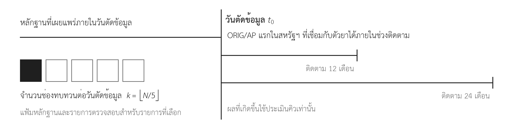
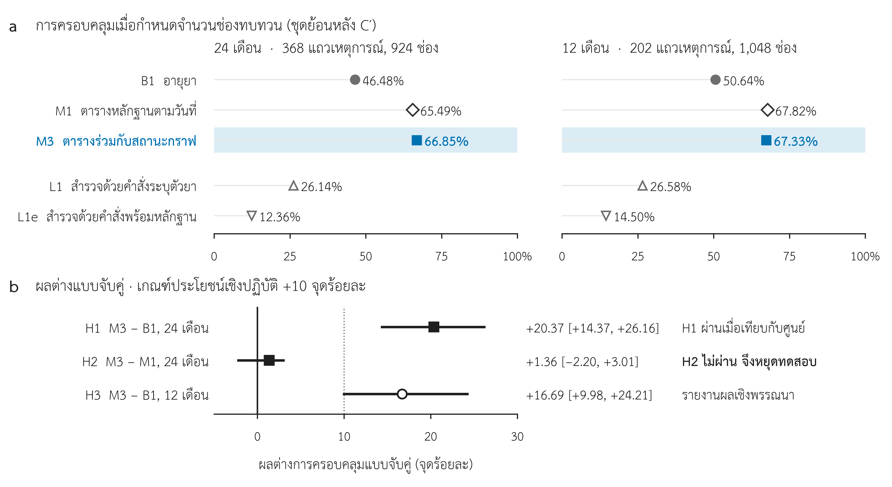

# การประเมินหลักฐานด้านการกำกับดูแลยาเพื่อจัดลำดับการทบทวนรายการยาก่อนการอนุมัติยาสามัญครั้งแรกในสหรัฐอเมริกา

# Review Queues for First US Generic Approvals Using Dated Evidence

นายศิริพล ศรีเฮงไพบูลย์\*¹ และ ผศ.ดร.ทัศนัย พลอยสุวรรณ²\
คณะเทคโนโลยีสารสนเทศ สถาบันเทคโนโลยีพระจอมเกล้าเจ้าคุณทหารลาดกระบัง\
เลขที่ 1 ซอยฉลองกรุง 1 แขวงลาดกระบัง เขตลาดกระบัง กรุงเทพฯ 10520

Siripon Srihangpiboon\*¹ and Tuchsanai Ploysuwan²\
School of Information Technology, King Mongkut's Institute of Technology Ladkrabang\
1 Chalong Krung 1 Alley, Lat Krabang, Bangkok 10520

## บทคัดย่อ

งานนี้ประเมินการจัดลำดับรายการยาโดยให้ทบทวนได้หนึ่งในห้าของรายการที่เข้าเกณฑ์ในแต่ละปีและปัดเศษลง ผู้วิจัยใช้หลักฐานที่มี ณ วันตัดข้อมูลและทดสอบย้อนหลังกับชุด C′ ซึ่งปิดผลรายรายการไว้จนได้รับอนุญาตให้ให้คะแนน เหตุการณ์คือการอนุมัติขั้นสุดท้ายครั้งแรกในสหรัฐฯ ของคำขอยาสามัญแบบย่อฉบับยื่นครั้งแรก (ANDA, ORIG/AP) ที่เชื่อมกับตัวยาได้และอยู่ในช่วงติดตาม ที่ระยะ 24 เดือน ตารางหลักฐานที่เพิ่มสถานะกราฟ (M3) ครอบคลุมร้อยละ 66.85 ของรายการที่เกิดเหตุการณ์ เทียบกับร้อยละ 46.48 จากวิธีตามอายุยา (B1) และร้อยละ 65.49 จากตารางหลักฐาน (M1) ผลต่างแบบจับคู่ระหว่าง M3 กับ B1 เท่ากับ +20.37 จุดร้อยละ (ช่วงความเชื่อมั่น 95% [+14.37, +26.16]) ผลนี้สนับสนุนการใช้คิวเพื่อจัดลำดับงานทบทวน ส่วนประโยชน์ที่ได้จากการเพิ่มสถานะกราฟยังไม่ชัดเจน และกฎยกเว้นอัตโนมัติไม่ผ่านเกณฑ์ความปลอดภัย รายการนอกคิวจึงยังต้องทบทวนตามปกติ

**คำสำคัญ** ยาสามัญ, ช่วงเวลาเข้าสู่ตลาด, กราฟหลักฐาน, การจัดลำดับการทบทวน, เสรีภาพในการดำเนินการ

## Abstract

We ranked drug cases using evidence available at each annual cutoff and allocated one review slot per five eligible cases, rounded down. Historical C′ row-level outcomes were sealed until authorized scoring. The endpoint was the first linked, dated, final original US abbreviated new drug application approval (ANDA, ORIG/AP) within 12 or 24 months of each cutoff. At 24 months, the dated-evidence table with graph states (M3) captured 66.85% of event rows, compared with 46.48% for drug age (B1) and 65.49% for the dated-evidence table (M1). The paired M3−B1 gain was +20.37 percentage points (95% CI [+14.37, +26.16]). The results support review prioritization. The incremental gain from adding graph states remained unconfirmed, and automatic clearance failed the safety check. Cases outside the queue still require routine review.

**Keywords** generic drugs, market window, evidence graph, review prioritization, freedom to operate

\* 68076060@kmitl.ac.th\
¹ นักศึกษาปริญญาโท สาขาวิชาปัญญาประดิษฐ์เพื่อการวิเคราะห์เชิงธุรกิจ / Postgraduate Student, Artificial Intelligence for Business Analytics Program\
² ผู้ช่วยศาสตราจารย์ คณะเทคโนโลยีสารสนเทศ / Assistant Professor, School of Information Technology, KMITL

## 1 บทนำ

งานศึกษาก่อนหน้าเรื่องการจัดอันดับเอกสารสิทธิบัตรข้ามสาขา [1] พบว่า สำหรับคำค้น 435 จาก 692 รายการ เอกสาร 100 อันดับแรกไม่มีเอกสารที่ทราบว่าเกี่ยวข้อง งานนี้เปรียบเทียบคิวทบทวนที่มีจำนวนช่องเท่ากันว่าครอบคลุมการอนุมัติ ANDA ฉบับยื่นครั้งแรกในสหรัฐฯ ได้เพียงใด โดยนับการอนุมัติขั้นสุดท้ายครั้งแรกที่เชื่อมกับตัวยาได้ มีวันที่ และอยู่ในช่วงพยากรณ์

LOE-Bench ประเมินการจัดคิวจากระเบียนย้อนหลังของสหรัฐฯ เพื่อจัดลำดับงานก่อนลงทุนศึกษาชีวสมมูล แฟ้มข้อมูลช่วงเวลาเข้าสู่ตลาด (Market Window Dossier) ส่งต่อคิว หลักฐานที่ระบุวันที่ และรายการตรวจสอบให้ผู้เชี่ยวชาญด้านเสรีภาพในการดำเนินการ (FTO) การประเมินสิ้นสุดที่การอนุมัติ ส่วนวันเริ่มขาย การเข้าสู่ตลาดไทย และ FTO อยู่นอกโจทย์วิจัย

### วัตถุประสงค์การวิจัย

- RQ1 เปรียบเทียบสัดส่วนรายการที่เกิดเหตุการณ์ซึ่งได้รับเลือกให้ทบทวน เมื่อกำหนดจำนวนรายการที่ทบทวนเท่ากัน โดยเปรียบเทียบ M3 กับวิธีตามอายุยา (B1) และวิธีตารางหลักฐาน ณ วันตัดข้อมูล (M1) ตามลำดับที่ลงทะเบียนไว้ล่วงหน้าบน OSF
- RQ2 ประกอบด้วยการวิเคราะห์เชิงสำรวจสามเรื่อง ได้แก่ การครอบคลุมของแบบจำลองภาษา 7B เมื่อได้รับหลักฐานต้นทางชุดเดียวกัน การครอบคลุมรายการที่มีผู้ยื่นคำขอได้รับอนุมัติอย่างน้อยสามรายภายใน 36 เดือน และความคลาดเคลื่อนของการพยากรณ์ยอดเบิกจ่ายเมื่อใช้ตัวคูณราคาตามสถานการณ์จำลอง
- RQ3 ประเมินว่าข้อความใดในแฟ้มสืบถึงแหล่งข้อมูลที่ระบุวันที่ได้ และข้อความใดยังต้องให้ผู้เชี่ยวชาญตรวจสอบเพิ่มเติม

## 2 ทฤษฎีและงานวิจัยที่เกี่ยวข้อง

### 2.1 การประมาณวันเข้าตลาดและลำดับการทบทวน

Beall และคณะใช้สิทธิบัตรและระยะคุ้มครองประมาณวันเข้าสู่ตลาดของยาสามัญ [2], [3] LOE-Bench เปรียบเทียบการครอบคลุมของวิธีที่ใช้หลักฐาน ณ วันตัดข้อมูล โดยกำหนดจำนวนรายการที่ทบทวนเท่ากัน งานอื่นวัดเวลาถึงการอนุมัติ [4] หรือพยากรณ์การยื่นครั้งแรก [5], [6] FDA พบว่าการอนุมัติกับการเริ่มขายเกิดต่างเวลากัน [7]

การโต้แย้งสิทธิบัตรและการชะลออนุมัติเกี่ยวข้องกับช่วงเวลาเข้าสู่ตลาด [8], [9] ผู้วิจัยใช้คลัง Orange Book ของ NBER [10] เฉพาะช่วงพัฒนา การประเมินตามแผนที่ตรึงไว้ใช้ฉบับของ FDA ที่ยืนยันวันเผยแพร่ได้ ส่วนระเบียนคดีใช้วันยื่นคดีแทนวันที่ประชาชนอาจเข้าถึงข้อมูล [11]

### 2.2 ผู้ยื่นคำขอ ผู้ผลิตที่ขายจริง และยอดเบิกจ่าย

FDA ใช้ราคาผู้ผลิตเฉลี่ย (average manufacturer price หรือ AMP) คำนวณสัดส่วนราคามัธยฐานเทียบกับยาต้นแบบก่อนมียาสามัญ ได้ร้อยละ 46.5 เมื่อมีผู้ผลิตขายจริงสองราย และร้อยละ 21.2 เมื่อมีสี่ราย [12] การจำลองราคาใช้จำนวนผู้ผลิตที่สมมติว่าขายจริงและค่า AMP ของยาต้นแบบก่อนมียาสามัญที่มีหลักฐานและใช้หน่วยตรงกัน งานก่อนหน้าศึกษาการเข้าสู่ตลาด ราคา และส่วนแบ่งของผู้เข้าตลาดรายแรก [13]–[16]

### 2.3 การส่งต่อหลักฐานและการใช้ในบริบทไทย

WIPO แยกการสำรวจภาพรวมสิทธิบัตรออกจากการประเมิน FTO และอธิบายหลักฐานที่ผู้เชี่ยวชาญใช้ [17], [18] งานค้นและออกแบบด้าน FTO ใน PatentAgentBench ใช้เทียบการกำหนดโจทย์ [19] งานศึกษาการตรวจสอบสิทธิบัตรไทยใช้ประกอบรายการตรวจสอบ [20], [21] ระเบียนภูมิภาคให้เบาะแสสำหรับตรวจต่อกับแหล่งข้อมูลของประเทศ

### 2.4 กรอบการประเมิน

แบบจำลองภาษาอาจเคยเห็นผลย้อนหลังจากชุดฝึกหรือข้อมูลที่ป้อน [22] งานควบคุมช่วงข้อมูลฝึกและ ForecastBench เป็นตัวอย่างการควบคุมตามเวลา [23], [24] งานนี้ใช้แนวทางการลงทะเบียนล่วงหน้า การจำแนกแบบเลือกตอบ การสุ่มซ้ำระดับกลุ่ม การทดสอบตามลำดับ [25]–[28] และการเรียนรู้แบบเสริมกำลังจากผลลัพธ์ [29] งานเหล่านี้และงานด้านการยื่นคำขอ การโต้แย้ง และใบสั่งยาใช้ประกอบการออกแบบ ส่วนผลเปรียบเทียบย้อนหลังมาจากวิธีที่ใช้ชุดรายการอนุมัติของ FDA ชุดเดียวกัน Track A ตรึง Cox และป่าสุ่มแบบวิเคราะห์การรอดชีพสำหรับการสำรวจด้วยข้อมูลเปิด ทั้งสองวิธียังรอผลจริง

## 3 วิธีดำเนินการวิจัย

### 3.1 การตัดสินใจ ณ วันตัดข้อมูลและการส่งต่อหลักฐาน

แต่ละวิธีจัดลำดับชุดส่วนออกฤทธิ์ของตัวยา (active-moiety set) ที่เข้าเกณฑ์จากข้อมูลที่เผยแพร่ทันวันตัดข้อมูล (รูปที่ 1) แฟ้มระบุรูปแบบยา เขตอำนาจ รหัสและฉบับของแหล่งข้อมูล ค่าแฮชเมื่อมี ตำแหน่งอ้างอิง และหลักฐานวันเข้าถึง พร้อมแยกข้อสังเกต ค่าประมาณ และสถานการณ์จำลอง และชี้จุดที่ผู้เชี่ยวชาญต้องตรวจต่อ

*รูปที่ 1 จัดสรรหนึ่งช่องทบทวนต่อห้ารายการที่เข้าเกณฑ์ในแต่ละวันตัดข้อมูลโดยปัดเศษลง ประเมินจากการอนุมัติขั้นสุดท้ายครั้งแรกของ ANDA ฉบับยื่นครั้งแรกในสหรัฐฯ ที่เชื่อมกับตัวยาได้ มีวันที่ และเกิดในช่วงพยากรณ์ 12 หรือ 24 เดือน*

### 3.2 รายการที่เข้าเกณฑ์ หลักฐาน และผลลัพธ์

หนึ่งรายการหมายถึงหนึ่งชุดส่วนออกฤทธิ์ ณ วันตัดข้อมูลประจำปี รายการที่เข้าเกณฑ์ต้องมีรหัสเชื่อมตัวยา มีคำขออนุมัติยาใหม่ (NDA) ฉบับยื่นครั้งแรกที่อนุมัติขั้นสุดท้ายพร้อมวันที่ มี NDA ฉบับยื่นครั้งแรกที่อนุมัติขั้นสุดท้ายและจัดเป็น TYPE 1 ภายในวันตัดข้อมูล และติดตามได้ครบระยะ ณ วันตัดข้อมูลต้องยังไม่เคยมีการอนุมัติ ANDA ขั้นสุดท้ายที่เชื่อมกับตัวยาได้ เหตุการณ์คือการอนุมัติขั้นสุดท้ายครั้งแรกของ ANDA ฉบับยื่นครั้งแรกในสหรัฐฯ (ORIG/AP) ที่เชื่อมกับตัวยาได้และมีวันที่หลังวันตัดข้อมูลจนถึงวันสิ้นสุดการติดตาม โดยนับวันสุดท้ายด้วย

ผู้วิจัยเชื่อมการอนุมัติกับตัวยาผ่าน Drugs@FDA และฐานรหัสสาร Global Substance Registration System ฉบับปี 2026 ซึ่งจัดทำภายหลัง สำหรับ C′ ใช้ Orange Book ฉบับล่าสุดของ FDA ที่ลงวันที่ไม่เกินหกเดือนปฏิทินก่อนวันตัดข้อมูล มีค่าแฮชตรงกัน และยืนยันว่าเผยแพร่ทันวันนั้น สถานะการโต้แย้งอาศัยรายการ Paragraph IV ฉบับล่าสุดที่ยืนยันวันเผยแพร่ได้และระเบียนคดีที่เข้าเกณฑ์ หากพบคำขอที่ไม่มีวันที่ ให้คงสถานะไม่ทราบแม้อยู่ในฉบับที่ทันเวลา เว้นแต่มีหลักฐานอื่นยืนยันได้ทันวันตัดข้อมูล หากตรวจรายการที่เข้าเกณฑ์แล้วไม่พบ จึงบันทึกว่าไม่พบตามเกณฑ์ รายการที่ขาด การเชื่อมตัวตนย้อนหลัง และช่องว่างของระเบียนโต้แย้งอาจเปลี่ยนผลการคัดเข้า ตัวแปรพยากรณ์ และการเชื่อมเหตุการณ์ [30]

ทั้งสองระยะใช้ข้อมูลปี 2010 สำหรับฝึก ชุดพัฒนาใช้ปี 2012–2015 ที่ระยะ 12 เดือนและปี 2013–2014 ที่ระยะ 24 เดือน ส่วน C′ ใช้ปี 2017–2025 และ 2017–2024 ตามลำดับ ผลรายรายการของ C′ ปิดไว้จนได้รับอนุญาตให้ให้คะแนน ก่อนลงทะเบียน ผู้วิจัยเห็นผลรวม B0–B2 ระยะ 36 เดือนที่ทับซ้อน 4,162 แถว ผลตรวจระบบเบื้องต้นจากหลายช่วงเวลา และจำนวนรายการที่นับจาก NDA เท่านั้น ผลชุดพัฒนาใช้กำหนดตัวชี้วัดและเลือกแบบจำลอง ตามบันทึก ผู้วิจัยไม่ได้ตรวจผลรายรายการหรือใช้ C′ เลือกวิธี การตรวจย้อนกลับอย่างอิสระยังไม่ครอบคลุมขั้นตอนต้นทาง [30]

### 3.3 คิวและลำดับการทดสอบที่ลงทะเบียน

คิวตามอายุยา (B1) ประมาณอัตราอนุมัติจากเวลาหลัง NDA ครั้งแรก คิวจากตารางหลักฐานตามวันที่ (M1) ใช้การถดถอยโลจิสติกแบบมีพจน์ลงโทษ L2 กับอายุยา หลักฐานตามวันที่ และค่าลอจิตของ B1 คิวจากตารางหลักฐานที่เพิ่มสถานะกราฟ (M3) หรือคิวกราฟ เพิ่มตัวบ่งชี้ OPEN, BLOCKED และ CONTESTED กราฟใช้วันหมดอายุของสิทธิบัตร ระยะคุ้มครอง และการโต้แย้งที่พบ โดยคงค่าที่ไม่ทราบตามตรรกะสามค่าของคลีนี ผู้วิจัยใช้ OPEN เป็นตัวแปรของแบบจำลอง ส่วนผู้เชี่ยวชาญพิจารณาข้อกฎหมายแยกต่างหาก [30]

ในแต่ละวันตัดข้อมูลและระยะพยากรณ์ ผู้วิจัยกำหนดจำนวนรายการที่ทบทวนไว้ที่หนึ่งในห้าของรายการที่เข้าเกณฑ์โดยปัดลง และจัดลำดับด้วยคะแนนเดิมก่อนปรับเทียบหรือพักการตัดสิน โดยแบ่งน้ำหนักเมื่อคะแนนเสมอตรงขอบลำดับ การครอบคลุม (recall) คือจำนวนรายการที่เกิดเหตุการณ์และคาดว่าจะเข้าคิว หารด้วยจำนวนรายการที่เกิดเหตุการณ์ทั้งหมดรวมทุกวันตัดข้อมูล

ลำดับทดสอบคือ M3 เทียบกับ B1 ที่ 24 เดือน (H1) เทียบกับ M1 ที่ 24 เดือน (H2) และเทียบกับ B1 ที่ 12 เดือน (H3) โดยใช้ α ด้านเดียวเท่ากับ 0.025 การอนุมัติครั้งเดียวอาจนับเป็นสองแถวที่เกิดเหตุการณ์ในช่วง 24 เดือนที่ซ้อนกัน ผู้วิจัยสุ่มซ้ำแบบจับคู่ทั้งตัวยา 2,000 รอบและจัดคิวใหม่ทุกรอบเพื่อคงความสัมพันธ์ของข้อมูล โดยใช้แบบจำลองที่ฝึกแล้วและช่วงปีเดิม หยุดทดสอบเมื่อขอบล่างไม่สูงกว่าศูนย์หรือคำนวณช่วงไม่ได้ รายงานช่วงความเชื่อมั่น 95% แบบเปอร์เซ็นไทล์สองด้าน ช่วงของผลรองและผลสำรวจไม่รับประกันการควบคุมความผิดพลาดรวมหลายการทดสอบ [30]

### 3.4 การลงทะเบียนและการทดสอบซ้ำไปข้างหน้า

การลงทะเบียนครั้งแรกบน Open Science Framework (OSF) ขาดเอกสารแนบที่ตั้งใจส่ง 10 รายการ การปรับปรุงครั้งที่ 1 ที่ได้รับอนุมัติจึงใช้ระเบียน OSF ต้นฉบับอ้างอิงการเปิดให้คะแนนแทนไฟล์ PDF ที่ไม่มี การให้คะแนนย้อนหลังใช้การปรับปรุงครั้งที่ 1 และ 2 หลังผ่านการตรวจรับฉบับข้อมูลและเกณฑ์ตัวยาที่เกิดเหตุการณ์อย่างน้อย 50 ตัวที่ระยะ 24 เดือน ผู้ตรวจรับเปิดเผยเฉพาะคำตัดสินเมื่อ 28 พฤศจิกายน 2026 เวลา 05:12 UTC [30]

การปรับปรุงครั้งที่ 3 เปลี่ยนช่วงฝึก C9 หลังให้คะแนนย้อนหลัง ครั้งที่ 4 บันทึกการตรึงชุดไปข้างหน้าและระบุว่ายังไม่ได้วิเคราะห์ C′ เพิ่มเติม ณ วันยื่น ผลเพิ่มเติมจากไฟล์ส่งออกในภายหลังรายงานเชิงพรรณนา [30], [31]

สำหรับ Track A ผู้วิจัยฝึกแบบจำลองจากช่วงที่ติดตามครบ ณ วันอ้างอิง 27 พฤศจิกายน 2026 การตรึงชุดและการบันทึกบน OSF ในวันที่ 28 พฤศจิกายนเสร็จก่อนเข้าถึงผลหลังวันอ้างอิง รายละเอียดการตรึงอยู่ในส่วนที่ 5 [TRACKA-FREEZE](../../../loe-bench/receipts/TRACKA-FREEZE.md)

### 3.5 การเปรียบเทียบเชิงสำรวจ

การเปรียบเทียบใช้ Qwen2.5-7B-Instruct รุ่นและวิธีถอดรหัสเดียวกัน L1 รับตัวยา วันตัดข้อมูล และระยะพยากรณ์ ส่วน L1e ได้ข้อมูลต้นทางที่ M3 ใช้และคำสั่งเพิ่มเติม โดยไม่ป้อนคะแนนจากแบบจำลอง อัตราจาก B1 ผลตัดสินจากกราฟ คำสั่งปฏิบัติ หรือผลลัพธ์ ส่วนการเปรียบเทียบไปข้างหน้า C9 จับคู่ GRPO (group relative policy optimization) กับ SFT (supervised fine-tuning) บน Qwen2.5-1.5B-Instruct ที่ระยะ 24 เดือน

การวิเคราะห์จำนวนผู้ยื่นคำขอที่ได้รับอนุมัติใช้คิวระยะ 24 เดือนที่ตรึงไว้และติดตามผล 36 เดือนในชุดพัฒนาปี 2013 และ C′ ปี 2017–2023 ผู้วิจัยใช้ Orange Book ฉบับแรกที่เข้าเกณฑ์ภายใน 12 เดือนหลังอนุมัติและหลักฐานโดยตรงที่บันทึกไว้เพื่อระบุนิติบุคคลที่ได้รับอนุมัติ ANDA ฉบับยื่นครั้งแรก ผู้วิจัยรวมความแรงและคำขอซ้ำ คงสถานะไม่ทราบเมื่อระบุผู้ยื่นไม่ได้ และทดสอบความไวด้วยชื่อผู้รับอนุญาตปัจจุบัน

การวิเคราะห์ C4b จับคู่ข้อมูล State Drug Utilization Data ย้อนหลังโดยยังยืนยันฉบับที่ใช้ได้ ณ วันตัดข้อมูลไม่ได้ สำหรับตัวยาในคิวระยะ 12 เดือน ใช้ตัวคูณ 0.465 ตามสมมติฐานผู้ผลิตสองรายปรับค่าพยากรณ์แบบยกค่าล่าสุด โดยใช้กฎตัดคะแนนเสมอเดียวกัน ตัวยานอกคิวใช้ค่าล่าสุด ส่วนวิธีฐานรองใช้การต่อแนวโน้ม FDA เผยแพร่ตัวคูณหลังช่วงจุดตั้งต้น

ยอดเบิกจ่ายที่จับคู่ได้เป็นยอดก่อนหักเงินคืน รวมยอด Medicaid และยอดส่วนอื่นตามระเบียน ตัวชี้วัดคือยอดต่อใบสั่งยาในไตรมาสที่สี่เมื่อมีใบสั่งยา และยอดรวมสี่ไตรมาสถัดไป ผู้วิจัยคำนวณผลต่างความคลาดเคลื่อนจากคู่ตัวยากับจุดตั้งต้นชุดเดียวกันและสุ่มซ้ำระดับตัวยา [C4b](../../../loe-bench/receipts/C4b.md)

## 4 ผลการวิจัย

### 4.1 การครอบคลุมเมื่อจำกัดจำนวนการทบทวน

ชุดย้อนหลัง C′ ที่ระยะ 24 เดือนมี 4,639 แถวจากยา 771 ตัว เกิดเหตุการณ์ 368 แถวจากยา 202 ตัว และมี 924 ช่องทบทวน ส่วนที่ระยะ 12 เดือนมี 5,259 แถวจากยา 803 ตัว เกิดเหตุการณ์ 202 แถวจากยา 202 ตัว และมี 1,048 ช่อง เฉพาะ H1 ผ่านการทดสอบ M3 ครอบคลุมร้อยละ 66.85 ที่ 24 เดือน เทียบกับร้อยละ 46.48 ของ B1 ผลต่างแบบจับคู่ +20.37 จุดร้อยละ (ช่วงความเชื่อมั่น 95% [+14.37, +26.16]) ขอบล่างสูงกว่าทั้งศูนย์และเกณฑ์ประโยชน์เชิงปฏิบัติ +10 จุดร้อยละที่กำหนดไว้สำหรับค่าประมาณ การครอบคลุมรวมสัดส่วนที่คาดว่าจะเลือกได้เมื่อคะแนนเสมอ [SCORE](../../../loe-bench/receipts/SCORE.md#primary-family)

*รูปที่ 2 การครอบคลุมในชุดย้อนหลัง C′ และผลต่างพร้อมช่วงความเชื่อมั่น 95% จากการสุ่มซ้ำแบบจับคู่ระดับตัวยา จำนวนเหตุการณ์นับเป็นแถวตัวยาต่อวันตัดข้อมูล ผล L1 และ L1e เป็นเชิงสำรวจ ทดสอบความเหนือกว่าที่เส้นศูนย์ ส่วนเส้นประ +10 จุดร้อยละแสดงเกณฑ์ประโยชน์เชิงปฏิบัติ*

ที่ 24 เดือน M1 ครอบคลุมร้อยละ 65.49 ผลต่าง H2 เท่ากับ +1.36 จุดร้อยละ (ช่วงความเชื่อมั่น 95% [−2.20, +3.01]) จึงไม่ผ่านการทดสอบและยังสรุปไม่ได้ว่ากราฟเพิ่มการครอบคลุมหรือให้ผลเทียบเท่าเดิม ลำดับทดสอบไปไม่ถึง H3 จึงรายงานเชิงพรรณนา (+16.69 จุดร้อยละ [+9.98, +24.21]) แม้ค่าประมาณสูงกว่า +10 จุดร้อยละ ในการเปรียบเทียบรอง M1 สูงกว่า B1 อยู่ +19.01 [+13.34, +25.62] จุดร้อยละที่ 24 เดือน และ +17.18 [+9.88, +24.06] ที่ 12 เดือน ผลต่างนี้ยังบอกไม่ได้ว่าประโยชน์มาจากตัวแปรใด [SCORE](../../../loe-bench/receipts/SCORE.md#secondary-analyses)

หลังเห็นผลชุดพัฒนา ผู้วิจัยย้ายเกณฑ์ความปลอดภัยของกฎยกเว้นอัตโนมัติจากเกณฑ์ยอมรับมาเป็นผลรองก่อนลงทะเบียน ใน C′ ขอบบนของอัตราพลาดสูงกว่า 3% ทั้งห้ากรณีที่คำนวณได้ M3 พลาด 16 จาก 1,678 รายการที่ยกเว้นที่ระยะ 12 เดือน และ 28 จาก 1,413 รายการที่ระยะ 24 เดือน (ขอบบนร้อยละ 4.39 และ 6.39) ส่วน B1 ไม่ยกเว้นรายการใดที่ 24 เดือน จึงประเมินอัตราไม่ได้ รายการนอกคิวยังต้องทบทวนตามปกติ [FREEZE](../../../loe-bench/receipts/FREEZE.md#development-results) [SCORE](../../../loe-bench/receipts/SCORE.md#secondary-analyses)

ผลเชิงพรรณนาจากไฟล์ส่งออก [31] รายงานการคัดเข้าและการสอบเทียบความน่าจะเป็นแบบ 10 กลุ่ม โดยช่วง Wilson รายแถวไม่คำนึงถึงตัวยาซ้ำ และปกปิดจำนวนน้อยรวมถึงค่าที่ใช้คำนวณย้อนกลับ ข้อมูลไม่พอสำหรับสรุปตัวแปร C′ 15 จาก 28 ตัวและแยกรายการที่ตัดออกเพราะ ANDA เกิดก่อน NDA ครั้งแรก ผลรายงาน ROC AUC รวมจากคะแนนดิบและความแม่นที่จุดตัด ที่จุดตัดของคะแนนสอบเทียบ ทั้งหกชุดไม่พบผลบวกจริง ส่วน M3 ที่ 24 เดือนมีผลบวกลวงหนึ่งรายการ (ความแม่นร้อยละ 92.05 เทียบกับร้อยละ 92.07 เมื่อทายลบทุกครั้ง) ดัชนี C จำกัดตามระยะคำนวณไม่ได้เพราะไม่มีวันเกิดเหตุการณ์ [CPRIME-DESC](../../../loe-bench/receipts/CPRIME-DESC.md) [CPRIME-SUPP](../../../loe-bench/receipts/CPRIME-SUPP.md)

### 4.2 การครอบคลุมของแบบจำลองภาษา 7B

แบบจำลองภาษาแต่ละวิธีให้ผลลัพธ์ตรงตามรูปแบบ 9,898 รายการ รวมคำตอบที่งดตัดสินใจแต่ยังให้ค่าความน่าจะเป็น ผลต่าง L1e เทียบกับ M3 เท่ากับ −54.48 จุดร้อยละที่ 24 เดือน (ช่วงความเชื่อมั่น 95% [−61.18, −47.61]) และ −52.83 [−59.34, −45.19] ที่ 12 เดือน ผลต่าง L1e เทียบกับ L1 เท่ากับ −13.78 [−17.71, −10.32] และ −12.08 [−16.41, −7.45] ตามลำดับ ผลเชิงสำรวจนี้ไม่ปรับสำหรับหลายคู่เปรียบเทียบและใช้ได้กับรุ่น วิธีถอดรหัส และคำสั่งที่ทดสอบ ผู้วิจัยเปลี่ยนหลักฐานและคำสั่งพร้อมกัน และชุดฝึกอาจมีผลย้อนหลัง [SCORELLM](../../../loe-bench/receipts/SCORELLM.md) [ผลชุดพัฒนา](../../../loe-bench/receipts/C2.md#development-results)

### 4.3 ผลเรื่องผู้ยื่นคำขอและยอดเบิกจ่าย

ที่วันตัดข้อมูลชุดพัฒนาปี 2013 คิว M3 ครอบคลุมมากกว่า B1 ส่วนการสำรวจ C3 ในชุด C′ ใช้รายการที่เข้าเกณฑ์ 4,024 แถวจากเจ็ดวันตัดข้อมูล โดยคิดการครอบคลุมจาก 173 แถวที่ยืนยันว่าถึงเกณฑ์จากยา 92 ตัว อีกสี่แถวที่ยังไม่ทราบผลยังมีสิทธิ์ได้ช่องทบทวน M3 ครอบคลุมร้อยละ 79.8 เทียบกับร้อยละ 49.7 ของ B1 (ผลต่าง +30.11 จุดร้อยละ ช่วงความเชื่อมั่น 95% [+20.16, +36.86]) เมื่อใช้ชื่อผู้รับอนุญาตตามฉบับที่ตรึงไว้ ผลต่างเท่ากับ +30.16 จุดร้อยละ ขอบเขตผลเมื่อสมมติค่าของแถวที่ไม่ทราบอยู่ในบันทึกผล [31] จำนวนผู้ได้รับอนุมัติบอกโอกาสเกิดการแข่งขัน ส่วนจำนวนผู้ผลิตที่ขายจริงต้องใช้ข้อมูลการจำหน่าย [C3b](../../../loe-bench/receipts/C3b.md) [SCORE, C3](../../../loe-bench/receipts/SCORE.md#c3--competition-at-launch)

C4b จับคู่ข้อมูลย้อนหลังได้เจ็ดจุดตั้งต้นในชุดพัฒนา และเชื่อมกับคิวได้สี่จุด ตัวคูณตามสถานการณ์จำลอง 0.465 เพิ่มความคลาดเคลื่อนสัมบูรณ์เฉลี่ย (MAE) ของยอดเบิกจ่ายทั้งสองแบบ ส่วนวิธีต่อแนวโน้มลดความคลาดเคลื่อนทั้งสองแบบ (ตารางที่ 1) ชุดย่อยที่เชื่อมคิวมี 160 คู่จากยา 68 ตัวสำหรับยอดต่อใบสั่งยา และ 150 คู่จากยา 64 ตัวสำหรับยอดรายปี

การวิเคราะห์ C4 ในชุดย้อนหลังที่กันไว้ไม่ได้ดำเนินการ (NOT_RUN) เพราะแผนที่ตรึงไว้ไม่รับจุดตั้งต้นปี 2017 และขาดข้อมูลผลปี 2018 ส่วน C4b แบบใช้เฉพาะฉบับที่ยืนยันได้ ณ เวลานั้นไม่มีจุดตั้งต้นที่ผ่านเกณฑ์ จึงไม่ได้ดำเนินการเช่นกัน ข้อมูลที่มีไม่พอจะประมาณยอดรวมระดับประเทศรายตัวยา [C4b](../../../loe-bench/receipts/C4b.md) [SCORE, C4](../../../loe-bench/receipts/SCORE.md#c4--medicaid-demand-and-reimbursement)

*ตารางที่ 1 ผลต่าง MAE แบบจับคู่เทียบกับการยกค่าล่าสุด (ช่วงความเชื่อมั่น 95%) ในชุดพัฒนาที่จับคู่ย้อนหลังและเชื่อมกับคิว*

| วิธีพยากรณ์ | ดอลลาร์สหรัฐต่อใบสั่งยา ในไตรมาส 4 | ล้าน USD ต่อปี |
| --- | ---: | ---: |
| คิว B1 | +372.05 [193.27, 587.26] | +4.98 [2.24, 8.29] |
| คิว M3 | +381.24 [203.61, 606.77] | +21.43 [4.07, 53.21] |
| แนวโน้ม | −172.13 [−292.12, −66.37] | −3.69 [−8.41, −0.20] |

### 4.4 การสืบแหล่งข้อมูลของข้อความในแฟ้ม

ในแฟ้มชุดพัฒนาของ Solifenacin ยานี้อยู่นอกคิวปี 2014 หนังสือของ FDA ระบุว่าการยกฟ้องคดีสิทธิบัตรสหรัฐฯ เลขที่ 6017927 เกี่ยวข้องกับการเข้าเกณฑ์อนุมัติของ Teva ในเวลาต่อมา แฟ้มเก็บหนังสือฉบับนี้เป็นหลักฐานผลย้อนหลัง แฟ้มระบุหน้าที่อ้างถึงและรายการที่ยังต้องตรวจสอบกับแหล่งข้อมูลไทย [EVP](../../../loe-bench/receipts/EVP.md)

จากการตรวจ 32 แฟ้มชุดพัฒนาตามแผนที่ลงทะเบียน ผู้วิจัยสืบแหล่งข้อมูลด้วย URL หรือค่าแฮชได้ครบ 1,789 ข้อ และไม่พบข้อที่ถูกแจ้งว่าลงวันที่หลังวันตัดข้อมูล ส่วนเกณฑ์ C8 ที่กำหนดให้มีค่าแฮชยังไม่ครบ คือ 1,757 จาก 1,789 ข้อ (ร้อยละ 98.21) อีก 32 ข้อจาก อย. ไทยมีเฉพาะ URL ผู้เชี่ยวชาญยังต้องตรวจว่าหลักฐานรองรับข้อความจริงหรือไม่ ในหกกรณีที่เจาะจงเลือกมาสาธิต พบหลักฐานย้อนหลังรองรับข้อจำกัดสิทธิบัตรสามจากห้ากรณีที่ใช้เกณฑ์ได้ อีกสองกรณีไม่ทราบ และหนึ่งในหกกรณีใช้เกณฑ์นี้ไม่ได้ พบเบาะแสตระกูลครบ 17 สิทธิบัตรสหรัฐฯ แต่ยังยืนยันสมาชิกตระกูลในไทยไม่ได้ทั้ง 17 รายการ สถานะสิทธิบัตรไทยและทะเบียนยายังไม่ทราบทั้งหกกรณี แหล่งข้อมูลสี่ช่องทางเข้าไม่ได้ จึงไม่ได้ส่งคำค้นที่วางไว้ทั้ง 24 ครั้ง อัตราสำเร็จต่อคำค้นจึงคำนวณไม่ได้ [CLOSE-DISP](../../../loe-bench/receipts/CLOSE-DISP.md#c8-claim-inventory) [EVP](../../../loe-bench/receipts/EVP.md)

## 5 สรุปผล

ผลย้อนหลังผ่านเฉพาะ H1 คิว M3 จัดลำดับรายการทบทวนได้ดีกว่าวิธีตามอายุยา ส่วนผลของการเพิ่มกราฟยังไม่ชัดเจนและรายการนอกคิวยังต้องทบทวนตามปกติ ผู้วิจัยไม่ได้ทำ C10 (NOT_RUN) เพราะไม่ได้ยื่นขอพิจารณาจริยธรรมและไม่มีแผนศึกษากับผู้เข้าร่วมที่ผ่านการอนุมัติ จึงยังไม่มีผลวัดเวลาทบทวนหรือประโยชน์ต่อการตัดสินใจ รายงานปิดงาน [31] ระบุว่าโครงการส่วนวิจัยปิดเมื่อ 29 พฤศจิกายน 2026 หลังการทบทวนภายนอกสิบรอบ รอบสุดท้ายไม่พบประเด็นค้างที่ฉบับ 2cee4a62 และผู้วางแผนหลักเห็นชอบให้ปิดงาน

แบบขยายงานภายใต้สมมติฐานกลางทุกแบบที่ทดสอบมีกำลังทดสอบ H2 ต่ำกว่า 80% เมื่อกำหนดผลต่าง +1.36 จุดร้อยละ ผลจำลองที่ +5 จุดร้อยละขึ้นกับอุบัติการณ์สังเคราะห์ ความสัมพันธ์ของคะแนน การเก็บรักษาข้อมูล และโอกาสเก็บผลได้ครบ ยังไม่ได้ทำชุดการจำลองอิสระเพื่อขอยื่นแผนและยังไม่ได้ทำซ้ำจากข้อมูลดิบตาม T4c จึงยังไม่ผ่านเกณฑ์ยื่นแผน การขยายงานต้องลงทะเบียนแยกและให้เจ้าของโครงการตัดสินใจ ข้อสรุปด้านขอบเขตคือศึกษาสหรัฐฯ เท่านั้น เพราะแคนาดาและญี่ปุ่นยังยืนยันฉบับข้อมูลที่ครบและเผยแพร่ทันวันตัดข้อมูลไม่ได้ การเพิ่มแคนาดาในกรอบเวลาเดิมเพิ่มกำลังทดสอบได้จำกัดที่ผลต่าง +5 จุดร้อยละ เพราะกำลังเดิมใกล้เพดาน ยังไม่ได้จำลองการอ่านผลเร็วขึ้น จึงยังสรุปประโยชน์เชิงปฏิบัติไม่ได้ งานไทยและอาเซียนจึงอยู่ในขอบเขตการส่งต่อหลักฐานเชิงพรรณนา [POWER-SIM](../../../loe-bench/receipts/POWER-SIM.md) [JURIS-COUNT](../../../loe-bench/receipts/JURIS-COUNT.md) [Decision rule](../../../loe-bench/JURISDICTION-DECISION-RULE.md)

Track A ตรึงชุดส่วนออกฤทธิ์ 651 ชุดและกำหนด 130 ช่องทบทวนต่อระยะเมื่อ 28 พฤศจิกายน 2026 เวลา 11:18:44 UTC (แท็ก loe-track-a-freeze-20261127) การปรับปรุง OSF ครั้งที่ 4 ยื่นเวลา 11:30:06 UTC และตรวจแล้วว่าได้รับอนุมัติ มีแปดวิธีที่ 12 เดือนและสิบวิธีที่ 24 เดือน โดยเพิ่มคู่ C9 ที่ระยะหลัง GRPO เลือกงดตัดสินใจ 651 จาก 651 รายการ ส่วน SFT ไม่งดเลย ทั้งคู่เก็บค่าความน่าจะเป็นไว้และยังรอผลเปรียบเทียบ ทั้งสองระยะยังรอข้อมูล (PENDING) ระยะ 12 เดือนครบติดตามวันที่ 27 พฤศจิกายน 2027 ส่วนระยะ 24 เดือนครบวันที่ 27 พฤศจิกายน 2028

ผลเผยแพร่ที่ 12 เดือนเป็นเชิงพรรณนา การเผยแพร่ครั้งแรกที่รับรองได้ที่ 24 เดือนทดสอบ H1 แล้วจึงทดสอบ H2 จะทดสอบ H3 ที่ 12 เดือนอย่างเป็นทางการได้ต่อเมื่อทั้งสองข้อผ่าน โดยใช้ผล 12 เดือนฉบับแรกที่เก็บไว้และตรวจค่าแฮชแล้ว คู่มือ [32] กำหนดให้เก็บข้อมูลก่อนเปิดผลเพื่อให้คะแนน ตั้งแต่วันครบติดตามถึงเจ็ดวันหลังจากนั้น และรับรองด้วย Sigstore ฉบับแก้ไขใช้ได้เมื่อยืนยันจากหลักฐานที่เชื่อถือได้ทุกรายการว่ายังไม่มีผลเผยแพร่ฉบับแรก หากยืนยันความต่อเนื่องไม่ได้หรือพบหลักฐานขัดกัน ให้รายงานผลคำนวณใหม่เชิงพรรณนาและเก็บผลเดิมที่เผยแพร่ไว้ คู่มือระบุตัวชี้วัดรองที่คำนวณได้จากชุดตรึง การเก็บข้อมูลจริง การรับรอง การให้คะแนน การเผยแพร่ และการติดตั้ง Worker ยังไม่ได้ดำเนินการ [Readout guide](../../../loe-bench/HOW-TO-SCORE-TRACK-A.md)

การเข้าถึงข้อมูลและโค้ด คลังโครงการ [31] อธิบายการตรวจสอบสามระดับ ระดับแรกตรวจผลรวมที่เผยแพร่ได้ ระดับที่สองผู้ตรวจอิสระคำนวณผลอนุมานย้อนหลังซ้ำได้จากไฟล์คะแนนและเหตุการณ์สองชุดที่ยืนยันที่มาแล้ว ผลตรวจมีขอบเขตตามข้อมูลในไฟล์ ระดับที่สามยังไม่ได้ดำเนินการ (NOT_RUN) คือการทำซ้ำอย่างอิสระตั้งแต่การสร้างข้อมูลจากแหล่งเดิม การเชื่อมข้อมูล การคัดรายการ และการฝึกแบบจำลอง บุคคลทั่วไปยังเรียกคืนชุดข้อมูล C′ เดิมไม่ได้และผลรายรายการยังจำกัดการเข้าถึง โปรแกรม SCORE ต้องพบ OSF ฉบับปรับปรุงครั้งที่ 2 เป็นฉบับล่าสุด แต่ปัจจุบันเป็นครั้งที่ 4 การทำซ้ำเมื่อได้รับอนุญาตต้องใช้หลักฐานฉบับที่ 2 ที่ยืนยันแล้วและสร้างข้อมูลต้นทางอย่างอิสระ

ผู้ตรวจอิสระดาวน์โหลดคลัง Track A รุ่น 1.0.0 [33] โดยไม่ต้องลงชื่อเข้าใช้และตรวจว่าไฟล์ตรงกับชุดตรึง โปรแกรมให้คะแนนในคลังทำงานบน Windows CPU ที่ตั้งใหม่ คืนสถานะ PENDING ทั้งสองระยะ และผ่านการทดสอบกับคำตอบที่ทราบและไฟล์ที่จงใจแก้ไข ผลนี้ยืนยันว่าชุดเผยแพร่ทำงานได้ก่อนครบติดตาม [REPRO-C1](../../../loe-bench/receipts/REPRO-C1.md) [RESTORE-DOI](../../../loe-bench/receipts/RESTORE-DOI.md)

กิตติกรรมประกาศ ผู้เขียนใช้ผู้ช่วยปัญญาประดิษฐ์ (Anthropic Claude, OpenAI GPT และ SciSpace) ในการวางแผน เขียนโค้ด ร่างบทความ สร้างรูป และค้นวรรณกรรม ผู้เขียนตรวจเนื้อหาทั้งหมดและรับผิดชอบเนื้อหาทั้งหมด

## เอกสารอ้างอิง

[1] S. Srihangpiboon and T. Ploysuwan, “Diagnosing near-zero instruction effects in cross-domain patent reranking,” in *Proc. iSAI-NLP*, 2026, paper 53. [Online]. Available: https://isai-nlp2026.aiat.or.th/program

[2] R. F. Beall, J. J. Darrow, and A. S. Kesselheim, “A method for approximating future entry of generic drugs,” *Value Health*, vol. 21, no. 12, pp. 1382–1389, Dec. 2018. [doi: 10.1016/j.jval.2018.04.1827](https://doi.org/10.1016/j.jval.2018.04.1827).

[3] R. F. Beall et al., “Comparing onset of biosimilar versus generic competition in the United States,” *Clin. Pharmacol. Ther.*, vol. 108, no. 6, pp. 1308–1314, 2020. [doi: 10.1002/cpt.1981](https://doi.org/10.1002/cpt.1981).

[4] K. W. Kerr and L. J. Glos, “Effective market exclusivity of new molecular entities for rare and non-rare diseases,” *Pharmaceut. Med.*, vol. 34, no. 1, pp. 19–29, 2020. [doi: 10.1007/s40290-019-00317-9](https://doi.org/10.1007/s40290-019-00317-9).

[5] M. Hu et al., “Predictive analysis of first abbreviated new drug application submission for new chemical entities based on machine learning methodology,” *Clin. Pharmacol. Ther.*, vol. 106, no. 1, pp. 174–181, 2019. [doi: 10.1002/cpt.1479](https://doi.org/10.1002/cpt.1479).

[6] R. Hopefl et al., “Predictive analysis for first submission of generic drug application for orphan drug products using random survival forest,” *Clin. Transl. Sci.*, vol. 18, no. 10, e70365, 2025. [doi: 10.1111/cts.70365](https://doi.org/10.1111/cts.70365).

[7] H. S. Chahal, R. Patel, and M. Shimer, “Marketing of first generic drugs approved by U.S. FDA from January 2010 to June 2017,” U.S. Food and Drug Administration, Nov. 2021. [Report](https://www.fda.gov/media/154101/download).

[8] C. S. Hemphill and B. N. Sampat, “Evergreening, patent challenges, and effective market life in pharmaceuticals,” *J. Health Econ.*, vol. 31, no. 2, pp. 327–339, 2012. [Article](https://www.sciencedirect.com/science/article/abs/pii/S0167629612000057).

[9] S. Kannappan, J. J. Darrow, A. S. Kesselheim, and R. F. Beall, “The timing of 30-month stay expirations and generic entry: A cohort study of first generics, 2013–2020,” *Clin. Transl. Sci.*, vol. 14, no. 5, pp. 1917–1923, 2021. [doi: 10.1111/cts.13046](https://doi.org/10.1111/cts.13046).

[10] M. Durvasula *et al.*, “The NBER Orange Book dataset: A user’s guide,” *Res. Policy*, vol. 52, no. 7, Art. no. 104791, 2023. [doi: 10.1016/j.respol.2023.104791](https://doi.org/10.1016/j.respol.2023.104791).

[11] A. K. Rai, S. Vishnubhakat, J. Lemus, and E. Hovenkamp, “Replication data for: Post-grant adjudication of drug patents: Agency and/or court?,” Harvard Dataverse, ver. 1.0, 2021. [doi: 10.7910/DVN/YCMKVU](https://doi.org/10.7910/DVN/YCMKVU).

[12] R. Conrad and R. Lutter, “Generic competition and drug prices: New evidence linking greater generic competition and lower generic drug prices,” US FDA, 2019. [Report](https://www.fda.gov/media/133509/download).

[13] F. M. Scott Morton, “Entry decisions in the generic pharmaceutical industry,” *RAND J. Econ.*, vol. 30, no. 3, pp. 421–440, 1999. [doi: 10.2307/2556056](https://doi.org/10.2307/2556056).

[14] D. Reiffen and M. R. Ward, “Generic drug industry dynamics,” *Rev. Econ. Stat.*, vol. 87, no. 1, pp. 37–49, 2005. [doi: 10.1162/0034653053327694](https://doi.org/10.1162/0034653053327694).

[15] A. Hollis, “The importance of being first: Evidence from Canadian generic pharmaceuticals,” *Health Econ.*, vol. 11, no. 8, pp. 723–734, 2002. [doi: 10.1002/hec.698](https://doi.org/10.1002/hec.698).

[16] K. Nikolopoulos, S. Buxton, M. Khammash, and P. Stern, “Forecasting branded and generic pharmaceuticals,” *Int. J. Forecast.*, vol. 32, no. 2, pp. 344–357, 2016. [doi: 10.1016/j.ijforecast.2015.08.001](https://doi.org/10.1016/j.ijforecast.2015.08.001).

[17] A. Trippe, *Guidelines for Preparing Patent Landscape Reports*, prepared for the World Intellectual Property Organization, WIPO Publ. 946, 2015. [Guide](https://www.wipo.int/edocs/pubdocs/en/wipo_pub_946.pdf).

[18] World Intellectual Property Organization, *Identifying Inventions in the Public Domain: A Guide for Inventors and Entrepreneurs*, WIPO Publ. 1062, 2020. [Guide](https://www.wipo.int/publications/en/details.jsp?id=4501).

[19] Y. Hu *et al.*, “PatentAgentBench: Benchmarking LLM agents with professional patent task suites,” arXiv:2610.35031, 2026. [Online]. Available: https://arxiv.org/abs/2610.35031

[20] P. Leela and N. Kessomboon, “Challenges of examination processes of pharmaceutical patent application in Thailand,” *Isan J. Pharm. Sci.*, vol. 11, suppl., pp. 179–189, 2016. [Article](https://he01.tci-thaijo.org/index.php/IJPS/article/view/48601).

[21] D. Vachanavuttivong, P. Naboriboon, and A. Homhuan, “Expediting the patent examination system in Thailand: Recent developments,” Tilleke & Gibbins, Bangkok, Thailand, Mar. 3, 2014. [Online]. Available: https://www.tilleke.com/insights/expediting-patent-examination-system-thailand-recent-developments/

[22] D. Paleka, S. Goel, J. Geiping, and F. Tramèr, “Pitfalls in evaluating language model forecasters,” in *Proc. ICLR*, 2026. [Conference paper](https://proceedings.iclr.cc/paper_files/paper/2026/hash/b9d69c72e4587ddf3fa6352890aefc4f-Abstract-Conference.html).

[23] S. He, L. Lv, A. Manela, and J. Wu, “Chronologically consistent large language models,” *J. Financ. Econ.*, vol. 185, Art. no. 104374, 2026. [doi: 10.1016/j.jfineco.2026.104374](https://doi.org/10.1016/j.jfineco.2026.104374).

[24] E. Karger et al., “ForecastBench: A dynamic benchmark of AI forecasting capabilities,” in *Proc. ICLR*, 2025. [Conference paper](https://proceedings.iclr.cc/paper_files/paper/2025/hash/ea74e45a229dac70b5b63b28d8934db6-Abstract-Conference.html).

[25] O. R. van den Akker *et al.*, “Preregistration of secondary data analysis: A template and tutorial,” *Meta-Psychology*, vol. 5, 2021. [doi: 10.15626/MP.2020.2625](https://doi.org/10.15626/MP.2020.2625).

[26] J. Traub et al., “Overcoming common flaws in the evaluation of selective classification systems,” in *Adv. Neural Inf. Process. Syst.*, vol. 37, pp. 2323–2347, 2024. [Paper](https://proceedings.neurips.cc/paper_files/paper/2024/file/047c84ec50bd8ea29349b996fc64af4b-Paper-Conference.pdf).

[27] C. A. Field and A. H. Welsh, “Bootstrapping clustered data,” *J. R. Stat. Soc. B*, vol. 69, no. 3, pp. 369–390, 2007. [doi: 10.1111/j.1467-9868.2007.00593.x](https://doi.org/10.1111/j.1467-9868.2007.00593.x).

[28] U.S. Food and Drug Administration, *Multiple Endpoints in Clinical Trials: Guidance for Industry*, Oct. 2022. [Guidance](https://www.fda.gov/regulatory-information/search-fda-guidance-documents/multiple-endpoints-clinical-trials).

[29] B. Turtel, D. Franklin, K. Skotheim, L. Hewitt, and P. Schoenegger, “Outcome-based reinforcement learning to predict the future,” *Trans. Mach. Learn. Res.*, Nov. 2025. [Journal article](https://openreview.net/pdf/6854ebdc1a775820ad158c9a284cbe20d6241201.pdf).

[30] S. Srihangpiboon, “Market Window Dossier / LOE-Bench: evidence-graph review queues for forecasting US first generic approvals from dated open regulatory records,” OSF preregistration, 28 Nov. 2026. [doi: 10.17605/OSF.IO/P2SMD](https://doi.org/10.17605/OSF.IO/P2SMD).

[31] S. Srihangpiboon, “patent-to-pilot: Market Window Dossier and LOE-Bench,” GitHub repository, commit 3e06537b (C′ scoring), 2026. [Online]. Available: https://github.com/siriponsri/patent-to-pilot

[32] S. Srihangpiboon, “How to score LOE-Bench Track A,” Patent-to-Pilot, rev. 2cee4a62, Nov. 2026. [Source](https://github.com/siriponsri/patent-to-pilot/blob/2cee4a62/docs/loe-bench/HOW-TO-SCORE-TRACK-A.md)

[33] S. Srihangpiboon and T. Ploysuwan, “LOE-Bench Track A prediction release,” Zenodo dataset, ver. 1.0.0, Nov. 28, 2026. [doi: 10.5281/zenodo.24629100](https://doi.org/10.5281/zenodo.24629100).
