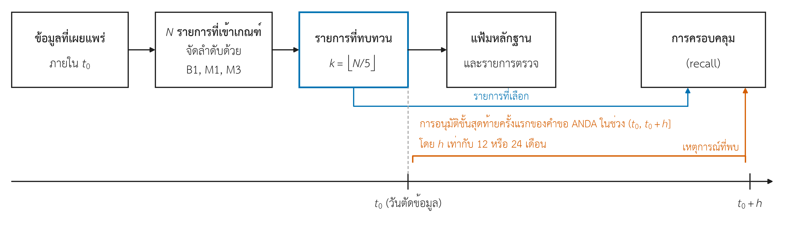

# การประเมินหลักฐานด้านการกำกับดูแลยาเพื่อจัดลำดับการทบทวนรายการยาก่อนการอนุมัติยาสามัญครั้งแรกในสหรัฐอเมริกา

# Evaluating Regulatory Evidence for Prioritizing Drug Reviews Ahead of First US Generic Approvals

นายศิริพล ศรีเฮงไพบูลย์\*¹ และ ผศ.ดร.ทัศนัย พลอยสุวรรณ²\
คณะเทคโนโลยีสารสนเทศ สถาบันเทคโนโลยีพระจอมเกล้าเจ้าคุณทหารลาดกระบัง\
เลขที่ 1 ซอยฉลองกรุง 1 แขวงลาดกระบัง เขตลาดกระบัง กรุงเทพฯ 10520

Siripon Srihangpiboon\*¹ and Tuchsanai Ploysuwan²\
School of Information Technology, King Mongkut's Institute of Technology Ladkrabang\
1 Chalong Krung 1 Alley, Lat Krabang, Bangkok 10520

## บทคัดย่อ

การประเมินกำหนดให้ทบทวนได้หนึ่งในห้าของรายการยาที่เข้าเกณฑ์ ณ วันตัดข้อมูลแต่ละปี โดยปัดจำนวนรายการลงเป็นจำนวนเต็ม ผู้วิจัยจัดลำดับรายการจากหลักฐานที่มี ณ วันตัดข้อมูลและประเมินการครอบคลุมในชุดทดสอบย้อนหลังแบบปิดผนึก (C′) เหตุการณ์คือการอนุมัติขั้นสุดท้ายครั้งแรกในสหรัฐฯ ของคำขออนุมัติยาสามัญแบบย่อฉบับยื่นครั้งแรก (ANDA) ที่ระยะ 24 เดือน วิธีจากตารางหลักฐานที่เพิ่มสถานะกราฟ (M3) ครอบคลุมร้อยละ 66.85 ของรายการที่เกิดเหตุการณ์ เทียบกับร้อยละ 46.48 สำหรับวิธีตามอายุยา (B1) และร้อยละ 65.49 สำหรับวิธีจากตารางหลักฐาน ณ วันตัดข้อมูล (M1) ผลต่างแบบจับคู่ระหว่าง M3 กับ B1 เท่ากับ 20.37 จุดร้อยละ (ช่วงความเชื่อมั่น 95% [14.37, 26.16]) การทดสอบยังยืนยันประโยชน์ส่วนเพิ่มจากการเพิ่มสถานะกราฟใน M1 ไม่ได้ ผลย้อนหลังสนับสนุนการจัดลำดับรายการเพื่อทบทวน กฎยกเว้นการทบทวนโดยอัตโนมัติไม่ผ่านเกณฑ์ความปลอดภัย รายการนอกลำดับที่เลือกจึงยังต้องทบทวนตามปกติ

**คำสำคัญ** ยาสามัญ, ช่วงเวลาเข้าสู่ตลาด, กราฟหลักฐาน, การจัดลำดับการทบทวน, เสรีภาพในการดำเนินการ

## Abstract

The evaluation limited review to one fifth of eligible drug cases at each annual cutoff, rounded down to a whole number of cases. We ranked eligible cases using evidence available at each cutoff and evaluated recall in a sealed historical test (C′). The event was the first final US approval of an original abbreviated new drug application (ANDA). At 24 months, the dated-evidence table with graph states (M3) captured 66.85% of event cases, compared with 46.48% for the drug-age baseline (B1) and 65.49% for the dated-evidence table (M1). The paired difference between M3 and B1 was 20.37 percentage points (95% CI 14.37 to 26.16). The test did not establish an incremental gain from adding graph states to M1. The historical results support prioritization for review. The automatic clearance rule failed the safety check, so cases outside the queue still require routine review.

**Keywords** generic drugs, market window, evidence graph, review prioritization, freedom to operate

\* 68076060@kmitl.ac.th\
¹ นักศึกษาปริญญาโท สาขาวิชาปัญญาประดิษฐ์เพื่อการวิเคราะห์เชิงธุรกิจ / Postgraduate Student, Artificial Intelligence for Business Analytics Program\
² ผู้ช่วยศาสตราจารย์ คณะเทคโนโลยีสารสนเทศ / Assistant Professor, School of Information Technology, KMITL

## 1 บทนำ

การศึกษาก่อนหน้าเรื่องการจัดอันดับเอกสารสิทธิบัตรข้ามสาขา [1] พบว่า สำหรับคำค้น 435 จาก 692 รายการ เอกสาร 100 อันดับแรกไม่มีเอกสารที่ทราบว่าเกี่ยวข้อง การศึกษาครั้งนี้จึงพิจารณาวิธีเลือกรายการยาเพื่อทบทวนเมื่อกำหนดจำนวนรายการที่ทบทวนได้ไว้ล่วงหน้า ผู้วิจัยเปรียบเทียบว่าวิธีจัดลำดับจากข้อมูลที่มี ณ วันตัดข้อมูลแต่ละปีครอบคลุมรายการที่ต่อมามีการอนุมัติยาสามัญขั้นสุดท้ายครั้งแรกในสหรัฐอเมริกาเป็นสัดส่วนเท่าใด

LOE-Bench ประเมินวิธีจัดลำดับจากระเบียนย้อนหลังของสหรัฐฯ การจำกัดจำนวนรายการที่ทบทวนเป็นเงื่อนไขสำหรับการจัดลำดับก่อนลงทุนศึกษาชีวสมมูล แฟ้มข้อมูลช่วงเวลาเข้าสู่ตลาด (Market Window Dossier) รวบรวมรายการตามลำดับ หลักฐานที่ระบุวันที่ และรายการตรวจสอบสำหรับผู้เชี่ยวชาญด้านเสรีภาพในการดำเนินการ (freedom to operate หรือ FTO)

### วัตถุประสงค์การวิจัย

- RQ1 เปรียบเทียบสัดส่วนรายการที่เกิดเหตุการณ์ซึ่งได้รับเลือกให้ทบทวน เมื่อกำหนดจำนวนรายการที่ทบทวนเท่ากัน โดยเปรียบเทียบ M3 กับวิธีตามอายุยา (B1) และวิธีที่ใช้ตารางหลักฐาน ณ วันตัดข้อมูล (M1) ตามลำดับที่ลงทะเบียนไว้
- RQ2 ประกอบด้วยการวิเคราะห์เชิงสำรวจสามเรื่อง ได้แก่ การครอบคลุมของแบบจำลองภาษา 7B เมื่อได้รับหลักฐานต้นทางชุดเดียวกัน การครอบคลุมรายการที่มีผู้ยื่นคำขอได้รับอนุมัติอย่างน้อยสามรายภายใน 36 เดือน และความคลาดเคลื่อนของค่าพยากรณ์ยอดเบิกจ่ายหลังใช้ตัวคูณราคา
- RQ3 ประเมินว่าข้อความใดในแฟ้มสืบถึงแหล่งข้อมูลที่ระบุวันที่ได้ และข้อความใดยังต้องให้ผู้เชี่ยวชาญตรวจสอบเพิ่มเติม

## 2 ทฤษฎีและงานวิจัยที่เกี่ยวข้อง

### 2.1 การประมาณวันเข้าสู่ตลาดและการจัดลำดับการทบทวน

Beall และคณะใช้สิทธิบัตรและระยะคุ้มครองประมาณวันเข้าสู่ตลาดของยาสามัญ [2], [3] LOE-Bench เปรียบเทียบการครอบคลุมของวิธีที่ใช้หลักฐาน ณ วันตัดข้อมูล โดยกำหนดจำนวนรายการที่ทบทวนเท่ากัน งานอื่นวัดเวลาถึงการอนุมัติ [4] หรือพยากรณ์การยื่นครั้งแรก [5], [6] FDA พบว่าการอนุมัติกับการเริ่มขายเกิดต่างเวลากัน [7]

งานด้านการโต้แย้งสิทธิบัตรและการชะลออนุมัติเชื่อมเหตุการณ์เหล่านี้กับเวลาเข้าสู่ตลาด [8], [9] ผู้วิจัยใช้ Orange Book ฉบับย้อนหลังสร้างรายการได้เมื่อยืนยันวันเผยแพร่ [10] และใช้วันยื่นคดีประมาณวันที่เข้าถึงระเบียนได้ [11]

### 2.2 ผู้ยื่นคำขอ ผู้ผลิตที่ขายจริง และยอดเบิกจ่าย

FDA ใช้ราคาผู้ผลิตเฉลี่ย (average manufacturer price หรือ AMP) คำนวณสัดส่วนราคามัธยฐานเทียบกับยาต้นแบบก่อนมียาสามัญ ได้ร้อยละ 46.5 เมื่อมีผู้ผลิตขายจริงสองราย และร้อยละ 21 เมื่อมีสี่ราย [12] งานก่อนหน้าศึกษาการเข้าสู่ตลาด ราคา และส่วนแบ่งของผู้เข้าตลาดรายแรก [13]–[16] ผู้วิจัยใช้จำนวนผู้ได้รับอนุมัติเป็นตัวชี้การแข่งขันที่อาจเกิดขึ้น การนำอัตราส่วน AMP มาปรับยอดเบิกจ่าย Medicaid เป็นการทดสอบการใช้ข้ามฐานราคา

### 2.3 การส่งต่อหลักฐานและการใช้ในบริบทไทย

WIPO แยกการสำรวจภาพรวมสิทธิบัตรออกจากการประเมิน FTO และอธิบายหลักฐานที่ผู้เชี่ยวชาญใช้ [17], [18] งานค้นและออกแบบด้าน FTO ใน PatentAgentBench ใช้เทียบการกำหนดโจทย์ [19] งานศึกษาการตรวจสอบสิทธิบัตรไทยใช้ประกอบรายการตรวจสอบ [20], [21] ระเบียนภูมิภาคให้เบาะแสสำหรับตรวจต่อกับแหล่งข้อมูลของประเทศ

### 2.4 กรอบการประเมิน

การทดสอบย้อนหลังของแบบจำลองภาษาอาจได้รับข้อมูลภายหลังจากชุดฝึกหรือหลักฐานที่ป้อน [22] แบบจำลองที่ควบคุมช่วงข้อมูลฝึกและ ForecastBench เป็นตัวอย่างการควบคุมตามเวลาและการประเมินไปข้างหน้า [23], [24] งานนี้อาศัยการลงทะเบียนล่วงหน้า การจำแนกแบบเลือกตอบ การสุ่มซ้ำระดับกลุ่ม และการทดสอบตามลำดับ [25]–[28] ส่วนการเรียนรู้แบบเสริมกำลังจากผลลัพธ์ใช้ประกอบการออกแบบการเปรียบเทียบไปข้างหน้าเชิงสำรวจ [29]

## 3 วิธีดำเนินการวิจัย

### 3.1 การตัดสินใจ ณ วันตัดข้อมูลและการส่งต่อหลักฐาน

แต่ละวิธีจัดลำดับชุดส่วนออกฤทธิ์ของตัวยา (active-moiety set) ที่เข้าเกณฑ์โดยใช้ข้อมูลที่เผยแพร่แล้ว ณ วันตัดข้อมูล (รูปที่ 1) แฟ้มระบุรูปแบบยาและเขตอำนาจเพื่อให้ผู้เชี่ยวชาญตรวจว่าหลักฐานใช้กับผลิตภัณฑ์ได้หรือไม่ แฟ้มระบุรหัสแหล่งข้อมูล ฉบับ ค่าแฮช ตำแหน่ง และหลักฐานวันเข้าถึงของข้อความสำคัญแต่ละข้อ พร้อมแยกข้อสังเกต ค่าประมาณ และสถานการณ์จำลอง และระบุรายการที่ต้องตรวจสอบเพิ่มเติม

### 3.2 รายการที่เข้าเกณฑ์ หลักฐาน และผลลัพธ์

รายการยา ณ วันตัดข้อมูลหมายถึงชุดส่วนออกฤทธิ์ของตัวยาที่พิจารณา ณ วันตัดข้อมูลประจำปี ผู้วิจัยรับรายการที่มีรหัสเชื่อมตัวยา มีคำขออนุมัติยาใหม่ (new drug application หรือ NDA) ฉบับยื่นครั้งแรกที่อนุมัติขั้นสุดท้ายพร้อมวันที่ มี NDA ฉบับยื่นครั้งแรกที่อนุมัติขั้นสุดท้ายและจัดเป็น TYPE 1 ภายในวันตัดข้อมูล และยังไม่มีการอนุมัติยาสามัญขั้นสุดท้ายครั้งแรกภายในวันนั้น ผู้วิจัยติดตามทุกรายการจนครบระยะและนับการอนุมัติขั้นสุดท้ายครั้งแรกของคำขออนุมัติยาสามัญแบบย่อ (abbreviated new drug application หรือ ANDA, ORIG/AP) หลังวันตัดข้อมูลจนถึงวันสิ้นสุดระยะ

ผู้วิจัยเชื่อมข้อมูลการอนุมัติกับตัวยาผ่าน Drugs@FDA และ Global Substance Registration System สำหรับชุดทดสอบย้อนหลังแบบปิดผนึก (C′) เลือก Orange Book ฉบับล่าสุดที่ลงวันที่ไม่เกินหกเดือนปฏิทินก่อนวันตัดข้อมูล มีค่าแฮชตรงกัน และมีหลักฐานว่าประชาชนเข้าถึงได้ทันวันนั้น ผู้วิจัยใช้รายการ Paragraph IV ของ FDA ฉบับที่เป็นปัจจุบัน ณ วันตัดข้อมูลและยืนยันวันเผยแพร่ได้ รวมถึงระเบียนคดีที่เข้าเกณฑ์ เพื่อระบุสถานะการโต้แย้ง รายการฉบับที่ทันวันตัดข้อมูลช่วยระบุว่าไม่พบการโต้แย้งตามเกณฑ์ หากขาดทั้งรายการที่เข้าเกณฑ์และหลักฐานว่ามีการโต้แย้ง คงสถานะไม่ทราบ [30]

ผู้วิจัยใช้ปี 2010 ฝึกทั้งสองระยะ ชุดพัฒนาใช้ปี 2012–2015 ที่ระยะ 12 เดือนและปี 2013–2014 ที่ระยะ 24 เดือน ส่วน C′ ใช้ปี 2017–2025 และ 2017–2024 ตามลำดับ ก่อนลงทะเบียน ผู้วิจัยได้รับข้อมูลสรุปบางส่วนที่ทับซ้อนกับ C′ ได้แก่ ผลรวม B0–B2 ที่ระยะ 36 เดือน การตรวจระบบเบื้องต้นที่ใช้ข้อมูลหลายช่วง และจำนวนรายการสำหรับจำลองกำลังทดสอบ บันทึกระบุว่าผู้วิจัยไม่ได้ตรวจผลรายกรณีหรือเลือกวิธีจากชุดทดสอบ [30] ตัวยาเดียวกันอาจปรากฏในหลายวันตัดข้อมูล จึงแยกจำนวนรายการที่เกิดเหตุการณ์รวมทุกวันตัดข้อมูลออกจากจำนวนตัวยาที่เกิดเหตุการณ์แบบไม่นับซ้ำ

### 3.3 คิวและลำดับการทดสอบที่ลงทะเบียน

คิวตามอายุยา (B1) ประมาณอัตราอนุมัติจากเวลาหลัง NDA ครั้งแรก คิวจากตารางหลักฐานตามวันที่ (M1) ใช้การถดถอยโลจิสติกแบบมีพจน์ลงโทษ L2 กับอายุยา หลักฐานตามวันที่ และค่าลอจิตของ B1 คิวจากตารางหลักฐานที่เพิ่มสถานะกราฟ (M3) หรือคิวกราฟ เพิ่มตัวบ่งชี้ OPEN, BLOCKED และ CONTESTED กราฟใช้วันหมดอายุของสิทธิบัตร ระยะคุ้มครอง และการโต้แย้งที่พบ โดยคงค่าที่ไม่ทราบตามตรรกะสามค่าของคลีนี ผู้วิจัยใช้ OPEN เป็นตัวแปรของแบบจำลอง ส่วนผู้เชี่ยวชาญพิจารณาข้อกฎหมายแยกต่างหาก [30]

ในแต่ละวันตัดข้อมูลและระยะพยากรณ์ ผู้วิจัยกำหนดจำนวนรายการที่ทบทวนไว้ที่หนึ่งในห้าของรายการที่เข้าเกณฑ์โดยปัดลง และจัดลำดับด้วยคะแนนเดิมก่อนปรับเทียบหรือพักการตัดสิน โดยแบ่งน้ำหนักเมื่อคะแนนเสมอตรงขอบลำดับ ผู้วิจัยคำนวณการครอบคลุม (recall) โดยหารจำนวนรายการที่เกิดเหตุการณ์และคาดว่าจะเข้าคิวด้วยจำนวนรายการที่เกิดเหตุการณ์ทั้งหมดรวมทุกวันตัดข้อมูล

ผู้วิจัยลงทะเบียนลำดับทดสอบ M3 เทียบกับ B1 ที่ระยะ 24 เดือน (H1) แล้วเทียบกับ M1 ที่ระยะ 24 เดือน (H2) และเทียบกับ B1 ที่ระยะ 12 เดือน (H3) โดยใช้ α ด้านเดียวเท่ากับ 0.025 ผู้วิจัยสุ่มซ้ำแบบจับคู่ระดับตัวยา 2,000 รอบต่อระยะ โดยคงแบบจำลองเดิมและคำนวณคิวใหม่ ผู้วิจัยหยุดเมื่อขอบล่างด้านเดียวไม่สูงกว่าศูนย์หรือคำนวณช่วงไม่ได้ ผู้วิจัยรายงานช่วงความเชื่อมั่น 95% แบบเปอร์เซ็นไทล์สองด้านสำหรับผลต่างที่คำนวณได้ รายงานขั้นที่ไปไม่ถึงเชิงพรรณนา และประเมินเกณฑ์ประโยชน์เชิงปฏิบัติ +10 จุดร้อยละแยกต่างหาก [30]

### 3.4 การลงทะเบียนและการทดสอบซ้ำไปข้างหน้า

ผู้วิจัยลงทะเบียนแผนวิเคราะห์สาธารณะบน Open Science Framework (OSF) ก่อนให้คะแนนเมื่อ 28 พฤศจิกายน 2026 ผู้ตรวจรับตรวจความครบถ้วนของฉบับข้อมูล กำหนดให้มีตัวยาที่เกิดเหตุการณ์ระยะ 24 เดือนอย่างน้อย 50 รายการแบบไม่นับซ้ำ และเปิดเผยเฉพาะคำตัดสิน การแก้ไขครั้งที่ 1 และ 2 ก่อนตรวจรับระบุเรื่องค่าแฮช เอกสารแนบ และการฝึก C9 ในเดือนธันวาคมหรือมกราคม การแก้ไขครั้งที่ 3 หลังให้คะแนนยกเลิกข้อจำกัดตามเดือน แต่คงกฎให้คะแนนย้อนหลังและเงื่อนไขฝึกหลังตรวจรับและก่อนตรึงชุดไปข้างหน้า [30]

*รูปที่ 1 ณ วันตัดข้อมูลแต่ละปี แต่ละวิธีจัดลำดับรายการยาจากข้อมูลที่เผยแพร่แล้ว โดยเลือกทบทวนได้ ⌊N/5⌋ รายการ และแบ่งน้ำหนักเมื่อคะแนนเสมอตรงขอบลำดับ การอนุมัติขั้นสุดท้ายครั้งแรกที่พบในช่วง 12 หรือ 24 เดือนถัดมาใช้คำนวณสัดส่วนรายการที่เกิดเหตุการณ์ซึ่งได้รับเลือกให้ทบทวน*

สำหรับชุดติดตามไปข้างหน้า (Track A) ผู้วิจัยฝึกแบบจำลองใหม่จากช่วงที่ติดตามครบ ณ วันอ้างอิง 27 พฤศจิกายน 2026 ชุดหลักใช้ B1, M1, M3 และ B3 โดย B3 ใช้เฉพาะวันหมดอายุและรายงานเชิงพรรณนา

ผู้ตรวจรับประกาศผลเมื่อ 05:12 UTC และผู้วิจัยได้รับอนุมัติการแก้ไขครั้งที่ 3 เมื่อ 09:09 UTC หลังให้คะแนน C′ โพรโทคอลกำหนดให้ผู้วิจัยบันทึกค่าแฮช ติดแท็ก Git และประทับเวลาบน OSF ก่อน 31 มกราคม 2027 เวลา 23:59 UTC และก่อนเข้าถึงผลลัพธ์หลังวันอ้างอิง หากตรึงไม่ทัน ผู้วิจัยวิเคราะห์ได้ในขอบเขตเชิงสำรวจ [30]

### 3.5 การเปรียบเทียบเชิงสำรวจ

ผู้วิจัยใช้แบบจำลองและการถอดรหัสเดียวกันกับ Qwen2.5-7B-Instruct ที่ได้รับหลักฐานชุดเดียวกัน (L1e) และแบบที่รับเฉพาะตัวยา วันตัดข้อมูล และระยะพยากรณ์ (L1) ผู้วิจัยป้อนหลักฐานต้นทางของ M3 และคำสั่งการใช้ให้ L1e โดยเว้นคะแนนจากแบบจำลอง อัตราจาก B1 ผลตัดสินจากกราฟ คำสั่งปฏิบัติ และผลลัพธ์ การเปรียบเทียบไปข้างหน้าเชิงสำรวจ (C9) จับคู่ GRPO (group relative policy optimization) กับ SFT (supervised fine-tuning) บน Qwen2.5-1.5B-Instruct ที่ระยะ 24 เดือน

การวิเคราะห์จำนวนผู้ยื่นคำขอที่ได้รับอนุมัติใช้คิวระยะ 24 เดือนที่ตรึงไว้และติดตามผล 36 เดือนในชุดพัฒนาปี 2013 และ C′ ปี 2017–2023 ผู้วิจัยใช้ Orange Book ฉบับแรกที่เข้าเกณฑ์ภายใน 12 เดือนหลังอนุมัติและหลักฐานโดยตรงที่บันทึกไว้เพื่อระบุนิติบุคคลที่ได้รับอนุมัติ ANDA ฉบับยื่นครั้งแรก ผู้วิจัยรวมความแรงและคำขอซ้ำ คงสถานะไม่ทราบเมื่อระบุผู้ยื่นไม่ได้ และทดสอบความไวด้วยชื่อผู้รับอนุญาตปัจจุบัน

ผู้วิจัยจับคู่ State Drug Utilization Data ของ Medicaid ย้อนหลังตามจุดตั้งต้นพยากรณ์และตัวยา สำหรับตัวยาในคิวระยะ 12 เดือน ผู้วิจัยใช้ตัวคูณ AMP ของ FDA สำหรับผู้ผลิตสองราย (0.465) ปรับค่าพยากรณ์แบบยกค่าล่าสุดและใช้กฎตัดคะแนนเสมอเดียวกัน ตัวยานอกคิวใช้ค่าล่าสุด ส่วนวิธีฐานรองใช้การต่อแนวโน้ม ผู้วิจัยยังยืนยันฉบับเผยแพร่ย้อนหลังไม่ได้ และ FDA เผยแพร่ตัวคูณหลังจุดตั้งต้นพยากรณ์

ผู้วิจัยวัดยอดเบิกจ่ายสองแบบ ยอดต่อใบสั่งยาคำนวณจากยอดรวมในไตรมาสที่สี่หารด้วยจำนวนใบสั่งยาเมื่อจำนวนใบสั่งยามากกว่าศูนย์ ยอดรายปีรวมยอดจ่ายสี่ไตรมาสถัดไป ผู้วิจัยคำนวณผลต่างความคลาดเคลื่อนจากตัวยาและจุดตั้งต้นคู่เดียวกัน และสุ่มซ้ำระดับตัวยาเพื่อหาช่วงความเชื่อมั่น จุดตั้งต้นสี่จุดให้ข้อมูล 160 คู่จากตัวยา 68 ตัวสำหรับยอดต่อใบสั่งยา และ 150 คู่จากตัวยา 64 ตัวสำหรับยอดรายปี ยอดก่อนหักเงินคืนรวมยอด Medicaid และยอดส่วนอื่นตามระเบียนที่จับคู่ได้ [C4b](../../../loe-bench/receipts/C4b.md)

## 4 ผลการวิจัย

### 4.1 การครอบคลุมเมื่อกำหนดจำนวนรายการที่ทบทวน

*ตารางที่ 1 การครอบคลุมที่ความจุคิวร้อยละ 20 ในชุดทดสอบย้อนหลัง C′*

| ระยะพยากรณ์ | รายการที่เข้าเกณฑ์ | รายการที่เกิดเหตุการณ์ | ตำแหน่งในคิว | B1 อายุยา | M1 ตาราง | M3 กราฟ | L1 ชื่อตัวยา | L1e หลักฐาน |
| --- | ---: | ---: | ---: | ---: | ---: | ---: | ---: | ---: |
| 24 เดือน | 4,639 | 368 | 924 | 46.48% | 65.49% | 66.85% | 26.14% | 12.36% |
| 12 เดือน | 5,259 | 202 | 1,048 | 50.64% | 67.82% | 67.33% | 26.58% | 14.50% |

*รูปที่ 2 ผลต่างการครอบคลุมแบบจับคู่เมื่อกำหนดจำนวนรายการที่ทบทวนไว้ที่ร้อยละ 20 (จุดร้อยละ ช่วงความเชื่อมั่น 95% สองด้านจากการสุ่มซ้ำระดับตัวยา) ใน C′ ผล H1 ผ่าน ลำดับการทดสอบสิ้นสุดที่ H2 และรายงาน H3 เชิงพรรณนา เส้นแนวตั้งระบุศูนย์และเกณฑ์ประโยชน์เชิงปฏิบัติที่กำหนดล่วงหน้า (+10 จุดร้อยละ)*

ชุด C′ ผ่านการตรวจรับแบบปกปิดผล ผู้วิจัยให้คะแนนตามแผนที่ลงทะเบียน แต่ละระยะมีตัวยาที่เกิดเหตุการณ์ 202 ตัวแบบไม่นับซ้ำ เมื่อกำหนดจำนวนรายการที่ทบทวนเท่ากัน M3 ครอบคลุมร้อยละ 66.85 ของรายการที่เกิดเหตุการณ์ภายใน 24 เดือนทั้งหมด 368 รายการ เทียบกับร้อยละ 46.48 สำหรับ B1 ผลต่างแบบจับคู่เท่ากับ +20.37 จุดร้อยละ (ช่วงความเชื่อมั่น 95% [+14.37, +26.16]) H1 ผ่านการทดสอบเทียบกับศูนย์ และช่วงความเชื่อมั่นอยู่เหนือเกณฑ์ประโยชน์เชิงปฏิบัติ +10 จุดร้อยละ [GATE](../../../loe-bench/receipts/GATE.md) [SCORE](../../../loe-bench/receipts/SCORE.md#primary-family)

ที่ระยะ 24 เดือน M1 ครอบคลุมร้อยละ 65.49 เมื่อเพิ่มสถานะกราฟใน M1 ผลต่างการครอบคลุมที่ 24 เดือนเท่ากับ +1.36 จุดร้อยละ (ช่วงความเชื่อมั่น 95% −2.20 ถึง +3.01) การทดสอบตามลำดับที่ลงทะเบียนไว้สิ้นสุดที่ H2 ผล H2 ยังยืนยันประโยชน์ส่วนเพิ่มไม่ได้ ผู้วิจัยรายงาน H3 เชิงพรรณนา (+16.69 จุดร้อยละ ช่วงความเชื่อมั่น 95% [+9.98, +24.21]) ในการเปรียบเทียบรอง คิวตารางครอบคลุมมากกว่าคิวตามอายุยา +19.01 [+13.34, +25.62] จุดร้อยละที่ระยะ 24 เดือน และ +17.18 [+9.88, +24.06] ที่ระยะ 12 เดือน [SCORE](../../../loe-bench/receipts/SCORE.md#secondary-analyses)

ขอบล่างของช่วงในรูปที่ 2 เป็นขอบเขตด้านเดียวด้วย ใน C′ ค่าประมาณ H1 และ H3 สูงกว่า +10 จุดร้อยละ ชุดพัฒนามีตัวยาที่เกิดเหตุการณ์แบบไม่นับซ้ำ 67 ตัวที่ระยะ 24 เดือน และ 90 ตัวที่ระยะ 12 เดือน ชุดพัฒนาให้ผลต่างสำหรับ H1, H2 และ H3 ที่ +9.80 [+0.14, +19.65], +5.49 [−2.00, +11.25] และ +13.00 [+3.27, +23.17] จุดร้อยละ (ช่วงความเชื่อมั่น 95% ในรูปที่ 2) เฉพาะค่าประมาณ H3 ในชุดพัฒนาถึงเกณฑ์ +10 จุดร้อยละ กฎยกเว้นการทบทวนโดยอัตโนมัติไม่ผ่านในทุกวิธีและระยะที่ประเมินได้ในชุดพัฒนา ผลย้อนหลังสนับสนุนการใช้วิธีนี้จัดลำดับรายการที่จะทบทวน กฎยกเว้นการทบทวนโดยอัตโนมัติของ M3 ไม่ผ่านเกณฑ์ความปลอดภัยที่กำหนดไว้ทั้งสองระยะ รายการนอกลำดับที่เลือกจึงยังอยู่ในขอบเขตการทบทวนตามปกติ [FREEZE](../../../loe-bench/receipts/FREEZE.md#development-results) [SCORE](../../../loe-bench/receipts/SCORE.md#secondary-analyses)

### 4.2 การครอบคลุมของแบบจำลองภาษา 7B

ใน C′ แบบจำลองภาษาแต่ละวิธีให้คำพยากรณ์ที่ถูกรูปแบบครบ 9,898 รายการ L1e ให้ผลต่างแบบจับคู่เทียบกับคิวกราฟที่ −54.48 จุดร้อยละในระยะ 24 เดือน (ช่วงความเชื่อมั่น 95% [−61.18, −47.61]) และ −52.83 จุดในระยะ 12 เดือน [−59.34, −45.19] ผลต่าง L1e − L1 เท่ากับ −13.78 [−17.71, −10.32] และ −12.08 [−16.41, −7.45] ตามลำดับ การเปรียบเทียบเชิงสำรวจนี้ใช้แบบจำลองรุ่นเดียว การถอดรหัสแบบเดียว และคำสั่งหนึ่งคู่ ผู้วิจัยเปลี่ยนทั้งช่องหลักฐานและคำสั่งใน L1e และยังไม่ทราบว่าชุดฝึกมีผลลัพธ์ในอดีตหรือไม่ [SCORELLM](../../../loe-bench/receipts/SCORELLM.md)

ชุดพัฒนาให้ผลต่าง L1e − M3 ที่ −36.87 [−47.40, −23.92] จุดร้อยละที่ระยะ 12 เดือน และ −30.37 [−43.08, −16.44] ที่ระยะ 24 เดือน (ช่วงความเชื่อมั่น 95% แบบจับคู่ ผลเชิงสำรวจยังไม่ปรับสำหรับหลายคู่เปรียบเทียบ) [C2](../../../loe-bench/receipts/C2.md#development-results)

### 4.3 การครอบคลุมตามจำนวนผู้ยื่นคำขอที่ได้รับอนุมัติและความคลาดเคลื่อนของค่าพยากรณ์ยอดเบิกจ่าย

ณ วันตัดข้อมูลขั้นพัฒนาปี 2013 M3 ครอบคลุมร้อยละ 71.43 เทียบกับร้อยละ 45.83 ของ B1 จาก 21 เหตุการณ์ใน 539 รายการ โดยแต่ละวิธีมี 107 ตำแหน่ง (ผลต่าง +25.60 จุดร้อยละ ช่วงความเชื่อมั่น 95% [6.25, 45.00]) วิธีใช้ชื่อผู้รับอนุญาตปัจจุบันให้ผลเท่าเดิม ใน C′ ที่ติดตามครบ การวิเคราะห์เชิงสำรวจเรื่องผู้ยื่นคำขอที่ได้รับอนุมัติ (C3) พบ 173 รายการที่ยืนยันว่าถึงเกณฑ์จากตัวยา 92 ตัว M3 ครอบคลุมร้อยละ 79.8 และ B1 ร้อยละ 49.7 (ผลต่าง +30.11 จุดร้อยละ ช่วงความเชื่อมั่น 95% [+20.16, +36.86]) ผู้วิจัยเว้น 4 รายการที่ยังไม่ทราบผลจากตัวหาร ผลต่างเมื่อใช้ชื่อผู้รับอนุญาตจากฉบับข้อมูลที่กำหนดเท่ากับ +30.16 จุดร้อยละ จำนวนผู้ยื่นคำขอที่ได้รับอนุมัติเป็นตัวบ่งชี้การแข่งขันที่อาจเกิดขึ้น การประมาณจำนวนผู้ผลิตที่วางจำหน่ายยาจริงต้องใช้ข้อมูลการจำหน่าย [C3b](../../../loe-bench/receipts/C3b.md) [SCORE, C3](../../../loe-bench/receipts/SCORE.md#c3--competition-at-launch)

ในชุดย่อยที่จับคู่ข้อมูลย้อนหลัง การใช้ตัวคูณ 0.465 เพิ่มค่าคลาดเคลื่อนสัมบูรณ์เฉลี่ยของการพยากรณ์ยอดเบิกจ่าย Medicaid ทั้งสองตัวชี้วัด ตารางที่ 2 รายงานผลต่างค่าคลาดเคลื่อนสัมบูรณ์เฉลี่ย (mean absolute error หรือ MAE) วิธีต่อแนวโน้มลด MAE ทั้งสองแบบ ผู้วิจัยรายงานผลเชิงพรรณนาโดยยังไม่ปรับสำหรับหลายคู่เปรียบเทียบ ผู้วิจัยไม่ได้ประเมิน C4 ส่วนที่กันไว้ เพราะชุดตรึงขาดข้อมูลผลลัพธ์ปี 2018 ตัวคูณราคาใช้เป็นสมมติฐานในการวิเคราะห์สถานการณ์จำลองได้ [C4b](../../../loe-bench/receipts/C4b.md) [SCORE, C4](../../../loe-bench/receipts/SCORE.md#c4--medicaid-demand-and-reimbursement)

*ตารางที่ 2 ผลต่าง MAE เทียบกับการยกค่าล่าสุด*

| วิธีเทียบกับการยกค่าล่าสุด | ดอลลาร์สหรัฐต่อใบสั่งยาในไตรมาสสุดท้าย [ช่วงความเชื่อมั่น 95%] | ล้านดอลลาร์สหรัฐต่อปี [ช่วงความเชื่อมั่น 95%] |
| --- | ---: | ---: |
| ปรับตามคิว B1 | +372.05 [193.27, 587.26] | +4.98 [2.24, 8.29] |
| ปรับตามคิว M3 | +381.24 [203.61, 606.77] | +21.43 [4.07, 53.21] |
| ต่อแนวโน้มลบยกค่าล่าสุด | −172.13 [−292.12, −66.37] | −3.69 [−8.41, −0.20] |

### 4.4 การสืบถึงแหล่งข้อมูลและการตรวจสอบข้อความในแฟ้ม

ในแฟ้มชุดพัฒนาของ Solifenacin ยานี้อยู่นอกคิวปี 2014 หนังสือของ FDA ระบุว่าการยกฟ้องคดีสิทธิบัตรสหรัฐฯ เลขที่ 6017927 เกี่ยวข้องกับการเข้าเกณฑ์อนุมัติของ Teva ในเวลาต่อมา แฟ้มเก็บหนังสือฉบับนี้เป็นหลักฐานผลย้อนหลัง แฟ้มระบุหน้าที่อ้างถึงและรายการที่ยังต้องตรวจสอบกับแหล่งข้อมูลไทย [EVP](../../../loe-bench/receipts/EVP.md)

การตรวจอัตโนมัติตามรอยข้อความสำคัญ 1,789 ข้อจาก 32 แฟ้มไปถึงระเบียนต้นทาง ในจำนวนนี้ 1,757 ข้อมีค่าแฮช และระบบไม่พบข้อความที่ลงวันที่หลังวันตัดข้อมูลของแฟ้ม ในกรณีสาธิตหกกรณี ผู้วิจัยพบหลักฐานรองรับข้อจำกัดสิทธิบัตรสามจากห้าข้อที่ตรวจและพบเบาะแสตระกูลครบ 17 จาก 17 สิทธิบัตรหลักของสหรัฐฯ ผู้วิจัยยืนยันสถานะสิทธิบัตรไทยได้ศูนย์จากหกกรณี และยืนยันทะเบียนยาของสำนักงานคณะกรรมการอาหารและยา (อย.) ได้ศูนย์จากหกกรณี แหล่งข้อมูลสี่ช่องทางปิดกั้นการเข้าถึงหรือการค้นอัตโนมัติ ผู้วิจัยจึงคงสถานะไทยเป็นไม่ทราบ ผู้เชี่ยวชาญยังต้องตรวจว่าระเบียนรองรับแต่ละข้อความจริงและตรวจข้อค้างในไทย [UIBUILD](../../../loe-bench/receipts/UIBUILD.md) [EVP](../../../loe-bench/receipts/EVP.md)

## 5 สรุปผล

ผลการประเมินย้อนหลังสนับสนุนการใช้หลักฐานด้านการกำกับดูแลยาที่ระบุวันที่เพื่อจัดลำดับการทบทวนก่อนการอนุมัติยาสามัญครั้งแรกในสหรัฐฯ หลักฐานยังไม่เพียงพอที่จะยืนยันว่าการเพิ่มสถานะกราฟช่วยเพิ่มการครอบคลุม ผลเชิงสำรวจมีขอบเขตเฉพาะการตั้งค่าแบบจำลองภาษา 7B ที่ทดสอบ ตัวบ่งชี้จากจำนวนผู้ยื่นคำขอที่ได้รับอนุมัติ และชุดย่อยยอดเบิกจ่ายที่จับคู่ย้อนหลัง แฟ้มเชื่อมข้อความกับหลักฐานที่ระบุวันที่และระบุรายการที่ผู้เชี่ยวชาญต้องตรวจสอบเพิ่มเติม

กลุ่มศึกษาครอบคลุมประวัติตัวยาใหม่ที่เข้าเกณฑ์ในสหรัฐฯ ฉบับข้อมูลที่ขาด การเชื่อมรหัสตัวยาจากข้อมูลภายหลัง วันที่เข้าถึงหลักฐานโต้แย้งที่ไม่แน่นอน และจำนวนตัวยาที่เกิดเหตุการณ์แบบไม่นับซ้ำจำกัดการตีความ ผู้วิจัยยังยืนยันฉบับย้อนหลังของ Medicaid ไม่ได้ และใช้แบบจำลองภาษาเพียงรุ่นเดียวโดยไม่ทราบว่าชุดฝึกมีผลลัพธ์หรือไม่ หากจะวัดวันเริ่มขาย ความต้องการในไทย และเวลาที่ผู้ทบทวนใช้ ผู้วิจัยต้องเก็บข้อมูลโดยตรง ผู้เชี่ยวชาญยังต้องตรวจข้อความกับหลักฐานและตรวจทะเบียนไทยและอาเซียนเพื่อประเมิน FTO ของผลิตภัณฑ์

ผู้วิจัยฝึกแบบจำลอง C9 ทั้งสองวิธีเสร็จแล้ว คำพยากรณ์ของชุดหลัก Track A ครอบคลุมยา 651 รายการต่อระยะ โดยใช้วันที่ 27 พฤศจิกายน 2026 เป็นวันอ้างอิงพยากรณ์ ผู้วิจัยตรึงชุดคำพยากรณ์ของทั้งสิบวิธีเมื่อวันที่ 28 พฤศจิกายน 2026 เวลา 11:18:44 UTC ด้วย Git tag loe-track-a-freeze-20261127 ส่วนการประทับเวลาภายนอกบน OSF (update 4) ยังไม่เสร็จ ณ เวลาที่เขียน แบบจำลอง C9 วิธี GRPO เลือกงดพยากรณ์ทั้ง 651 รายการ กรอบติดตาม 12 และ 24 เดือนจะครบวันที่ 27 พฤศจิกายน 2027 และ 27 พฤศจิกายน 2028 ตามลำดับ

การเข้าถึงข้อมูลและโค้ด โค้ด ค่ากำหนดที่ตรึงไว้ บันทึกงาน และแผนการวิเคราะห์ที่ลงทะเบียนล่วงหน้า เข้าถึงได้จากคลังโค้ดของโครงการ [31] และบันทึกการลงทะเบียนบน OSF [30] คลังโค้ดเผยแพร่ผลรวมของ C′ ส่วนป้ายกำกับระดับแถวของชุดทดสอบยังจำกัดการเข้าถึง

กิตติกรรมประกาศ ผู้เขียนใช้ผู้ช่วยปัญญาประดิษฐ์ (Anthropic Claude, OpenAI GPT และ SciSpace) ในการวางแผน เขียนโค้ด ร่างบทความ สร้างรูป และค้นวรรณกรรม ผู้เขียนตรวจเนื้อหาทั้งหมดและรับผิดชอบเนื้อหาทั้งหมด

## เอกสารอ้างอิง

[1] S. Srihangpiboon and T. Ploysuwan, “Diagnosing near-zero instruction effects in cross-domain patent reranking,” in *Proc. iSAI-NLP*, 2026, paper 53. [Online]. Available: https://isai-nlp2026.aiat.or.th/program

[2] R. F. Beall, J. J. Darrow, and A. S. Kesselheim, “A method for approximating future entry of generic drugs,” *Value Health*, vol. 21, no. 12, pp. 1382–1389, Dec. 2018. [doi: 10.1016/j.jval.2018.04.1827](https://doi.org/10.1016/j.jval.2018.04.1827).

[3] R. F. Beall et al., “Comparing onset of biosimilar versus generic competition in the United States,” *Clin. Pharmacol. Ther.*, vol. 108, no. 6, pp. 1308–1314, 2020. [doi: 10.1002/cpt.1981](https://doi.org/10.1002/cpt.1981).

[4] K. W. Kerr and L. J. Glos, “Effective market exclusivity of new molecular entities for rare and non-rare diseases,” *Pharmaceut. Med.*, vol. 34, no. 1, pp. 19–29, 2020. [doi: 10.1007/s40290-019-00317-9](https://doi.org/10.1007/s40290-019-00317-9).

[5] M. Hu et al., “Predictive analysis of first abbreviated new drug application submission for new chemical entities based on machine learning methodology,” *Clin. Pharmacol. Ther.*, vol. 106, no. 1, pp. 174–181, 2019. [doi: 10.1002/cpt.1479](https://doi.org/10.1002/cpt.1479).

[6] R. Hopefl et al., “Predictive analysis for first submission of generic drug application for orphan drug products using random survival forest,” *Clin. Transl. Sci.*, vol. 18, no. 10, e70365, 2025. [doi: 10.1111/cts.70365](https://doi.org/10.1111/cts.70365).

[7] H. S. Chahal, R. Patel, and M. Shimer, “Marketing of first generic drugs approved by U.S. FDA from January 2010 to June 2017,” U.S. Food and Drug Administration, Nov. 2021. [Report](https://www.fda.gov/media/154101/download).

[8] C. S. Hemphill and B. N. Sampat, “Evergreening, patent challenges, and effective market life in pharmaceuticals,” *J. Health Econ.*, vol. 31, no. 2, pp. 327–339, 2012. [Article](https://www.sciencedirect.com/science/article/abs/pii/S0167629612000057).

[9] S. Kannappan, J. J. Darrow, A. S. Kesselheim, and R. F. Beall, “The timing of 30-month stay expirations and generic entry: A cohort study of first generics, 2013–2020,” *Clin. Transl. Sci.*, vol. 14, no. 5, pp. 1917–1923, 2021. [doi: 10.1111/cts.13046](https://doi.org/10.1111/cts.13046).

[10] M. Durvasula *et al.*, “The NBER Orange Book dataset: A user’s guide,” *Res. Policy*, vol. 52, no. 7, Art. no. 104791, 2023. [doi: 10.1016/j.respol.2023.104791](https://doi.org/10.1016/j.respol.2023.104791).

[11] A. K. Rai, S. Vishnubhakat, J. Lemus, and E. Hovenkamp, “Replication data for: Post-grant adjudication of drug patents: Agency and/or court?,” Harvard Dataverse, ver. 1.0, 2021. [doi: 10.7910/DVN/YCMKVU](https://doi.org/10.7910/DVN/YCMKVU).

[12] R. Conrad and R. Lutter, “Generic competition and drug prices: New evidence linking greater generic competition and lower generic drug prices,” US FDA, 2019. [Report](https://www.fda.gov/media/133509/download).

[13] F. M. Scott Morton, “Entry decisions in the generic pharmaceutical industry,” *RAND J. Econ.*, vol. 30, no. 3, pp. 421–440, 1999. [doi: 10.2307/2556056](https://doi.org/10.2307/2556056).

[14] D. Reiffen and M. R. Ward, “Generic drug industry dynamics,” *Rev. Econ. Stat.*, vol. 87, no. 1, pp. 37–49, 2005. [doi: 10.1162/0034653053327694](https://doi.org/10.1162/0034653053327694).

[15] A. Hollis, “The importance of being first: Evidence from Canadian generic pharmaceuticals,” *Health Econ.*, vol. 11, no. 8, pp. 723–734, 2002. [doi: 10.1002/hec.698](https://doi.org/10.1002/hec.698).

[16] K. Nikolopoulos, S. Buxton, M. Khammash, and P. Stern, “Forecasting branded and generic pharmaceuticals,” *Int. J. Forecast.*, vol. 32, no. 2, pp. 344–357, 2016. [doi: 10.1016/j.ijforecast.2015.08.001](https://doi.org/10.1016/j.ijforecast.2015.08.001).

[17] A. Trippe, *Guidelines for Preparing Patent Landscape Reports*, prepared for the World Intellectual Property Organization, WIPO Publ. 946, 2015. [Guide](https://www.wipo.int/edocs/pubdocs/en/wipo_pub_946.pdf).

[18] World Intellectual Property Organization, *Identifying Inventions in the Public Domain: A Guide for Inventors and Entrepreneurs*, WIPO Publ. 1062, 2020. [Guide](https://www.wipo.int/publications/en/details.jsp?id=4501).

[19] Y. Hu *et al.*, “PatentAgentBench: Benchmarking LLM agents with professional patent task suites,” arXiv:2610.35031, 2026. [Online]. Available: https://arxiv.org/abs/2610.35031

[20] P. Leela and N. Kessomboon, “Challenges of examination processes of pharmaceutical patent application in Thailand,” *Isan J. Pharm. Sci.*, vol. 11, suppl., pp. 179–189, 2016. [Article](https://he01.tci-thaijo.org/index.php/IJPS/article/view/48601).

[21] D. Vachanavuttivong, P. Naboriboon, and A. Homhuan, “Expediting the patent examination system in Thailand: Recent developments,” Tilleke & Gibbins, Bangkok, Thailand, Mar. 3, 2014. [Online]. Available: https://www.tilleke.com/insights/expediting-patent-examination-system-thailand-recent-developments/

[22] D. Paleka, S. Goel, J. Geiping, and F. Tramèr, “Pitfalls in evaluating language model forecasters,” in *Proc. ICLR*, 2026. [Conference paper](https://proceedings.iclr.cc/paper_files/paper/2026/hash/b9d69c72e4587ddf3fa6352890aefc4f-Abstract-Conference.html).

[23] S. He, L. Lv, A. Manela, and J. Wu, “Chronologically consistent large language models,” *J. Financ. Econ.*, vol. 185, Art. no. 104374, 2026. [doi: 10.1016/j.jfineco.2026.104374](https://doi.org/10.1016/j.jfineco.2026.104374).

[24] E. Karger et al., “ForecastBench: A dynamic benchmark of AI forecasting capabilities,” in *Proc. ICLR*, 2025. [Conference paper](https://proceedings.iclr.cc/paper_files/paper/2025/hash/ea74e45a229dac70b5b63b28d8934db6-Abstract-Conference.html).

[25] O. R. van den Akker *et al.*, “Preregistration of secondary data analysis: A template and tutorial,” *Meta-Psychology*, vol. 5, 2021. [doi: 10.15626/MP.2020.2625](https://doi.org/10.15626/MP.2020.2625).

[26] J. Traub et al., “Overcoming common flaws in the evaluation of selective classification systems,” in *Adv. Neural Inf. Process. Syst.*, vol. 37, pp. 2323–2347, 2024. [Paper](https://proceedings.neurips.cc/paper_files/paper/2024/file/047c84ec50bd8ea29349b996fc64af4b-Paper-Conference.pdf).

[27] C. A. Field and A. H. Welsh, “Bootstrapping clustered data,” *J. R. Stat. Soc. B*, vol. 69, no. 3, pp. 369–390, 2007. [doi: 10.1111/j.1467-9868.2007.00593.x](https://doi.org/10.1111/j.1467-9868.2007.00593.x).

[28] U.S. Food and Drug Administration, *Multiple Endpoints in Clinical Trials: Guidance for Industry*, Oct. 2022. [Guidance](https://www.fda.gov/regulatory-information/search-fda-guidance-documents/multiple-endpoints-clinical-trials).

[29] B. Turtel, D. Franklin, K. Skotheim, L. Hewitt, and P. Schoenegger, “Outcome-based reinforcement learning to predict the future,” *Trans. Mach. Learn. Res.*, Nov. 2025. [Journal article](https://openreview.net/pdf/6854ebdc1a775820ad158c9a284cbe20d6241201.pdf).

[30] S. Srihangpiboon, “Market Window Dossier / LOE-Bench: evidence-graph review queues for forecasting US first generic approvals from dated open regulatory records,” OSF preregistration, 28 Nov. 2026. [doi: 10.17605/OSF.IO/P2SMD](https://doi.org/10.17605/OSF.IO/P2SMD).

[31] S. Srihangpiboon, “patent-to-pilot: Market Window Dossier and LOE-Bench,” GitHub repository, commit 3e06537b (C′ scoring), 2026. [Online]. Available: https://github.com/siriponsri/patent-to-pilot
