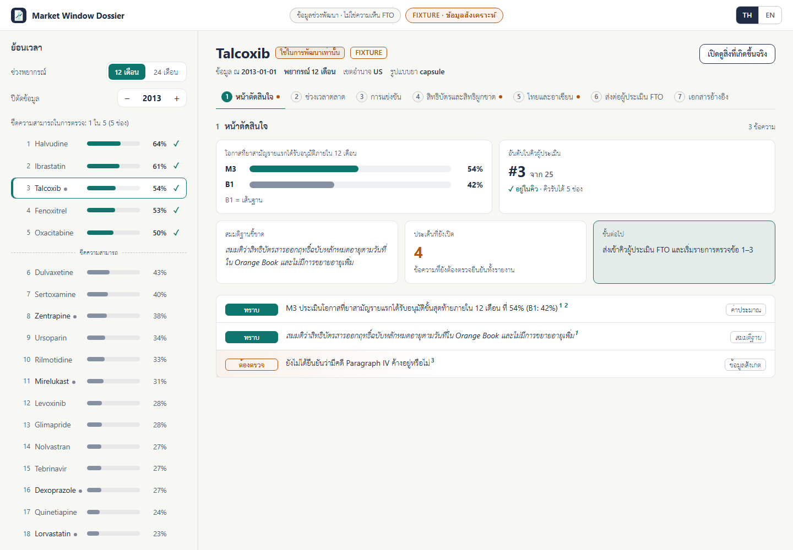

# Market Window Dossier demo

A static demo of the Market Window Dossier. Pick a forecast horizon and a development cutoff year, see the first-generic review queue at 1-in-5 review capacity, open a seven-part dossier for a molecule, follow each claim to its dated source, and reveal what happened afterwards. It is decision support for FTO evaluators, not an FTO or legal opinion.

The current data are **FIXTURE** data: invented molecule names, companies, numbers, dates and digests. They exist so the interface can be built before card PRD1 delivers real development dossiers. The FIXTURE pill in the top bar and the chip in each dossier header say so.



## Open it

Double-click `index.html`, or open it in a browser:

```text
product/demo/index.html
```

From `file://` the app reads `data.bundle.js`, because browsers block `fetch()` for local files. No server, build step or network access is needed. Thai is the default language; the TH/EN toggle switches the interface, the `lang` attribute and the claim text.

The URL hash records the view, so a link reopens the same state:

```text
index.html#lang=en&h=12&c=2013&m=talcoxib&tab=patents
index.html#lang=th&h=12&c=2013&m=zentrapine&reveal=1
index.html#lang=en&h=12&c=2013&m=talcoxib&tab=handoff&cite=c01   (opens the sources drawer)
```

## Refresh the data bundle

```powershell
python product/demo/bundle.py                  # data/ if data/index.json exists, else fixtures/
python product/demo/bundle.py --source fixtures
python product/demo/fixtures/make_fixtures.py  # regenerate FIXTURE files (seeded, deterministic)
```

Both scripts use the Python standard library only. Re-run `bundle.py` whenever files under `data/` or `fixtures/` change, and commit the regenerated `data.bundle.js` so `file://` and static hosting stay in sync.

## Data layout

The app reads an index manifest and loads files relative to the manifest's folder. On a web server it tries `data/index.json` (PRD1 output), then `fixtures/index.json`, then `data.bundle.js`. Real data replaces the fixtures without code changes when it follows this shape:

```jsonc
// data/index.json  (schema mwd.index.v1)
{
  "fixture": false,
  "queues":   [{ "cutoff": "2013", "as_of": "2013-01-01", "horizon_months": 12, "path": "queues/queue-2013-h12.json" }],
  "dossiers": [{ "key": "…", "cutoff": "2013", "horizon_months": 12, "path": "dossiers/…-2013-h12.json" }]
}
```

- **Queue file** (`mwd.queue.v1`): `rows[]` of `{key, display_name, m3_p, b1_p, in_queue, event}`, plus `queue_size` (review slots), `n_candidates`, and `capture: {events_total, m3_captured, b1_captured}`. The app sorts rows by `m3_p`. `event` and `capture` appear only after **Reveal what happened**.
- **Dossier file** (`mwd.dossier.v1`): `molecule`, `as_of`, `jurisdiction`, `forecast`, `outcome_reveal` (development only), `sections[7]`, `claims[]`, `sources[]` and `checklist[]`, as defined on card PRD1. The decision section may add `next_action_th`, `next_action_en` and `decisive_claim` (a claim id). Without them, the summary uses the first assumption claim and the first checklist item.

A queue row without a dossier entry stays in the list (no ● marker) and opens a short "no dossier yet" panel.

## Deploy to GitHub Pages

The folder is a self-contained static site with relative paths.

1. Run `python product/demo/bundle.py` and commit `data.bundle.js` with the data.
2. Publish `product/demo/` as the site root. For example, use a Pages workflow with `actions/upload-pages-artifact` and `path: product/demo`, or push the folder's contents to a `gh-pages` branch.
3. Open `https://<user>.github.io/<repo>/`. Over HTTPS the app fetches `data/index.json` directly and falls back to the bundle.

Publishing makes the data public. Only open development data may be deployed. Protected test material, sealed outcomes and Track A outputs must never go into `data/`.

## What is built and what is not

| Built in this card (PRD2C) | Not built |
|---|---|
| Time-machine rail: horizon control, cutoff stepper, ranked queue, capacity divider | Real molecules and forecasts (PRD1) |
| Dossier with seven numbered tabs, decision summary, claim state and kind chips | Thai demo molecules (separate curation card) |
| Sources drawer with SHA-256 copy, references tab, FTO checklist saved in this browser | Server-side persistence, accounts, sharing |
| Reveal panel with queue capture (M3 vs B1), respecting reduced motion | Track A or sealed-test views (not available by design) |
| Thai/English, dark theme, under-900 px drawer layout, keyboard support, print stylesheet | Formal WCAG audit with assistive technology |

Files: [`index.html`](index.html), [`styles.css`](styles.css), [`app.js`](app.js), [`bundle.py`](bundle.py), [`fixtures/make_fixtures.py`](fixtures/make_fixtures.py). Receipt: [PRD2C](../../docs/loe-bench/receipts/PRD2C.md).
