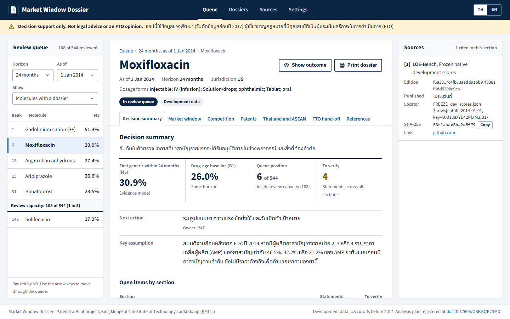

# Market Window Dossier app

The working web app of Market Window Dossier. Choose a forecast horizon and an as-of date, review the first-generic review queue at 1-in-5 capacity, open the seven-part dossier for a molecule, follow each statement to its dated source, and show what happened afterwards. It is decision support for BD, R&D and FTO evaluators, not legal advice or an FTO opinion.

The visual system is F2, Regulatory agency, defined in [DESIGN.md](../../DESIGN.md) and chosen by the owner on 28 November 2026. The same files run in a browser, on a static host and inside the [Windows desktop app](../desktop/README.md). The [landing page](../site/README.md) links here.



## Data status

The app shows **development data**: six example molecules at US cutoffs from 2012 to 2015, built by [PRD1](../../docs/loe-bench/receipts/PRD1.md) with the [EVP](../../docs/loe-bench/receipts/EVP.md) Thai and ASEAN evidence merged by [UIBUILD](../../docs/loe-bench/receipts/UIBUILD.md). The six cases include four catches, one false alarm and one miss. Each dossier carries the "Development data" chip. No sealed-test or Track A material is in `data/`.

## Open it

Double-click `index.html`, or open it in a browser. No server, build step or network access is needed. From `file://` the app reads `data.bundle.js`. On a web server it reads `data/index.json` and the files it lists, and falls back to the bundle.

The URL hash records the view, so a link reopens the same state:

```text
index.html#view=queue&lang=th&h=24&c=2014&m=U%3AU188XYD42P
index.html#view=queue&lang=en&h=24&c=2014&m=U%3AU188XYD42P&tab=patents&reveal=1
index.html#view=queue&lang=en&h=24&c=2014&m=U%3AQXS94885MZ&tab=patents&src=challenge-1
index.html#view=dossiers
```

`view` is `queue`, `dossiers`, `sources` or `settings`. `tab` is one of `decision`, `market`, `competition`, `patents`, `thai_asean`, `handoff` and `references`. `reveal=1` shows the outcome, `show=all` lists every ranked molecule, and `src` highlights one source.

## What is on screen

| Region | Contents |
|---|---|
| Top bar | Queue, Dossiers, Sources and Settings views, and the TH/EN content toggle |
| Notice | "Decision support only. Not legal advice or an FTO opinion." It is always visible. |
| Review queue | Horizon, as-of and show filters, the ranked table (rank, molecule, M3) and the review-capacity divider. After **Show outcome**, an Outcome column marks catches, misses and molecules with no event. |
| Dossier | Breadcrumb, molecule name, **Show outcome** and **Print dossier**, chips, and seven tabs: Decision summary, Market window, Competition, Patents, Thailand and ASEAN, FTO hand-off and References. Each tab has a stats row and a statements table with Status and Source. |
| Sources | Numbered sources cited in the open tab, with issuer, edition, publication date, locator, retrieval date, SHA-256 and link. Selecting a citation highlights the source and the statements that cite it. |

Headings, navigation, labels and buttons are English. Statements, checklist items and notes follow the TH/EN toggle, Thai by default, and `<html lang>` follows the content language. Settings, the language choice and checklist ticks are stored in this browser only.

**Keyboard.** Arrow keys, Home and End move through the queue when it has focus. Alt+Down and Alt+Up open the next or previous molecule that has a dossier. Arrow keys move between tabs, and Alt+1 to Alt+7 open a section. Ctrl+P prints the open dossier with every section expanded.

**Layouts.** Three columns from 1280 px. Between 1024 and 1279 px the sources panel moves below the dossier. Below 1024 px the regions stack.

## Refresh the data

```powershell
py -3.12 -m product.mwd.build     # PRD1 builder; needs the private inputs under _private_artifacts
py -3.12 -m product.mwd.audit     # claim traceability and as-of dates
python product/demo/bundle.py     # writes data/index.json and data.bundle.js
python product/demo/fonts_css.py  # only after replacing a font file
```

`bundle.py` uses `data/` when it holds dossier files, and `fixtures/` otherwise (`--source fixtures` forces the old FIXTURE set). Commit the regenerated `data/index.json` and `data.bundle.js` with the data.

## Files

| File | Purpose |
|---|---|
| [`index.html`](index.html) | Page shell |
| [`styles.css`](styles.css) | Tokens and layout from DESIGN.md, responsive and print rules |
| [`app.js`](app.js) | Data loading, hash state, queue, dossier, sources, views, checklist storage |
| [`bundle.py`](bundle.py) | Builds `data/index.json` and `data.bundle.js` |
| [`fonts_css.py`](fonts_css.py) | Inlines the self-hosted fonts into `assets/fonts/fonts.css` for the app and the landing page |
| `assets/fonts/` | Source Sans 3 and Noto Sans Thai (SIL OFL 1.1), with licence files |
| `assets/logo.svg` | Logo, refined for F2 |
| `fixtures/` | The earlier FIXTURE data set (synthetic), kept for tests of the loader |

## Deploy

The folder is a static site with relative paths. Publish `product/` so that `site/` and `demo/` sit side by side, because the landing page links to `../demo/index.html`. Publishing makes the data public, so only open development data may be deployed. Protected test material, sealed outcomes and Track A outputs must never go into `data/`.

## Limits

- The dossiers are development examples. The prospective product (molecule, dosage form, jurisdiction and launch date as inputs) is not built.
- Thai patent and registration status stays "verify" until a person checks the registers.
- Accessibility was checked with axe-core and keyboard tests, not with a screen-reader user study.
