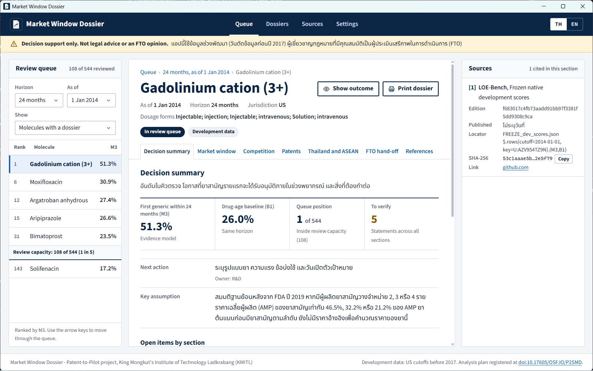

# Market Window Dossier for Windows

A Tauri v2 desktop app that shows the [Market Window Dossier web app](../demo/README.md) in a native Windows window. The app files and the development data are bundled into the program, so it works offline. The window title is "Market Window Dossier", the minimum size is 1280 × 800 and the icon is the F2 logo (`../demo/assets/logo.svg`).



## Install

Run `Market Window Dossier_0.1.0_x64-setup.exe`. It installs for the current user, without administrator rights, and adds a Start menu entry. Windows 11 includes Microsoft Edge WebView2. On Windows 10 without WebView2, the installer downloads Microsoft's WebView2 bootstrapper. The installer is not code-signed, so Windows SmartScreen may warn before it runs. Compare the file's SHA-256 with the value in the [UIBUILD receipt](../../docs/loe-bench/receipts/UIBUILD.md) first:

```powershell
Get-FileHash ".\Market Window Dossier_0.1.0_x64-setup.exe" -Algorithm SHA256
```

The installer is kept out of Git. The project copy is under `_private_artifacts/mwd-desktop/` beside the repository.

## Build

The build needs Node.js (for the Tauri CLI), the Rust toolchain and a Windows linker. Neither Visual Studio nor administrator rights are needed. This project builds with the GNU toolchain and a user-level MinGW-w64.

```powershell
# one-time setup, all user-level
rustup-init.exe -y --default-host x86_64-pc-windows-gnu --profile minimal
#   MinGW-w64 (gcc, windres, ar): unzip WinLibs GCC 16.2.0 UCRT to %USERPROFILE%\.local\winlibs
$env:PATH = "$env:USERPROFILE\.cargo\bin;$env:USERPROFILE\.local\winlibs\mingw64\bin;$env:PATH"

cd product\desktop
npm install          # @tauri-apps/cli 2.x
npx tauri build      # copies ../demo into dist/, compiles, writes the NSIS installer
```

The installer is written to `src-tauri/target/release/bundle/nsis/`. A first build compiles about 400 crates and takes about seven minutes. Later builds take one to two minutes. `npx tauri dev` opens a development window.

Rebuild after changing the web app or its data (`python product/demo/bundle.py`). `scripts/prepare-frontend.mjs` copies `index.html`, `styles.css`, `app.js`, `data/`, `data.bundle.js` and `assets/` from `product/demo` into `dist/` before each build.

## Files

| Path | Purpose |
|---|---|
| `package.json` | Tauri CLI dependency and scripts |
| `scripts/prepare-frontend.mjs` | Copies the web app into `dist/` |
| `src-tauri/tauri.conf.json` | Window, content security policy and NSIS bundle settings |
| `src-tauri/Cargo.toml`, `build.rs`, `src/` | The Rust shell. It opens one window and adds no commands. |
| `src-tauri/capabilities/default.json` | Core permissions only |
| `src-tauri/icons/` | Icons generated from the logo with `npx tauri icon` |

`node_modules/`, `dist/`, `src-tauri/target/` and generated schemas are ignored.

## Security

The content security policy allows only the bundled files (`'self'`) and inline font data. The window loads no remote pages on its own. A source link opens only when the user follows it; how WebView2 presents that page (new window or browser) was not tested. The app sends no data anywhere. Checklist ticks and settings are kept in the WebView's local storage on this computer.

## Limits

- The installer is unsigned.
- Only the Windows NSIS target is configured. MSI, macOS and Linux targets are not built.
- The GNU-toolchain linker reports one warning, ".rsrc merge failure: multiple non-default manifests". The built program starts and renders normally, as recorded in the receipt.
