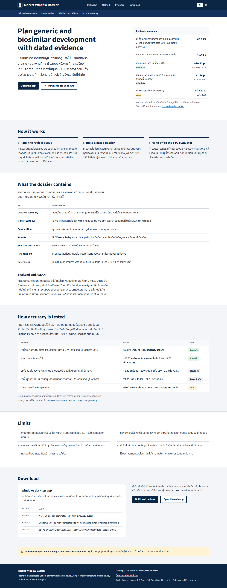

# Market Window Dossier landing page

A one-page public introduction to Market Window Dossier in the F2 Regulatory agency design ([DESIGN.md](../../DESIGN.md)). It explains what the product does, what a dossier contains, how accuracy is tested and where the limits are, and links to the [web app](../demo/README.md) and the [Windows desktop app](../desktop/README.md).

## Open it

Open `index.html` in a browser. It needs no server or network access. Headings, navigation and buttons are English. Body text follows the TH/EN toggle, Thai by default. The choice is stored in this browser and shared with the app. `index.html#lang=en` opens the English version.

## Sections

| Section | Contents |
|---|---|
| Top bar | Overview, Method, Evidence and Download, then the TH/EN toggle |
| Workflow-stage bar | Before development, Patent review, Thailand and ASEAN and Accuracy testing, which mark the current section while scrolling |
| Hero | Heading, plain lead, **Open the app** and **Download for Windows**, and the Evidence summary panel |
| How it works | Rank the review queue, build a dated dossier, hand off to the FTO evaluator |
| What the dossier contains | The seven parts, and the Thailand and ASEAN evidence status |
| How accuracy is tested | Confirmatory, exploratory and pending results, each with its status |
| Limits | What the product does not claim |
| Download | The Windows installer's version, size, requirements and SHA-256, and how to get it |
| Notice and footer | "Decision support only", KMITL attribution, OSF DOI, GitHub link and licences |

## Figures and their sources

Every number on the page comes from a recorded result. Update the page when these sources change.

| Figure | Status | Source |
|---|---|---|
| 66.85% vs 46.48% at a 20% review budget, 24 months; +20.37 pp (95% CI +14.37 to +26.16) | Confirmed (H1) | [SCORE receipt](../../docs/loe-bench/receipts/SCORE.md), `loe-bench/data/SCORE_CPRIME_RESULTS.json`, [OSF registration](https://doi.org/10.17605/OSF.IO/P2SMD) |
| Evidence graph over a matched model without it: +1.36 pp (95% CI −2.20 to +3.01) | Not confirmed (H2) | SCORE receipt |
| At least three approved generic applicants within 36 months: 79.8% vs 49.7% (+30.11 points) | Exploratory (C3) | SCORE receipt |
| Track A frozen before 31 January 2027 | Pending | [LOE-Bench plan](../../docs/loe-bench/PLAN.md) |
| Thai family traces 17 of 17, Thai members confirmed 0 of 17 | Development evidence pilot | [EVP receipt](../../docs/loe-bench/receipts/EVP.md) |
| Installer size and SHA-256 | Build record | [UIBUILD receipt](../../docs/loe-bench/receipts/UIBUILD.md) |

The page names no customers, prices or deployments, because there are none.

## Files

`index.html`, `site.css`, `site.js` (language toggle and stage marker), `assets/logo.svg` and `assets/fonts/` (same fonts as the app, generated by [`../demo/fonts_css.py`](../demo/fonts_css.py)).

Publish `product/` with `site/` and `demo/` side by side so the app links resolve.
